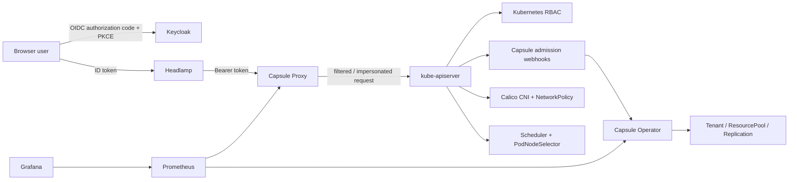
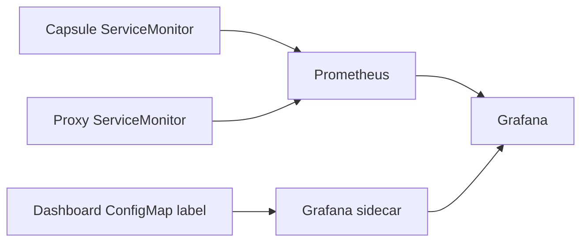

# Capsule lab deep dive

Tài liệu này giải thích toàn bộ lab từ kiến trúc cấp cao xuống từng file, từng khối
cấu hình và luồng xử lý thực tế. Đây không phải hướng dẫn chạy nhanh; `README.md`
giữ vai trò đó. Tài liệu này trả lời câu hỏi: **vì sao mỗi thành phần tồn tại, nó
liên kết với thành phần nào, và request bị cho phép hoặc từ chối ở đâu**.

> Trạng thái được đối chiếu ngày 2026-08-17 trên cluster `hocbt@kubernetes`,
> Kubernetes server `v1.36.2`, Calico `v3.32.0`.

---

## 1. Mục tiêu của lab

Một cluster Kubernetes vật lý được chia thành hai môi trường logic:

| Tenant | Owner | Developer | Namespace | Compute | Pod CIDR |
|---|---|---|---|---|---|
| Solar | group `solar-owners` | group `solar-developers` | `solar-*`, tối đa 5 | `wk1`, `wk2` | `10.240.0.0/18` |
| Water | group `water-owners` | chưa cấu hình | `water-*`, tối đa 3 | `wk3` | `10.240.64.0/18` |

Capsule Operator là control plane tenancy. Nó không tạo cluster con hay virtual
API server. Tất cả tenant vẫn dùng cùng Kubernetes API, nhưng Capsule liên tục
reconcile namespace, RBAC, policy, quota và metadata để tạo ranh giới tenant.

Lab bổ sung:

- Keycloak làm OIDC Identity Provider.
- Capsule Proxy tạo góc nhìn cluster-scoped đã lọc cho từng tenant.
- Headlamp là UI, gửi danh tính user đến Capsule Proxy.
- Calico cấp IP pool riêng và thực thi NetworkPolicy.
- `PodNodeSelector` buộc Pod chạy trên compute pool đúng tenant.
- ResourcePool chia CPU, RAM và số Pod giữa các namespace.
- Prometheus/Grafana quan sát metrics do Operator và Proxy expose.

## 2. Kiến trúc tổng thể



### 2.1 Hai đường truy cập Kubernetes API

**Cluster admin** dùng kubeconfig X.509 trực tiếp:

```text
kubectl -> kube-apiserver
username: kubernetes-admin
groups: kubeadm:cluster-admins, system:authenticated
```

**User OIDC trên Headlamp** đi qua Proxy:

```text
browser -> Headlamp -> Capsule Proxy -> kube-apiserver
```

Sự khác biệt này quan trọng:

- Alice gọi API trực tiếp không có quyền `list nodes`.
- Alice gọi qua Capsule Proxy thấy `wk1,wk2` vì Proxy lọc Node theo
  `Tenant.spec.nodeSelector`.
- Bob chỉ thấy `wk3`; Mallory thấy danh sách rỗng.
- Namespaced resource vẫn chịu Kubernetes RBAC bình thường.

Capsule Proxy không biến user thành cluster-admin. Nó giải quyết trải nghiệm với
resource cluster-scoped mà RBAC thuần không thể lọc từng object trong một lệnh
`LIST`.

## 3. Các lớp cô lập

| Lớp | Cơ chế | Cấu hình chính |
|---|---|---|
| Danh tính | Keycloak OIDC | username `preferred_username`, group claim `groups` |
| Xác thực API | Structured Authentication Configuration | issuer, CA, audiences, claim mappings |
| Phân quyền | Kubernetes RBAC do Capsule reconcile | owner=`admin`; developer=`edit` trong namespace tenant |
| Namespace | Capsule Tenant | prefix, quota, protected namespace, owner matching |
| Admission | Capsule webhook | registry, QoS, Service type, metadata lock |
| Compute | Tenant nodeSelector + PodNodeSelector | Solar=`wk1,wk2`, Water=`wk3` |
| IPAM | Calico IPPool + namespace annotation | pool `Manual`, CIDR riêng |
| East-west traffic | Calico NetworkPolicy | chỉ cùng tenant và DNS |
| Tài nguyên | Capsule ResourcePool/Claim | budget tenant được chia cho namespace |
| UI cluster scope | Capsule Proxy | Namespace/Node được lọc theo tenant |
| Quan sát | Prometheus/Grafana | ServiceMonitor, dashboard và CRD metrics |

Không lớp nào thay thế lớp nào. Ví dụ RBAC chặn Alice đọc Water API, còn
NetworkPolicy chặn một Pod Solar gọi thẳng IP/Service Water sau khi Pod đã chạy.

## 4. Persona và quyền thực tế

### 4.1 Cluster admin

Hiện dùng certificate kubeadm, không phải user Keycloak:

```text
username: kubernetes-admin
group: kubeadm:cluster-admins
```

Cluster admin làm các việc platform-level:

- cài/upgrade Operator, Proxy, cert-manager, monitoring và Headlamp;
- tạo/sửa Tenant, GlobalTenantResource, ResourcePool và Calico IPPool;
- label Node, cấu hình API server, OIDC và admission plugin;
- quản lý CRD, ClusterRole, ClusterRoleBinding và namespace hệ thống;
- quan sát hoặc can thiệp mọi tenant.

Keycloak có bootstrap user `admin`, nhưng đây là **Keycloak admin trong realm
`master`**, không phải Kubernetes admin và không thuộc issuer realm `capsule`.

### 4.2 Tenant owner

- Alice mang groups `projectcapsule.dev`, `solar-owners`.
- Bob mang groups `projectcapsule.dev`, `water-owners`.

Owner có thể:

- tạo namespace đúng prefix của tenant và trong namespace quota;
- quản lý workload, Secret, Service, Role/RoleBinding và NetworkPolicy trong tenant;
- tạo `ResourcePoolClaim` để phân budget cho namespace;
- xem namespace và Node thuộc tenant qua Capsule Proxy/Headlamp.

Owner không thể:

- sửa Tenant CR, ResourcePool, IPPool, ClusterRole hoặc Node;
- vào namespace tenant khác hay `kube-system`;
- đổi annotation chọn IPPool;
- chọn compute node của tenant khác;
- tạo Service NodePort/LoadBalancer/ExternalName;
- tạo workload sai registry hoặc sai QoS.

### 4.3 Developer

Joe mang groups `projectcapsule.dev`, `solar-developers`. Capsule replicate một
RoleBinding `ClusterRole/edit` vào mọi namespace Solar.

Joe có thể CRUD phần lớn namespaced workload, ConfigMap, Secret, Service,
NetworkPolicy, xem log và exec Pod trong Solar. Joe không thể tạo namespace theo
nghĩa hiệu lực: RBAC chung cho phép gửi request `CREATE namespace`, nhưng Capsule
admission từ chối vì Joe không phải Tenant owner.

Joe cũng không thể tạo Role/RoleBinding, ResourcePoolClaim, ResourceQuota, Tenant,
IPPool, Node hay truy cập Water. Lưu ý `edit` đọc được Secret và cho phép
`pods/exec`; production có thể cần custom Role hẹp hơn.

### 4.4 User không có tenant

Mallory chỉ có `projectcapsule.dev`. Group này cho phép request đi đến namespace
provisioner, nhưng Capsule không tìm thấy Tenant owner tương ứng nên admission
từ chối tạo namespace và Proxy trả danh sách tenant resource rỗng.

## 5. Luồng OIDC từ đầu đến cuối

### 5.1 Login

1. Browser mở Headlamp.
2. Headlamp đọc discovery document của issuer
   `https://keycloak.127.0.0.1.nip.io:8443/realms/capsule`.
3. Headlamp redirect browser sang Keycloak bằng Authorization Code Flow + PKCE.
4. Keycloak xác thực user và phát ID token có:
   - `preferred_username`, ví dụ `alice`;
   - `groups`, ví dụ `projectcapsule.dev`, `solar-owners`;
   - audience `headlamp`.
5. Headlamp dùng ID token làm bearer token khi gọi Kubernetes qua Capsule Proxy.
6. Proxy xác thực token, tìm Tenant liên quan, lọc cluster-scoped response rồi
   chuyển request đến API server.
7. API server tự xác thực lại JWT theo `AuthenticationConfiguration`, map username
   và groups, sau đó chạy authorization và admission.

### 5.2 Tại sao issuer dùng hostname browser nhưng discovery dùng ClusterIP

Claim `iss` phải đúng tuyệt đối với URL public của Keycloak, nên issuer là hostname
browser. API server lại không thể đi qua `kubectl port-forward`; nó dùng
`discoveryURL` nội bộ `https://10.96.200.10:8443/...`.

Certificate Keycloak chứa cả:

- DNS `keycloak.127.0.0.1.nip.io`;
- DNS service trong cluster;
- IP `10.96.200.10`.

Keycloak bật `KC_HOSTNAME_BACKCHANNEL_DYNAMIC=true`, cho phép backchannel discovery
và JWKS dùng địa chỉ nội bộ trong khi token vẫn có issuer public đúng chuẩn.

### 5.3 Logout

Headlamp logout chỉ xóa token local. Cookie SSO vẫn ở Keycloak nên lần login sau
có thể tự vào user cũ. Muốn đổi user, logout Headlamp rồi mở:

```text
https://keycloak.127.0.0.1.nip.io:8443/realms/capsule/protocol/openid-connect/logout
```

Hoặc dùng cửa sổ ẩn danh riêng cho từng persona.

## 6. Luồng tạo Namespace

Ví dụ Alice tạo `solar-demo`:

1. RBAC nhận group `projectcapsule.dev` và cho request tạo Namespace đi tiếp.
2. Capsule webhook tìm Tenant mà group `solar-owners` sở hữu.
3. `forceTenantPrefix: true` yêu cầu tên bắt đầu bằng `solar-`.
4. `namespaceOptions.quota: 5` kiểm tra số namespace hiện tại.
5. Capsule gắn label chuẩn `capsule.clastix.io/tenant=solar`.
6. Capsule gắn metadata bổ sung:
   - Calico pool annotation `solar-ippool`;
   - label dùng chọn ResourcePool;
   - Pod Security labels.
7. Capsule gắn annotation namespace node selector.
8. Operator tạo RoleBinding cho owner và developer.
9. GlobalTenantResource replicate LimitRange, ConfigMap và NetworkPolicy.
10. Namespace ban đầu có ResourcePool quota bằng zero; owner phải tạo Claim trước
    khi workload tiêu thụ tài nguyên.

Nếu Joe hoặc Mallory tạo namespace, bước 2 không tìm được Tenant được sở hữu và
request bị từ chối dù `kubectl auth can-i create namespaces` có thể trả `yes`.
Đây là ví dụ rõ về khác biệt giữa authorization và admission.

## 7. Luồng tạo Pod

Ví dụ tạo `solar-web`:

1. RBAC kiểm tra user có quyền tạo Pod/Deployment trong `solar-dev`.
2. Capsule rules kiểm tra image registry và QoS.
3. Pod Security Admission kiểm tra baseline/restricted warnings.
4. `PodNodeSelector` đọc annotation namespace và inject:

   ```yaml
   spec:
     nodeSelector:
       capsule.clastix.io/tenant: solar
   ```

5. Nếu user cố đặt selector `water`, admission thấy conflict và từ chối.
6. Scheduler chỉ chọn `wk1` hoặc `wk2`.
7. Calico CNI đọc namespace annotation và chọn `solar-ippool`.
8. ResourceQuota được tạo từ ResourcePoolClaim kiểm tra budget.
9. NetworkPolicy mặc định áp vào Pod.

Pod hiện tại minh họa kết quả:

```text
solar-web -> wk2 -> 10.240.43.128
water-web -> wk3 -> 10.240.109.64
```

## 8. Cấu trúc repository và thứ tự triển khai

```text
README.md                         chạy nhanh và thông tin truy cập
CAPSULE-LAB-DEEP-DIVE.md          tài liệu kiến trúc này
values/                           Helm values
manifests/                        Kubernetes/Capsule/Calico resources
scripts/                          orchestration và verification
tests/                            manifest cố tình vi phạm policy
```

`scripts/deploy.sh` chạy theo thứ tự:

```text
preflight
  -> cert-manager
  -> Prometheus Operator
  -> Capsule Operator + Capsule Proxy
  -> Calico/Tenant/ResourcePool
  -> Keycloak
  -> API server OIDC + PodNodeSelector
  -> Headlamp
  -> demo namespace/claim/workload
  -> verification
```

Monitoring được cài trước Capsule để CRD `ServiceMonitor` và namespace
`monitoring-system` đã tồn tại. Capsule sau đó được cài đúng một lần, tạo luôn
ServiceMonitor và dashboard; Prometheus tự discover các ServiceMonitor đó.
Monitoring không cần biết hay đọc Capsule CRD.

---

## 9. Giải thích từng file `values/`

### 9.1 `values/capsule.yaml`

- `crds.install: true`: chart cài các CRD như Tenant, ResourcePool,
  GlobalTenantResource.
- `rbac.resourcepoolclaims.create: true`: tạo quyền cần thiết để Tenant owner tạo
  claim.
- `manager.options.capsuleConfiguration: default`: controller dùng
  CapsuleConfiguration tên `default`.
- `manager.options.users`: group `projectcapsule.dev` là tập user được Capsule
  xem xét cho namespace self-service.
- `protectedNamespaceRegex`: bảo vệ namespace hệ thống khỏi tenant assignment.
- `generateCertificates` và `certManager.generateCertificates`: dùng cert-manager
  phát TLS certificate cho Capsule webhook.
- `resources`: giữ lab nhẹ nhưng có limit rõ.
- dashboard ConfigMap trong `monitoring-system` với label `grafana_dashboard=1`;
- ServiceMonitor trong `monitoring-system`.

Grafana sidecar sẽ thấy label và tự nạp dashboard.

### 9.2 `values/capsule-proxy.yaml`

- `capsuleConfigurationName: default`: Proxy đọc cùng tenancy config với Operator.
- `authPreferredTypes: BearerToken,TLSCertificate`: ưu tiên OIDC bearer token,
  vẫn hỗ trợ client certificate.
- `oidcUsernameClaim: preferred_username`: đồng nhất với API server.
- `roleBindingReflector: true`: Proxy quan sát RoleBinding để developer nhìn thấy
  namespace được cấp quyền, không chỉ namespace do chính họ sở hữu.
- Service là ClusterIP port `9001`.
- ServiceMonitor scrape mỗi 15 giây. Runtime metrics gồm
Go/controller-runtime và health của Proxy; `up{job="capsule-proxy"}` đã được kiểm
tra bằng Prometheus.

### 9.3 `values/headlamp.yaml`

**OIDC**

- `inCluster: true`: Headlamp dùng in-cluster Kubernetes client.
- client `headlamp`, secret lab, issuer Keycloak.
- callback cố định theo URL port-forward.
- `useAccessToken: false`: dùng ID token; token có group mapper.
- `usePKCE: true`: bảo vệ authorization-code flow.
- `enableHelm: false`: tenant UI không được dùng Headlamp để thao tác Helm.

**Không cấp đặc quyền cho Headlamp**

- `clusterRoleBinding.create: false`.
- `automountServiceAccountToken: false` ngăn chart tự mount mặc định.
- Một projected ServiceAccount token vẫn được mount thủ công vì in-cluster client
  cần bootstrap config; ServiceAccount này không có cluster-admin.

**Bắt Headlamp đi qua Capsule Proxy**

```yaml
KUBERNETES_SERVICE_HOST=capsule-proxy.capsule-system.svc
KUBERNETES_SERVICE_PORT=9001
```

Projected volume đặt `capsule-proxy` CA vào vị trí `ca.crt`, nên Kubernetes client
tin TLS của Proxy thay vì CA API server trực tiếp.

**Tin CA Keycloak và Proxy**

Init container copy system CA bundle, nối Lab Root CA và Proxy CA vào bundle mới.
Hai lệnh `printf '\n'` là cần thiết: thiếu newline từng làm hai PEM dính thành
`END CERTIFICATE-----BEGIN CERTIFICATE`, khiến Headlamp báo unknown authority.

`SSL_CERT_FILE` buộc Go đọc đúng bundle. `hostAliases` ánh xạ hostname issuer sang
Service IP cố định từ bên trong Pod, giữ hostname/issuer nhất quán.

**Hardening**

- non-root UID/GID;
- read-only root filesystem;
- drop toàn bộ Linux capabilities;
- không privilege escalation;
- requests/limits rõ ràng.

### 9.4 `values/monitoring.yaml`

**Alertmanager/Grafana/Prometheus** dùng storage tạm thời vì cluster không có
StorageClass. Prometheus giữ 6 giờ/tối đa 4 GB; Alertmanager giữ 24 giờ.

Grafana:

- sidecar tìm dashboard ở mọi namespace;
- chỉ nạp ConfigMap có `grafana_dashboard=1`;
- persistence tắt;
- credential là lab-only.

Prometheus:

- selector `NilUsesHelmValues: false` và namespace selectors rỗng cho phép chọn
  ServiceMonitor/PodMonitor/Rule ngoài release namespace;
- không scrape etcd, controller-manager, scheduler vì lab chưa cấu hình endpoint
  và certificate cho các control-plane component đó.

File này hoàn toàn không tham chiếu Capsule CRD. Prometheus chỉ cần CRD
`ServiceMonitor`; sau khi Capsule tạo ServiceMonitor, Prometheus Operator tự cấu
hình scrape endpoint tương ứng.

---

## 10. Giải thích từng file `manifests/`

### 10.1 `manifests/calico-pools.yaml`

Mỗi IPPool:

- `allowedUses: Workload`: chỉ cấp cho workload, không Tunnel/LB;
- `assignmentMode: Manual`: Pod không thuộc tenant không tự lấy IP pool này;
- namespace annotation phải chọn pool một cách tường minh;
- `/18` cho mỗi tenant, không overlap default pool `192.168.0.0/16`;
- `blockSize: 26`: Calico cấp block `/26` cho node để IPAM phân phối;
- `nodeSelector`: pool Solar chỉ usable trên node label Solar, Water tương tự;
- `ipipMode: Never`, `vxlanMode: CrossSubnet`: dùng VXLAN khi qua subnet;
- `natOutgoing: true`: SNAT khi workload đi ra ngoài pool.

Hai lớp `Manual + nodeSelector` ngăn Pod hệ thống lấy nhầm tenant CIDR và ngăn
pool được dùng trên compute node sai tenant.

### 10.2 `manifests/tenants.yaml`

**Tenant Solar**

- owner là group, không hard-code một user;
- prefix `solar-` và quota 5 namespace;
- `nodeSelector` vừa lọc Node ở Proxy vừa tạo placement policy;
- Calico pool annotation được inject và nằm trong forbidden annotations;
- label `demo.capsule.dev/tenant=solar` chọn ResourcePool;
- Pod Security enforce baseline, audit/warn restricted;
- developer group nhận `edit`; label reflection giúp Capsule Proxy biết quyền;
- NodePort, LoadBalancer, ExternalName và externalIPs đều bị cấm;
- registry allowlist chỉ chấp nhận Docker Hub, Quay, registry.k8s.io, GHCR;
- deny BestEffort và Burstable, vì vậy workload phải Guaranteed.

**Tenant Water** giống Solar, nhưng không có developer binding, quota namespace 3,
compute label Water và IPPool Water.

Capsule tự thêm default owner cluster roles `admin` và
`capsule-namespace-deleter`; các RoleBinding generated có tên
`capsule:managed:<hash>`.

### 10.3 `manifests/tenant-resources.yaml`

**GlobalTenantResource** replicate ba object vào mọi namespace tenant:

1. `LimitRange tenant-default-limits`
   - default request bằng default limit để workload đơn giản trở thành Guaranteed;
   - min/max tránh container quá nhỏ hoặc quá lớn.
2. `ConfigMap tenant-info`
   - minh họa template `{{tenant.name}}` và `{{namespace}}`.
3. `NetworkPolicy tenant-isolation`
   - chọn mọi Pod;
   - ingress chỉ từ namespace có cùng Capsule tenant label;
   - egress chỉ đến cùng tenant và kube-dns UDP/TCP 53;
   - vì không có rule internet, Pod tenant mặc định không egress Internet.

`resyncPeriod: 60s` giúp Operator khôi phục object bị drift/xóa.

**ResourcePool Solar** có tổng 20 Pod, 4 CPU, 8 GiB; **Water** có 10 Pod,
2 CPU, 4 GiB. `defaultsZero: true` khiến namespace chưa claim không tự dùng budget.

### 10.4 `manifests/solar-claims.yaml`

Chia toàn bộ Solar pool thành hai phần bằng nhau:

- `solar-dev`: 10 Pod, 2 CPU, 4 GiB;
- `solar-prod`: 10 Pod, 2 CPU, 4 GiB.

Claim nằm trong namespace và reference `pool: solar-compute`. Capsule biến claim
thành quota hiệu lực, theo dõi trạng thái `Ready/Bound`.

### 10.5 `manifests/water-claims.yaml`

Tương tự, mỗi Water namespace có 5 Pod, 1 CPU, 2 GiB. Tổng claim đúng bằng hard
quota của `water-compute`.

### 10.6 `manifests/demo-workloads.yaml`

Hai Deployment/ClusterIP Service minh họa:

- image nằm trong allowlist;
- nginx chạy cổng unprivileged `8080`;
- requests bằng limits để QoS Guaranteed;
- non-root, seccomp RuntimeDefault, drop capabilities;
- không khai báo nodeSelector thủ công: PodNodeSelector inject từ namespace;
- không khai báo pool: Calico đọc namespace annotation.

Solar đặt ở `solar-dev`, Water đặt ở `water-prod` để test chéo namespace/tenant.

### 10.7 `manifests/keycloak.yaml`

**PKI chain**

1. SelfSigned Issuer bootstrap Root CA.
2. CA Certificate lưu ở Secret `capsule-lab-root-ca`.
3. CA Issuer dùng Root CA ký certificate Keycloak.
4. Certificate có đầy đủ DNS/IP SAN cho browser và backchannel.

**Bootstrap Secret** chứa admin realm `master`. Credential nằm plaintext trong
source vì đây là lab; production phải dùng external secret manager.

**Realm import** tạo realm `capsule`:

- registration/reset password tắt;
- token 5 phút, SSO idle 30 phút;
- group dùng làm RBAC claims;
- client confidential `headlamp` dùng code flow/PKCE;
- client public `kubernetes` dành cho kubectl OIDC;
- group mapper ghi groups vào ID token, access token và userinfo;
- Alice/Joe/Bob/Mallory được gắn group theo persona;
- direct access grants bật để script có thể lấy token test; production thường tắt.

**Deployment**

- Keycloak `26.7.0`, `start-dev --import-realm`;
- `Recreate` tránh hai Pod cùng dùng volatile local database;
- hostname public và dynamic backchannel;
- HTTPS trực tiếp bằng cert-manager Secret;
- health/metrics bật;
- không mount ServiceAccount token;
- realm và TLS mount read-only.

Không có PVC/database: restart Pod có thể làm mất thay đổi UI; realm file chỉ được
import khi realm chưa tồn tại trong database mới.

**Service** dùng ClusterIP cố định `10.96.200.10` vì API server static manifest cần
discovery endpoint ổn định ngay cả khi Pod IP đổi.

### 10.8 `manifests/apiserver-patcher.yaml`

Đây là phần can thiệp control plane kubeadm.

ConfigMap chứa Python patcher:

- mount `/etc/kubernetes` từ control-plane host;
- copy AuthenticationConfiguration vào `pki/` với mode `0600`;
- tìm command list của kube-apiserver;
- thêm `--authentication-config=...` nếu chưa có;
- thêm `PodNodeSelector` vào danh sách admission plugin, giữ plugin cũ;
- idempotent: nếu cả hai đã có thì không sửa manifest;
- backup manifest timestamp vào `/etc/kubernetes/backups/capsule-lab/`;
- ghi file tạm, `fsync`, rồi atomic `os.replace` để tránh static manifest dở dang.

Job:

- bắt buộc chạy trên `fdp-k8s-cp1`;
- toleration control-plane;
- không ServiceAccount token;
- container root để ghi hostPath nhưng drop capabilities và không privilege
  escalation;
- TTL tự dọn Job sau khi hoàn tất.

Kubelet phát hiện static manifest đổi và restart kube-apiserver.

---

## 11. Giải thích từng file `scripts/`

Mọi script dùng `set -euo pipefail`: lỗi command, biến chưa khai báo hoặc lỗi trong
pipeline đều dừng triển khai thay vì tiếp tục ở trạng thái nửa vời.

### 11.1 `scripts/00-preflight.sh`

- khóa context mặc định ở `hocbt@kubernetes`, có thể override `EXPECTED_CONTEXT`;
- xác nhận caller có `*/*` cluster-wide;
- phát hiện hai tenant CIDR đã tồn tại;
- bảo vệ ClusterIP cố định Keycloak khỏi conflict;
- in node và IPPool để người chạy kiểm tra topology.

### 11.2 `scripts/10-cert-manager.sh`

Cài cert-manager `v1.21.1` từ OCI chart, bật CRD, chờ controller và webhook
Available. Capsule/Keycloak certificate phụ thuộc bước này.

### 11.3 `scripts/20-monitoring.sh`

Cài kube-prometheus-stack `88.3.0`. Sau bước này cluster có Prometheus Operator và
CRD `ServiceMonitor`, nên Capsule có thể tạo monitoring objects ngay khi được cài.
Monitoring không phụ thuộc vào Capsule CRD.

### 11.4 `scripts/30-capsule.sh`

Cài Capsule Operator `0.13.10` và Proxy `0.13.9` bằng official Helm charts, bật
dashboard/ServiceMonitor rồi chờ Operator và Proxy Available. Helm là phương thức
cài Operator; workload sinh ra là `capsule-controller-manager`, CRD và admission
webhooks.

### 11.5 `scripts/40-platform.sh`

1. Label worker theo biến `SOLAR_NODES`/`WATER_NODES`; default phù hợp cluster này.
2. Hàm migration xử lý Tenant đã tồn tại:
   - tạm bỏ nodeSelector;
   - annotate namespace cũ;
   - sau đó apply lại Tenant selector.

Migration này tránh Capsule webhook tự chặn controller khi thêm enforced annotation
vào namespace cũ. Fresh install không cần nhánh đó.

3. Server-side apply IPPool, Tenant, GlobalTenantResource và ResourcePool.
4. Chờ Tenant Ready.

### 11.6 `scripts/50-keycloak.sh`

- apply PKI/realm/Deployment/Service;
- chờ hai Certificate Ready và Deployment rollout;
- tạo Pod curl tạm, mount Root CA, gọi discovery qua Service IP;
- `--rm --attach` tự dọn Pod test.

Test bằng IP nội bộ chứng minh API server cũng có đường backchannel dùng được.

### 11.7 `scripts/60-enable-oidc.sh`

Script lấy Root CA và dựng `AuthenticationConfiguration`:

- issuer URL public;
- discovery URL internal;
- audiences chấp nhận `headlamp` hoặc `kubernetes`;
- map username/groups không prefix;
- CEL rule cấm username giả mạo prefix `system:`.

Config được lưu trong ConfigMap, Job patcher được recreate và chờ Complete. Sau
API restart, script poll `/readyz`.

Capsule Operator có thể crash/backoff nếu start đúng lúc API down. Script chờ
rollout; nếu quá 2 phút thì xóa đúng controller Pod để Deployment tạo Pod mới,
rồi chờ tối đa 5 phút.

### 11.8 `scripts/70-headlamp.sh`

- copy Lab Root CA sang `capsule-system` vì Secret không cross-namespace;
- cài Headlamp chart `0.44.0` với custom CA/proxy/OIDC values;
- chờ rollout.

### 11.9 `scripts/80-demo-namespaces.sh`

Hàm tạo namespace chạy `kubectl --as/--as-group`, nghĩa là cluster admin giả lập
đúng identity claims để test RBAC/admission mà không cần interactive browser.

- Alice tạo Solar namespace; Bob tạo Water namespace.
- Claims được apply dưới identity owner, chứng minh self-service.
- Chờ claim Ready trước khi tạo workload.
- Workload được apply rồi rollout restart để Pod mới nhận node selector/pool policy
  mới nhất.

### 11.10 `scripts/90-verify.sh`

Hai helper `assert_allowed`/`assert_denied` biến expected behavior thành test.

Script kiểm tra:

- owner được tenant mình, bị chặn tenant khác và system;
- developer chỉ sửa Solar;
- Mallory không có access;
- registry, Burstable, NodePort, wrong-node đều bị deny server-side;
- Headlamp ServiceAccount không phải cluster-admin;
- Alice không list Node qua direct API;
- Headlamp tin Keycloak CA;
- owner không đổi được pool annotation;
- Pod IP nằm đúng CIDR bằng Python `ipaddress`;
- Node của Pod có đúng tenant label;
- same-tenant HTTP thành công, cross-tenant HTTP timeout;
- ba replicated objects tồn tại trong cả bốn namespace;
- Tenant, ResourcePool và IPPool tồn tại/Ready.

### 11.11 `scripts/access.sh`

Mở ba port-forward song song:

- Keycloak `8443`;
- Headlamp `8444`;
- Grafana `3000`.

Trap dọn background jobs khi Ctrl+C. Script cũng in Keycloak SSO logout URL.

### 11.12 `scripts/deploy.sh`

Orchestrator tuyến tính gọi toàn bộ step. Các bước dùng Helm upgrade/install,
server-side apply và conditional creation nên phần lớn idempotent.

### 11.13 `scripts/rollback-oidc.sh`

Dùng `kubectl debug node/... --profile=sysadmin` để mount host filesystem và xóa
đúng flag AuthenticationConfiguration khỏi static manifest, sau đó chờ API Ready.

Rollback này **chỉ tắt OIDC**. Nó không:

- xóa file auth config;
- tắt `PodNodeSelector`;
- uninstall Keycloak/Headlamp/Capsule;
- gỡ Tenant/IPPool.

---

## 12. Giải thích từng file `tests/`

Các test chỉ dùng `--dry-run=server`, nên đi qua RBAC/admission nhưng không lưu
object.

### 12.1 `tests/untrusted-pod.yaml`

Pod Guaranteed và security context hợp lệ, nhưng image
`untrusted.example.invalid` không thuộc allowlist. Tách lỗi registry khỏi lỗi QoS.

### 12.2 `tests/burstable-pod.yaml`

Requests khác limits nên QoS Burstable. Image và security hợp lệ; Capsule phải deny
đúng rule QoS.

### 12.3 `tests/nodeport-service.yaml`

Service trỏ đúng `solar-web` nhưng type NodePort, bị `serviceOptions` từ chối.

### 12.4 `tests/wrong-node-pod.yaml`

Pod Solar cố chọn label Water. `PodNodeSelector` so với enforced namespace selector
và từ chối conflict.

---

## 13. Resource do Operator tự sinh

Không phải mọi object live đều có file YAML trực tiếp. Capsule reconcile từ Tenant:

- label `capsule.clastix.io/tenant` trên namespace;
- annotation node selector;
- RoleBinding owner/developer;
- namespace ownership/status trong Tenant;
- quota liên quan ResourcePoolClaim;
- replicated LimitRange/ConfigMap/NetworkPolicy;
- webhook-generated/default metadata.

Ví dụ RoleBinding live tại `solar-dev`:

```text
solar-owners     -> ClusterRole/admin
solar-owners     -> ClusterRole/capsule-namespace-deleter
solar-developers -> ClusterRole/edit
```

Không nên copy các object generated vào source và quản lý song song; hãy sửa Tenant,
ResourcePool hoặc GlobalTenantResource, rồi để Operator reconcile.

## 14. Monitoring hoạt động thế nào



Hai loại signal:

1. Operator/controller metrics như tenant condition và reconciliation.
2. Proxy runtime/availability metrics; target hiện `up=1`.

Dashboard Capsule/ResourcePool được chart đặt vào ConfigMap và Grafana sidecar tự
nạp. Không có persistence nên lịch sử mất khi Prometheus Pod/PVC-less storage bị
tạo lại.

## 15. Quyết định thiết kế quan trọng

### 15.1 Tại sao dùng Helm nhưng vẫn gọi Capsule Operator

Helm là installer/lifecycle package. Chart cài CRD, controller-manager, webhook,
RBAC và certificate resources. Controller mới là Operator liên tục reconcile
Tenant. Capsule chính thức phân phối Operator bằng Helm chart; không cần OLM.

### 15.2 Tại sao cần Capsule Proxy

Kubernetes RBAC chỉ trả allow/deny cho toàn collection; nó không thể nói “Alice
được LIST Node nhưng chỉ nhận 2 trong 4 object”. Proxy lấy tenancy context và lọc
collection. Headlamp vì vậy phải gọi Proxy, không gọi API server trực tiếp.

### 15.3 Tại sao IPPool phải `Manual`

Nếu để `Automatic`, Pod hệ thống được schedule lên worker tenant có thể nhận IP từ
tenant pool dù namespace không thuộc tenant. `Manual` buộc explicit namespace
annotation; Node selector của pool tạo lớp bảo vệ thứ hai.

### 15.4 Tại sao ResourcePool cần Claim

Tenant tổng hợp có budget, nhưng namespace nào được dùng bao nhiêu là quyết định
của owner. `defaultsZero` biến claim thành thao tác delegation rõ ràng, đồng thời
demo được self-service resource governance.

### 15.5 Tại sao cả Pod Security và Capsule rules

Pod Security xử lý hardening tiêu chuẩn như privileged/host namespaces. Capsule
rules xử lý policy theo Tenant như registry và QoS. Hai bộ policy bổ sung nhau.

## 16. Giới hạn hiện tại và việc cần làm trước production

1. Keycloak chạy `start-dev`, database/storage tạm thời và một replica.
2. Prometheus, Grafana, Alertmanager không có PVC.
3. Password/client secret nằm plaintext trong Git và Helm values.
4. CA tự ký, thời hạn dài; browser phải trust thủ công.
5. Headlamp dùng HTTP callback qua port-forward, không có Ingress/Gateway TLS.
6. Fixed Service IP và control-plane hostname hard-code theo cluster này.
7. Capsule controller mặc định có quyền rộng; production nên đánh giá strict RBAC.
8. Developer `edit` có quyền đọc Secret và exec Pod.
9. NetworkPolicy hiện chặn toàn bộ tenant Internet egress ngoài DNS/cùng tenant;
   cần mở có chủ đích nếu ứng dụng cần external API/database.
10. Chưa có NetworkPolicy bảo vệ namespace hệ thống khỏi tenant theo mọi chiều;
    current tenant egress policy đã chặn phần lớn đường đi nhưng production nên
    thiết kế cluster-wide policy model.
11. Không có OIDC Kubernetes cluster-admin; cluster admin dùng kubeconfig X.509.
12. `rollback-oidc.sh` không phải full uninstall.
13. kubectl client `1.33` đang lệch Kubernetes server `1.36` quá supported skew;
    nên nâng kubectl trước khi dùng production workflow.
14. Chưa cấu hình HA cho Capsule Proxy/Keycloak/monitoring.
15. Direct access grant của Keycloak chỉ phục vụ scripted demo.

## 17. Cách tự quan sát từng lớp

```bash
# Operator/Proxy/UI
kubectl get pods -n capsule-system -o wide

# Tenant desired state và status
kubectl get tenant solar water -o yaml

# Object do Capsule sinh trong namespace
kubectl get rolebinding,limitrange,resourcequota,networkpolicy,configmap -n solar-dev

# Node và namespace placement
kubectl get nodes -L capsule.clastix.io/tenant
kubectl get ns solar-dev water-prod -o yaml

# IPPool
kubectl get ippool solar-ippool water-ippool -o yaml

# Budget
kubectl get resourcepool,resourcepoolclaim -A

# API authentication/admission flags
kubectl get pod -n kube-system -l component=kube-apiserver -o yaml

# Test toàn bộ invariants
./scripts/90-verify.sh
```

## 18. Mental model ngắn gọn

Khi debug, đi theo thứ tự:

```text
Ai đang gọi?
  -> token có username/groups gì?
  -> request đi direct API hay Capsule Proxy?
  -> RBAC có cho verb/resource/namespace không?
  -> Capsule admission rule nào áp dụng?
  -> namespace metadata có đúng tenant/pool/node selector không?
  -> ResourcePoolClaim còn budget không?
  -> scheduler chọn đúng node không?
  -> Calico cấp đúng IP không?
  -> NetworkPolicy có cho traffic không?
```

Nếu giữ đúng chuỗi này, phần lớn lỗi trong lab có thể định vị mà không phải đoán.
