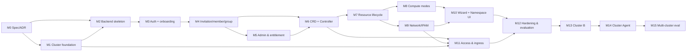
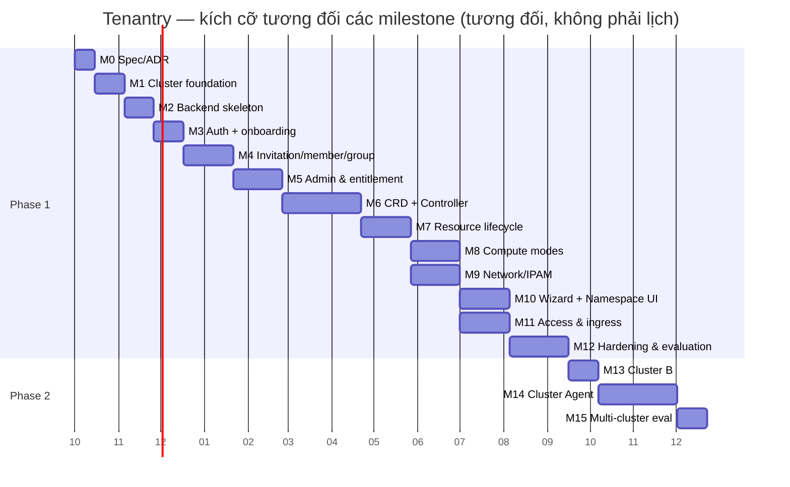

# Tenantry — Kế hoạch triển khai kỹ thuật (Implementation Plan)

> Bám theo `docs/PRODUCT-PLAN.md` ("spec"). Cập nhật: 2026-11-22
> Nơi định nghĩa cho cấu trúc repo, layering, transaction, worker, tham số tuning, milestone và test. Schema, state machine, phiên/token/credential nằm ở `docs/architecture/` — bản đồ ở `docs/README.md`; file này trỏ sang chứ không chép lại.

Tài liệu này trả lời bốn câu hỏi: code đặt ở đâu (mục 2), mỗi thành phần được cấu trúc bên trong thế nào (mục 3–6), làm theo thứ tự nào và khi nào coi là xong (mục 7–9), và cần chốt gì trước khi gõ dòng code đầu tiên (mục 10–12).

---

## 1. Nguyên tắc thực hiện

- **Vertical slice theo milestone**: mỗi milestone M0–M12 (spec §25) đi xuyên DB → API → worker/controller → UI cho một nhóm tính năng, thay vì làm xong toàn bộ backend rồi mới làm UI. Deliverable của milestone là thứ demo được, đúng như spec định nghĩa.
- **Luôn demo được**: nhánh `main` phải dựng lại được trên lab cluster bằng hai lệnh (`make cluster-up` + `make deploy`) tại mọi thời điểm; không merge thứ gì làm hỏng verification suite hiện có của lab. Chưa có registry (đẩy lên Docker Hub là công khai image): `make deploy` tự build image backend và portal, tag là `src-<hash nội dung nguồn>` (không dùng image id vì BuildKit đổi id sau mỗi lần build), rồi nạp vào containerd của từng node qua ssh; nguồn không đổi thì không build, nạp hay restart lại (`deploy/cluster/deploy.sh`).
- **Test là deliverable lõi, không phải phần phụ**: spec §26.2 nói rõ isolation test, resource reservation, group mapping và delete cleanup là "lõi chứng minh đồ án". Mỗi milestone có mục "Test bắt buộc" và milestone chưa xong nếu test đó chưa chạy xanh.
- **Một monorepo**: API, controller, web, Helm chart, lab script và tài liệu cùng một repo, cùng một tag; đơn giản cho một người làm và cho hội đồng xem code.
- **Contract-first ở hai ranh giới**: OpenAPI (`/api/v1`) giữa web và API; CRD `PlatformWorkspace` và ba CRD phụ (mục 4.5, `tenantry.io/v1alpha1`) giữa central plane và Cluster. Hai contract này thay đổi theo migration/versioning rõ ràng, không sửa ad hoc.
- **Đơn giản là mặc định**: modular monolith Go + các vòng lặp worker trong một binary (mục 5.3), cùng image với API, khác entrypoint; PostgreSQL làm cả kho phiên, outbox và idempotency; không Redis/Kafka/Temporal (spec §13.2, lý do ở `architecture/06-security-and-identity.md` mục 3.3).
- **Bám scope, cắt theo §26.2**: khi trễ, cắt iframe Headlamp, custom role builder, email thật, CLI riêng, chart nâng cao; không cắt isolation/reservation/group mapping/delete cleanup.
- **Ghi ADR khi quyết định**: 22 ADR ở spec §29 được viết dần trong `docs/adr/` khi milestone tương ứng chạm tới, không dồn cuối.

---

## 2. Cấu trúc repository

```text
<repo root>
├── go.work                      # (chưa có) thêm khi có operator/; tới lúc đó repo chỉ có một module Go là backend/
├── Makefile                     # entry point duy nhất cho dev/test/deploy
├── backend/                     # central plane: mọi thứ chạm PostgreSQL (một module Go, modular monolith)
│   ├── cmd/
│   │   ├── tenantry-api/        # HTTP server /api/v1 + BFF/OIDC
│   │   ├── tenantry-worker/     # ba loop: provisioning, groupsync, housekeeping (--loops chọn loop nào chạy)
│   │   ├── tenantry-migrate/    # chạy migrations
│   │   └── tenantry-seed/       # seed dev: Cluster A, onboarding policy, shared pool, NetworkPool
│   ├── internal/
│   │   ├── httpapi/             # handler + middleware (phiên, CSRF, rate limit, admin, validate, idempotency)
│   │   │   └── oapi/            #   code oapi-codegen sinh từ OpenAPI
│   │   ├── config/              # đọc cấu hình từ env, logger
│   │   ├── auth/                # OIDC (Authorization Code + PKCE), phiên trong PostgreSQL, upsert user theo (issuer, subject)
│   │   ├── org/                 # organizations, members, invitations, groups, ownership_transfers, entitlement
│   │   ├── user/                # account projection: user Active/Disabled
│   │   ├── operation/           # operations: máy trạng thái, get/retry
│   │   ├── workspace/           # workspaces, workspace_namespaces, bindings, state machine
│   │   ├── reservation/         # cluster registry, cluster grants, shared pools, dedicated node grants, capacity math, reservation tx
│   │   ├── ipam/                # network_pools, network_allocations, CIDR math, quarantine
│   │   ├── outbox/              # outbox_events repo + provisioning worker loop
│   │   ├── housekeeping/        # vòng housekeeping (mục 5.3)
│   │   ├── keycloak/            # Keycloak Admin API client + group sync worker
│   │   ├── k8s/                 # client apply/watch PlatformWorkspace CR bằng scoped credential
│   │   ├── audit/               # audit_events
│   │   ├── apperr/              # kiểu lỗi nghiệp vụ dùng chung (mục 3.3)
│   │   ├── id/                  # sinh ID: tiền tố + ULID
│   │   ├── testdb/              # database riêng cho mỗi test
│   │   └── store/               # sqlc: queries/*.sql của mọi domain + code sinh ra
│   ├── migrations/              # SQL migrations (goose)
│   └── openapi/                 # tenantry.v1.yaml + config sinh code Go/TS
├── operator/                    # Workspace Operator per Cluster (module Go riêng, kubebuilder layout)
│   ├── cmd/manager/
│   ├── api/v1alpha1/            # types của PlatformWorkspace và ba CRD phụ + deepcopy + CRD gen (backend/ import package này, mục 2.1)
│   ├── internal/
│   │   ├── controller/          # PlatformWorkspaceReconciler + finalizer + status
│   │   ├── subreconciler/       # compute, network, tenant, namespaces, policy, rbac, routes, proxyaccess
│   │   ├── render/              # pure functions: spec → object mong muốn (unit test được, không cần cluster)
│   │   └── observe/             # Namespace watch → status.namespaces, node/cert/IPPool observation
│   └── config/                  # CRD và RBAC do controller-gen sinh; chart tenantry-operator lấy CRD từ đây (deploy bằng Helm)
├── web/                         # Vue 3 + TypeScript SPA (Vite), mục 6
│   ├── src/{app,features,components,api,i18n,styles}/   # api/ = TS client generated từ OpenAPI
│   └── e2e/                     # Playwright
├── deploy/
│   ├── Dockerfile.backend       # một image, 4 binary; Deployment chọn binary bằng command
│   ├── Dockerfile.operator
│   ├── Dockerfile.web
│   ├── compose/                 # docker compose cho PostgreSQL local (make dev-up)
│   ├── charts/tenantry-backend/ # Helm: api + 2 worker Deployment + migrate job
│   ├── charts/tenantry-operator/
│   ├── charts/tenantry-web/
│   ├── keycloak/                # realm export tenantry (client portal, headlamp-{clusterId}, kubectl, cluster-verify; tenantry-sync từ M4)
│   └── cluster/                 # nền của Cluster: storage, Traefik, cert-manager, PostgreSQL, Keycloak, Mailpit, OIDC, Capsule, Headlamp
│       ├── charts/postgres/     #   chart nhỏ tự viết: phần riêng (Job tạo role/database, Secret) chart nào cũng không có sẵn
│       └── …                    #   script đánh số, values cho chart có sẵn (csi-driver-nfs, cert-manager, traefik,
│                                #   keycloakx, capsule, capsule-proxy, headlamp) và values của 3 chart Tenantry cho Cluster này
├── test/
│   ├── e2e/                     # Go test chạy trên lab cluster thật (persona §24.3, isolation §24.4, concurrency §24.5)
│   └── bench/                   # script benchmark §24.6 + baseline kind/vcluster
└── docs/                        # README.md (bản đồ tài liệu), PRODUCT-PLAN.md, IMPLEMENTATION-PLAN.md, architecture/, adr/, report/
```

Một câu cho mỗi thư mục cấp một:

- `backend/`: toàn bộ central plane bằng Go — HTTP API, BFF, các vòng lặp worker, migrations, seed; một module, nhiều package nội bộ tách theo domain. Tên là `backend/` chứ không phải `api/` vì chỉ một trong bốn binary là HTTP server.
- `operator/`: thứ chạy **trong** Cluster, chỉ biết CRD và các resource Kubernetes/Capsule/Calico, không biết PostgreSQL.
- `web/`: portal SPA gọi API qua cookie phiên, không giữ token.
- `deploy/`: mọi thứ để đưa platform lên một cụm kubeadm trần: `cluster/` dựng nền (storage, ingress, TLS, PostgreSQL, Keycloak, OIDC, Capsule, Headlamp), Helm chart cho từng thành phần của Tenantry, realm Keycloak. Không có thư mục `lab/` riêng: dựng nền cũng là deploy. `cluster/` **viết mới ở M1**; nhánh `feat/tenantry-scaffold` chỉ còn để tra cấu hình Capsule/OIDC đã từng chạy được.
- `test/`: test cần cluster thật hoặc nhiều tiến trình; unit/integration test nằm cạnh code.
- `docs/`: spec, kế hoạch, ADR, báo cáo test/benchmark cho luận văn.

### 2.1 Quy tắc ranh giới package Go

```text
cmd/*            → internal/httpapi, internal/outbox…  (chỉ wiring; chưa cần package app riêng)
internal/httpapi → service của các domain            (không tự viết SQL; chỉ dùng kiểu dữ liệu của store để map ra response)
internal/<domain> → internal/store + apperr + id      (business rule, transaction boundary)
internal/store   → không import bất kỳ domain nào     (toàn bộ SQL nằm ở store/queries/*.sql, sqlc sinh method có kiểu)
internal/outbox, internal/keycloak, internal/k8s     → adapter; domain định nghĩa interface, adapter implement
operator/api/v1alpha1 → được backend/internal/k8s import để build CR; ngược lại operator không import gì từ backend/
```

Không có lớp repository viết tay cho từng domain: sqlc đã là lớp đó, và gom SQL về một chỗ để sqlc đọc được schema. Domain import domain khác chỉ khi cần kiểu/hằng của nó (ví dụ `operation` dùng role của `org`); chiều ngược lại bị cấm để không tạo vòng.

Ngoại lệ đã chấp nhận, có trong code:

- middleware idempotency của `httpapi` gọi thẳng `store`: nó sở hữu transaction của request (mục 3.4), không có service nào đứng giữa;
- `org` gọi hàm của `reservation` (grant và allocation cho `/entitlement`, `/usage` và bước duyệt);
- `outbox` import `operation` để chuyển state Operation khi giao event.

Trình biên dịch Go từ chối import vòng; rule `depguard` của golangci-lint cho các chiều cấm còn lại sẽ thêm khi có domain thứ ba.

Khi có `operator/` (M6) sẽ có hai module Go (`backend`, `operator`) và `go.work` cho dev local. `go.work` không có tác dụng khi build image hay chạy CI, nên `backend/go.mod` phải `require` module operator kèm `replace => ../operator`, và image backend build từ repo root (hiện `make image` lấy context là `backend/`). Package `operator/api/v1alpha1` tạo `SchemeBuilder` bằng `runtime.NewSchemeBuilder` của apimachinery thay cho `sigs.k8s.io/controller-runtime/pkg/scheme` mà kubebuilder sinh sẵn; nếu không, backend import package này là kéo cả controller-runtime vào module của mình.

---

## 3. Kiến trúc code Platform API

### 3.1 Layering

```text
HTTP request
  → middleware: request-id → cookie phiên → user → requirePlatformAdmin (chỉ tiền tố /api/v1/admin/)
    → rate limit request ghi → CSRF → validate request theo OpenAPI → Idempotency-Key (mở transaction, mục 3.4)
  → generated handler (oapi-codegen strict server)
  → service: resolve Organization từ row, kiểm membership/role (mục 3.5), business rule, ghi audit + outbox
  → store (SQL thuần, sqlc sinh code) → PostgreSQL
```

- Handler không chứa business rule; service không biết HTTP; query sqlc không chứa rule.
- Không có middleware quyền theo Organization: quyền phụ thuộc row nên chỉ service kiểm được. Mọi route `/workspaces/{workspaceId}`, `/groups/{groupId}`, `/operations/{operationId}` resolve `org_id` từ row rồi mới check membership — không tin `orgId` client gửi (spec §10.1).
- Endpoint namespace/binding cần thêm rule "OrgOwner/OrgAdmin **hoặc** member của group giữ `TenantOwner` tại Workspace" (spec §4.5) — implement trong `workspace` service, không trong middleware.

### 3.2 Transaction boundary cho reservation (create/resize/delete Workspace)

Toàn bộ bước 9–10 của spec §17.1 nằm trong **một** transaction. Thứ tự lock cố định định nghĩa ở `architecture/02-data-model.md` mục 4; phác thảo dưới đây đi đúng thứ tự đó, bỏ qua cấp không dùng tới:

```sql
BEGIN;                                                                        -- row idempotency_keys đã được giành ngay sau BEGIN (3.4)
SELECT ... FROM organization_entitlements   WHERE org_id=$1 FOR UPDATE;      -- maxWorkspacesTotal
SELECT status FROM clusters                 WHERE id=$2 FOR SHARE;           -- phải Ready
SELECT ... FROM organization_cluster_grants WHERE org_id=$1 AND cluster_id=$2 FOR UPDATE;  -- Σ của Workspace chưa Deleted: CPU/RAM/Pod chỉ Workspace Shared; số Workspace, Namespace, storage mọi Workspace
SELECT ... FROM shared_compute_pools        WHERE id=$3 FOR UPDATE;          -- Shared, luôn khóa (soft: Σ ≤ ratio × reservable; pool dùng chung giữa nhiều grant)
SELECT ... FROM dedicated_node_grants       WHERE id=$3 FOR UPDATE;          -- Dedicated (hard: Σ reservation Pending/Active/Releasing + mới ≤ reservable)
SELECT ... FROM network_pools               WHERE id=$4 FOR UPDATE;          -- từ M9; overlap check trên network_allocations của cùng cluster_id
-- tính toán trong Go trên snapshot đã lock; fail → ROLLBACK + error code
INSERT INTO workspaces (...);                 -- state = Provisioning (Validating/Reserving chỉ tồn tại trong request)
INSERT INTO workspace_group_bindings (...);
INSERT INTO workspace_node_reservations (...); -- Dedicated, state Pending; Active khi Workspace Ready lần đầu (04 mục 3)
INSERT INTO network_allocations (...);        -- từ M9, state Allocated
UPDATE group_members SET sync_status='Pending' ...;  -- member của các group được bind, để tính lại tenantry:tenant-users (5.2)
INSERT INTO operations (...);                 -- type workspace.create, state Pending
INSERT INTO outbox_events (operation_id, ordering_key='Workspace/<id>', target_cluster_id, type='workspace.apply', payload=CR spec JSON, version);
INSERT INTO audit_events (...);
UPDATE idempotency_keys SET response_...;    -- response 202 vừa dựng
COMMIT;
```

- "Reservation" trên ClusterGrant không có row và không có state: nó là `SUM` cột tài nguyên của các Workspace chưa `Deleted` trong grant (02 mục 4). Chỉ `workspace_node_reservations` (Dedicated) có state.
- Lớp bảo vệ thứ hai ở DB là các constraint liệt kê trong `architecture/02-data-model.md` (exclusion constraint CIDR, partial unique index…). Row lock là cơ chế chính, constraint là lưới an toàn.
- Resize lock cùng các row như create (spec §17.2). Dedicated tăng: nâng `workspace_node_reservations` ngay trong transaction PATCH. Dedicated giảm: reservation giữ số cũ tới khi Operation update `Succeeded`, để DB không bao giờ thấp hơn `hard` đang áp trong Cluster.
- Release capacity **chỉ** khi delete đã dọn xong trong Cluster, do worker làm trong một transaction sau khi CR biến mất: reservation `Released`, CIDR `Quarantined` (từ M9), Workspace `Deleted` (`architecture/04-state-machines.md` mục 3). Không release lúc API nhận DELETE.

### 3.3 Mô hình lỗi

- Package `internal/apperr`: lỗi nghiệp vụ chỉ mang `Code` ổn định; ánh xạ `Code` → HTTP status nằm ở đúng một chỗ, `httpapi/errors.go`. Handler chỉ `return nil, err`.
- Danh sách `Code` là enum `ErrorCode` trong `backend/openapi/tenantry.v1.yaml` — đó là nguồn duy nhất và sinh type cho TS; không chép danh sách ở tài liệu. Phía Go, mỗi mã là một hằng trong `apperr`, kèm test bảo đảm mọi hằng đều có trong enum. Mã mới thêm vào cả hai chỗ khi làm tới endpoint dùng nó. Spec §16.5 chỉ nêu ví dụ.
- Body lỗi theo một schema OpenAPI duy nhất `ErrorResponse{code, message, details, requestId}`; UI map `code` → message tiếng Việt/Anh và gợi ý remediation (spec FR-10).

### 3.4 Idempotency-Key

- Header `Idempotency-Key` (UUID do client sinh) **bắt buộc** với `POST .../workspaces`, `POST .../invitations` và mọi `POST /admin/*` tạo resource — những chỗ retry mù có thể tạo trùng hoặc sinh token thứ hai. Các `POST` khác nhận header nếu client gửi. Chỉ `POST` xét header; method khác bỏ qua nó.
- Bảng `idempotency_keys`, khóa chính `(user_id, key)` (schema: `architecture/02-data-model.md` mục 2). Key của user này không đụng key của user khác.
- Middleware **giành key ở đầu transaction**, trước khi vào handler: mở transaction rồi `INSERT ... ON CONFLICT (user_id, key) DO NOTHING` kèm `method`, `path`, `request_hash`.
  - insert được → chạy handler trong chính transaction đó. Service chỉ ghi qua `store.InTx`: gặp transaction của request trong context thì mở savepoint bên trong, không thì mở transaction mới. Service không bao giờ ghi thẳng vào pool, nếu không thay đổi sẽ commit tách khỏi key. Handler xong, middleware ghi status, header `Location` và body của response vào row rồi commit: thay đổi và response đã lưu cùng commit hoặc cùng mất;
  - key đã có, cùng `method`, `path` và `request_hash` → trả lại đúng response đã lưu kèm header `Idempotent-Replayed: true`, không chạy handler;
  - key đã có, khác một trong ba thứ đó → `422 IDEMPOTENCY_KEY_REUSED`.
- Hai request cùng key đến đồng thời: câu `INSERT` của request sau đứng chờ ngay tại đó cho tới khi request trước commit (rồi replay response của nó) hoặc rollback (rồi tự chạy handler). Giành key ở cuối transaction thì sai: request sau sẽ vấp thay đổi của request trước trước khi vấp key, ví dụ unique index của slug ở `POST /organizations`, và trả `409 SLUG_TAKEN` thay vì response của request trước.
- Response được giữ trong bộ nhớ tới khi commit xong mới gửi, để client không bao giờ thấy thành công rồi bị rollback.
- Chỉ response 2xx được lưu; request lỗi thì rollback cả transaction, key được nhả, nên client sửa rồi gửi lại cùng key được.
- Body lưu ở cột kiểu `json`, không phải `jsonb`: `jsonb` sắp lại thứ tự key, còn `json` giữ nguyên văn bản nên response replay giống từng byte.
- Ngoại lệ: response mang bí mật dùng một lần (link/token của invitation) được lưu **sau khi bỏ bí mật**. Replay trả invitation không kèm link; UI báo "link đã tạo trước đó, tạo link mới (và thu hồi link cũ)".
- Row giữ 24 giờ, vòng `housekeeping` xóa (mục 5.3).

### 3.5 Authz

- Cookie phiên → `users` row + `realm_roles` của phiên. Cơ chế phiên, refresh, CSRF và rate limit: `architecture/06-security-and-identity.md` mục 3 và 6.
- Middleware `requirePlatformAdmin` kiểm `platform-admin` trong `realm_roles` của phiên cho mọi path có tiền tố `/api/v1/admin/`.
- Quyền trong Organization kiểm **trong service**, sau khi resolve Organization từ row: không phải member → `404`, thiếu role → `403`, Organization chưa `Active` → `409 ORG_NOT_ACTIVE` (đúng thứ tự đó, spec §9.2). Thứ tự role `OrgMember < OrgAdmin < OrgOwner`. Transfer ownership, xóa Organization, đổi role Owner yêu cầu `OrgOwner`.
- Hành động admin nằm ngoài `/admin/` tự kiểm `platform-admin` trong service `operation`: `:force` (chỉ Platform Admin), `GET /operations/{id}` và `:retry` của Organization mà admin không là member. Đó là chỗ duy nhất Platform Admin được bỏ qua membership; cờ admin không đi vào `org`.
- Matrix role × endpoint được viết thành **bảng dữ liệu** trong test (`authz_matrix_test.go`) để cover threat case spec §20.3 (đổi `orgId`, OrgMember tự nâng role, user thường gọi admin, OrgAdmin gọi transfer-ownership...).

### 3.6 OpenAPI-first

- File nguồn `backend/openapi/tenantry.v1.yaml` viết tay theo spec §16; sinh server stub Go bằng **oapi-codegen** (router **chi** — `ServeMux` của std không match được path kiểu `{id}:retry`; strict-server: handler nhận struct có kiểu; strict-server chỉ decode JSON, ràng buộc schema như `maxLength`/`additionalProperties` do middleware `oapi-codegen/nethttp-middleware` kiểm theo spec embed) và TS client bằng **openapi-typescript + openapi-fetch** (không runtime nặng).
- `make generate` chạy `go generate` của backend (oapi-codegen, sqlc) rồi `npm run generate` của web (openapi-typescript). CI fail nếu `git diff` sau `make generate` khác rỗng.
- Contract test: request/response mẫu trong `openapi/examples/` validate bằng `kin-openapi` (spec §24.1 "OpenAPI request/response"). **Còn nợ của M2**: thư mục và test chưa có.

### 3.7 Các quy ước khác

- ID, thời gian và cách lưu lượng tài nguyên: quy ước chung ở đầu `architecture/02-data-model.md`. Tài nguyên lưu số nguyên (milliCPU, byte); Kubernetes quantity chỉ xuất hiện ở biên API, parse bằng `k8s.io/apimachinery/pkg/api/resource`.
- Audit ghi trong cùng transaction với mutation; log structured (`slog`), không log token/kubeconfig (spec §20.1).

---

## 4. Kiến trúc Workspace Controller

### 4.1 Một CRD, một reconciler, nhiều sub-reconciler

- CRD chính `PlatformWorkspace` (`tenantry.io/v1alpha1`), schema đúng spec §14.2; `status.conditions` dùng `metav1.Condition`. Cùng với ba CRD phụ ở mục 4.5, cả bốn CRD đều **cluster-scoped**.
- `PlatformWorkspaceReconciler` chạy tuần tự các sub-reconciler, mỗi cái trả về một Condition và có thể yêu cầu requeue:

| Thứ tự | Sub-reconciler | Có từ | Output Kubernetes | Condition sở hữu |
|---|---|---|---|---|
| 1 | `compute` | M8 | Dedicated: membership label `workspaces.tenantry.io/<ws-id>=true` trên `spec.compute.nodeName`; kiểm tra org label/taint `tenantry.io/dedicated-org` đã có (do `PlatformNodeGrant`); Shared: `ComputeReady` khi pool có ít nhất một node Ready mang label `tenantry.io/compute-pool=<pool>` (reason `PoolHasNoNode`), không cần `PlatformSharedPool` tồn tại; Dedicated: reason `NodeNotGranted`/`NodeNotReady` | `ComputeReady` |
| 2 | `network` | M9 | Calico `IPPool` (CIDR, `assignmentMode: Manual`, `allowedUses: [Workload]`, nodeSelector theo mode; `all()` tới khi M8 xong), `GlobalTenantResource` replicate NetworkPolicy baseline (spec §7.4) | `NetworkReady` |
| 3 | `tenant` | M6 | Capsule `Tenant` tên `<org>-<ws>`: owners = group `TenantOwner` + ServiceAccount của operator (để operator tạo được Namespace của `spec.namespaces`); `namespaceOptions.quota` + `forceTenantPrefix`; `namespaceOptions.additionalMetadata` gắn label Namespace `tenantry.io/org=<ULID của Organization>`; annotation của Namespace: từ M8 ba key `scheduler.alpha.kubernetes.io/*` là metadata managed và `cni.projectcalico.org/{ipv4pools,ipv6pools}` bị rule deny metadata (M6–M7 dùng `forbiddenAnnotations`, M8 bỏ, xem 05 §5); `storageClasses.allowed`; container registry/service/QoS rules từ profile mặc định. Annotation IPPool (M9) và `nodeSelector` (M8) thêm khi có | `CapsuleTenantReady` |
| 4 | `namespaces` | M6 | Tạo Namespace `<org>-<ws>-<hậu tố>` cho từng hậu tố trong `spec.namespaces`, gắn label tenant; xóa các tên đầy đủ trong `spec.namespacesToDelete` | (góp vào `CapsuleTenantReady`) |
| 5 | `policy` | M7 | Quota chung của Workspace: `Tenant.spec.rules[].quota[]` (Capsule sinh `GlobalResourceQuota`), `hard` = allocation (spec §5.4), áp cho mọi Namespace kể cả Namespace tạo bằng kubectl; `GlobalTenantResource` replicate LimitRange + Pod Security label; Dedicated (M8): LimitRange `maxLimitRequestRatio: {cpu: 1, memory: 1}` và `default` = `defaultRequest` | `PolicyReady` |
| 6 | `rbac` | M6 | `Tenant.additionalRoleBindings` cho Developer/Viewer → `tenantry:tenant-developer`/`tenantry:tenant-viewer` (ClusterRole cài sẵn bởi chart controller) | `IdentityBindingsReady` |
| 7 | `routes` | M11 | Một `Ingress` cho mỗi entry của `spec.routes` trong Namespace tương ứng (class `platform-shared`, không `tls.secretName`); xóa Ingress mang managed label mà không còn trong `spec.routes`; ghi `status.routes` | không có condition riêng: trạng thái từng Route nằm ở `status.routes`, một Route lỗi không làm Workspace `Degraded` |
| 8 | `proxyaccess` | M11 | `ProxySetting` `tenantry` ở Namespace đầu tiên của Tenant, subjects = group Developer/Viewer + SA `tenantry-proxy-probe` (05 §8). Synthetic verification: operator xin token 600s cho SA probe qua TokenRequest (Role chỉ `serviceaccounts/token` create, `resourceNames` probe; token chỉ trong bộ nhớ, dùng lại tới khi còn 2 phút), gọi `GET /api/v1/namespaces` qua Proxy. Pass khi đủ Namespace của Workspace và mọi Namespace trả về đều mang label tenant là tên một PlatformWorkspace có thật (probe là subject chung của mọi Workspace; việc Dev/Viewer của Workspace A không thấy ns của B do ProxySetting của A chỉ ghi group của A, có golden và envtest). Sai: `ProxyNotFiltering`; Proxy lỗi hoặc không 200: `ProxyUnreachable`; chưa có ns: `True` reason `NoNamespace`. Pass thì probe lại sau 5 phút, fail sau 30s, generation hoặc tập ns đổi thì probe ngay. Cordoned: không ghi ProxySetting, chỉ probe. Tắt được bằng `--proxy-url` rỗng | `ProxyAccessReady` |

Tên Namespace: `spec.namespaces` và body tạo giữ **hậu tố** (`frontend`); `spec.namespacesToDelete`, `status.namespaces`, `spec.routes[].namespace`, `workspace_namespaces.name` và `{name}` trong path API giữ **tên đầy đủ** (`acme-solar-frontend`).

Policy của Tenant (M7, đã kiểm trên lab): LimitRange `tenantry-defaults` (requests mặc định 100m/128Mi, limits 500m/512Mi) phát xuống mọi Namespace của Tenant, kể cả Namespace tạo bằng kubectl, qua một `GlobalTenantResource` mỗi Workspace (cluster-scoped, vì Workspace có thể chưa có Namespace nào để đặt `TenantResource`); Pod Security `enforce=baseline`, `warn`/`audit` ở `restricted`; không có object-count quota. Mọi field của Tenant đã chuyển sang `spec.rules[]`; M8 bỏ nốt `namespaceOptions.forbiddenAnnotations` (nó từ chối cả annotation do Capsule gắn, 05 §5), nên Tenant không còn field deprecated nào.

Guardrail của Tenant (M6, đã kiểm trên lab): registry cho phép lấy từ values `allowedRegistries` của chart operator (mặc định `docker.io`, `ghcr.io`, `quay.io`, `registry.k8s.io`), render bằng `rules[].enforce.workloads.registries` kèm hai regex cho tên ngắn của Docker Hub (`nginx`, `user/app`), vì Capsule không tự hiểu tên ngắn là `docker.io`; QoS cấm `BestEffort`, nên trước khi M7 có LimitRange mặc định, Pod không khai requests bị từ chối; Service `NodePort`/`LoadBalancer`/`ExternalName` bị cấm; `namespacesToDelete` chỉ xóa Namespace mang label tenant của đúng Tenant đó.

Capsule 0.15.2: các field M6 render (`namespaceOptions.additionalMetadata`, `namespaceOptions.forbiddenAnnotations`, `serviceOptions`, `containerRegistries`, `limitRanges`, `networkPolicies`, `resourceQuotas`) đã deprecated nhưng vẫn chạy (webhook chỉ trả Warning; đã kiểm trên lab). Bản thay thế là `spec.rules[]` (`enforce`, `permissions`, `quota`). M6 dùng các field cũ đã kiểm; M7 chuyển hết sang `rules` cùng với quota (mục M7 bước 2), vì `rules[].quota` đã đo là chặn đúng.

`ClusterGrantValid`, `ClusterReady` (từ M6), `ResourcesReserved` (M7), `DedicatedNodeCapacityReserved` (M8) là condition **phía API/DB**, ghi vào `workspaces.conditions` cùng các condition chép từ CR; controller không biết grant.

Condition đến theo milestone: M6 `CapsuleTenantReady`, `IdentityBindingsReady`; M7 `PolicyReady`, `ResourcesReserved`; M8 `ComputeReady`, `DedicatedNodeCapacityReserved`; M9 `NetworkReady`; M11 `ProxyAccessReady`. Condition của phần chưa làm thì không được đặt và không bắt buộc để vào `Ready`.

`status.phase` ∈ `Provisioning|Ready|Updating|Degraded|Failed|Deleting`, suy ra: mọi condition áp dụng True → `Ready`; bất kỳ False sau khi đã Ready → `Degraded`; đang xử lý → `Provisioning`/`Updating`; có finalizer đang chạy → `Deleting`. Không có phase `Blocked`: delete kẹt là condition `Deleting=False` reason `BlockedByFinalizer`, worker map thành Operation `Blocked`. `observedGeneration` chỉ cập nhật sau khi vòng reconcile hoàn tất.

### 4.2 Kỹ thuật apply

- **Server-side apply** với field manager `tenantry-workspace-controller`, `ForceOwnership: true` để restore drift (spec §14.4 "manual sửa resource managed phải được controller restore").
- **Owner reference** từ PlatformWorkspace → Tenant, IPPool, GlobalTenantResource chỉ là lưới an toàn khi CR bị xóa ngoài luồng; thứ tự xóa do finalizer làm tường minh (mục 4.3). Kubernetes chỉ dọn object cluster-scoped theo owner cluster-scoped, nên PlatformWorkspace phải cluster-scoped. Namespace do Capsule đặt ownerRef về Tenant.
- `render/` là pure function `Render(spec) → []client.Object`, unit test bằng golden file; sub-reconciler chỉ apply + đọc status.
- Managed labels theo spec §18 gắn lên mọi object render ra.

### 4.3 Finalizer và thứ tự xóa

Finalizer `tenantry.io/workspace` làm phần trong Cluster của delete (spec §17.4 bước 4–10) theo đúng thứ tự dưới đây; spec §17.4 và `architecture/04-state-machines.md` mục 10 phải khớp thứ tự này:

1. gỡ owners và RoleBinding của Tenant → tenant mất quyền;
2. bỏ `cordoned` trên Tenant: ở lab cũ, Capsule cordon chặn cả ghi của controller (kiểm lại trên 0.15.x ở M6);
3. xóa Namespace của Tenant (cả portal và kubectl) → đợi biến mất (PVC và Pod mất theo Namespace); quá ngưỡng 10 phút → condition `Deleting=False, reason=BlockedByFinalizer` kèm tên object; worker map thành Operation `Blocked`. Capsule 0.15.2 có controller `namespace-cleanup`: Namespace có ownerRef tới Tenant mà đang Terminating thì sau khoảng 10 giây, khi không còn Pod, nó xóa mọi object còn lại và gỡ finalizer của chúng (trừ finalizer của Capsule); không có cờ tắt. Vì vậy trong Namespace tenant, PVC finalizer (kể cả của tool backup) không giữ được việc xóa; chỉ Pod kẹt (finalizer trên Pod, node mất) mới giữ được (đo ở M12).
4. xóa tường minh GlobalTenantResource, Tenant → đợi biến mất;
5. IPPool (từ M9): đợi không còn địa chỉ đang cấp trong các `IPAMBlock` thuộc CIDR (Calico v3.32 không serve `workloadendpoints` qua API server) → xóa IPPool qua API `projectcalico.org/v3` (để Calico nhả block affinity) → đợi `IPAMBlock` của CIDR biến mất (kiểm trên lab); Lab có Calico API server (`v3.projectcalico.org`, Service `calico-system/calico-api`), nên xóa qua `projectcalico.org/v3` được.
6. Dedicated (từ M8): gỡ membership label `workspaces.tenantry.io/<ws-id>` khỏi node (giữ org label/taint);
7. gỡ finalizer. Worker xóa CR với propagation `Background`; thấy CR mất thì trong một transaction: reservation `Released`, CIDR `Quarantined` (từ M9), Workspace `Deleted`.

`:force` của Platform Admin = worker patch annotation `tenantry.io/force-delete=true` (audit ở API). Controller thôi chờ Namespace ở bước 3 và thôi chờ Tenant ở bước 4: Tenant của Capsule 0.15.2 có finalizer `controller.projectcapsule.dev/finalize` chờ mọi Namespace mất hẳn, nên có Pod kẹt thì Tenant cũng kẹt (đo ở M12). Controller vẫn ra lệnh xóa Tenant và GlobalTenantResource rồi đi tiếp; trước khi gỡ finalizer của CR, ghi Event Warning nêu Tenant, các Namespace còn Terminating và Pod đang kẹt. Bước 1 (gỡ quyền) đã xong nên Namespace bỏ lại không còn ai trong tenant truy cập được; Capsule tự dọn xong khi Pod hết kẹt. `:force` không bỏ qua bước 5: IP rò gỡ tay theo `architecture/05-network-and-scheduling.md` mục 5. PlatformWorkspace mới trùng tên khi Tenant cũ còn Terminating báo `CapsuleTenantReady=False` reason `TenantTerminating`. Runbook Pod kẹt: gỡ finalizer của Pod, hoặc `kubectl delete pod --grace-period=0 --force`; việc xóa tự đi tiếp.

### 4.4 Quan sát Namespace

- Watch `Namespace` với predicate label `capsule.clastix.io/tenant=<tenant>` (Capsule gắn) → map về PlatformWorkspace cùng tên → ghi `status.namespaces[{name, source}]`; `source=portal` nếu có trong `spec.namespaces`, ngược lại `kubectl`.
- Đồng thời watch Tenant, IPPool, Ingress, Node (chỉ node có label `tenantry.io/dedicated-org`) bằng `Owns()`/`Watches()` với handler map về CR.

### 4.5 Ba CRD phụ: `PlatformNodeGrant`, `PlatformSharedPool`, `PlatformNodeInventory`

Credential của worker chỉ có quyền trên CRD `tenantry.io`, không đọc hay patch Node (chi tiết quyền: `architecture/06-security-and-identity.md` mục 7). Mọi thứ central plane cần biết hoặc cần làm với Node đi qua ba CRD nhỏ, cluster-scoped, do operator reconcile:

| CRD (`tenantry.io/v1alpha1`) | Spec | Operator làm | Status trả về |
|---|---|---|---|
| `PlatformNodeGrant` | `nodeName`, `organizationId` | M6: chỉ báo status. M8: kiểm node `Ready`, schedulable, không phải control-plane/system, không mang label `tenantry.io/compute-pool` (không thuộc pool nào), không còn Pod tenant nào (kể cả Pod Shared của chính Organization); đạt thì gắn label + taint `tenantry.io/dedicated-org=<org-id>`; gỡ khi CR bị xóa | Condition `Ready` (reason `NodeNotReady`/`NodeNotEligible`/`NodeNotClean` kèm danh sách Pod), `allocatable` của node |
| `PlatformSharedPool` | `nodes` (tên node) | Từ M6: gắn label `tenantry.io/compute-pool=<pool-id>` lên node trong danh sách, gỡ khỏi node ngoài danh sách; từ chối node là control-plane, system, đang dedicated hoặc thuộc pool khác. Không đuổi Pod | Condition `Ready` (reason `NodeNotEligible` kèm tên node), số node `Ready`, tổng `allocatable` của pool |
| `PlatformNodeInventory` (một object mỗi cụm, do chart `tenantry-operator` tạo) | rỗng | Chỉ quan sát | Mỗi node: tên, `Ready`, schedulable, loại (control-plane, system, worker), `allocatable` |

Worker apply `PlatformSharedPool` và `PlatformNodeGrant`, chỉ đọc `PlatformNodeInventory`. Thay đổi từ M6 trở đi đi qua Operation (`sharedpool.update`, `node.grant`, `node.revoke`) + outbox như Workspace; ngoài ra worker dựng lại hai CRD này từ DB lúc khởi động và ở mỗi lần resync (mục 5.1), nên thay đổi ghi ở M5 (chỉ có DB) vẫn xuống Cluster. Operation cấp Cluster như `sharedpool.update` không thuộc Organization nào, chỉ Platform Admin thấy.

Quy trình đưa một node của pool thành dedicated: Admin bớt node khỏi pool trên portal → drain → uncordon → cấp cho Organization. Node không còn label pool nên Pod Shared không quay lại được.

Ai gắn label pool: từ M1 tới M5, `deploy/cluster/10-nodes.sh` gắn `tenantry.io/compute-pool=shared-general` cho `SHARED_NODES` (tạm thời) và `tenantry-seed` ghi các node đó vào `cluster_nodes.shared_pool_id`. Từ M6 operator sở hữu label này theo `PlatformSharedPool.spec.nodes` và script thôi gắn. Pool id `system` bị cấm vì đó là label của system pool.

Worker chép status về `dedicated_node_grants`, `shared_compute_pools.capacity_snapshot` và `cluster_nodes`; đó là nguồn của capacity math và drift `Overcommitted`. Cùng kênh với `PlatformWorkspace` nên Phase 2 (Cluster Agent) không phải đổi gì.

---

## 5. Provisioning Worker và Group Sync Worker

### 5.1 Provisioning Worker (outbox → CR → status)

```text
loop mỗi 1s (mục 12, quyết định 8):
  BEGIN
  SELECT e.* FROM outbox_events e JOIN clusters c ON c.id = e.target_cluster_id
   WHERE e.processed_at IS NULL AND e.next_attempt_at <= now()
     AND c.status <> 'Unavailable'
     AND NOT EXISTS (event cũ hơn, chưa giao, cùng ordering_key)
   ORDER BY e.id LIMIT 10 FOR UPDATE OF e SKIP LOCKED;
  với mỗi event:
     build CR từ payload (version) → server-side apply, field manager tenantry-provisioning-worker
     type workspace.delete → client.Delete CR (propagation Background)
     OK   → processed_at = now()
     lỗi  → attempts++, next_attempt_at = now() + backoff(attempts), last_error
  COMMIT
```

Event của Cluster `Unavailable` không được lấy và `attempts` không tăng, nên Operation của nó giữ `Pending` (`architecture/04-state-machines.md` mục 6).

- Schema `outbox_events`: `architecture/02-data-model.md` mục 4.
- **Không cần lease**: batch chạy trong một transaction giữ row lock của các event đang giao; worker chết thì transaction rollback, lock tự nhả và event được giao lại.
- **Thứ tự theo resource**: `ordering_key = <resource_type>/<resource_id>` của operation (do `outbox.Enqueue` tự đặt). Event chỉ được lấy khi không còn event cũ hơn chưa giao cùng key, kể cả khi event đó đang backoff — nên `workspace.delete` không thể vượt `workspace.apply` đang lỗi của cùng Workspace; resource khác không bị chặn.
- Backoff exponential 1s → 5 phút, không giới hạn attempts với lỗi tạm thời; sau 10 lần lỗi liên tiếp, `operations.state = Failed` để UI hiện nút retry; worker vẫn tiếp tục giao ở backoff tối đa. Event đã giao nhưng condition False kéo dài quá `TENANTRY_OPERATION_TIMEOUT` (mặc định 10 phút, mục 12 quyết định 8) cũng đưa Operation sang `Failed`.
- **Retry** (`POST /operations/{id}:retry`, OrgOwner/OrgAdmin hoặc Platform Admin) nhận Operation `Failed` hoặc `Blocked`. Event chưa giao được: reset `attempts`, `next_attempt_at`. Lỗi do controller báo (event đã giao hết): ghi lại event apply với `spec.retryNonce` mới (generation mới; reservation và CIDR không đổi). `Blocked → Running`; còn kẹt thì controller báo `Blocked` lại. Operation `Failed` không tự thành `Succeeded`, Workspace giữ `Failed` tới khi retry. `:force` chỉ Platform Admin.
- **At-least-once + idempotent**: apply CR là idempotent (SSA); payload mang `generation` mong muốn; apply lặp không tạo duplicate.
- **Status sync**: một informer trên các CRD `tenantry.io` (quyền của credential: `architecture/06-security-and-identity.md` mục 7); worker chỉ tin status có `observedGeneration` bằng `generation` của CR. Mỗi status update → `workspaces.state`, `workspaces.conditions`, `operations.state/progress/error_code` (từ conditions), `workspace_namespaces` (observed, upsert theo `status.namespaces`), `Degraded` khi condition False sau Ready; CR biến mất sau delete → transaction release (mục 3.2, 4.3).
- **Như đã làm ở M6** (lab):
  - Annotation `tenantry.io/spec-version` = `workspaces.desired_generation`, ghi trong cùng một lần SSA với spec. Worker chỉ tin status khi `status.observedGeneration == metadata.generation`, rồi lấy version trong annotation làm `workspaces.observed_generation` (`metadata.generation` đếm lại từ 1 khi CR bị tạo lại và không tăng khi spec không đổi). Spec không đổi thì status `Ready` hiện có được tính cho version mới.
  - Status đọc từ cache của informer mỗi 2 giây, không xử lý theo từng event. Timeout tính từ lúc Operation sang `Running`.
  - `error_code` do worker đặt: `RECONCILE_TIMEOUT`, `RECONCILE_FAILED`, `RECONCILE_DEGRADED`. Apply bị apiserver trả 400/403/422 (thử lại vô ích) thì Operation `Failed` với `APPLY_FAILED` ngay, không chờ đủ 10 lần.
  - Retry lỗi controller báo: ghi lại CR với `retryNonce = "<opId>-<generation>"`, không lưu vào DB; Workspace `Failed → Provisioning`, `Ready`/`Degraded → Updating`.
  - Worker chỉ giao event của Cluster `TENANTRY_CLUSTER_ID` (chart `worker.provisioning.clusterId`, mặc định `seed.clusterId`). CR `PlatformSharedPool`/`PlatformNodeGrant` do worker tạo mang nhãn `tenantry.io/cluster-id`; khi dựng lại, worker chỉ xóa CR có nhãn đó.
  - Operation cấp Cluster: `sharedpool.update` chỉ sinh khi tập node đổi, xong khi CR đã reconcile đúng tập node trong DB và `Ready=True`; `node.grant` `Ready=True` thì `Succeeded`, reason `NodeNotEligible`/`NodeNotClean` thì `Failed`, `NodeNotReady` thì chờ tới timeout; `node.revoke` xong khi CR biến mất. `PUT` shared pool và `PUT dedicated-nodes` vẫn trả 200, thêm trường tùy chọn `operation`/`operations`.
  - Binding: `PUT` trả 200 khi không đổi, 202 kèm Operation `workspace.update` khi đổi; `DELETE` trả 204 khi group không có role. Đổi binding hoặc Namespace chỉ khi Workspace `Ready`/`Degraded` và không có Operation đang chạy (`WORKSPACE_NOT_READY`). Operation Namespace có type `namespace.create`/`namespace.delete`, vẫn đưa Workspace sang `Updating`.
  - Mã lỗi: tạo Namespace vượt `namespaceQuota` (đếm cả Namespace kubectl) `409 CONFLICT` với `details.limit=namespaceQuota`; xóa group còn binding `409 CONFLICT` với `details.workspaceIds`; tạo Dedicated trước M8 `400`.
- **Như đã làm ở M7–M8** (lab):
  - Operation: `Succeeded` nhận từ `Running` hoặc `Blocked` (vật kẹt tự hết); `Running` nhận thêm từ `Blocked` (retry, force). Retry một delete `Blocked` chỉ đưa về `Running`, không ghi lại gì.
  - Trước M9 (chưa có CIDR), release xóa hẳn row `workspaces` cùng reservation, bindings, namespaces trong một transaction; member của các group từng được bind chuyển `Pending` để tính lại `tenantry:tenant-users`.
  - Đổi StorageClass của grant: Workspace `Ready`/`Degraded` nhận Operation `workspace.update`; Workspace đang có Operation nhận CR mới dưới Operation đó, không tạo Operation thứ hai; Workspace `Cordoned` nhận `workspace.update` mà vẫn giữ cordon; Workspace `Failed` bỏ qua (retry render lại từ DB).
  - Cột `workspaces.cordoned` (desired) và `usage_snapshot`.
  - Dedicated: resize tăng giữ ngay, giảm giữ số cũ tới khi Operation `Succeeded`; reservation `Pending → Active` khi Workspace `Ready`, `Releasing` khi xóa rồi giải phóng; node `Overcommitted` làm Workspace `Degraded`.
- Resync định kỳ 5 phút để phát hiện drift khi worker restart hoặc mất event; mỗi lần resync (và lúc khởi động) cũng dựng lại `PlatformSharedPool`/`PlatformNodeGrant` từ DB (mục 4.5).
- Chạy nhiều replica được nhờ `SKIP LOCKED`; MVP một replica là đủ.
- Trạng thái Cluster đổi bằng tay ở MVP: Platform Admin `PATCH`, kể cả `Registered → Ready` (không có bước kiểm bootstrap tự động). Worker chỉ ping `/version` của Cluster mỗi 30s và ghi `clusters.last_health_check` (từ M6). Duyệt Organization, tạo grant và tạo Workspace cần Cluster `Ready` (`409 CLUSTER_NOT_READY`).

### 5.2 Group Sync Worker (DB → Keycloak)

Không đi qua `outbox_events` (bảng đó chỉ mang thay đổi cho Cluster). Worker là một reconciler trên hai bảng `groups` và `group_members`; trạng thái và cạnh chuyển: `architecture/04-state-machines.md` mục 9.1.

- Mọi thay đổi ở `org` service đặt `sync_status = Pending` trong cùng transaction. Xóa là **tombstone** (`deleted_at`), không xóa row — row bị xóa thì không còn gì để worker biết phải gỡ trên Keycloak.
- Vòng lặp: lấy row `sync_status IN (Pending, Error)` tới hạn `next_sync_at` bằng `FOR UPDATE SKIP LOCKED`, rồi đưa Keycloak về đúng hướng row mong muốn:
  - row sống → đảm bảo group tồn tại theo `machine_name` (`org_<ulid>:group_<ulid>`, lưu `keycloak_group_id`) và user là member → `Synced`;
  - tombstone → gỡ membership (hoặc xóa group) trên Keycloak → xóa hẳn row. Không logout user: Keycloak chạy lại group mapper khi refresh nên token kế tiếp đã mất group (`architecture/06-security-and-identity.md` mục 5).
- Sau mỗi lần xử lý row `group_members`, cập nhật group platform `tenantry:tenant-users` cho user đó theo rule "user có ≥1 Workspace binding qua group còn sống" (spec §9.3).
- Tập binding đổi thì kết quả rule đổi theo, dù membership không đổi. Vì vậy mọi transaction làm đổi tập binding (tạo/xóa Workspace, `PUT`/`DELETE` binding, xóa group) đặt `sync_status = 'Pending'` cho mọi `group_members` còn sống của các group bị ảnh hưởng, để worker tính lại `tenantry:tenant-users` cho các user đó.
- Disable/enable user (M5): API đặt `users.status`, `users.sync_status = 'Pending'` và (khi disable) xóa mọi phiên của user trong một transaction; worker lấy row `users` tới hạn `next_sync_at` như với group và đặt `enabled=false/true` cho user trên Keycloak bằng client `tenantry-sync` (schema: `architecture/02-data-model.md` mục 2).
- Lỗi → `Error`, `sync_attempts++`, `next_sync_at` theo backoff 1s → 5 phút, `last_error`. Mọi lời gọi Keycloak idempotent nên chạy lại là an toàn.
- Keycloak Admin API: client mỏng tự viết cho vài endpoint cần dùng (group by name, create/delete group, add/remove membership; enable/disable user từ M5), xác thực bằng service account của client `tenantry-sync`.
- Create Workspace bị chặn `GROUP_SYNC_PENDING` nếu group chọn chưa `Synced`.
- Mapper group claim cấu hình một lần trong realm export cho client `headlamp-{clusterId}` và `kubectl` (không cho `portal`).
- Metric: sync lag (thời gian từ `Pending` → `Synced`), error count (spec §21.2).

### 5.3 Deploy

Một binary `tenantry-worker`, ba vòng lặp, chọn bằng flag `--loops` (danh sách, hoặc `all`). Deploy thành **hai** Deployment từ cùng image để tách credential:

| Deployment | `--loops` | Credential |
|---|---|---|
| `tenantry-worker-provisioning` | `provisioning,housekeeping` | SA `tenantry-worker-provisioning`: chỉ các CRD `tenantry.io`. Không thấy credential Keycloak. |
| `tenantry-worker-groupsync` | `groupsync` | Chỉ mount Secret của client `tenantry-sync`. Không có quyền nào trên Cluster. |

Quyền chi tiết của từng credential: `architecture/06-security-and-identity.md` mục 7.

Vòng `housekeeping` chỉ đụng PostgreSQL, chạy mỗi phút, làm ba việc dọn dẹp mà trước đây nằm rải rác dưới tên "job"/"sweeper":

- xóa `sessions` có `expires_at < now()`;
- xóa `idempotency_keys` cũ hơn 24 giờ;
- chuyển `network_allocations` `Quarantined` quá `quarantine_until` sang `Released` và xóa hẳn row `workspaces` tương ứng cùng reservation của nó; lịch sử nằm ở `audit_events` (`architecture/02-data-model.md` mục 4). Trước M9 (chưa có CIDR), row Workspace bị xóa ngay khi thành `Deleted`.

Các loop không liên quan nghiệp vụ — chúng chỉ chung một hình dạng (poll PostgreSQL → làm việc → ghi trạng thái) nên dùng chung DB pool, backoff, metric, graceful shutdown. Gộp ở mức code, tách ở mức deploy: một tiến trình không cầm đồng thời quyền apply CR và quyền quản trị user Keycloak. Tách này chỉ giới hạn credential bị lộ trực tiếp: API và hai worker dùng chung một role PostgreSQL đọc-ghi, nên ai điều khiển được một tiến trình là điều khiển được cả hai worker qua DB (`architecture/06-security-and-identity.md`). `--loops=all` dành cho chạy local.

---

## 6. Frontend

### 6.1 Stack

| Việc | Chọn | Lý do |
|---|---|---|
| Framework | **Vue 3** + TypeScript, component viết dạng SFC với `<script setup lang="ts">` | Người làm dự án biết Vue; một kiểu viết duy nhất cho mọi component |
| Build, dev server | Vite | Chuẩn của hệ Vue; proxy `/api` và `/auth` về API local (mục 10) |
| Router | Vue Router | Router chính thức |
| Dữ liệu từ server | TanStack Query (bản Vue) | Cache, refetch, trạng thái loading/error cho mọi lời gọi API; không tự viết lại các thứ đó trong từng màn |
| Client API | `openapi-typescript` sinh kiểu từ `openapi.yaml`, gọi qua `openapi-fetch` | Kiểu request/response và enum mã lỗi luôn khớp backend; `make generate` sinh lại |
| Component | **Element Plus** | Có sẵn Steps, Form kèm validation, Table, Dialog, Notification đủ cho wizard 7 màn và admin CRUD; dòng 2.x ổn định, tài liệu và ví dụ nhiều; tránh phải tự thiết kế component (spec §13.2) |
| Test | Vitest + Vue Test Utils cho logic và component; Playwright cho luồng thật trên cụm | |
| Kiểm kiểu, lint | `vue-tsc`, ESLint, Prettier | Chạy trong CI và pre-commit |

- Dùng bản ổn định mới nhất của từng thư viện lúc dựng khung; phiên bản cụ thể nằm trong `package.json` và lockfile, không ghi ở tài liệu này.
- Đã cân nhắc PrimeVue (nhiều component nhất, nhưng form cần thêm gói riêng) và Naive UI (cộng đồng nhỏ, phát hành thưa). Không đổi thư viện component giữa chừng.
- **Không dùng Pinia** lúc đầu: dữ liệu server nằm trong TanStack Query, Organization đang chọn nằm trong URL, state của wizard nằm trong một composable. Thêm store khi có state dùng chung mà ba chỗ đó không chứa được.
- Không SSR, không Nuxt: portal là SPA tĩnh do nginx phục vụ, mọi trang đều sau đăng nhập.

### 6.2 Cấu trúc `web/src`

```text
api/          client sinh từ OpenAPI + một file bọc: gắn X-CSRF-Token, bắt 401, đổi lỗi thành ApiError(code, message, requestId)
app/          main.ts, router, layout (thanh trên, org switcher, menu), guard đăng nhập và guard admin
features/     mỗi vùng nghiệp vụ một thư mục: onboarding, organizations, members, groups, workspaces, routes, admin, operations
components/   component dùng chung nhiều feature: StatusTag, QuotaMeter, PageHeader, Panel, KeyValues, ConditionTimeline,
              EmptyState, ErrorState, ConfirmByName, CopyField
i18n/         bảng mã lỗi → câu hiển thị (vi/en)
styles/       file theme nhỏ lấy từ docs/design/mockups/theme.css
```

Mockup của mọi màn hình, dựng bằng chính Vue và Element Plus với dữ liệu mẫu, nằm ở `docs/design/mockups/` (mở `index.html`). Bộ component dùng chung ở đó mang đúng các tên trên và là bản mẫu cho `components/`; code thật viết lại thành SFC, không chép file mockup.

Trong một feature: trang (`*Page.vue`), component riêng của feature, và một file `queries.ts` chứa mọi lời gọi API của feature dưới dạng composable (`useOrganizations()`, `useApproveOrganization()`). Component không gọi `fetch` trực tiếp.

### 6.3 Quy ước

- **Auth**: SPA không giữ token; `GET /api/v1/me` để biết user và có `platform-admin` hay không; danh sách Organization lấy từ `GET /api/v1/organizations` (có phân trang cursor). Login = chuyển tới `/auth/login`; logout = `POST /auth/logout`; gặp `401` thì chuyển tới `/auth/login`. Mọi request ghi gửi header `X-CSRF-Token` lấy từ cookie `__Host-tenantry_csrf`. Phía server: `architecture/06-security-and-identity.md` mục 3.
- **Lỗi**: mọi lỗi API hiển thị mã ổn định (`SLUG_TAKEN`, `CLUSTER_GRANT_QUOTA_EXCEEDED`…) kèm câu giải thích tra từ `i18n/` và `requestId`. Lỗi gắn với một trường thì hiện ngay dưới trường đó; lỗi khác hiện bằng Notification. Mã lỗi lấy từ enum của OpenAPI, nên UI, backend và test E2E dùng chung một nguồn.
- **Ba trạng thái của mọi màn có dữ liệu**: đang tải (skeleton), rỗng (`EmptyState` có câu giải thích và hành động kế tiếp), lỗi (`ErrorState` có nút thử lại). Danh sách bắt buộc ở `architecture/07-ux-wireflow.md` mục 5.
- **Request `POST`** gửi `Idempotency-Key` sinh một lần cho mỗi lần mở form, để bấm lại hay mạng chập chờn không tạo hai bản ghi (server chỉ xét header này ở `POST`, mục 3.4).
- **Nút bị khóa phải nói lý do** (tooltip hoặc dòng chữ bên cạnh): hết quota, Cluster đang `Maintenance`, không đủ quyền.
- **Hành động phá hủy** (xóa Workspace, xóa Namespace, xóa Organization) dùng `ConfirmByName`: gõ lại tên mới bấm được.
- **Giao diện**: Element Plus cộng một file theme nhỏ lấy từ `docs/design/mockups/theme.css`, không thiết kế gì thêm; bố cục dùng được từ 1280px trở lên, không tối ưu cho điện thoại. Chữ trên giao diện là tiếng Anh; câu giải thích lỗi có cả tiếng Việt và tiếng Anh.

### 6.4 Route và màn hình

- **Routes** mirror IA spec §19 (đây là nơi định nghĩa route; `architecture/07-ux-wireflow.md` vẽ lại theo luồng):

```text
/login
/                                       chưa thuộc Org nào: xin tạo Organization / trạng thái yêu cầu
/orgs/:orgSlug                          Overview
/orgs/:orgSlug/workspaces               list
/orgs/:orgSlug/workspaces/new           wizard 7 màn, gom 12 mục của spec §19.1 (bên dưới)
/orgs/:orgSlug/workspaces/:wsSlug       detail; tab: overview|resources|compute|network|members|namespaces|routes|access|danger
/orgs/:orgSlug/members                  members + invitations
/orgs/:orgSlug/groups
/orgs/:orgSlug/settings                 display name, transfer ownership (đề nghị đang chờ hiện cho Owner và người nhận), leave/delete
/orgs/:orgSlug/clusters                 Granted Clusters: quota, shared pools, dedicated nodes, network pools
/orgs/:orgSlug/audit
/invitations/:token                     xem trước rồi accept
/admin/organizations | /admin/organizations/:orgId | /admin/clusters | /admin/clusters/:clusterId (shared pools, node, network pools)
/admin/onboarding-policy | /admin/grants (danh sách) | /admin/grants/:orgSlug/:clusterId (sửa một grant) | /admin/operations | /admin/health
```

- Admin area chỉ render khi `me.isPlatformAdmin === true`; backend vẫn check (spec §10.1).
- **Operation status**: `GET /api/v1/operations/{id}/events` SSE (quyết định 7 ở mục 12), fallback polling 2s; hiển thị timeline conditions theo tên condition thật.
- **Wizard** có 7 màn: 1 Name; 2 Cluster & compute (mục 2–5 của spec §19.1); 3 Resources (mục 6); 4 Network (mục 7); 5 Namespaces (mục 8, kèm danh sách Namespace tạo luôn cùng Workspace, tùy chọn); 6 Access (mục 9–10); 7 Review & submit (mục 11–12).
- Rời mỗi màn, wizard gọi `POST .../workspaces:validate` với payload hiện tại để hiện lỗi đúng chỗ, và gọi lần cuối trước Submit. Màn Cluster & compute với Dedicated hiển thị node card (reservable/reserved/remaining, capacity state, disable + lý do); màn Network mặc định Auto, Advanced mới lộ pool/prefix/CIDR kèm số địa chỉ khả dụng.
- **Empty/error states** spec §19.2 là checklist trong Playwright, không chỉ happy path.
- **State của wizard** nằm trong một composable `useWorkspaceWizard()` (một object reactive + hàm chuyển bước), test bằng Vitest không cần render.
- Test: Vitest + Vue Test Utils cho component/logic; Playwright cho flow login → wizard → Ready trên lab.

---

## 7. Kế hoạch theo milestone M0–M12

Ước lượng tương đối: S < M < L < XL (XL ≈ 4× S). Thứ tự là thứ tự phụ thuộc (spec §25).

### M0 — Chốt spec/ADR

- **Mục tiêu**: đóng băng spec và các quyết định mục 12; scaffold repo.
- **Công việc**:
  1. Chốt 11 quyết định ở mục 12 và ghi vào spec/ADR.
  2. Viết ADR 1, 2, 4, 5, 7, 8, 9, 10, 16, 17, 18 (những cái không cần code để quyết). **Còn nợ**: `docs/adr/` chưa có; viết bù trước khi bắt đầu M6.
  3. Tạo monorepo theo mục 2, `Makefile`, CI (lint, test, generate-check); `go.work` thêm khi có `operator/` (mục 2.1).
  4. Viết `backend/openapi/tenantry.v1.yaml` bản đầu cho §16.1–16.2, error schema.
  5. Vẽ lại architecture diagram + threat model (spec §20.3) thành checklist test.
  6. Kiểm tra version Kubernetes của lab và pin controller-runtime/client-go tương ứng.
- **Đầu ra kiểm chứng**: repo build rỗng xanh CI; spec + ADR được review.
- **Test bắt buộc**: CI pipeline chạy `go vet`, `golangci-lint`, `npm run lint`.
- **Phụ thuộc**: không.
- **Rủi ro chính**: tốn quá nhiều thời gian viết tài liệu; giới hạn M0 ở "đủ để code M1–M3".
- **Ước lượng**: S.

### M1 — Cluster foundation

- **Mục tiêu**: cluster nền reproducible cho toàn bộ đồ án, dựng bằng một lệnh và có script kiểm tra.
- **Công việc**:
  1. Viết mới `deploy/cluster/`: script đánh số chạy được nhiều lần (idempotent), values Helm, manifest; `make cluster-up` chạy lần lượt, `make cluster-verify` kiểm tra.
  2. Gắn label `tenantry.io/compute-pool=system` và taint `tenantry.io/compute-pool=system:NoSchedule` cho node system pool; mọi Pod central plane và thành phần nền khai nodeSelector và toleration tương ứng. Chi tiết ở `architecture/05-network-and-scheduling.md` mục 1. Gắn tạm label `tenantry.io/compute-pool=shared-general` cho `SHARED_NODES` (tới M6 operator nhận việc này, mục 4.5).
  3. Dựng NFS server cho lab, cài **`csi-driver-nfs`** → StorageClass `standard` (default) theo `architecture/05-network-and-scheduling.md` mục 9; tùy chọn local-path.
  4. Cài **Traefik** class `platform-shared` theo `architecture/05-network-and-scheduling.md` mục 7 (hostPort 80/443 trên node control-plane, chỉ bật provider Ingress). Tạo bản ghi DNS trên Cloudflare (DNS only): `*.mvp.tenantry.site` và các host platform.
  5. **cert-manager** với ClusterIssuer `letsencrypt` (DNS-01, API token Cloudflare trong Secret): wildcard cert `*.mvp.tenantry.site` làm cert mặc định của Traefik, và cert cho host Keycloak/Headlamp/Proxy/Portal. Dùng endpoint staging của Let's Encrypt khi thử, chuyển production khi chạy ổn.
  6. PostgreSQL bằng một chart nhỏ tự viết trong `deploy/cluster/` (image `postgres` chính thức, ghim phiên bản): StatefulSet một replica trên PVC `standard`, Service, mật khẩu đưa vào bằng file (`*_FILE`) thay vì biến môi trường, và một Job chạy sau mỗi lần install/upgrade để tạo role và database `tenantry`, `keycloak` nếu chưa có. Chart có template Secret: mật khẩu sinh ngẫu nhiên ở lần cài đầu, các lần upgrade đọc lại Secret đang có bằng `lookup` nên không đổi; Secret mang `helm.sh/resource-policy: keep` để gỡ chart không làm mất mật khẩu của dữ liệu còn trên PVC. Không dùng chart Bitnami (image miễn phí không còn ghim được phiên bản). Keycloak dùng database `keycloak` trên instance này.
  7. Keycloak bằng chart cộng đồng `keycloakx` của codecentric (ghim phiên bản chart; image chính thức `quay.io/keycloak/keycloak`), cấu hình qua file values trong `deploy/cluster/`: một replica với `KC_CACHE=local`, chạy HTTP sau Traefik, database `keycloak` trên instance PostgreSQL ở bước 6 (mật khẩu lấy từ Secret có sẵn), file realm gắn vào bằng volume. Ingress `auth.tenantry.site` chỉ mở `/realms/tenantry` và `/resources` — trang admin **và realm `master`** không ra internet (client `admin-cli` của `master` nhận mật khẩu trực tiếp, mở ra là cho dò mật khẩu admin); vào admin bằng port-forward. Không dùng operator của Keycloak hay chart Bitnami.
  8. Realm `deploy/keycloak/realm-tenantry.json` viết mới theo `architecture/06-security-and-identity.md` mục 2–3, nạp lúc Keycloak khởi động (`--import-realm` chỉ nạp khi realm chưa tồn tại; từ M3 thay đổi của file được áp vào realm đang chạy bằng bước đồng bộ ở mục 10): client `portal`, `headlamp-cluster-a`, `kubectl` (group mapper cho hai client sau) và `cluster-verify`, realm role `platform-admin`, user demo, bật chống brute-force. Mật khẩu user demo và client secret sinh lúc cài, không nằm trong repo. `kubectl` giữ là client public + PKCE, không bật direct grant; `cluster-verify` lấy token qua một client confidential riêng.
  9. Bật OIDC (structured authentication config, 2 audience) và hai admission plugin `PodNodeSelector`, `PodTolerationRestriction` trên kube-apiserver, kèm script rollback; cài Capsule, Capsule Proxy (`kube-a.tenantry.site`), Headlamp (`console-a.tenantry.site`) bằng chart của dự án gốc.
  10. Viết `cluster-verify`: PVC bound trên `standard`, HTTPS với cert hợp lệ, cert-manager Ready, đăng nhập Keycloak lấy được token, kube-apiserver nhận token đó, `PodNodeSelector` đang bật. Ghi `deploy/cluster/README.md` gồm các bước làm tay (DNS, token Cloudflare, mở cổng).
- **Đầu ra kiểm chứng**: `make cluster-up` từ cluster kubeadm sạch → verify pass; PVC bound; `https://demo.mvp.tenantry.site` trả về qua ingress với cert Let's Encrypt.
- **Test bắt buộc**: `make cluster-verify` qua hết trên cụm vừa dựng và khi chạy `make cluster-up` lần thứ hai.
- **Phụ thuộc**: M0.
- **Rủi ro chính**: NFS server cho lab; cổng 80/443 của node control-plane phải mở ra internet; giới hạn số cert mỗi tuần của Let's Encrypt nếu xin lại nhiều lần trên production.
- **Ước lượng**: M.

### M2 — Backend skeleton

- **Mục tiêu**: API chạy được với migrations, OpenAPI, error model, bảng user/org/membership, khung operation/outbox.
- **Công việc**:
  1. `store`: pgx pool, tx helper `store.InTx(ctx, db, fn)` và `store.WithTx(ctx, tx)` (gắn transaction của request vào context, mục 3.4), sqlc config.
  2. Migrations `0001` (`users`, `organizations`, `organization_members`) và `0002` (`operations`, `outbox_events`). Bảng khác được thêm ở milestone đầu tiên dùng tới nó.
  3. oapi-codegen strict server; middleware request-id, recover, logging, `ErrorResponse`.
  4. `org` service: xin tạo (`Pending` + OrgOwner; slug theo quyết định 4 ở mục 12, không có `-`), get/patch/list Organization có phân trang cursor; `GET /me`.
  5. `outbox` repo + worker loop khung (chưa apply CR, chỉ log).
  6. `operations` service: create/get/retry state machine `Pending → Running → Succeeded|Failed|Blocked`.
  7. Healthz/readyz, config bằng env, Dockerfile multi-stage, chart `tenantry-backend` tối thiểu.
  8. Test harness: test đọc `TEST_DATABASE_URL`, mỗi test tự tạo rồi xóa một database riêng đã migrate (local: postgres của docker compose; CI: service postgres).
- **Đầu ra kiểm chứng**: `GET /healthz`, `GET /api/v1/organizations/{id}` với auth giả (dev header) trả dữ liệu seed; chart cài lên lab.
- **Test bắt buộc**: integration test repo/outbox với PostgreSQL thật; contract test OpenAPI examples (**còn nợ**: chưa có `openapi/examples/` và test, mục 3.6).
- **Phụ thuộc**: M0 (repo), M1 (PostgreSQL trên cụm để deploy).
- **Rủi ro chính**: chọn sai tool codegen gây rework; thử oapi-codegen trên 3 endpoint trước khi viết hết.
- **Ước lượng**: M.

### M3 — Portal auth + onboarding

- **Mục tiêu**: user mới login xin được Organization, Platform Admin duyệt, Organization có grant dùng được.
- **Công việc** (mỗi mục một commit):
  1. **Đăng nhập OIDC** theo `architecture/06-security-and-identity.md` mục 3: migration `sessions`; `GET /auth/login` và `GET /auth/callback` (bắt buộc `email_verified=true`, upsert `users` theo `(issuer, subject)`, tạo phiên); middleware đọc phiên; CSRF double-submit. Dev header `X-Tenantry-Dev-User` của M2 bị bỏ hẳn; test tạo phiên thẳng trong DB. Dùng `github.com/coreos/go-oidc/v3` và `golang.org/x/oauth2`, không tự viết phần kiểm JWT.
  2. **Refresh lười, logout, housekeeping**: refresh khi access token hết hạn, khóa row phiên trong lúc refresh; Keycloak từ chối refresh thì phiên chết; `POST /auth/logout` kết thúc cả SSO session. `tenantry-worker` nhận `--loops` và có vòng `housekeeping` xóa phiên hết hạn.
  3. **Idempotency-Key, audit, rate limit**: migrations `idempotency_keys`, `audit_events`; rate limit theo `architecture/06-security-and-identity.md` mục 6 bằng `golang.org/x/time/rate`.
  4. **Duyệt Organization**:
     - Migrations cho mọi bảng mà bước duyệt ghi vào: `clusters`, `onboarding_policies`, `organization_entitlements`, `organization_cluster_grants`, `shared_compute_pools`, `network_pools`, `cluster_grant_shared_pools`, `cluster_grant_network_pools`, `groups`, `group_members` (đủ cột sync và tombstone); thêm FK `outbox_events.target_cluster_id → clusters(id)` hoãn từ `0002`.
     - `tenantry-seed`: `cluster-a` ở trạng thái `Ready` (MVP không có bước kiểm bootstrap; Admin đổi trạng thái bằng tay từ M5, mà duyệt bắt buộc Cluster `Ready`), onboarding policy gồm mẫu entitlement theo spec §5.1 và mẫu grant theo §5.2.1, shared pool `shared-general`, NetworkPool `onboarding-pod-network` (`10.240.0.0/18`, chừa chỗ cho pool riêng của Organization trong `10.240.0.0/16`).
     - Middleware `requirePlatformAdmin`; `GET /admin/organizations?status=Pending` (cũ nhất trước) trả kèm grant điền sẵn từ policy; `POST /admin/organizations/{id}:approve|reject`.
     - Duyệt là một transaction: `Active`, entitlement, ClusterGrant đầy đủ (quota, shared pool, NetworkPool), 3 group mặc định `admins/developers/viewers`, Owner vào `admins`, audit. Từ chối: `Rejected` + `review_note`, nhả slug.
     - Ranh giới với milestone sau: group nằm ở `sync_status=Pending` cho tới khi Group Sync Worker có ở M4. Pool ở M3 chỉ có bảng và dữ liệu seed; API và UI quản lý pool, capacity math thuộc M5.
  5. `GET /me`, `GET /organizations`, `/entitlement`, `/usage`:
     - `/entitlement` trả `{ entitlement, clusterGrants[] }`, mỗi grant dùng schema `ClusterGrant` của bước 4.
     - `/usage` theo spec §5.6: đếm thật member và group; số Workspace và phần theo từng grant bằng 0 vì bảng `workspaces` chỉ có từ M6 (M6 nối phần này với bảng đó).
     - Quyền theo spec §9.2: OrgOwner/OrgAdmin đọc được, OrgMember `403`, không phải member `404`, Organization chưa `Active` thì `409 ORG_NOT_ACTIVE` (thêm mã này vào enum `ErrorCode`).
  6. **Web**: dựng khung `web/` theo mục 6 (Vue 3, Vite, Vue Router, TanStack Query, Element Plus, client TypeScript sinh từ OpenAPI bằng `make generate`), kèm bộ component dùng chung `ErrorState`, `EmptyState`, `QuotaMeter`, `StatusTag` và theme (mục 6.2, 6.3); thêm job web vào CI (`vue-tsc`, ESLint/Prettier, Vitest, build) như M0 đã đòi. Gồm layout, login redirect, màn trống "xin tạo Organization" (báo `SLUG_TAKEN` tại chỗ), trạng thái yêu cầu (chờ, hoặc bị từ chối kèm lý do), org switcher, Overview hiển thị grant/quota, trang Admin duyệt yêu cầu.
  7. **Deploy lên cụm**:
     - Chart `tenantry-web` (nginx); Ingress `portal.tenantry.site` đưa `/api` và `/auth` vào API, còn lại vào web.
     - Secret chứa client secret của `portal` và khóa mã hóa phiên do script sinh, không vào repo. Seed chạy trong cụm.
     - **Mailpit** (hộp thư giả) trong namespace `keycloak`, không có Ingress; realm bật `verifyEmail: true` và trỏ SMTP vào Mailpit. Lý do và giới hạn: `architecture/06-security-and-identity.md` mục 3.
     - Bước đồng bộ realm vào Keycloak đang chạy (mục 10).
  8. **Playwright trên cụm**: đăng ký user mới (lấy link xác minh từ API của Mailpit), xin tạo Organization, Admin duyệt, user thấy Overview; F5 vẫn login; logout kết thúc SSO session.
- **Đầu ra kiểm chứng**: đăng ký user mới trên Keycloak và xác minh email → portal hiện màn xin tạo Organization → Admin duyệt → user thấy Organization + quota mặc định; refresh trang vẫn login; để quá 5 phút rồi dùng tiếp vẫn login (refresh chạy); logout xóa phiên và kết thúc SSO session.
- **Test bắt buộc**: first login idempotent (login hai lần không tạo hai user); callback với `email_verified=false` không tạo phiên; phiên chết khi Keycloak từ chối refresh; hai request đồng thời chỉ refresh một lần; user `Disabled` bị 401 ngay; request ghi thiếu CSRF bị từ chối; cùng `Idempotency-Key` trả lại response cũ, khác body bị `IDEMPOTENCY_KEY_REUSED`; vượt ngưỡng rate limit trả 429; yêu cầu `Pending` thứ hai của cùng user bị chặn; duyệt tạo đúng group + grant (kèm pool) trong một transaction; từ chối nhả slug; user thường gọi `/admin/*` bị 403. Integration test OIDC dùng một issuer giả chạy ngay trong tiến trình test (nhanh, không cần Docker); Keycloak thật được kiểm bằng Playwright trên cụm. `make deploy` hai lần và `make cluster-verify` vẫn qua hết.
- **Phụ thuộc**: M1 (Keycloak realm), M2.
- **Rủi ro chính**: cookie/redirect giữa `portal.tenantry.site` và `auth.tenantry.site`; bước đồng bộ realm ghi đè nhầm (đổi client secret, mất user) — kiểm trên realm có user thật trước khi coi là xong.
- **Ước lượng**: M.

### M4 — Invitation/member/group

- **Mục tiêu**: Alice mời Joe, tạo group, token Joe có group claim.
- **Công việc**:
  1. Migrations `invitations`, `ownership_transfers` (không có token; `groups`, `group_members` đã có từ M3).
  2. Invitation: tạo token (hash + expiry + one-time), hiển thị link, accept chỉ khi email verified khớp (spec §9.1); `GET .../invitations` (danh sách), `DELETE /invitations/{invitationId}` (thu hồi), `GET /invitations/{token}` (xem trước cho người được mời đã đăng nhập, không accept). Kiểm `maxMembers` dưới lock `organization_entitlements` lúc tạo và lúc accept (`ENTITLEMENT_EXCEEDED`). Response tạo invitation lưu vào `idempotency_keys` **không kèm** link (mục 3.4).
  3. Member: patch role, remove (chặn Owner), `members/me:leave` (chặn Owner). Transfer ownership trong portal, không token: `POST .../{orgId}:transfer-ownership` (Owner chọn một OrgAdmin), `GET .../{orgId}/ownership-transfer` (đề nghị đang chờ, Owner và người nhận xem được), `POST /ownership-transfers/{transferId}:accept` (chỉ người nhận), `DELETE /ownership-transfers/{transferId}` (Owner hủy). Transaction accept kiểm lại dưới lock: vẫn `Proposed`, chưa hết hạn, người nhận còn là OrgAdmin, người đề nghị còn là OrgOwner; **hạ Owner cũ trước rồi mới nâng người nhận** (unique index một-Owner không deferrable).
  4. Group CRUD, add/remove member; tạo group kiểm `maxGroups` dưới lock entitlement, không tính tombstone (`ENTITLEMENT_EXCEEDED`). Guard "không xóa group còn binding" làm ở M6 cùng bảng `workspace_group_bindings` (trước M6 chưa thể có binding).
  5. Group Sync Worker (mục 5.2) + group `tenantry:tenant-users`; `sync_status` hiển thị trên UI.
  6. Realm: client `tenantry-sync` (confidential, service account với role `manage-users`, `query-groups` của `realm-management`, client scope `kc-admin-api`, `fullScopeAllowed: false`; `architecture/06-security-and-identity.md` mục 2), Secret do script sinh; chart `tenantry-backend` thêm Deployment `tenantry-worker-groupsync` (`--loops=groupsync`, mục 5.3). Group mapper cho `kubectl`/`headlamp-cluster-a` và Capsule user group `oidc:tenantry:tenant-users` đã có từ M1.
  7. Mời member, tạo group trên Organization chưa `Active` trả `409 ORG_NOT_ACTIVE`; mã lỗi mới (`ENTITLEMENT_EXCEEDED`, mã của invitation) thêm vào `ErrorCode` và `apperr` (mục 3.3).
  8. Web: Members & invitations, Groups, Settings (transfer/leave, đề nghị transfer đang chờ), trang xem trước và accept invite.
  9. Authz matrix test đầy đủ cho §16.1–16.2.
  10. Audit events cho mọi mutation trên.
- **Đầu ra kiểm chứng**: Alice tạo link mời → Joe register/login → accept → thấy Org; Alice tạo group `backend` add Joe → `kubectl oidc-login` của Joe (hoặc token từ Keycloak) có claim `groups: ["org_...:group_..."]`.
- **Test bắt buộc**: unit invitation expiry/one-time/email mismatch; vượt `maxMembers` (lúc tạo và lúc accept) và `maxGroups` bị chặn; replay `Idempotency-Key` của invitation không trả link; transfer accept đúng thứ tự hạ/nâng và bị từ chối khi người nhận không còn là OrgAdmin; integration Keycloak create group/add/remove, refresh ra token theo membership mới; kiểm chứng trên Keycloak 26 của lab: quyền của `tenantry-sync` đủ (06 mục 7) và refresh token có chạy lại group mapper (06 mục 5); tombstone: gỡ member → mất quyền portal ngay, row chỉ biến mất sau khi Keycloak đã gỡ, thêm lại giữa chừng hội tụ về "là member"; worker chết giữa sync chạy lại không lệch; authz matrix; concurrency accept invite hai lần.
- **Phụ thuộc**: M3.
- **Rủi ro chính**: Keycloak Admin API version/lag; viết client mỏng có retry và test với đúng Keycloak 26.x của lab.
- **Ước lượng**: L.

### M5 — Admin & entitlement

- **Mục tiêu**: Platform Admin cấp và điều chỉnh tài nguyên qua UI; capacity math có test.
- **Công việc**:
  1. Migrations `dedicated_node_grants` (thu hồi là đặt `revoked_at`, `UNIQUE (cluster_id, node_name) WHERE revoked_at IS NULL`), `cluster_nodes`, cột `clusters.reserved_cidrs`, cột `users.sync_status`/`next_sync_at` cho disable/enable (bảng pool và bảng nối với grant đã có từ M3, kèm dữ liệu seed). Schema: `architecture/02-data-model.md` mục 2–3.
  2. Endpoint admin của spec §16.5 (middleware `requirePlatformAdmin` đã có từ M3):
     - organizations: tạo thẳng Org + Owner + grant ban đầu (approve/reject đã có từ M3), `GET /admin/organizations/{orgId}` (entitlement, ClusterGrant và usage, cùng số với `/usage`); `PUT .../entitlement` từ chối `409 ENTITLEMENT_BELOW_USAGE` khi thấp hơn mức đang dùng hoặc `maxGroups` < 3;
     - clusters: register, `PATCH` trạng thái bằng tay kể cả `Registered → Ready` (mục 5.1);
     - onboarding-policy `GET`/`PUT`; `GET /admin/cluster-grants` (danh sách cho `/admin/grants`);
     - cluster-grants `PUT`/`DELETE` theo spec §5.5. Ở M5 chỉ kiểm được: grant có ≥1 NetworkPool, pool và NetworkPool cùng Cluster với grant, audit giá trị trước/sau. Guard cần bảng của milestone sau thêm ở đó: M7 (tổng Workspace/Namespace/tài nguyên, xóa grant), M8 (gỡ shared pool, bớt node khỏi pool, dedicated node), M9 (gỡ NetworkPool);
     - dedicated-nodes, shared-pools (`GET`, tạo, sửa ratio/system reserve/danh sách node, spec §6.2; pool id `system` bị cấm), `GET /admin/clusters/{clusterId}/nodes`;
     - network-pools `GET`/`POST`/`PATCH`: NetworkPool của một Cluster không overlap nhau và không overlap `clusters.reserved_cidrs` (service kiểm lúc tạo/sửa);
     - `GET /admin/operations?state=`; `POST /admin/users/{userId}:disable|:enable` (mục 5.2).
  3. `reservation` capacity math: `reservable/reserved/remaining`, capacity state, soft ratio Shared; snapshot allocatable của node/pool do worker chép từ status của các CRD phụ (mục 4.5). Trước khi operator có ở M6, `tenantry-seed` nhập snapshot, danh sách node và ghi `SHARED_NODES` vào `cluster_nodes.shared_pool_id` bằng tay.
  4. Thêm/bớt node của pool và grant dedicated node ở M5 **chỉ ghi DB** (`dedicated_node_grants` với `node_state=NotReady`), không tạo Operation/outbox: vòng provisioning của M2–M5 chỉ log rồi đánh dấu event đã giao, event sẽ mất. Từ M6 worker dựng các CRD phụ từ DB (mục 4.5). Việc kiểm node (spec §6.3) và gắn label/taint là của operator, làm ở M8.
  5. Catalog §16.3 phía Org (filter theo grant, sanitize node): clusters, compute-options, shared-pools, network-pools, dedicated-nodes (reserved = 0 tới M8). Endpoint availability của NetworkPool làm ở M9.
  6. Web: khu Admin (Organizations, Cluster registry, Onboarding policy, Grants, Pools/Nodes/NetworkPools, Operations), trang Granted Clusters phía Org. Trang Platform health làm ở M6, cùng lúc với health check của Cluster.
- **Đầu ra kiểm chứng**: Admin tạo Org `acme` + Owner + grant; trên lab, bớt `fdp-k8s-wk3` khỏi shared pool `shared-general` trên portal (ở M5 chỉ đổi DB, label trên node giữ nguyên tới M6) rồi ghi nhận grant node đó cho `acme` (node dùng được từ M8), cuối test trả `wk3` về pool để lab giữ nguyên; Org thấy remaining capacity; user thường gọi `/admin/*` bị 403.
- **Test bắt buộc**: unit capacity math + transition `Overcommitted`; unit CIDR pool validation (overlap giữa các pool và với `reserved_cidrs`); grant không có NetworkPool bị từ chối; sửa grant ghi audit trước/sau; hạ entitlement dưới mức đang dùng bị `ENTITLEMENT_BELOW_USAGE`; disable user xóa mọi phiên của user; authz admin.
- **Phụ thuộc**: M4.
- **Rủi ro chính**: nhiều form CRUD admin ăn thời gian UI — dùng bảng/form có sẵn của Element Plus, không làm đẹp.
- **Ước lượng**: L.

### M6 — CRD + Controller

- **Mục tiêu**: outbox → CR → Capsule Tenant Ready; Namespace từ portal xuất hiện trong cluster.
- **Công việc**:
  1. kubebuilder scaffold `operator/` (module Go riêng, mục 2.1), types `PlatformWorkspace` theo §14.2 và ba CRD phụ, cả bốn cluster-scoped. CRD phụ (mục 4.5): `PlatformNodeInventory` báo danh sách node; `PlatformSharedPool` gắn/gỡ label pool theo `spec.nodes` và báo `allocatable`; `PlatformNodeGrant` chỉ báo `allocatable` (kiểm node, gắn label/taint ở M8). Từ đây `deploy/cluster/10-nodes.sh` thôi gắn label `shared-general`. CRD gen, chart `tenantry-operator`: RBAC operator đúng bảng ở `architecture/06-security-and-identity.md` mục 7, object `PlatformNodeInventory` duy nhất của cụm.
  2. Capsule users thêm group `system:serviceaccounts:tenantry-operator` (`deploy/cluster/values/capsule.yaml`) và ServiceAccount của operator là owner của mọi Tenant, để operator tạo được Namespace của `spec.namespaces`. Lab cũ đã kiểm trên Capsule 0.13.10; kiểm lại trên 0.15.x.
  3. ClusterRole `tenantry:tenant-developer`, `tenantry:tenant-viewer` (spec §10.5) trong chart, permission matrix `kubectl auth can-i` test.
  4. `render/` + sub-reconciler `tenant`, `namespaces`, `rbac`; conditions `CapsuleTenantReady`, `IdentityBindingsReady`; `status.namespaces` observation.
  5. Finalizer khung (mục 4.3 bước 1–4 và 7), chưa network/node.
  6. `k8s` adapter dùng trong worker (API không gọi Kubernetes): build CR từ Workspace + apply/delete; ServiceAccount `tenantry-worker-provisioning` chỉ có quyền trên các CRD `tenantry.io`.
  7. Provisioning worker thật + status informer → DB (mục 5.1): `workspace.*`, `sharedpool.update`, `node.grant|revoke`; dựng lại `PlatformSharedPool`/`PlatformNodeGrant` từ DB lúc khởi động và mỗi lần resync; ping Cluster ghi `last_health_check`; không giao event của Cluster `Unavailable`.
  8. `workspace` service tối thiểu: create (chưa reservation resource, chỉ grant/cluster/binding validation; body có thể kèm `namespaces` là danh sách hậu tố tạo cùng Workspace, tính vào `namespaceQuota`; slug bị từ chối `409 SLUG_TAKEN` khi lồng tiền tố với slug Workspace khác chưa `Deleted` của cùng Organization tại ranh giới `-`, quyết định 4 ở mục 12), list/detail, bindings PUT/DELETE (chặn `LAST_OWNER_BINDING`), namespaces POST/DELETE qua `spec.namespaces`/`namespacesToDelete`. Mọi thay đổi binding đặt `group_members` của group bị ảnh hưởng về `Pending` (mục 5.2). Guard xóa group còn binding.
  9. Migrations `workspaces`, `workspace_namespaces`, `workspace_group_bindings` (FK `group_id` `ON DELETE RESTRICT`); `operations.org_id` cho phép NULL (Operation cấp Cluster như `sharedpool.update`). `/usage` từ đây đếm số Workspace (trừ `Deleted`) và allocated theo grant từ `workspaces` (CPU/RAM/Pod chỉ Workspace Shared).
  10. envtest cho reconciler; golden test cho render.
- **Đầu ra kiểm chứng**: `POST .../workspaces` qua curl → Operation Running → Tenant `acme-solar` xuất hiện với owners đúng → `POST .../namespaces {frontend}` → Namespace `acme-solar-frontend` tạo; `kubectl create ns acme-solar-scratch` bằng token owner → hiện trên `GET .../namespaces` với `source=kubectl`.
- **Test bắt buộc**: envtest reconcile idempotent (apply hai lần không đổi); worker restart giữa apply → không duplicate; unit state machine Workspace; permission matrix Developer/Viewer; member của group Owner vào `tenantry:tenant-users` sau khi tạo Workspace; thay đổi pool ghi ở M5 xuống được Cluster sau khi worker khởi động; kiểm trên Capsule 0.15.x của lab: `Tenant.spec.cordoned` có chặn ghi của ServiceAccount operator không (lab cũ trên 0.13.10: có), kết quả ghi vào mục 4.3.
- **Phụ thuộc**: M4 (group sync để có subject), M5 (grant/cluster).
- **Rủi ro chính**: độ phức tạp controller + Capsule schema 0.15.x; giữ mỗi sub-reconciler dưới ~200 dòng, render tách khỏi apply.
- **Ước lượng**: XL.

### M7 — Resource lifecycle

- **Mục tiêu**: dynamic Workspace resource enforcement; state machine đầy đủ create/update/cordon/delete.
- **Công việc**:
  1. Transaction reservation mục 3.2 cho ClusterGrant (chưa node/CIDR), kể cả `maxWorkspacesTotal` dưới lock entitlement; vượt grant trả `CLUSTER_GRANT_QUOTA_EXCEEDED` kèm `details.resource/limit/allocated/requested`, vượt entitlement trả `ENTITLEMENT_EXCEEDED`; condition `ResourcesReserved`. Guard sửa grant của spec §5.5 cần tổng Workspace: không giảm dưới allocation (`CLUSTER_GRANT_BELOW_ALLOCATION`), không xóa grant còn Workspace.
  2. Sub-reconciler `policy` (mục 4.1): quota chung `Tenant.spec.rules[].quota[]` (spec §5.4; đã đo ở M6, không vượt khi tạo đồng thời), LimitRange, object-count quota, Pod Security label; `PolicyReady`. Cùng milestone này chuyển các field deprecated còn lại của Tenant sang `spec.rules[]` (chỉ đổi phía operator, không đổi hợp đồng CR). `status.usage` đọc từ status của `GlobalResourceQuota`.
  3. Update: PATCH resources (chặn giảm dưới usage — đọc `status.usage` của CR), namespaceQuota, display name; `Ready → Updating → Ready`. PATCH, DELETE, cordon khi Workspace đang có Operation `Pending`/`Running`/`Blocked` trả `409 WORKSPACE_NOT_READY`.
  4. `POST /workspaces/{id}:cordon` và `:uncordon` (OrgOwner/OrgAdmin): CR `spec.cordoned` → `Tenant.spec.cordoned`; Operation `workspace.cordon`/`workspace.uncordon`; Workspace thành `Cordoned` khi Operation `Succeeded`.
  5. Delete workflow đầy đủ phía API + finalizer (mục 4.3) trừ network/node; confirm gõ tên; `Blocked` + `:force` admin; `:retry` nhận `Failed` và `Blocked` (mục 5.1). Trước M9 Workspace không có CIDR: delete bỏ qua Quarantine, `k8s_name` dùng lại được ngay khi Workspace `Deleted` và row bị xóa hẳn (mục 5.3).
  6. `DELETE /organizations/{orgId}` (OrgOwner): guard theo `04-state-machines.md` mục 11 (không còn row `workspaces` nào, không còn DedicatedNodeGrant; `409 ORGANIZATION_NOT_EMPTY`; khóa `organizations` → `organization_entitlements`). Cùng transaction: status `Deleted`, xóa ClusterGrant, hủy invitation và transfer đang chờ, tombstone group và group member; audit. Organization `Deleted` trả 404 ở mọi endpoint.
  7. Đổi `allowed_storage_classes` của grant sinh một event `workspace.apply` cho mỗi Workspace trong grant (`architecture/02-data-model.md` mục 5).
  8. Drift: resync định kỳ, `Degraded` khi condition False; restore khi tenant sửa object managed.
  9. `GET /workspaces/{id}/usage` từ ResourceQuota trong các Namespace của Workspace (nguồn: `status.usage` của CR và usage trong từng entry `status.namespaces`, spec §14.2; worker chép về DB); `GET /workspaces/{id}/operations`; `GET /operations/{id}/events` (SSE, cùng payload với `GET /operations/{id}`).
  10. Web: Workspace detail tab Overview/Resources/Danger zone (cordon, delete), operation timeline (SSE), xóa Organization ở Settings.
- **Đầu ra kiểm chứng**: tạo Workspace Solar 2 CPU/4 GiB (limits 4 CPU/8 GiB, vừa grant mặc định) → Pod vượt quota bị từ chối với message; tăng quota → chạy được; xóa Workspace có PVC → Namespace/PVC mất, Workspace `Deleted`, allocation của grant giảm.
- **Test bắt buộc**: unit quota math; integration reservation tx với PostgreSQL thật; concurrency hai create sát quota (chỉ một pass); giảm grant dưới allocation bị `CLUSTER_GRANT_BELOW_ALLOCATION`; xóa Organization bị chặn khi còn Workspace; e2e delete cleanup (không còn Tenant/Namespace/PVC); kiểm `storageClasses.allowed` của Capsule 0.15.x nhận tên chính xác.
- **Phụ thuộc**: M6.
- **Rủi ro chính**: `spec.rules[]` là API mới của Capsule 0.15, chuyển các field cũ sang có thể lộ hành vi khác; golden test và kiểm trên lab từng rule (metadata, services, registries, quota).
- **Ước lượng**: L.

### M8 — Compute modes

- **Mục tiêu**: nhiều Dedicated Workspace chung node không overbook; placement enforced.
- **Công việc**:
  1. Migration `workspace_node_reservations`; lock `dedicated_node_grants` trong transaction (mục 3.2); Dedicated bắt `requests = limits`, đúng một node; reservation `Pending → Active` khi Workspace `Ready` lần đầu; resize Dedicated theo mục 3.2. LimitRange của Namespace Dedicated: `maxLimitRequestRatio: {cpu: 1, memory: 1}`, `default` = `defaultRequest` (Guaranteed QoS); condition `DedicatedNodeCapacityReserved`.
  2. Shared: validate pool thuộc grant, soft ratio; render Tenant `nodeSelector` pool; IPPool (nếu M9 đã xong) đổi từ `all()` sang selector theo mode.
  3. Reconciler `PlatformNodeGrant` đầy đủ: kiểm node theo mục 4.5 (Ready, schedulable, không control-plane/system, không mang label pool, không còn Pod tenant nào), gắn/gỡ label + taint `tenantry.io/dedicated-org` và gắn lại nếu bị gỡ; node bị cordon hoặc NotReady sau khi cấp vẫn giữ label/taint, chỉ `Ready=False` reason `NodeNotReady`; chưa đạt thì requeue 30s; thu hồi node grant là đặt `revoked_at`, chặn khi còn reservation chưa `Released`. Sub-reconciler `compute` gắn/gỡ membership label; `ComputeReady`.
  4. Placement (`architecture/05-network-and-scheduling.md` mục 2):
     - `PodNodeSelector` (bật ở M1) ghép selector của Namespace vào mọi Pod và kubelet kiểm lại nodeSelector, nên `spec.nodeName` không đặt được Pod ra ngoài pool/node của mình;
     - annotation `scheduler.alpha.kubernetes.io/defaultTolerations` + `tolerationsWhitelist` cho `PodTolerationRestriction`: Namespace Dedicated có toleration của Organization, whitelist gồm toleration đó và các taint `node.kubernetes.io/*`; Namespace Shared có `defaultTolerations` rỗng, whitelist chỉ các taint `node.kubernetes.io/*`; cả ba annotation `scheduler.alpha.kubernetes.io/*` là metadata managed trong `Tenant.spec.rules[]` ở mọi Workspace;
     - ValidatingAdmissionPolicy trong chart operator chỉ cho SA `tenantry-operator` (và group trong value `nodeLabelAdmins`, lab thêm `kubeadm:cluster-admins`, 06 §7) đổi label/taint khóa `tenantry.io/*` và `workspaces.tenantry.io/*` trên Node;
     - VAP từ chối `spec.nodeName` của tenant là hardening (báo lỗi rõ hơn), không phải lớp bắt buộc; Capsule không có luật cho `nodeName`;
     - test bắt buộc khi plugin tắt (spec §6.4).
  5. Capacity state, `Overcommitted` drift → `Degraded`, chặn reservation mới.
  6. Guard sửa grant/pool của spec §5.5 và §6.2: không gỡ shared pool còn Workspace Shared, bớt node khỏi pool bị `COMPUTE_POOL_CAPACITY_EXCEEDED` nếu tổng allocation vượt `ratio × reservable`, không thu hồi dedicated node còn reservation.
  7. Catalog `dedicated-nodes` trả reservable/reserved/remaining và Workspace đang giữ; UI node card.
  8. Web: bước compute của wizard (tạm dùng form đơn giản, wizard hoàn chỉnh ở M10), tab Compute.
- **Đầu ra kiểm chứng** (trên lab, node `fdp-k8s-wk3` rút khỏi shared pool: allocatable 3 CPU / ~11,5Gi, systemReserve 0,5 CPU / 1,5Gi → reservable 2,5 CPU / 10Gi): Water 1 CPU / 4Gi + Green 1 CPU / 4Gi tạo OK, Workspace thứ ba 1 CPU bị `DEDICATED_NODE_INSUFFICIENT_CAPACITY` (còn 0,5 CPU); Pod Water/Green chỉ trên node đó; Pod đặt `nodeName` sang node khác không chạy được (kubelet từ chối vì nodeSelector của Namespace).
- **Test bắt buộc**: unit reservable/reserved/remaining; concurrency hai goroutine reserve phần cuối (đúng một thắng); isolation node placement; ServiceAccount khác `tenantry-operator` đổi label `tenantry.io/*` trên Node bị từ chối; delete Water release 1 CPU, Green vẫn chạy.
- **Phụ thuộc**: M7.
- **Rủi ro chính**: phụ thuộc admission `PodNodeSelector` của kubeadm; system reserve tính sai làm Pod Pending.
- **Ước lượng**: L.

### M9 — Network/IPAM

- **Mục tiêu**: Workspace nhận CIDR tự động; cross-Workspace traffic bị chặn; delete quarantine.
- **Công việc**:
  0. Trước khi có IPPool tenant đầu tiên: script trong `deploy/cluster` đặt `detectLocalMode: InterfaceNamePrefix`, `detectLocal.interfaceNamePrefix: cali` trong ConfigMap `kube-proxy` rồi restart kube-proxy. Lý do: IPPool tenant cấp từ `10.240.0.0/16`, nằm ngoài `clusterCIDR` của kube-proxy (`192.168.0.0/16`), nên kube-proxy masquerade traffic Service của chúng và NetworkPolicy "cùng Workspace" hỏng (`architecture/05-network-and-scheduling.md` mục 5).
  1. Migration `network_allocations` + exclusion constraint; `ipam` service: auto-allocate theo `defaultPrefixLength`, advanced prefix/requested CIDR, containment trong pool và không overlap `clusters.reserved_cidrs`; state `Allocated/Releasing/Quarantined/Released`. Cửa sổ chặn tái dùng `k8s_name` theo `network_allocations` (`architecture/02-data-model.md` mục 4).
  2. Lock `network_pools` trong transaction reservation; error `CIDR_OUTSIDE_ALLOWED_POOL`, `CIDR_OVERLAP`. Guard sửa grant của spec §5.5: không gỡ NetworkPool còn Workspace giữ CIDR.
  3. Sub-reconciler `network`: Calico IPPool (nodeSelector `all()` nếu M8 chưa xong) + annotation `cni.projectcalico.org/ipv4pools` của Namespace là metadata managed trong `Tenant.spec.rules[]` (thay rule deny của M8; tenant sửa thì Capsule đặt lại), `ipv6pools` vẫn bị deny; `NetworkReady`.
  4. Baseline NetworkPolicy qua `GlobalTenantResource` (spec §7.4) gồm allow từ namespace `ingress-system`, deny metadata endpoint.
  5. ValidatingAdmissionPolicy `tenantry-tenant-pod-network` (chart operator): trong Namespace tenant, từ chối Pod do tenant tạo mang annotation `cni.projectcalico.org/ipv4pools`, `ipv6pools`, `ipAddrs`, `ipAddrsNoIpam`, `floatingIPs`. VAP `tenantry-tenant-network-ready`: từ chối tạo Pod trong Namespace tenant mang label managed `tenantry.io/network=true` (chỉ khi có `spec.network`) mà chưa có NetworkPolicy `tenant-default-deny`; lỗi là `422` message cố định (05 §6).
  6. Finalizer bước IPPool (mục 4.3 bước 5); worker đặt `Quarantined` (mặc định 10 phút), vòng `housekeeping` chuyển `Released`.
  7. `GET /organizations/{orgId}/network-pools/{poolId}/availability` (chỉ pool nằm trong grant của Organization); UI Network tab + Advanced trong wizard.
- **Đầu ra kiểm chứng**: Solar và Water nhận /24 khác nhau từ pool `onboarding-pod-network` (`10.240.0.0/18`); Pod IP đúng CIDR; Solar không ping/curl Water; cùng Workspace khác Namespace gọi được; xóa Workspace → CIDR `Quarantined` rồi `Released`, cấp lại được.
- **Test bắt buộc**: unit CIDR math (containment/overlap/next-free); concurrency hai request cùng CIDR; isolation network suite; e2e IPPool lifecycle; Pod tenant mang annotation `ipv4pools` bị từ chối; từ M9 `cluster-verify` kiểm một lời gọi Service trong cùng Workspace giữa hai node chạy được; Namespace tạo bằng kubectl vẫn có annotation IPPool (controller gắn nếu Capsule chưa kịp).
- **Phụ thuộc**: M7 (delete flow). Làm song song với M8 được: trước khi M8 xong IPPool dùng `nodeSelector: all()`, M8 đổi sang selector theo mode.
- **Rủi ro chính**: Calico IPAM release chậm làm delete kéo dài; đo thời gian thật trên lab và đặt timeout hợp lý.
- **Ước lượng**: L.

### M10 — Wizard + Namespace UI

- **Mục tiêu**: OrgOwner tự phục vụ hoàn toàn trên portal.
- **Công việc**:
  1. Wizard 7 màn (mục 6.4, gom 12 mục của spec §19.1) với `:validate` khi rời mỗi màn, giải thích inline (Cluster immutable, Shared vs Dedicated, Guaranteed QoS...).
  2. Capacity preview: remaining grant, pool usage, node card, network availability + số địa chỉ.
  3. Group-role selector (Owner bắt buộc ≥1; chặn group `sync_status != Synced`).
  4. Review + submit với Idempotency-Key; live operation status.
  5. Workspace detail hoàn chỉnh: Overview/conditions/operations, Resources, Compute, Network, Members & bindings, Namespaces (list/create/delete + usage per Namespace, confirm khi có PVC), Danger zone.
  6. Empty/error states spec §19.2 (hết quota, Cluster Maintenance, không node đủ capacity, group chưa sync, pool hết CIDR, delete Blocked).
  7. Audit page phía Org: `GET /organizations/{orgId}/audit-events` (OrgOwner/OrgAdmin).
  8. i18n tối thiểu (vi/en) cho message lỗi từ `code`.
- **Đầu ra kiểm chứng**: Alice làm toàn bộ Phần 2–3 của demo (spec §28) không dùng curl/YAML.
- **Test bắt buộc**: Vitest cho wizard state; Playwright: wizard Shared → Ready, wizard Dedicated bị chặn khi thiếu capacity, mỗi state §19.2 có screenshot.
- **Phụ thuộc**: M8, M9.
- **Rủi ro chính**: scope creep UI; giữ Element Plus với file theme lấy từ mockup (mục 6.3), không thiết kế thêm.
- **Ước lượng**: L.

### M11 — Access & ingress

- **Mục tiêu**: user thao tác data plane bằng kubectl/web; app truy cập được qua URL HTTPS của Route.
- **Công việc**:
  1. `GET /workspaces/{id}/kubeconfig`: server = proxy endpoint từ `clusters`, exec `kubectl oidc-login` client `kubectl` (spec §11.2); audit download.
  2. `GET /workspaces/{id}/console-link` → Headlamp URL của Cluster; disable khi Cluster `Unavailable`.
  3. Kiểm tra JWT header size khi user thuộc ~20 group qua Traefik, Capsule Proxy, Headlamp; TLS của Capsule Proxy và Headlamp đã có từ M1.
  4. Route theo `PRODUCT-PLAN.md` mục 7.6: migration `workspace_routes`, API list/create/delete, ghép hostname, `spec.routes`; sub-reconciler `routes` dựng Ingress, báo `status.routes`.
  5. ValidatingAdmissionPolicy `tenantry-tenant-ingress-lockdown` (chart operator) theo `architecture/05-network-and-scheduling.md` mục 7: chỉ áp cho người gọi là tenant (`request.userInfo.username` bắt đầu bằng `oidc:`), không viết thành "chặn mọi người trừ X", vì namespace controller và garbage collector phải xóa được Ingress khi Namespace bị xóa.
  6. ValidatingAdmissionPolicy `tenantry-tenant-rolebinding-subjects` (chart operator): CREATE/UPDATE `rolebindings` trong Namespace có label `capsule.clastix.io/tenant`, chỉ khi người gọi là tenant (`oidc:`). Mọi subject phải là Group tên `oidc:org_<ULID của Organization sở hữu Tenant>:...` (đọc từ label Namespace `tenantry.io/org`, mục 4.1) hoặc ServiceAccount có namespace bắt đầu bằng `<tên Tenant>-`. `additionalRoleBindings` của Capsule, operator và controller của Kubernetes không phải người gọi `oidc:` nên đi qua. Nhờ luật này contract thu hồi quyền (`architecture/06-security-and-identity.md` mục 5) đứng vững: Owner không cấp quyền được cho người ngoài Organization.
  7. Sub-reconciler `proxyaccess` (ProxySetting cho Developer/Viewer) và synthetic verification; `ProxyAccessReady`.
  8. Demo app chart nhỏ (Deployment + PVC `standard` + Service, không có Ingress) để Joe deploy; Route do Alice tạo trên portal.
  9. Revoke test theo contract ở `architecture/06-security-and-identity.md` mục 5: gỡ Joe → token cũ còn tới TTL, token mới không có group, Joe phải đăng nhập lại; ghi contract vào UI.
  10. Web: Access tab (download kubeconfig, hướng dẫn cài kubelogin, Open Web Console); Routes tab (list/create/delete, URL, trạng thái).
- **Đầu ra kiểm chứng**: Alice (OrgOwner) tạo Namespace `frontend` trên portal → Joe (group `developers`, Developer) tải kubeconfig → `kubectl get ns` qua Proxy chỉ thấy Namespace Solar → deploy app có PVC vào `acme-solar-frontend` → Alice tạo Route trên portal → `https://web-acme-solar.mvp.tenantry.site` mở được; `kubectl apply` Ingress hoặc Certificate bị từ chối; Joe không tạo được Namespace hay Route; Bob (group `viewers`, Viewer) chỉ đọc; Alice mở Headlamp qua SSO không nhập lại password.
- **Test bắt buộc**: e2e kubeconfig + Proxy filter (Namespace/Node/PV); tenant ghi Ingress/Certificate bị chặn; xóa Namespace hoặc Workspace có Route chạy xong (controller của Kubernetes vẫn xóa được Ingress); Owner không bind được user ngoài Organization hay group `oidc:tenantry:tenant-users` vào RoleBinding; Route trùng hostname trả `ROUTE_HOSTNAME_TAKEN`; xóa Namespace xóa Route; PVC ngoài StorageClass allow-list bị chặn; revoke contract test đo thời gian; xác định Capsule Proxy forward token hay impersonation bằng audit log của kube-apiserver; trang Nodes của Headlamp ở Shared mode báo thiếu quyền.
- **Phụ thuộc**: M6 (rbac), M9 (policy allow ingress), M1 (ingress/cert-manager).
- **Rủi ro chính**: luật admission chặn nhầm controller; kubelogin cache token cũ khi test revoke (dùng `--oidc-... --force-refresh`/xóa cache).
- **Ước lượng**: L.

### M12 — Hardening & evaluation

- **Mục tiêu**: test report, benchmark, known limitations cho luận văn.
- **Công việc**:
  1. Metrics Prometheus cho API/worker/controller (spec §21.2) + dashboard Grafana Tenantry (queue lag, provision duration, reconcile duration, sync lag, IP exhaustion).
  2. Persona E2E spec §24.3 tự động trong `test/e2e` (Go) chạy trên lab.
  3. Isolation suite §24.4 đầy đủ, mỗi threat case §20.3 map tới một test.
  4. Concurrency/failure §24.5: kill worker giữa apply, restart controller giữa provisioning, Keycloak/kube-apiserver tạm lỗi, PVC finalizer.
  5. Benchmark §24.6: 10/20/50 Workspace, baseline kind/vcluster (mục 9.5).
  6. Secret/config cleanup: không credential trong repo, chart values có `existingSecret`, header bảo mật. Thu hẹp quyền của client `tenantry-sync` bằng fine-grained admin permissions v2 của Keycloak (`manage-users` mạnh ngang Platform Admin, `architecture/06-security-and-identity.md` mục 7).
  7. Known limitations + ADR còn thiếu (3, 6, 11–15, 19–22).
  8. Rehearsal demo §28 theo script thời gian.
- **Kết quả đã có (phía cụm, track B, 2026-11-23)**: report ở `docs/report/` (nhánh `feat/operator`):
  - `isolation-cluster.md`: 8/8 subtest, 31 lần chặn đúng, mỗi threat §20.3 phía cụm ghi lớp đã chặn (VAP, RBAC, NetworkPolicy, Capsule, Pod Security, PodNodeSelector, PodTolerationRestriction trả 500 chứ không 403); phần Dedicated chạy lại qua API admin sau M8.
  - `failure-cluster.md`: restart controller giữa provisioning (Tenant cùng UID, không có gì nhân đôi), Pod kẹt giữ việc xóa, `:force` khi Pod kẹt (CR mất dưới 1s, Event `ForceDeleteLeftovers`), PVC finalizer bị Capsule gỡ; runbook Pod kẹt.
  - `benchmark.md` + CSV: tạo cùng lúc N Workspace nhỏ, Ready p50/p95: N=10 1m42s/2m22s, N=20 2m36s/3m52s, N=50 3m51s/8m48s; xóa hết 15s/27s/1m38s; một Workspace một mình 10–20s; mỗi Workspace operator ~200 request, Capsule ~900; không có 5xx mới ở apiserver. Baseline: kind 33s và ~655 MiB, vcluster ~26s và ~303 MiB mỗi instance, Workspace 0 Pod thêm.
  - Capsule đặt nhịp chứ không phải operator (`--workers=1`, QPS 20, burst 30): Ready tăng gần tuyến tính theo N; chỉnh values Capsule rồi đo lại là việc tiếp theo.
  - Khi tải cao, Capsule replicate `GlobalTenantResource` thất bại tạm thời, Workspace `Degraded` một lúc rồi tự lên lại (giới hạn đã biết). Reason `Reconciling` của Capsule được coi là đang xử lý, không phải lỗi.
- **Đầu ra kiểm chứng**: `make test-e2e` xanh trên lab; báo cáo benchmark có bảng/biểu đồ; DoD Phase 1 (spec §27, 15 mục) tick hết.
- **Test bắt buộc**: tất cả suite; report lưu `docs/report/`.
- **Phụ thuộc**: M10, M11.
- **Rủi ro chính**: benchmark 50 Workspace vượt capacity lab — dùng Workspace nhỏ, đo control-plane thay vì workload.
- **Ước lượng**: L.

### Phase 2 (tóm tắt)

- **M13 — Cluster thứ hai**: đăng ký Cluster B, Headlamp + client `headlamp-cluster-b`, supernet `10.241.0.0/16`, wizard chọn Cluster thật; test Workspace tạo được ở cả hai. Ước lượng M.
- **M14 — Cluster Agent**: binary `tenantry-agent` outbound mTLS, endpoint `/internal/v1/clusters/{id}:heartbeat|assignments|workspace-status`, bảng `cluster_agents`, thay worker apply trực tiếp; central không giữ credential; tách central plane ra ngoài Cluster A. Ước lượng XL.
- **M15 — Multi-cluster evaluation**: benchmark chia hai Cluster; demo Cluster A `Unavailable` không ảnh hưởng portal/Cluster B. Ước lượng M.

---

## 8. Sơ đồ phụ thuộc milestone



Gantt dưới đây chỉ là **kích cỡ tương đối** (1 "tuần" = một đơn vị S; ngày bắt đầu là placeholder), không phải lịch cứng. M8 và M9 có thể chạy song song (M9 dùng IPPool `nodeSelector: all()` tới khi M8 xong); M11 có thể bắt đầu ngay sau M9 trong khi M10 làm UI.



---

## 9. Chiến lược test theo lớp

### 9.1 Unit (chạy mọi commit, < 1 phút)

| Vùng | Nội dung | Vị trí |
|---|---|---|
| Quota math | cộng/trừ Kubernetes quantity, Σ allocation ≤ grant, không giảm dưới usage | `backend/internal/reservation` |
| Capacity math | `reservable/reserved/remaining`, capacity state, soft ratio Shared, `Overcommitted` drift, `requests = limits` Dedicated | `backend/internal/reservation` |
| CIDR | containment, overlap, next-free block theo prefix, quarantine transition | `backend/internal/ipam` |
| Authz matrix | bảng role × endpoint × kỳ vọng (200/403/404), bao gồm realm role admin | `backend/internal/httpapi` |
| State machine | Workspace, Operation, Reservation, NetworkAllocation transitions hợp lệ/không hợp lệ | `backend/internal/workspace` |
| Render | spec → Tenant/IPPool/Ingress/NetworkPolicy golden files | `operator/internal/render` |
| Keycloak mapping | machine name, group claim → subject `oidc:` | `backend/internal/keycloak` |
| OpenAPI contract | examples validate theo schema (còn nợ của M2); mọi hằng mã lỗi của `apperr` có trong enum `ErrorCode` | `backend/openapi`, `backend/internal/httpapi` |
| Frontend | wizard composable, error code map, form validation | `web/src` (Vitest) |

### 9.2 Integration (chạy trên PR, vài phút)

- **PostgreSQL** thật qua `TEST_DATABASE_URL` (mỗi test một database riêng): reservation transaction, exclusion constraint CIDR, outbox `FOR UPDATE SKIP LOCKED`, idempotency key, phiên, tombstone group.
- **envtest** cho controller: reconcile tạo đúng object, idempotent, finalizer thứ tự, status.namespaces từ Namespace fake; không cần Capsule thật (CRD Capsule/Calico load vào envtest từ `operator/config/crd/external/`).
- **Keycloak container** (image 26.x cùng lab): tạo group, add/remove member, token có group claim, refresh ra token theo membership mới.
- **Worker apply CR** với envtest apiserver + scoped RBAC: xác nhận credential không làm được gì ngoài các CRD `tenantry.io`.

### 9.3 E2E trên lab cluster thật (`test/e2e`, Go test, tag `e2e`)

- Persona scenario spec §24.3 chạy tuần tự (Admin → Alice → Joe/Bob → Dedicated → revoke → delete) bằng API client sinh từ OpenAPI + `kubectl` qua kubeconfig Workspace + `client-go` admin để assert trạng thái cluster.
- Isolation suite §24.4 dưới dạng table-driven test: mỗi hàng là một threat case §20.3 với kết quả kỳ vọng (deny + error code hoặc Kubernetes Forbidden).
- Playwright cho luồng UI chính và các state §19.2.
- Chạy `make cluster-verify` trước e2e như smoke test.
- Mỗi lần chạy, Playwright (`make e2e`, từ M3) để lại account `e2e…` và Organization của chúng trên lab vì chưa có API xóa. Từ M7, e2e tự xóa Organization của mình bằng `DELETE /organizations/{orgId}`; account trong Keycloak vẫn còn (portal không xóa account, PRODUCT-PLAN 9.4), dọn bằng tay qua admin console khi cần.

### 9.4 Concurrency (integration + e2e)

- Hai goroutine gọi `POST workspaces` sát quota grant / cùng node grant phần capacity cuối / cùng requested CIDR → đúng một thành công, DB invariant còn đúng (`SELECT` kiểm tra Σ).
- Chạy lặp 50 lần với `-race`.
- Failure injection: kill worker pod giữa batch, scale controller về 0 giữa provisioning rồi lên 1, chặn Keycloak bằng NetworkPolicy tạm, xem retry không duplicate.

### 9.5 Benchmark (spec §24.6)

- Script `test/bench` tạo N ∈ {10, 20, 50} Workspace Shared nhỏ qua API với tốc độ cố định, ghi `submit → Ready` từ `operations` timestamps (p50/p95), `controller_runtime_reconcile_time_seconds`, `apiserver_request_duration_seconds` trước/sau, CPU/RAM các namespace platform từ Prometheus.
- Group change → token mới có hiệu lực: đo từ `PUT groups/{id}/members` tới token refresh có claim.
- **Baseline**: thời gian và RAM/CPU idle để tạo một môi trường tương đương bằng `kind create cluster` và một vcluster instance trên cùng máy; bảng so sánh per-environment cost + time-to-ready. Xuất bảng/biểu đồ vào `docs/report/`.

---

## 10. Môi trường dev

- **Chạy local trỏ vào lab cluster**: `tenantry-api` và `tenantry-worker` chạy trên máy dev với `KUBECONFIG` admin của lab (dev only), PostgreSQL dùng của lab qua `kubectl port-forward` hoặc chạy local bằng `make dev-up` (docker compose ở `deploy/compose/`), Keycloak dùng của lab qua `auth.tenantry.site`; operator chạy `make run-operator` (controller-runtime ngoài cluster). Web chạy Vite dev server proxy `/api` và `/auth` về API local.
- **Host name dev**: Vite chạy ở `http://localhost:5173` (trình duyệt coi `localhost` là ngữ cảnh an toàn nên cookie `Secure` vẫn được đặt). Client `portal` của realm có thêm redirect URI `http://localhost:5173/auth/callback`. Máy dev giữ client secret của `portal` trong file ngoài repo.
- **`make` targets** (`make help` liệt kê bản đang có):

```text
make dev-up / dev-down            # PostgreSQL local bằng docker compose (dev-down xóa luôn volume)
make cluster-up / cluster-verify  # dựng nền Cluster và kiểm tra
make generate                     # go generate (oapi-codegen, sqlc) + npm run generate của web (openapi-typescript)
make migrate-up / migrate-down / migrate-status
make seed                         # cluster-a, onboarding policy, shared-general, onboarding-pod-network
make run-api / run-worker / run-web / web-install / web-check   # run-worker mặc định WORKER_LOOPS=provisioning,housekeeping; groupsync cần secret của tenantry-sync
make build / fmt / lint / vet / test
make image / chart-lint           # image backend và portal; lint + render các chart (fail nếu Deployment khác groupsync mount secret tenantry-sync)
make deploy                       # build + nạp image qua ssh rồi helm upgrade --install các chart với values trong deploy/cluster/values/
make e2e                          # Playwright trên lab (tạo account e2e*); E2E_SLOW=1 thêm test refresh 5 phút
make keycloak-live-test           # client Keycloak thật chạy với Keycloak của lab bằng quyền tenantry-sync
```

Thêm theo milestone: `run-operator` và controller-gen trong `generate` (M6), `test-e2e` (Go, M12), `bench` (M12), `realm-export` khi cần kéo thay đổi realm về file.

- **Migrations**: **goose** — SQL thuần, embed vào binary `tenantry-migrate`, chạy như Helm hook job trước API. golang-migrate là lựa chọn tương đương; chọn goose vì hỗ trợ migration Go khi cần backfill.
- **Keycloak realm**: `deploy/keycloak/realm-tenantry.json` là nguồn; client secret và mật khẩu không nằm trong file.
  - Lần đầu, Keycloak nạp file lúc khởi động (`--import-realm`, chỉ nạp khi realm chưa tồn tại).
  - Từ M3, mỗi lần chạy script cài Keycloak có thêm một bước đồng bộ chạy lại được nhiều lần: cài đặt realm và client theo đúng file; user, group, membership và client secret đang có giữ nguyên.
  - Không bao giờ xóa realm rồi nạp lại: làm vậy `sub` của mọi user đổi, và row `users` của portal (khóa theo `(issuer, subject)`) mồ côi.
  - Thay đổi làm trên UI được kéo về file để commit (target `realm-export` khi cần). Realm chứa user demo `alice/joe/bob/mallory` + `admin` có realm role `platform-admin`.
- **Seed**: `tenantry-seed` idempotent: insert `clusters` (cluster-a ở `Ready`, endpoints proxy/console/apps domain), `onboarding_policies` (mẫu entitlement theo spec §5.1, mẫu grant theo §5.2.1), `shared_compute_pools` (`shared-general`, ratio 3.0; bảng không có cột selector), `network_pools` (`onboarding-pod-network` `10.240.0.0/18`, org null). Từ M5 seed thêm `clusters.reserved_cidrs` (lab: `192.168.0.0/16`, `10.96.0.0/12`), snapshot node và ghi `SHARED_NODES` vào `cluster_nodes.shared_pool_id`. Label pool trên node: tới M5 do `deploy/cluster/10-nodes.sh` gắn, từ M6 do operator gắn theo `PlatformSharedPool.spec.nodes` (mục 4.5). Seed chỉ insert khi chưa có, không ghi đè row đang tồn tại; không đụng Keycloak. Từ M5 seed nhận thêm `--reserved-cidrs` và `--node` (lặp lại được: `name=,kind=,cpu=,memory=,pods=,ready=,schedulable=,pool=`); `deploy.sh` đọc `podSubnet`/`serviceSubnet` từ `kubeadm-config` và danh sách node từ `kubectl get nodes`, pool lấy theo label `tenantry.io/compute-pool` lúc seed chạy lần đầu; seed không ghi đè dữ liệu đã có. Từ M6 `PlatformNodeInventory` mới là nguồn danh sách node.
- **Pre-commit**: gofmt/golangci-lint, eslint/prettier, `make generate` diff check.

---

## 11. Risk register

| # | Rủi ro | Tác động | Giảm thiểu | Nổi lên ở |
|---|---|---|---|---|
| 1 | Capsule 0.15.x schema/hành vi (quota scope `Tenant`, `forceTenantPrefix`) khác giả định; nhiều field của Tenant đã deprecated, thay bằng `spec.rules[]` | Render sai, rework controller | Pin version trong chart; spike trên lab trước M6; golden test theo version | M6–M7 |
| 2 | Controller phức tạp vượt sức một người | Trễ M6 kéo mọi thứ sau | Render tách apply; sub-reconciler nhỏ; envtest; làm tenant/namespaces/rbac trước, network/compute sau | M6 |
| 3 | Keycloak Admin API lag/rate limit, group claim chỉ có ở token mới | Create Workspace bị `GROUP_SYNC_PENDING`, demo revoke gây hiểu nhầm | Sync worker retry + hiển thị `sync_status`; TTL token 5 phút; ghi contract revoke rõ trên UI | M4, M11 |
| 4 | Phụ thuộc admission `PodNodeSelector` và `PodTolerationRestriction` của kubeadm | Placement không enforce nếu plugin tắt | Test bắt buộc kiểm tra plugin bật (trong `cluster-verify`); kubelet kiểm lại nodeSelector nên `nodeName` không vượt pool; VAP chặn `nodeName` chỉ là hardening | M8 |
| 5 | Calico IPAM release chậm khi delete; block affinity chỉ nhả khi xóa IPPool | Delete kéo dài, CIDR bị giữ | Xóa IPPool qua `projectcalico.org/v3` (mục 4.3); timeout + `Blocked` rõ ràng; quarantine; đo thời gian thật | M9 |
| 6 | JWT header quá lớn khi user nhiều group (Proxy/Traefik/Headlamp) | 431/WebSocket lỗi | Giới hạn group theo entitlement `maxGroups`; test ở M11 | M11 |
| 7 | Scope creep UI (đẹp, chart, iframe) | Trễ M10 | Element Plus + file theme của mockup, không thiết kế thêm; cắt theo §26.2; wizard trước, dashboard sau | M10 |
| 8 | Race/overbook không bắt được trong test | Sai luận điểm reservation | Test concurrency với `-race` lặp; exclusion constraint + partial unique index như lưới an toàn | M7–M9 |
| 9 | Cụm phải mở ra internet (80/443) và phụ thuộc Cloudflare + Let's Encrypt | Không xin/gia hạn được cert thì HTTPS hỏng | DNS-01 không cần gọi vào cụm; thử trên staging trước; cert có hạn 90 ngày, cert-manager tự gia hạn | M1, M11 |
| 10 | Lab cluster nhỏ không đủ cho benchmark 50 Workspace | Không có số liệu | Workspace benchmark không chạy workload; đo control plane; ghi rõ giới hạn | M12 |
| 11 | Ba CRD phụ (mục 4.5) làm operator lớn thêm | Trễ M6/M8 | Reconciler của CRD phụ rất nhỏ (một object, không finalizer phức tạp); `PlatformNodeInventory` chỉ quan sát, `PlatformSharedPool` chỉ gắn và gỡ một label | M6, M8 |
| 12 | Drift giữa OpenAPI, DB và CR khi sửa spec | Bug tích hợp | Generate-check trong CI; một PR đổi contract phải đổi cả ba nơi | mọi M |
| 13 | IPPool tenant nằm ngoài `clusterCIDR` của kube-proxy | kube-proxy masquerade traffic Service, NetworkPolicy "cùng Workspace" hỏng | `detectLocalMode: InterfaceNamePrefix` trước IPPool tenant đầu tiên; test trong `cluster-verify` (M9 bước 0) | M9 |

---

## 12. Quyết định kỹ thuật đã chốt

Số thứ tự được code trích dẫn (`IMPLEMENTATION-PLAN §12, decision N`) nên giữ nguyên.

| # | Câu hỏi | Quyết định |
|---|---|---|
| 1 | Tỷ lệ requests/limits cho Shared | **Bỏ**: không có tỷ lệ theo pool hay theo container. Shared: limits ≥ requests, bị trần bởi quota của Workspace và quota limits của grant. Dedicated: limits = requests (spec) |
| 2 | Thời hạn token và phiên | Một bộ số ở realm, phiên portal gắn với refresh token: `architecture/06-security-and-identity.md` mục 3.1 |
| 3 | Định dạng ID | ULID (lowercase Crockford) có tiền tố kebab lưu `text`: `usr-`, `org-01j…`, `grant-`, `ws-01j…`, `grp-`, `op-`, `netalloc-`, `nodegrant-`, `rte-`; Keycloak machine name theo spec §4.3 `org_<ulid>:group_<ulid>` |
| 4 | Quy tắc slug | Organization slug `^[a-z][a-z0-9]*$` (không có `-`), 3–20 ký tự; Workspace slug `^[a-z][a-z0-9]*(-[a-z0-9]+)*$`, 2–20; Namespace suffix 1–20 → `<org>-<ws>-<ns>` ≤ 62 ≤ 63 (DNS label). Org slug không có `-` nên `<org>-<ws>` unique theo cấu tạo và tiền tố của hai Organization không lồng nhau. Trong một Organization, tạo Workspace bị từ chối `409 SLUG_TAKEN` (details nêu Workspace nào) khi slug của nó và slug một Workspace chưa `Deleted` lồng tiền tố tại ranh giới `-` (`solar` và `solar-prod`), vì `forceTenantPrefix` của Capsule sẽ cho Workspace này tạo Namespace trong vùng tên của Workspace kia; `UNIQUE (k8s_name)` vẫn là lưới an toàn. Cấm từ khóa `kube`, `default`, `system`, `capsule`, `tenantry`, `admin`; tombstone `k8s_name` chặn tái dùng trong quarantine |
| 5 | Pagination | Cursor keyset trên ULID: `?limit=50&cursor=…` (max 200), response `{items, nextCursor}`; sort mặc định `created_at desc`. Ngoại lệ: `GET /admin/organizations` sort cũ nhất trước (hàng đợi duyệt) |
| 6 | Codegen/ORM | oapi-codegen (strict server, router chi) + sqlc + pgx v5; migration bằng goose; TS: openapi-typescript + openapi-fetch |
| 7 | Push trạng thái operation | SSE `GET /operations/{id}/events`, fallback polling 2s; không WebSocket |
| 8 | Outbox tuning | poll 1s, batch 10, backoff 1s→5m, 10 lỗi liên tiếp → Operation `Failed`; Operation `Running` có condition False kéo dài quá `TENANTRY_OPERATION_TIMEOUT` (biến môi trường của worker, mặc định 10 phút) → `Failed`; finalizer kẹt quá 10 phút → `Blocked` (mục 4.3); resync CR status 5 phút; CIDR quarantine 10 phút |
| 9 | Cách gắn label/taint dedicated node và đọc allocatable | Ba CRD phụ `PlatformNodeGrant`, `PlatformSharedPool` và `PlatformNodeInventory` do operator reconcile (mục 4.5); worker vẫn chỉ đụng CRD `tenantry.io` |
| 10 | Deploy artefact | 3 Helm chart riêng (`tenantry-backend`, `tenantry-operator`, `tenantry-web`) + values của lab trong `deploy/cluster/values/` (không kustomize); 3 image: một cho cả 4 binary của `backend/` (Deployment chọn binary bằng `command`), một cho operator, một cho web (nginx static); tag `src-<hash nội dung nguồn>`, nạp vào node qua ssh, chưa có registry (mục 1) |
| 11 | Redis | Không dùng: phiên, idempotency và hàng đợi đều ở PostgreSQL (`architecture/06-security-and-identity.md` mục 3.3) |
