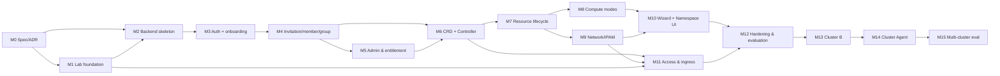
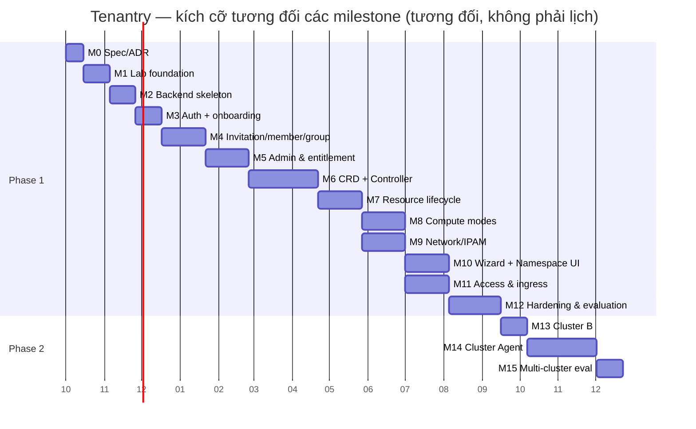

# Tenantry — Kế hoạch triển khai kỹ thuật (Implementation Plan)

> Phiên bản: 0.1 — bám theo `docs/PRODUCT-PLAN.md` v0.6 (single source of truth)
> Ngày: 2026-09-02
> Đối tượng: tác giả đồ án, dùng để quyết định bắt đầu code như thế nào. Mọi chỗ spec chưa nói được đánh dấu **(đề xuất)**; các chỗ còn lại dùng đúng tên/khái niệm của spec.

Tài liệu này trả lời bốn câu hỏi: code đặt ở đâu (mục 2), mỗi thành phần được cấu trúc bên trong thế nào (mục 3–6), làm theo thứ tự nào và khi nào coi là xong (mục 7–9), và cần chốt gì trước khi gõ dòng code đầu tiên (mục 10–12).

---

## 1. Nguyên tắc thực hiện

- **Vertical slice theo milestone**: mỗi milestone M0–M12 (spec §25) đi xuyên DB → API → worker/controller → UI cho một nhóm tính năng, thay vì làm xong toàn bộ backend rồi mới làm UI. Deliverable của milestone là thứ demo được, đúng như spec định nghĩa.
- **Luôn demo được**: nhánh `main` phải dựng lại được trên lab cluster bằng một lệnh (`make lab-up` + `make deploy`) tại mọi thời điểm; không merge thứ gì làm hỏng verification suite hiện có của lab.
- **Test là deliverable lõi, không phải phần phụ**: spec §26.2 nói rõ isolation test, resource reservation, group mapping và delete cleanup là "lõi chứng minh đồ án". Mỗi milestone có mục "Test bắt buộc" và milestone chưa xong nếu test đó chưa chạy xanh.
- **Một monorepo**: API, controller, web, Helm chart, lab script và tài liệu cùng một repo, cùng một tag; đơn giản cho một người làm và cho hội đồng xem code.
- **Contract-first ở hai ranh giới**: OpenAPI (`/api/v1`) giữa web và API; CRD `PlatformWorkspace` (`tenantry.io/v1alpha1`) giữa central plane và Cluster. Hai contract này thay đổi theo migration/versioning rõ ràng, không sửa ad hoc.
- **Đơn giản là mặc định**: modular monolith Go + hai worker loop trong cùng binary (hoặc cùng image, khác entrypoint), PostgreSQL làm cả session store và outbox, không Redis/Kafka/Temporal (spec §13.2).
- **Bám scope, cắt theo §26.2**: khi trễ, cắt iframe Headlamp, custom role builder, email thật, CLI riêng, chart nâng cao; không cắt isolation/reservation/group mapping/delete cleanup.
- **Ghi ADR khi quyết định**: 20 ADR ở spec §29 được viết dần trong `docs/adr/` khi milestone tương ứng chạm tới, không dồn cuối.

---

## 2. Cấu trúc repository đề xuất

```text
<repo root>
├── go.work                      # workspace gộp hai module Go: backend/ và operator/
├── Makefile                     # entry point duy nhất cho dev/test/deploy
├── backend/                     # central plane: mọi thứ chạm PostgreSQL (một module Go, modular monolith)
│   ├── cmd/
│   │   ├── tenantry-api/        # HTTP server /api/v1 + BFF/OIDC
│   │   ├── tenantry-worker/     # provisioning loop + group sync loop (--loops chọn loop nào chạy)
│   │   ├── tenantry-migrate/    # chạy migrations
│   │   └── tenantry-seed/       # seed dev: Cluster A, onboarding policy, shared pool, NetworkPool
│   ├── internal/
│   │   ├── app/                 # wiring/DI: build services từ config, không chứa business logic
│   │   ├── httpapi/             # handler generated từ OpenAPI + middleware (session, authz, idempotency, CSRF)
│   │   ├── auth/                # OIDC (Authorization Code + PKCE), session store PostgreSQL, upsert user theo (issuer, subject)
│   │   ├── org/                 # organizations, members, invitations, groups, ownership_transfers, entitlement
│   │   ├── workspace/           # workspaces, workspace_namespaces, bindings, state machine, operations
│   │   ├── reservation/         # cluster registry, cluster grants, shared pools, dedicated node grants, capacity math, reservation tx
│   │   ├── ipam/                # network_pools, network_allocations, CIDR math, quarantine
│   │   ├── outbox/              # outbox_events repo + provisioning worker loop
│   │   ├── keycloak/            # Keycloak Admin API client + group sync worker
│   │   ├── k8s/                 # client apply/watch PlatformWorkspace CR bằng scoped credential
│   │   ├── audit/               # audit_events
│   │   └── store/               # pgx pool, transaction helper, sqlc-generated queries (đề xuất)
│   ├── migrations/              # SQL migrations (goose, đề xuất)
│   └── openapi/                 # tenantry.v1.yaml + config sinh code Go/TS
├── operator/                    # Workspace Operator per Cluster (module Go riêng, kubebuilder layout)
│   ├── cmd/manager/
│   ├── api/v1alpha1/            # PlatformWorkspace types + deepcopy + CRD gen (backend/ import package này)
│   ├── internal/
│   │   ├── controller/          # PlatformWorkspaceReconciler + finalizer + status
│   │   ├── subreconciler/       # compute, network, tenant, namespaces, policy, rbac, ingresscert, proxyaccess
│   │   ├── render/              # pure functions: spec → object mong muốn (unit test được, không cần cluster)
│   │   └── observe/             # Namespace watch → status.namespaces, node/cert/IPPool observation
│   └── config/                  # CRD, RBAC, ClusterRole tenantry:tenant-developer/viewer, kustomize base
├── web/                         # React + TypeScript SPA (Vite)
│   ├── src/{app,features,components,api}/   # api/ = TS client generated từ OpenAPI
│   └── e2e/                     # Playwright
├── deploy/
│   ├── Dockerfile.backend       # một image, 4 binary; Deployment chọn binary bằng command
│   ├── Dockerfile.operator
│   ├── Dockerfile.web
│   ├── charts/tenantry-backend/ # Helm: api + 2 worker Deployment + migrate job
│   ├── charts/tenantry-operator/
│   ├── charts/tenantry-web/
│   ├── keycloak/                # realm export tenantry (3 client: portal, headlamp-{clusterId}, kubectl)
│   └── kustomize/lab/           # overlay lab: ingress host, CA, PostgreSQL, Keycloak, values
├── lab/                         # cluster, DNS, TLS, Capsule, PostgreSQL, Keycloak, OIDC — nền để chạy 3 thành phần trên
├── test/
│   ├── e2e/                     # Go test chạy trên lab cluster thật (persona §24.3, isolation §24.4, concurrency §24.5)
│   └── bench/                   # script benchmark §24.6 + baseline kind/vcluster
└── docs/                        # PRODUCT-PLAN.md, IMPLEMENTATION-PLAN.md, architecture/, adr/, report/
```

Một câu cho mỗi thư mục cấp một:

- `backend/`: toàn bộ central plane bằng Go — HTTP API, BFF, hai worker loop, migrations, seed; một module, nhiều package nội bộ tách theo domain. Tên là `backend/` chứ không phải `api/` vì chỉ một trong bốn binary là HTTP server.
- `operator/`: thứ chạy **trong** Cluster, chỉ biết CRD và các resource Kubernetes/Capsule/Calico, không biết PostgreSQL.
- `web/`: portal SPA gọi API qua session cookie, không giữ token.
- `deploy/`: mọi thứ để cài platform lên một Cluster đã có Capsule (Helm chart per component + realm Keycloak + overlay lab).
- `lab/`: script dựng nền (Capsule/Proxy/Keycloak/Headlamp/Calico/monitoring/verify) làm nền M1 và regression; dựng lại ở M1, tham chiếu bản đã chạy được ở nhánh `feat/tenantry-scaffold`.
- `test/`: test cần cluster thật hoặc nhiều tiến trình; unit/integration test nằm cạnh code.
- `docs/`: spec, kế hoạch, ADR, báo cáo test/benchmark cho luận văn.

### 2.1 Quy tắc ranh giới package Go (đề xuất)

```text
cmd/*            → internal/app                     (chỉ wiring)
internal/httpapi → internal/{auth,org,workspace,reservation,ipam,audit}  (gọi service, không gọi repo)
internal/<domain>/service.go → repo cùng domain + interface của domain khác (không import package domain khác trực tiếp nếu tránh được)
internal/<domain>/repo.go    → internal/store        (SQL của domain nằm trong domain đó)
internal/outbox, internal/keycloak, internal/k8s     → adapter; domain định nghĩa interface, adapter implement, app nối lại
internal/store   → không import bất kỳ domain nào
operator/api/v1alpha1 → được backend/internal/k8s import để build CR; ngược lại operator không import gì từ backend/
```

Kiểm tra bằng `go vet` + một test `depguard`/`go list -deps` đơn giản trong CI để phát hiện import ngược. Hai module Go riêng (`backend`, `operator`) để controller-runtime không kéo dependency vào backend và ngược lại; `go.work` cho dev local.

---

## 3. Kiến trúc code Platform API

### 3.1 Layering

```text
HTTP request
  → middleware: request-id, session cookie → user, CSRF, Idempotency-Key, rate limit
  → generated handler (oapi-codegen, đề xuất) → decode/validate theo OpenAPI
  → authz: RequireOrgRole(orgId, ≥OrgMember|OrgAdmin|OrgOwner) hoặc RequirePlatformAdmin()
  → service (business rule, transaction boundary, ghi audit + outbox)
  → repository (SQL thuần, sqlc đề xuất) → PostgreSQL
```

- Handler không chứa business rule; service không biết HTTP; repo không biết rule.
- Mọi route `/workspaces/{workspaceId}`, `/groups/{groupId}`, `/operations/{operationId}` resolve `org_id` từ row rồi mới check membership — không tin `orgId` client gửi (spec §10.1).
- Endpoint namespace/binding cần thêm rule "OrgOwner/OrgAdmin **hoặc** member của group giữ `TenantOwner` tại Workspace" (spec §4.5) — implement trong `workspace` service, không trong middleware.

### 3.2 Transaction boundary cho reservation (create/resize/delete Workspace)

Toàn bộ bước 9–10 của spec §17.1 nằm trong **một** transaction, thứ tự lock cố định để tránh deadlock:

```sql
BEGIN;
SELECT ... FROM organization_cluster_grants WHERE org_id=$1 AND cluster_id=$2 FOR UPDATE;   -- 1. grant
SELECT ... FROM shared_compute_pools       WHERE id=$3 FOR UPDATE;                          -- 2a. Shared (soft: Σ ≤ ratio × reservable)
SELECT ... FROM dedicated_node_grants      WHERE id=$3 FOR UPDATE;                          -- 2b. Dedicated (hard: Σ active + new ≤ reservable)
SELECT ... FROM network_pools              WHERE id=$4 FOR UPDATE;                          -- 3. pool; overlap check trên network_allocations của cùng cluster_id
-- tính toán trong Go trên snapshot đã lock; fail → ROLLBACK + error code
INSERT INTO workspaces (...);                                  -- state = Reserving → Provisioning
INSERT INTO workspace_node_reservations (...) -- state Pending → Active khi commit (Dedicated)
INSERT INTO network_allocations (...);        -- state Active
INSERT INTO operations (...);                 -- type workspace.create, state Pending
INSERT INTO outbox_events (operation_id, ordering_key='Workspace/<id>', target_cluster_id, type='workspace.apply', payload=CR spec JSON, version);
INSERT INTO audit_events (...);
COMMIT;
```

- Lớp bảo vệ thứ hai ở DB: exclusion constraint `EXCLUDE USING gist (cluster_id WITH =, cidr inet_ops WITH &&) WHERE (state <> 'Released')` trên `network_allocations`; partial unique index cho "đúng một OrgOwner"; unique `(cluster_id, node_name)` cho `dedicated_node_grants`. Row lock là cơ chế chính, constraint là lưới an toàn.
- Resize Dedicated lock cùng grant + node grant + cập nhật `workspace_node_reservations` cùng transaction (spec §17.2).
- Release capacity **chỉ** khi delete đã dọn xong trong Cluster (spec §17: reservation `Active` → `Releasing` → `Released`), do worker chuyển sau khi CR biến mất, không phải lúc API nhận DELETE.

### 3.3 Mô hình lỗi

- Một type `apperr.Error{Code, HTTPStatus, Message, Details map}`; service trả `Code` stable đúng danh sách spec §16.5 (`CLUSTER_GRANT_CPU_QUOTA_EXCEEDED`, `CLUSTER_NOT_GRANTED`, `CLUSTER_NOT_READY`, `COMPUTE_POOL_CAPACITY_EXCEEDED`, `DEDICATED_NODE_NOT_GRANTED`, `DEDICATED_NODE_INSUFFICIENT_CAPACITY`, `DEDICATED_NODE_NOT_READY`, `CIDR_OUTSIDE_ALLOWED_POOL`, `CIDR_OVERLAP`, `LAST_OWNER_BINDING`, `GROUP_SYNC_PENDING`, `WORKSPACE_NOT_READY`) cộng các code chung `VALIDATION_FAILED`, `FORBIDDEN`, `NOT_FOUND`, `CONFLICT`, `IDEMPOTENCY_KEY_REUSED` (đề xuất).
- Body lỗi theo một schema OpenAPI duy nhất `ErrorResponse{code, message, details, requestId}`; UI map `code` → message tiếng Việt/Anh và gợi ý remediation (spec FR-10).
- Danh sách code là enum trong OpenAPI để TS client có type.

### 3.4 Idempotency-Key

- Header `Idempotency-Key` bắt buộc cho `POST .../workspaces`, `POST .../namespaces`, `POST .../invitations`, `POST admin/*` (đề xuất: bắt buộc với mọi POST tạo resource).
- Bảng `idempotency_keys(key, user_id, method, path, request_hash, response_status, response_body, created_at)` **(đề xuất, spec chỉ nêu header)**; unique `(user_id, key)`; insert trong cùng transaction với side effect; TTL 24h dọn bằng job.
- Cùng key + cùng hash → trả lại response cũ; cùng key + hash khác → `IDEMPOTENCY_KEY_REUSED`.

### 3.5 Authz middleware

- Session cookie → `users` row + snapshot claims (realm roles) lưu trong `sessions` (PostgreSQL). Realm role `platform-admin` được đọc lại mỗi lần BFF refresh token, không cache quá TTL access token.
- `RequireOrgRole(min)`: load `organization_members` cho `(org_id, user_id)`; thứ tự `OrgMember < OrgAdmin < OrgOwner`. Endpoint transfer-ownership, delete Organization, đổi role Owner yêu cầu `OrgOwner`.
- `RequirePlatformAdmin()`: kiểm tra realm role trong session; áp cho `/api/v1/admin/*` và `operations/{id}:force`.
- Matrix role × endpoint được viết thành **bảng dữ liệu** trong test (`authz_matrix_test.go`) để cover threat case spec §20.3 (đổi `orgId`, OrgMember tự nâng role, user thường gọi admin, OrgAdmin gọi transfer-ownership...).

### 3.6 OpenAPI-first

- File nguồn `backend/openapi/tenantry.v1.yaml` viết tay theo spec §16; sinh server stub Go bằng **oapi-codegen** (std `net/http` router Go 1.22+, strict-server: handler nhận struct có kiểu; strict-server chỉ decode JSON, ràng buộc schema như `maxLength`/`additionalProperties` do middleware `oapi-codegen/nethttp-middleware` kiểm theo spec embed) và TS client bằng **openapi-typescript + openapi-fetch** (đề xuất, không runtime nặng).
- CI fail nếu `git diff` sau `make generate` khác rỗng.
- Contract test: request/response mẫu trong `openapi/examples/` validate bằng `kin-openapi` (spec §24.1 "OpenAPI request/response").

### 3.7 Các quy ước khác

- ID: ULID có tiền tố (`org-`, `ws-`, `grp-`, `op-`, `netalloc-`, `nodegrant-`...) lưu `text` (xem mục 12).
- Thời gian `timestamptz`, tài nguyên CPU/RAM lưu dạng `text` Kubernetes quantity và parse bằng `k8s.io/apimachinery/pkg/api/resource` để cộng trừ đúng.
- Audit ghi trong cùng transaction với mutation; log structured (`slog`), không log token/kubeconfig (spec §20.1).

---

## 4. Kiến trúc Workspace Controller

### 4.1 Một CRD, một reconciler, nhiều sub-reconciler

- CRD duy nhất `PlatformWorkspace` (`tenantry.io/v1alpha1`), schema đúng spec §14.2; `status.conditions` dùng `metav1.Condition`.
- `PlatformWorkspaceReconciler` chạy tuần tự các sub-reconciler, mỗi cái trả về một Condition và có thể yêu cầu requeue:

| Thứ tự | Sub-reconciler | Output Kubernetes | Condition sở hữu |
|---|---|---|---|
| 1 | `compute` | Dedicated: membership label `workspaces.tenantry.io/<ws-id>=true` trên `spec.compute.nodeName`; kiểm tra org label/taint `tenantry.io/dedicated-org` đã có (do node grant event); Shared: chỉ verify pool selector tồn tại | `ComputeReady` |
| 2 | `network` | Calico `IPPool` (CIDR, `assignmentMode: Manual`, `allowedUses: [Workload]`, nodeSelector theo mode) | `NetworkReady` |
| 3 | `tenant` | Capsule `Tenant` tên `<org>-<ws>`: owners (group `TenantOwner`), `namespaceOptions.quota` + `forceTenantPrefix` + annotation IPPool, `nodeSelector`, `ingressOptions` (allowedClasses, `allowedHostnames.allowedRegex`, `hostnameCollisionScope: Cluster`), `storageClasses.allowed`, container registry/service/QoS rules từ profile lab hiện tại | `CapsuleTenantReady` |
| 4 | `namespaces` | Tạo Namespace `<org>-<ws>-<name>` cho `spec.namespaces`, gắn label tenant; xóa `spec.namespacesToDelete`; ResourcePoolClaim per Namespace (theo mẫu `lab/manifests/solar-claims.yaml`) | (góp vào `CapsuleTenantReady`) |
| 5 | `policy` | Capsule `ResourcePool` (quota tổng), `TenantResource` replicate LimitRange + NetworkPolicy baseline (spec §7.4) + Pod Security label | `PolicyReady` |
| 6 | `rbac` | `Tenant.additionalRoleBindings` cho Developer/Viewer → `tenantry:tenant-developer`/`tenantry:tenant-viewer` (ClusterRole cài sẵn bởi chart controller) | `IdentityBindingsReady` |
| 7 | `ingresscert` | cert-manager `Certificate` wildcard `*.<org>-<ws>.apps.<cluster>.<domain>`, issuer ClusterIssuer lab CA; `TenantResource` replicate Secret TLS vào mọi Namespace | `IngressReady` **(đề xuất, spec chưa có condition riêng)** |
| 8 | `proxyaccess` | Capsule Proxy `ProxySetting` cho group Developer/Viewer (đề xuất) và verify Tenant được Proxy nhận diện | `ProxyAccessReady` |

`ClusterGrantValid`, `ClusterReady`, `ResourcesReserved`, `DedicatedNodeCapacityReserved` là condition **phía API/DB**, worker ghi vào `operations`; controller không biết grant.

`status.phase` suy ra: mọi condition True → `Ready`; bất kỳ False sau khi đã Ready → `Degraded`; đang xử lý → `Provisioning`/`Updating`; có finalizer đang chạy → `Deleting`. `observedGeneration` chỉ cập nhật sau khi vòng reconcile hoàn tất.

### 4.2 Kỹ thuật apply

- **Server-side apply** với field manager `tenantry-workspace-controller`, `ForceOwnership: true` để restore drift (spec §14.4 "manual sửa resource managed phải được controller restore").
- **Owner reference** từ PlatformWorkspace → Tenant, IPPool, Certificate, ResourcePool, TenantResource (cùng cluster-scoped hoặc namespaced trong system namespace của controller). Namespace do Capsule đặt ownerRef về Tenant.
- `render/` là pure function `Render(spec) → []client.Object`, unit test bằng golden file; sub-reconciler chỉ apply + đọc status.
- Managed labels theo spec §18 gắn lên mọi object render ra.

### 4.3 Finalizer và thứ tự xóa

Finalizer `tenantry.io/workspace` thực thi thứ tự spec §17.4 bước 4–9:

1. đặt Tenant cordoned (`spec.cordoned: true`) → chặn mutation;
2. xóa Namespace của Tenant (cả portal và kubectl) → đợi biến mất (PVC bị xóa theo Namespace); quá ngưỡng (đề xuất 10 phút) → condition `Deleting=False, reason=BlockedByFinalizer` kèm tên object; worker map thành operation `Blocked`;
3. đợi Calico: không còn `WorkloadEndpoint`/`IPAMBlock` thuộc IPPool → xóa IPPool;
4. Dedicated: đợi không còn Pod có label Workspace trên node → gỡ membership label `workspaces.tenantry.io/<ws-id>` (giữ org label/taint);
5. xóa Certificate/TenantResource/ResourcePool/Tenant (phần lớn qua ownerRef garbage collection, nhưng phải đợi bước 2–4 xong);
6. gỡ finalizer. Worker thấy CR mất → chuyển reservation `Released`, CIDR `Quarantined`, Workspace `Deleted`.

`:force` của Platform Admin = worker patch annotation `tenantry.io/force-delete=true`; controller bỏ qua chờ finalizer PVC ở bước 2 và ghi event (audit ở API).

### 4.4 Quan sát Namespace

- Watch `Namespace` với predicate label `capsule.clastix.io/tenant=<tenant>` (Capsule gắn) → map về PlatformWorkspace cùng tên → ghi `status.namespaces[{name, source}]`; `source=portal` nếu có trong `spec.namespaces`, ngược lại `kubectl`.
- Đồng thời watch Tenant, IPPool, Certificate, Node (chỉ node có label `tenantry.io/dedicated-org`) bằng `Owns()`/`Watches()` với handler map về CR.

### 4.5 Node grant

Grant/revoke dedicated node là event outbox `node.grant`/`node.revoke` (đề xuất) → worker apply label/taint `tenantry.io/dedicated-org=<org-id>` trực tiếp bằng scoped credential? **Không** — credential worker chỉ có quyền CRD. Vì vậy đề xuất một CRD phụ rất nhỏ `PlatformNodeGrant` (đề xuất) hoặc tái dùng annotation trên Node do controller xử lý. Đây là quyết định mở, xem mục 12.

---

## 5. Provisioning Worker và Group Sync Worker

### 5.1 Provisioning Worker (outbox → CR → status)

```text
loop mỗi 1s (đề xuất):
  BEGIN
  SELECT * FROM outbox_events
   WHERE processed_at IS NULL AND next_attempt_at <= now()
     AND NOT EXISTS (event cũ hơn, chưa giao, cùng ordering_key)
   ORDER BY id LIMIT 10 FOR UPDATE OF e SKIP LOCKED;
  với mỗi event:
     build CR từ payload (version) → server-side apply, field manager tenantry-provisioning-worker
     type workspace.delete → client.Delete CR
     OK   → processed_at = now()
     lỗi  → attempts++, next_attempt_at = now() + backoff(attempts), last_error
  COMMIT
```

- Cột thêm so với spec §15: `operation_id`, `next_attempt_at`, `last_error`, `ordering_key`.
- **Thứ tự theo resource**: `ordering_key = <resource_type>/<resource_id>` của operation (do `outbox.Enqueue` tự đặt). Event chỉ được lấy khi không còn event cũ hơn chưa giao cùng key, kể cả khi event đó đang backoff — nên `workspace.delete` không thể vượt `workspace.apply` đang lỗi của cùng Workspace; resource khác không bị chặn.
- Backoff exponential 1s → 5 phút, không giới hạn attempts với lỗi tạm thời; sau 10 lần lỗi liên tiếp, `operations.state = Failed` để UI hiện nút retry (`:retry` reset `attempts`, `next_attempt_at`).
- **At-least-once + idempotent**: apply CR là idempotent (SSA); payload mang `generation` mong muốn; apply lặp không tạo duplicate.
- **Status sync**: một informer trên `PlatformWorkspace` (credential có `get/list/watch/patch/update/delete` đúng resource này, không hơn — spec §14.3); mỗi status update → `workspaces.state`, `operations.state/progress/error_code` (từ conditions), `workspace_namespaces` (observed, upsert theo `status.namespaces`), `Degraded` khi condition False sau Ready; CR biến mất sau delete → release reservation/CIDR (mục 4.3).
- Resync định kỳ 5 phút (đề xuất) để phát hiện drift khi worker restart hoặc mất event.
- Chạy nhiều replica được nhờ `SKIP LOCKED`; MVP một replica là đủ.
- Health check Cluster tối thiểu (spec §6.1 MVP): worker ping `/version` Cluster mỗi 30s, cập nhật `clusters.last_health_check`; Admin đổi trạng thái bằng tay.

### 5.2 Group Sync Worker (DB → Keycloak)

- Nguồn: `groups.sync_status`, `group_members.sync_status` ∈ `Pending|Error`; mỗi mutation ở `org` service đặt `Pending` trong cùng transaction.
- Keycloak Admin API client (đề xuất thư viện `gocloak`, hoặc client tự viết vài endpoint: group by name, create group, add/remove user membership, logout user sessions). Service account client `tenantry-sync` với role `manage-users`, `query-groups` — credential trong Secret (spec §20.1).
- Vòng lặp: `FOR UPDATE SKIP LOCKED` trên hàng `Pending`; ensure group Keycloak theo `machine_name` (`org_<id>:group_<id>`), lưu `keycloak_group_id`; add/remove membership; cập nhật group platform `tenantry:tenant-users` theo rule "có ≥1 Workspace binding" (spec §9.3); revoke session user bị remove (`POST /admin/realms/{realm}/users/{id}/logout`); ghi `sync_status = Synced|Error` + `last_error`.
- Create Workspace bị chặn `GROUP_SYNC_PENDING` nếu group chọn chưa `Synced`.
- Mapper group claim cấu hình một lần trong realm export cho client `headlamp-{clusterId}` và `kubectl` (không cho `portal`).
- Metric: sync lag (thời gian từ `Pending` → `Synced`), error count (spec §21.2).

### 5.3 Deploy

Một binary `tenantry-worker`, hai vòng lặp, chọn bằng flag `--loops=provisioning|groupsync|all`. Deploy thành **hai** Deployment từ cùng image để tách credential:

| Deployment | `--loops` | ServiceAccount / Secret |
|---|---|---|
| `tenantry-worker-provisioning` | `provisioning` | SA `tenantry-worker`: Role trên `platformworkspaces` (+ `nodes get/list` từ M5). Không thấy credential Keycloak. |
| `tenantry-worker-groupsync` | `groupsync` | Chỉ mount Secret client `tenantry-sync` (`manage-users`, `query-groups`). Không có quyền nào trên Cluster. |

Hai loop không liên quan nghiệp vụ — chúng chỉ chung một hình dạng (poll PostgreSQL → gọi hệ thống ngoài → ghi trạng thái) nên dùng chung DB pool, backoff, metric, graceful shutdown. Gộp ở mức code, tách ở mức deploy: một tiến trình không cầm đồng thời quyền apply CR và quyền quản trị user Keycloak. `--loops=all` dành cho chạy local.

---

## 6. Frontend

- **Stack**: React 19 + TypeScript + Vite; state server bằng TanStack Query; router TanStack Router hoặc React Router (đề xuất React Router vì quen thuộc).
- **Component library**: **Mantine** (đề xuất) — TypeScript-first, có sẵn Stepper/Form/Notifications/Modal/Table đủ cho wizard 12 bước và admin CRUD, theming nhẹ, MIT; tránh phải tự thiết kế component (spec §13.2).
- **Auth**: không giữ token; `GET /api/v1/me` để biết user, org list, có `platform-admin` hay không. Login = redirect `/auth/login` của BFF; logout = `POST /auth/logout` (+ tùy chọn Keycloak end-session). CSRF token qua header `X-CSRF-Token` lấy từ cookie không HttpOnly (double submit).
- **Routes** mirror IA spec §19:

```text
/login
/orgs/:orgSlug                          Overview
/orgs/:orgSlug/workspaces               list
/orgs/:orgSlug/workspaces/new           wizard (12 bước, spec §19.1)
/orgs/:orgSlug/workspaces/:wsSlug       detail; tab: overview|resources|compute|network|members|namespaces|access|danger
/orgs/:orgSlug/members                  members + invitations
/orgs/:orgSlug/groups
/orgs/:orgSlug/settings                 display name, transfer ownership, leave/delete
/orgs/:orgSlug/clusters                 Granted Clusters: quota, shared pools, dedicated nodes, network pools
/orgs/:orgSlug/audit
/invitations/:token                     accept
/ownership-transfers/:token             accept
/admin/organizations | /admin/clusters | /admin/onboarding-policy | /admin/grants | /admin/operations | /admin/health
```

- Admin area chỉ render khi `me.platformAdmin === true`; backend vẫn check (spec §10.1).
- **Operation status**: `GET /api/v1/operations/{id}/events` SSE **(đề xuất; spec cho phép poll/SSE)**, fallback polling 2s; hiển thị timeline conditions theo tên condition thật.
- **Wizard**: mỗi bước gọi `POST .../workspaces:validate` với payload hiện tại để hiện lỗi sớm; bước Dedicated hiển thị node card (reservable/reserved/remaining, capacity state, disable + lý do); bước network mặc định Auto, Advanced mới lộ pool/prefix/CIDR kèm số địa chỉ khả dụng.
- **Empty/error states** spec §19.2 là checklist trong Playwright, không chỉ happy path.
- Test: Vitest + Testing Library cho component/logic; Playwright cho flow login → wizard → Ready trên lab.

---

## 7. Kế hoạch theo milestone M0–M12

Ước lượng tương đối: S < M < L < XL (XL ≈ 4× S). Thứ tự là thứ tự phụ thuộc (spec §25).

### M0 — Chốt spec/ADR

- **Mục tiêu**: đóng băng spec v0.6 và các quyết định mục 12; scaffold repo.
- **Công việc**:
  1. Chốt 10 quyết định ở mục 12 và ghi vào spec/ADR.
  2. Viết ADR 1, 2, 4, 5, 7, 8, 9, 10, 16, 17, 18 (những cái không cần code để quyết).
  3. Tạo monorepo theo mục 2, `go.work`, `Makefile`, CI (lint, test, generate-check).
  4. Viết `backend/openapi/tenantry.v1.yaml` bản đầu cho §16.1–16.2, error schema.
  5. Vẽ lại architecture diagram + threat model (spec §20.3) thành checklist test.
  6. Kiểm tra version Kubernetes của lab và pin controller-runtime/client-go tương ứng.
- **Đầu ra kiểm chứng**: repo build rỗng xanh CI; spec + ADR được review.
- **Test bắt buộc**: CI pipeline chạy `go vet`, `golangci-lint`, `npm run lint`.
- **Phụ thuộc**: không.
- **Rủi ro chính**: tốn quá nhiều thời gian viết tài liệu; giới hạn M0 ở "đủ để code M1–M3".
- **Ước lượng**: S.

### M1 — Lab foundation

- **Mục tiêu**: cluster nền reproducible cho toàn bộ đồ án; giữ verification suite hiện có.
- **Công việc**:
  1. Chuyển `scripts/ values/ manifests/ tests/` vào `lab/` (chỉ sửa path), `deploy.sh` vẫn chạy.
  2. Gắn label system pool `tenantry.io/compute-pool=system` (đề xuất) cho node chạy central plane; taint để tenant không schedule.
  3. Cài **NFS subdir provisioner** → StorageClass `standard` (default), reclaim `Delete`; tùy chọn local-path.
  4. Cài **ingress-nginx** class `platform-shared`, wildcard DNS `*.apps.cluster-a.tenantry.example` (dnsmasq/CoreDNS lab hoặc sslip.io).
  5. **cert-manager ClusterIssuer** từ `capsule-lab-root-ca` (đã có secret trong `identity-system`), cấp cert cho Keycloak/Headlamp/Proxy/Portal host.
  6. PostgreSQL (Bitnami/CloudNativePG đơn giản) + Keycloak dùng PVC `standard` thay storage tạm.
  7. Capsule Proxy expose HTTPS qua ingress-nginx (`kube-cluster-a.tenantry.example`), Headlamp `console-cluster-a...`.
  8. Đổi realm Keycloak thành `deploy/keycloak/realm-tenantry.json` với 3 client (`portal`, `headlamp-cluster-a`, `kubectl`), realm role `platform-admin`, giữ user demo; structured authentication config nhận 2 audience.
  9. Cập nhật `90-verify.sh` cho storage (PVC bound), ingress (curl HTTPS với CA lab), cert-manager.
  10. Ghi lại bước `60-enable-oidc.sh`/`PodNodeSelector` thành tài liệu vận hành.
- **Đầu ra kiểm chứng**: `make lab-up` từ cluster kubeadm sạch → verify pass; PVC bound; `https://demo.apps.cluster-a.tenantry.example` trả về qua ingress với cert từ CA lab.
- **Test bắt buộc**: `lab/scripts/90-verify.sh` (RBAC/node/CIDR/network/policy hiện có) + case mới storage/ingress/TLS.
- **Phụ thuộc**: M0.
- **Rủi ro chính**: NFS server cho lab; wildcard DNS trong môi trường demo offline.
- **Ước lượng**: M.

### M2 — Backend skeleton

- **Mục tiêu**: API chạy được với migrations, OpenAPI, error model, bảng user/org/membership, khung operation/outbox.
- **Công việc**:
  1. `store`: pgx pool, tx helper `WithTx(ctx, fn)`, sqlc config.
  2. Migrations 0001–0005: `users`, `organizations`, `organization_members`, `organization_entitlements`, `operations`, `outbox_events`, `audit_events`, `idempotency_keys`, `sessions`.
  3. oapi-codegen strict server; middleware request-id, recover, logging, `ErrorResponse`.
  4. `org` service: get/patch Organization, list members; repo + unit test.
  5. `outbox` repo + worker loop khung (chưa apply CR, chỉ log).
  6. `operations` service: create/get/retry state machine `Pending → Running → Succeeded|Failed|Blocked`.
  7. Healthz/readyz, config bằng env, Dockerfile multi-stage, chart `tenantry-backend` tối thiểu.
  8. Test harness: testcontainers-go PostgreSQL, fixture migrate.
- **Đầu ra kiểm chứng**: `GET /healthz`, `GET /api/v1/organizations/{id}` với auth giả (dev header) trả dữ liệu seed; chart cài lên lab.
- **Test bắt buộc**: integration test repo/outbox với PostgreSQL thật; contract test OpenAPI examples.
- **Phụ thuộc**: M0 (repo), M1 (PostgreSQL trên lab để deploy).
- **Rủi ro chính**: chọn sai tool codegen gây rework; thử oapi-codegen trên 3 endpoint trước khi viết hết.
- **Ước lượng**: M.

### M3 — Portal auth + onboarding

- **Mục tiêu**: user mới login xin được Organization, Platform Admin duyệt, Organization có grant dùng được.
- **Công việc**:
  1. `auth`: OIDC discovery, Authorization Code + PKCE với client `portal`, callback, session PostgreSQL, cookie HttpOnly/Secure/SameSite=Lax, CSRF double-submit, logout (+ Keycloak end-session tùy chọn).
  2. First login chỉ upsert `users` theo `(issuer, subject)`. `POST /organizations` tạo yêu cầu `Pending` + OrgOwner membership. `RequirePlatformAdmin` tối thiểu (kéo từ M5) + `POST /admin/organizations/{id}:approve|reject`: duyệt → `Active`, 3 group mặc định `admins/developers/viewers` (chưa sync Keycloak — M4), ClusterGrant từ onboarding policy (bảng `clusters`, `onboarding_policies`, `organization_cluster_grants` migration ở đây, seed Cluster A); từ chối → `Rejected` + `review_note`.
  3. `GET /me`, `GET /organizations`, `/entitlement`, `/usage` (usage = 0 lúc này).
  4. Web: Vite scaffold, Mantine, layout, login redirect, màn trống "xin tạo Organization" + trạng thái yêu cầu, org switcher, Overview skeleton hiển thị grant/quota, trang Admin duyệt yêu cầu.
  5. Rate limit endpoint auth.
  6. Realm export dev + `tenantry-seed`.
- **Đầu ra kiểm chứng**: đăng ký user mới trên Keycloak → portal hiện màn xin tạo Organization → Admin duyệt → user thấy Organization + quota mặc định; refresh trang vẫn login; logout xóa session.
- **Test bắt buộc**: first login idempotent (login hai lần không tạo hai user); yêu cầu `Pending` thứ hai của cùng user bị chặn; duyệt tạo đúng group + grant trong một transaction; từ chối nhả slug; integration OIDC với Keycloak container (testcontainers) hoặc mock issuer; Playwright login/logout.
- **Phụ thuộc**: M1 (Keycloak realm), M2.
- **Rủi ro chính**: cookie/redirect trên domain lab (`*.tenantry.example` + CA tự ký) — chốt host và HTTPS local sớm.
- **Ước lượng**: M.

### M4 — Invitation/member/group

- **Mục tiêu**: Alice mời Joe, tạo group, token Joe có group claim.
- **Công việc**:
  1. Migrations `invitations`, `groups`, `group_members`, `ownership_transfers`.
  2. Invitation: tạo token (hash + expiry + one-time), hiển thị link, accept chỉ khi email verified khớp (spec §9.1).
  3. Member: patch role, remove (chặn Owner), `members/me:leave` (chặn Owner), transfer ownership hai bước trong một transaction.
  4. Group CRUD, add/remove member, chặn delete khi còn binding (bảng `workspace_group_bindings` migration tạo trước, dùng ở M6).
  5. Group Sync Worker (mục 5.2) + group `tenantry:tenant-users`; `sync_status` hiển thị trên UI.
  6. Realm: group mapper cho `kubectl`/`headlamp-cluster-a`; Capsule config `userGroups` = `oidc:tenantry:tenant-users` thay `projectcapsule.dev` hard-code.
  7. Web: Members & invitations, Groups, Settings (transfer/leave), trang accept invite/transfer.
  8. Authz matrix test đầy đủ cho §16.1–16.2.
  9. Audit events cho mọi mutation trên.
- **Đầu ra kiểm chứng**: Alice tạo link mời → Joe register/login → accept → thấy Org; Alice tạo group `backend` add Joe → `kubectl oidc-login` của Joe (hoặc token từ Keycloak) có claim `groups: ["org_...:group_..."]`.
- **Test bắt buộc**: unit invitation expiry/one-time/email mismatch; integration Keycloak create group/add/remove/logout; authz matrix; concurrency accept invite hai lần.
- **Phụ thuộc**: M3.
- **Rủi ro chính**: Keycloak Admin API version/lag; viết client mỏng có retry và test với đúng Keycloak 26.x của lab.
- **Ước lượng**: L.

### M5 — Admin & entitlement

- **Mục tiêu**: Platform Admin cấp và điều chỉnh tài nguyên qua UI; capacity math có test.
- **Công việc**:
  1. Migrations `shared_compute_pools`, `cluster_grant_shared_pools`, `dedicated_node_grants`, `network_pools`.
  2. `RequirePlatformAdmin`; endpoint §16.5 admin: organizations (tạo thẳng Org + Owner + grant ban đầu; approve/reject đã có từ M3), entitlement, clusters (register/patch trạng thái `Registered/Ready/Maintenance/Unavailable`), onboarding-policy, cluster-grants PUT/DELETE (chặn giảm dưới allocation, chặn delete khi còn Workspace), dedicated-nodes, shared-pools, network-pools.
  3. `reservation` capacity math: `reservable/reserved/remaining`, capacity state, soft ratio Shared; snapshot allocatable của node/pool bằng scoped credential đọc Node (worker cần thêm quyền `get/list nodes` — đề xuất chấp nhận cho MVP).
  4. Grant dedicated node: kiểm tra Pod lạ trên node (spec §6.3) và từ chối kèm danh sách.
  5. Catalog endpoint §16.3 phía Org (filter theo grant, sanitize node).
  6. Web: khu Admin (Organizations, Cluster registry, Onboarding policy, Grants, Pools/Nodes/NetworkPools), trang Granted Clusters phía Org.
- **Đầu ra kiểm chứng**: Admin tạo Org `acme` + Owner + grant; cấp node `wk3` cho `acme`; Org thấy remaining capacity; user thường gọi `/admin/*` bị 403.
- **Test bắt buộc**: unit capacity math + transition `Overcommitted`; unit CIDR pool validation; integration grant reduce dưới allocation bị chặn; authz admin.
- **Phụ thuộc**: M4.
- **Rủi ro chính**: nhiều form CRUD admin ăn thời gian UI — dùng bảng/form generic của Mantine, không làm đẹp.
- **Ước lượng**: L.

### M6 — CRD + Controller

- **Mục tiêu**: outbox → CR → Capsule Tenant Ready; Namespace từ portal xuất hiện trong cluster.
- **Công việc**:
  1. kubebuilder scaffold `operator/`, types `PlatformWorkspace` theo §14.2, CRD gen, chart `tenantry-operator` (RBAC operator: tenants/resourcepools/ippools/certificates/namespaces/nodes...).
  2. ClusterRole `tenantry:tenant-developer`, `tenantry:tenant-viewer` (spec §10.5) trong chart, permission matrix `kubectl auth can-i` test.
  3. `render/` + sub-reconciler `tenant`, `namespaces`, `rbac`; conditions `CapsuleTenantReady`, `IdentityBindingsReady`; `status.namespaces` observation.
  4. Finalizer khung (xóa Namespace → Tenant), chưa network/node.
  5. `k8s` adapter trong API: build CR từ Workspace + apply/delete; ServiceAccount `tenantry-worker` với Role chỉ trên `platformworkspaces` (+ nodes get/list từ M5).
  6. Provisioning worker thật + status informer → DB (mục 5.1).
  7. `workspace` service tối thiểu: create (chưa reservation resource, chỉ grant/cluster/binding validation), list/detail, bindings PUT/DELETE (chặn `LAST_OWNER_BINDING`), namespaces POST/DELETE qua `spec.namespaces`/`namespacesToDelete`.
  8. Migrations `workspaces`, `workspace_namespaces`, `workspace_group_bindings` (nếu chưa).
  9. envtest cho reconciler; golden test cho render.
- **Đầu ra kiểm chứng**: `POST .../workspaces` qua curl → Operation Running → Tenant `acme-solar` xuất hiện với owners đúng → `POST .../namespaces {frontend}` → Namespace `acme-solar-frontend` tạo; `kubectl create ns acme-solar-scratch` bằng token owner → hiện trên `GET .../namespaces` với `source=kubectl`.
- **Test bắt buộc**: envtest reconcile idempotent (apply hai lần không đổi); worker restart giữa apply → không duplicate; unit state machine Workspace; permission matrix Developer/Viewer.
- **Phụ thuộc**: M4 (group sync để có subject), M5 (grant/cluster).
- **Rủi ro chính**: độ phức tạp controller + Capsule schema 0.13.x; giữ mỗi sub-reconciler dưới ~200 dòng, render tách khỏi apply.
- **Ước lượng**: XL.

### M7 — Resource lifecycle

- **Mục tiêu**: dynamic Workspace resource enforcement; state machine đầy đủ create/update/cordon/delete.
- **Công việc**:
  1. Transaction reservation mục 3.2 cho ClusterGrant (chưa node/CIDR); error code quota.
  2. Sub-reconciler `policy`: ResourcePool + ResourcePoolClaim per Namespace, LimitRange, object-count quota, Pod Security label; `PolicyReady`.
  3. Update: PATCH resources (chặn giảm dưới usage — đọc ResourcePool status qua CR status), namespaceQuota, display name; `Ready → Updating → Ready`.
  4. Cordon/uncordon (`Tenant.spec.cordoned`).
  5. Delete workflow đầy đủ phía API + finalizer (mục 4.3) trừ network/node; confirm gõ tên; `Blocked` + `:force` admin; tombstone `k8s_name`.
  6. Drift: resync định kỳ, `Degraded` khi condition False; restore khi tenant sửa object managed.
  7. `GET /workspaces/{id}/usage` từ ResourcePool/ResourceQuota status trong CR status (đề xuất thêm `status.usage`).
  8. Web: Workspace detail tab Overview/Resources/Danger zone, operation timeline (SSE).
- **Đầu ra kiểm chứng**: tạo Workspace 4 CPU/8 GiB → Pod vượt quota bị từ chối với message; tăng quota → chạy được; xóa Workspace có PVC → Namespace/PVC mất, reservation `Released`.
- **Test bắt buộc**: unit quota math; integration reservation tx với PostgreSQL thật; concurrency hai create sát quota (chỉ một pass); e2e delete cleanup (không còn Tenant/Namespace/PVC/ResourcePool).
- **Phụ thuộc**: M6.
- **Rủi ro chính**: ResourcePool/Claim semantics của Capsule 0.13 khác kỳ vọng — kiểm chứng sớm trên lab (`lab/manifests/solar-claims.yaml`).
- **Ước lượng**: L.

### M8 — Compute modes

- **Mục tiêu**: nhiều Dedicated Workspace chung node không overbook; placement enforced.
- **Công việc**:
  1. Migration `workspace_node_reservations`; lock `dedicated_node_grants` trong transaction (mục 3.2); Dedicated bắt `requests = limits`, đúng một node.
  2. Shared: validate pool thuộc grant, soft ratio; render Tenant `nodeSelector` pool.
  3. Node grant → label/taint `tenantry.io/dedicated-org` (cơ chế chốt ở mục 12); sub-reconciler `compute` gắn/gỡ membership label; `ComputeReady`.
  4. Admission guard: PodNodeSelector (lab hiện có) + Capsule rule chặn `nodeName`/toleration/selector lạ; test bắt buộc khi plugin tắt (spec §6.4).
  5. Capacity state, `Overcommitted` drift → `Degraded`, chặn reservation mới.
  6. Catalog `dedicated-nodes` trả reservable/reserved/remaining và Workspace đang giữ; UI node card.
  7. Web: bước compute của wizard (tạm dùng form đơn giản, wizard hoàn chỉnh ở M10), tab Compute.
- **Đầu ra kiểm chứng**: node 8 CPU reservable: Water 4 + Green 2 tạo OK, Workspace 3 CPU bị `DEDICATED_NODE_INSUFFICIENT_CAPACITY`; Pod Water/Green chỉ trên node đó; Pod đặt `nodeName` khác bị deny.
- **Test bắt buộc**: unit reservable/reserved/remaining; concurrency hai goroutine reserve phần cuối (đúng một thắng); isolation node placement; delete Water release 4 CPU, Green vẫn chạy.
- **Phụ thuộc**: M7.
- **Rủi ro chính**: phụ thuộc admission `PodNodeSelector` của kubeadm; system reserve tính sai làm Pod Pending.
- **Ước lượng**: L.

### M9 — Network/IPAM

- **Mục tiêu**: Workspace nhận CIDR tự động; cross-Workspace traffic bị chặn; delete quarantine.
- **Công việc**:
  1. Migration `network_allocations` + exclusion constraint; `ipam` service: auto-allocate theo `defaultPrefixLength`, advanced prefix/requested CIDR, containment/overlap với Pod/Service CIDR Cluster; state `Available/Active/Quarantined/Released`.
  2. Lock `network_pools` trong transaction reservation; error `CIDR_OUTSIDE_ALLOWED_POOL`, `CIDR_OVERLAP`.
  3. Sub-reconciler `network`: Calico IPPool + Namespace annotation qua Tenant `namespaceOptions.additionalMetadata`; Capsule cấm sửa annotation (đã có trong lab); `NetworkReady`.
  4. Baseline NetworkPolicy qua `TenantResource` (spec §7.4) gồm allow từ ingress-nginx namespace, deny metadata endpoint.
  5. Finalizer: đợi WorkloadEndpoint/IPAMBlock sạch → xóa IPPool; worker quarantine (đề xuất 10 phút) → `Available`.
  6. `GET /network-pools/{id}/availability`; UI Network tab + Advanced trong wizard.
- **Đầu ra kiểm chứng**: Solar và Water nhận /24 khác nhau từ pool `10.240.0.0/16`; Pod IP đúng CIDR; Solar không ping/curl Water; cùng Workspace khác Namespace gọi được; xóa Workspace → CIDR `Quarantined` rồi `Available`.
- **Test bắt buộc**: unit CIDR math (containment/overlap/next-free); concurrency hai request cùng CIDR; isolation network suite; e2e IPPool lifecycle.
- **Phụ thuộc**: M7 (delete flow), độc lập với M8 (có thể làm song song).
- **Rủi ro chính**: Calico IPAM release chậm làm delete kéo dài; đo thời gian thật trên lab và đặt timeout hợp lý.
- **Ước lượng**: L.

### M10 — Wizard + Namespace UI

- **Mục tiêu**: OrgOwner tự phục vụ hoàn toàn trên portal.
- **Công việc**:
  1. Wizard 12 bước spec §19.1 với `:validate` từng bước, giải thích inline (Cluster immutable, Shared vs Dedicated, Guaranteed QoS...).
  2. Capacity preview: remaining grant, pool usage, node card, network availability + số địa chỉ.
  3. Group-role selector (Owner bắt buộc ≥1; chặn group `sync_status != Synced`).
  4. Review + submit với Idempotency-Key; live operation status.
  5. Workspace detail hoàn chỉnh: Overview/conditions/operations, Resources, Compute, Network, Members & bindings, Namespaces (list/create/delete + usage per Namespace, confirm khi có PVC), Danger zone.
  6. Empty/error states spec §19.2 (hết quota, Cluster Maintenance, không node đủ capacity, group chưa sync, pool hết CIDR, delete Blocked).
  7. Audit page phía Org.
  8. i18n tối thiểu (vi/en) cho message lỗi từ `code`.
- **Đầu ra kiểm chứng**: Alice làm toàn bộ Phần 2–3 của demo (spec §28) không dùng curl/YAML.
- **Test bắt buộc**: Vitest cho wizard state; Playwright: wizard Shared → Ready, wizard Dedicated bị chặn khi thiếu capacity, mỗi state §19.2 có screenshot.
- **Phụ thuộc**: M8, M9.
- **Rủi ro chính**: scope creep UI; giữ Mantine default, không custom design.
- **Ước lượng**: L.

### M11 — Access & ingress

- **Mục tiêu**: user thao tác data plane bằng kubectl/web; app truy cập được qua HTTPS trong vùng hostname của Workspace.
- **Công việc**:
  1. `GET /workspaces/{id}/kubeconfig`: server = proxy endpoint từ `clusters`, CA lab, exec `kubectl oidc-login` client `kubectl` (spec §11.2); audit download.
  2. `GET /workspaces/{id}/console-link` → Headlamp URL của Cluster; disable khi Cluster `Unavailable`.
  3. Capsule Proxy public TLS + Headlamp cert từ ClusterIssuer; kiểm tra JWT header size khi user nhiều group.
  4. Sub-reconciler `ingresscert`: Certificate wildcard per Workspace + TenantResource replicate Secret; `IngressReady`.
  5. Tenant `ingressOptions`: allowedClasses từ grant, `allowedHostnames.allowedRegex` vùng `<org>-<ws>`, `hostnameCollisionScope: Cluster`.
  6. Sub-reconciler `proxyaccess` (ProxySetting cho Developer/Viewer) ; `ProxyAccessReady`.
  7. Demo app chart nhỏ (Deployment + PVC `standard` + Ingress + TLS secret replicate) để Joe deploy.
  8. Logout/revoke test: remove Joe → session logout → token mới không có group; token cũ còn tới TTL (ghi contract vào UI).
  9. Web: Access tab (download kubeconfig, hướng dẫn cài kubelogin, Open Web Console).
- **Đầu ra kiểm chứng**: Joe tải kubeconfig → `kubectl get ns` qua Proxy chỉ thấy Namespace Solar → deploy app → `https://web.acme-solar.apps.cluster-a.tenantry.example` mở được với CA lab; Ingress host ngoài vùng bị Capsule từ chối; Bob Viewer không sửa được; Alice mở Headlamp qua SSO không nhập lại password.
- **Test bắt buộc**: e2e kubeconfig + Proxy filter (Namespace/Node/PV); ingress hostname collision negative test; PVC ngoài StorageClass allow-list bị chặn; revoke contract test đo thời gian.
- **Phụ thuộc**: M6 (rbac), M9 (policy allow ingress), M1 (ingress/cert-manager).
- **Rủi ro chính**: TLS chain trong browser/kubectl với CA tự ký; kubelogin cache token cũ khi test revoke (dùng `--oidc-... --force-refresh`/xóa cache).
- **Ước lượng**: L.

### M12 — Hardening & evaluation

- **Mục tiêu**: test report, benchmark, known limitations cho luận văn.
- **Công việc**:
  1. Metrics Prometheus cho API/worker/controller (spec §21.2) + dashboard Grafana Tenantry (queue lag, provision duration, reconcile duration, sync lag, IP exhaustion).
  2. Persona E2E spec §24.3 tự động trong `test/e2e` (Go) chạy trên lab.
  3. Isolation suite §24.4 đầy đủ, mỗi threat case §20.3 map tới một test.
  4. Concurrency/failure §24.5: kill worker giữa apply, restart controller giữa provisioning, Keycloak/kube-apiserver tạm lỗi, PVC finalizer.
  5. Benchmark §24.6: 10/20/50 Workspace, baseline kind/vcluster (mục 9.6).
  6. Secret/config cleanup: không credential trong repo, chart values có `existingSecret`, rate limit, header bảo mật.
  7. Known limitations + ADR còn thiếu (3, 6, 11–15, 19, 20).
  8. Rehearsal demo §28 theo script thời gian.
- **Đầu ra kiểm chứng**: `make test-e2e` xanh trên lab; báo cáo benchmark có bảng/biểu đồ; DoD Phase 1 (spec §27, 15 mục) tick hết.
- **Test bắt buộc**: tất cả suite; report lưu `docs/report/`.
- **Phụ thuộc**: M10, M11.
- **Rủi ro chính**: benchmark 50 Workspace vượt capacity lab — dùng Workspace nhỏ, đo control-plane thay vì workload.
- **Ước lượng**: L.

### Phase 2 (tóm tắt)

- **M13 — Cluster thứ hai**: đăng ký Cluster B, Headlamp + client `headlamp-cluster-b`, supernet `10.241.0.0/16`, wizard chọn Cluster thật; test Workspace tạo được ở cả hai. Ước lượng M.
- **M14 — Cluster Agent**: binary `tenantry-agent` outbound mTLS, endpoint `/internal/v1/clusters/{id}:heartbeat|assignments|workspace-status`, bảng `cluster_agents`, thay worker apply trực tiếp; central không giữ credential; tách central plane ra ngoài Cluster A. Ước lượng XL.
- **M15 — Multi-cluster evaluation**: benchmark chia hai Cluster; demo Cluster A `Unavailable` không ảnh hưởng portal/Cluster B. Ước lượng M.

---

## 8. Sơ đồ phụ thuộc milestone



Gantt dưới đây chỉ là **kích cỡ tương đối** (1 "tuần" = một đơn vị S; ngày bắt đầu là placeholder), không phải lịch cứng. M8 và M9 có thể chạy song song; M11 có thể bắt đầu ngay sau M9 trong khi M10 làm UI.



---

## 9. Chiến lược test theo lớp

### 9.1 Unit (chạy mọi commit, < 1 phút)

| Vùng | Nội dung | Vị trí |
|---|---|---|
| Quota math | cộng/trừ Kubernetes quantity, Σ allocation ≤ grant, không giảm dưới usage | `backend/internal/reservation` |
| Capacity math | `reservable/reserved/remaining`, capacity state, soft ratio Shared, `Overcommitted` drift, `requests = limits` Dedicated | `backend/internal/reservation` |
| CIDR | containment, overlap, next-free block theo prefix, quarantine transition | `backend/internal/ipam` |
| Authz matrix | bảng role × endpoint × kỳ vọng (200/403/404), bao gồm realm role admin | `backend/internal/httpapi` |
| State machine | Workspace, Operation, Reservation, NetworkAllocation transitions hợp lệ/không hợp lệ | `backend/internal/workspace` |
| Render | spec → Tenant/IPPool/Certificate/NetworkPolicy golden files | `operator/internal/render` |
| Keycloak mapping | machine name, group claim → subject `oidc:` | `backend/internal/keycloak` |
| OpenAPI contract | examples validate theo schema | `backend/openapi` |
| Frontend | wizard reducer, error code map, form validation | `web/src` (Vitest) |

### 9.2 Integration (chạy trên PR, vài phút)

- **PostgreSQL** qua testcontainers-go (đề xuất; fallback `docker-compose.test.yml`): reservation transaction, exclusion constraint CIDR, outbox `FOR UPDATE SKIP LOCKED`, idempotency key, session store.
- **envtest** cho controller: reconcile tạo đúng object, idempotent, finalizer thứ tự, status.namespaces từ Namespace fake; không cần Capsule thật (CRD Capsule/Calico/cert-manager load vào envtest từ `operator/config/crd/external/`).
- **Keycloak container** (image 26.x cùng lab): tạo group, add/remove member, logout session, token có group claim.
- **Worker apply CR** với envtest apiserver + scoped RBAC: xác nhận credential không làm được gì ngoài `platformworkspaces`.

### 9.3 E2E trên lab cluster thật (`test/e2e`, Go test, tag `e2e`)

- Persona scenario spec §24.3 chạy tuần tự (Admin → Alice → Joe/Bob → Dedicated → revoke → delete) bằng API client sinh từ OpenAPI + `kubectl` qua kubeconfig Workspace + `client-go` admin để assert trạng thái cluster.
- Isolation suite §24.4 dưới dạng table-driven test: mỗi hàng là một threat case §20.3 với kết quả kỳ vọng (deny + error code hoặc Kubernetes Forbidden).
- Playwright cho luồng UI chính và các state §19.2.
- Giữ `lab/scripts/90-verify.sh` chạy trước e2e như smoke test.

### 9.4 Concurrency (integration + e2e)

- Hai goroutine gọi `POST workspaces` sát quota grant / cùng node grant phần capacity cuối / cùng requested CIDR → đúng một thành công, DB invariant còn đúng (`SELECT` kiểm tra Σ).
- Chạy lặp 50 lần với `-race`.
- Failure injection: kill worker pod giữa batch, scale controller về 0 giữa provisioning rồi lên 1, chặn Keycloak bằng NetworkPolicy tạm, xem retry không duplicate.

### 9.5 Benchmark (spec §24.6)

- Script `test/bench` tạo N ∈ {10, 20, 50} Workspace Shared nhỏ qua API với tốc độ cố định, ghi `submit → Ready` từ `operations` timestamps (p50/p95), `controller_runtime_reconcile_time_seconds`, `apiserver_request_duration_seconds` trước/sau, CPU/RAM các namespace platform từ Prometheus.
- Group change → token mới có hiệu lực: đo từ `PUT groups/{id}/members` tới token refresh có claim.
- **Baseline**: thời gian và RAM/CPU idle để tạo một môi trường tương đương bằng `kind create cluster` và một vcluster instance trên cùng máy; bảng so sánh per-environment cost + time-to-ready. Xuất bảng/biểu đồ vào `docs/report/`.

---

## 10. Môi trường dev

- **Chạy local trỏ vào lab cluster**: `tenantry-api` và `tenantry-worker` chạy trên máy dev với `KUBECONFIG` admin của lab (dev only), PostgreSQL và Keycloak dùng của lab qua `kubectl port-forward` hoặc `docker compose up postgres keycloak` local; operator chạy `make run-operator` (controller-runtime ngoài cluster). Web chạy Vite dev server proxy `/api` và `/auth` về API local.
- **Host name dev**: thêm `portal.tenantry.example` → 127.0.0.1 vào `/etc/hosts`, cert dev cấp từ `capsule-lab-ca.crt` (mkcert-style) để cookie `Secure` hoạt động.
- **`make` targets (đề xuất)**:

```text
make lab-up / lab-verify        # chạy lab/scripts/deploy.sh và 90-verify.sh
make generate                   # oapi-codegen, sqlc, openapi-typescript, controller-gen
make migrate-up / migrate-new NAME=...
make seed                       # Cluster A, onboarding policy, shared-general, onboarding-pod-network, admin role
make run-api / run-worker / run-operator / run-web
make test / test-integration / test-e2e / bench
make deploy                     # helm upgrade --install 3 chart lên lab với deploy/kustomize/lab values
make realm-export / realm-import
```

- **Migrations**: **goose** (đề xuất) — SQL thuần, embed vào binary `tenantry-migrate`, chạy như Helm hook job trước API. golang-migrate là lựa chọn tương đương; chọn goose vì hỗ trợ migration Go khi cần backfill.
- **Keycloak realm**: `deploy/keycloak/realm-tenantry.json` là nguồn; import lúc Keycloak khởi động (như `lab/manifests/keycloak.yaml` hiện làm); `make realm-export` kéo thay đổi từ UI về file để commit. Realm dev chứa user `alice/joe/bob/mallory` + `admin` có realm role `platform-admin`.
- **Seed**: `tenantry-seed` idempotent: insert `clusters` (cluster-a, endpoints proxy/console/ingress domain), `onboarding_policies` theo mẫu spec §5.2.1, `shared_compute_pools` (`shared-general`, nodeSelector `tenantry.io/compute-pool=shared-general`, ratio 3.0), `network_pools` (`onboarding-pod-network` 10.240.0.0/16 org null), Organization demo `acme` + grant nếu flag `--demo`.
- **Pre-commit**: gofmt/golangci-lint, eslint/prettier, `make generate` diff check.

---

## 11. Risk register

| # | Rủi ro | Tác động | Giảm thiểu | Nổi lên ở |
|---|---|---|---|---|
| 1 | Capsule 0.13.x schema/hành vi (ResourcePool/Claim, `forceTenantPrefix`, `allowedHostnames`) khác giả định | Render sai, rework controller | Pin version trong chart; spike trên lab trước M6; golden test theo version | M6–M7 |
| 2 | Controller phức tạp vượt sức một người | Trễ M6 kéo mọi thứ sau | Render tách apply; sub-reconciler nhỏ; envtest; làm tenant/namespaces/rbac trước, network/compute sau | M6 |
| 3 | Keycloak Admin API lag/rate limit, group claim chỉ có ở token mới | Create Workspace bị `GROUP_SYNC_PENDING`, demo revoke gây hiểu nhầm | Sync worker retry + hiển thị `sync_status`; TTL token 5 phút; ghi contract revoke rõ trên UI | M4, M11 |
| 4 | Phụ thuộc admission `PodNodeSelector` của kubeadm | Placement không enforce nếu plugin tắt | Test bắt buộc kiểm tra plugin bật; Capsule rule chặn nodeName/toleration làm lớp hai | M8 |
| 5 | Calico IPAM release chậm khi delete | Delete kéo dài, CIDR bị giữ | Timeout + `Blocked` rõ ràng; quarantine; đo thời gian thật | M9 |
| 6 | JWT header quá lớn khi user nhiều group (Proxy/ingress-nginx/Headlamp) | 431/WebSocket lỗi | Giới hạn group theo entitlement `maxGroups`; tăng `large-client-header-buffers`; test ở M11 | M11 |
| 7 | Scope creep UI (đẹp, chart, iframe) | Trễ M10 | Mantine mặc định; cắt theo §26.2; wizard trước, dashboard sau | M10 |
| 8 | Race/overbook không bắt được trong test | Sai luận điểm reservation | Test concurrency với `-race` lặp; exclusion constraint + partial unique index như lưới an toàn | M7–M9 |
| 9 | TLS/CA tự ký trong browser, kubectl, Headlamp, Proxy | Demo trục trặc, cookie Secure không set | Một ClusterIssuer từ lab CA ở M1; import CA vào máy demo; script kiểm tra chain | M1, M3, M11 |
| 10 | Lab cluster nhỏ không đủ cho benchmark 50 Workspace | Không có số liệu | Workspace benchmark không chạy workload; đo control plane; ghi rõ giới hạn | M12 |
| 11 | Worker credential cần thêm quyền (Node read, node label) phá nguyên tắc "chỉ CRD" | Mâu thuẫn spec §20.2 | Chốt ở mục 12 (#9); nếu cần, chuyển label node vào controller qua CRD phụ | M5, M8 |
| 12 | Drift giữa OpenAPI, DB và CR khi sửa spec | Bug tích hợp | Generate-check trong CI; một PR đổi contract phải đổi cả ba nơi | mọi M |

---

## 12. Quyết định kỹ thuật mở cần chốt trước khi code

| # | Câu hỏi | Mặc định đề xuất |
|---|---|---|
| 1 | Tỷ lệ requests/limits cho Shared | Per pool `maxLimitToRequestRatio` (đề xuất), mặc định 2.0; Dedicated cố định 1.0 (spec) |
| 2 | Token TTL | Keycloak access token client `kubectl`/`headlamp-*`: 5 phút; SSO session idle 30 phút, max 10h; portal session cookie idle 8h, absolute 24h; BFF refresh token phía server |
| 3 | Định dạng ID | ULID (lowercase Crockford) có tiền tố kebab lưu `text`: `org-01j…`, `ws-01j…`, `grp-`, `op-`, `netalloc-`, `nodegrant-`; Keycloak machine name theo spec §4.3 `org_<ulid>:group_<ulid>` |
| 4 | Quy tắc slug | `^[a-z][a-z0-9]*(-[a-z0-9]+)*$`; Organization slug 3–20 ký tự, Workspace slug 2–20, Namespace suffix 1–20 → `<org>-<ws>-<ns>` ≤ 62 ≤ 63 (DNS label); cấm từ khóa `kube`, `default`, `system`, `capsule`, `tenantry`, `admin`; tombstone `k8s_name` chặn tái dùng trong quarantine |
| 5 | Pagination | Cursor keyset trên ULID: `?limit=50&cursor=…` (max 200), response `{items, nextCursor}`; sort mặc định `created_at desc` |
| 6 | Codegen/ORM | oapi-codegen (strict server, std net/http) + sqlc + pgx v5; TS: openapi-typescript + openapi-fetch |
| 7 | Push trạng thái operation | SSE `GET /operations/{id}/events`, fallback polling 2s; không WebSocket |
| 8 | Outbox tuning | poll 1s, batch 10, backoff 1s→5m, 10 lỗi liên tiếp → Operation `Failed`; resync CR status 5 phút; CIDR quarantine 10 phút |
| 9 | Cách gắn label/taint dedicated node và đọc allocatable | (a) worker được thêm quyền `nodes get/list/patch` — đơn giản nhưng nới spec §20.2; **(b) đề xuất**: CRD phụ `PlatformNodeGrant` (`tenantry.io/v1alpha1`) do controller reconcile label/taint và báo allocatable về status; worker vẫn chỉ đụng CRD `tenantry.io` |
| 10 | Deploy artefact | 3 Helm chart riêng (`tenantry-backend`, `tenantry-operator`, `tenantry-web`) + overlay kustomize lab; 3 image: một cho cả 4 binary của `backend/` (Deployment chọn binary bằng `command`), một cho operator, một cho web (nginx static) |

Sau khi chốt 10 mục này (ghi vào spec §31 hoặc ADR), bắt đầu M0 → M1 → M2 theo mục 7.
