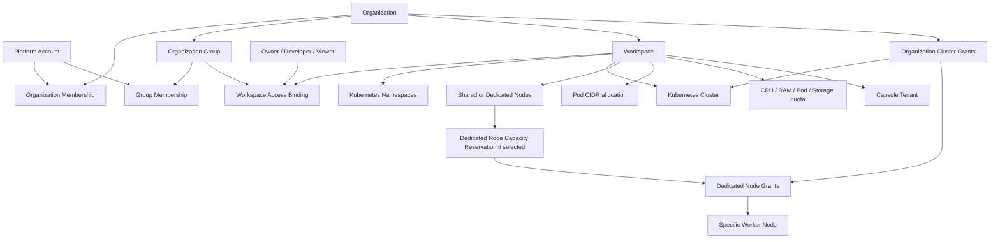
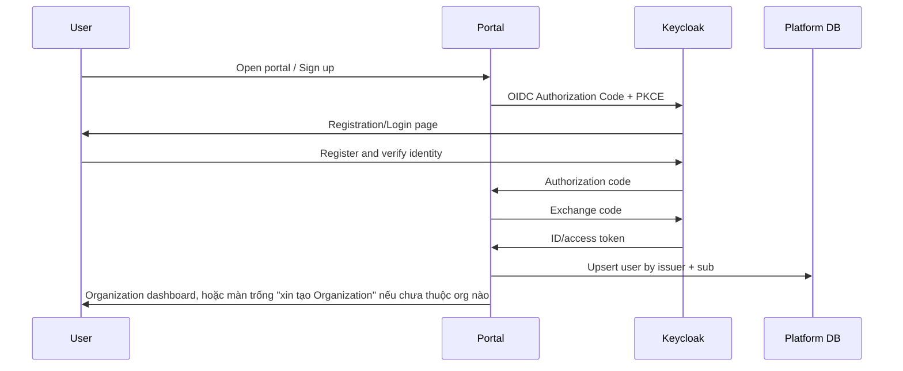
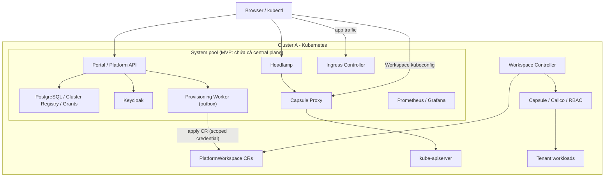

# Tenantry — Kế hoạch đồ án Kubernetes Tenant as a Service

> Phiên bản: 0.8 — phiên portal gắn với Keycloak, tombstone cho group sync, gom tài liệu về một nơi định nghĩa mỗi chủ đề
> Ngày: 2026-11-20
> File này định nghĩa **nghiệp vụ**: phạm vi, khái niệm, quy tắc, danh sách endpoint, FR/NFR, roadmap. Schema, state machine, phiên/token và kế hoạch code nằm ở file khác — bản đồ ở [`README.md`](README.md).
> Tên sản phẩm: **Tenantry** (API group `tenantry.io`, label prefix `tenantry.io/`, domain `tenantry.site`)
> Mục tiêu: xây một platform self-service cấp Kubernetes Tenant nhanh, rẻ trên cluster có sẵn, với Capsule là tenancy engine.

## 0. Changelog

### v0.7 → v0.8

1. **Phiên portal gắn với SSO session của Keycloak.** Phiên sống đúng bằng refresh token; một bộ thời hạn duy nhất đặt ở realm (access token 5 phút, SSO idle 8 giờ, SSO max 24 giờ) thay cho hai bộ số mâu thuẫn trước đây. Logout portal kết thúc luôn SSO session.
2. **Gỡ group/membership dùng tombstone.** Row bị đánh dấu xóa và chỉ biến mất sau khi Keycloak đã gỡ xong; trước đây row bị xóa ngay nên worker không còn gì để biết phải đồng bộ.
3. **Hệ quả của thu hồi quyền được ghi rõ**: logout trên Keycloak đăng xuất user ở mọi nơi; chỉ thực hiện khi group bị gỡ đang có binding Workspace.
4. **`Idempotency-Key`** lưu ở bảng riêng theo `(user, key)`, giành ở đầu transaction và commit cùng thay đổi.
5. **Không dùng Redis**, ghi thành quyết định có lý do (13.2, ADR 21).
6. **Central plane không đọc Node**: việc kiểm node sạch, gắn label/taint và đọc capacity đi qua các CRD phụ `PlatformNodeGrant`, `PlatformSharedPool` (và `PlatformNodeInventory`, xem điểm 17); cấp dedicated node trở thành một Operation.
7. **Storage dùng `csi-driver-nfs`** thay cho NFS subdir provisioner (đã ngừng phát hành từ 2023); vẫn là NFS, StorageClass `standard` không đổi. Lý do ở `architecture/05-network-and-scheduling.md` mục 9.
8. **Route thay cho Ingress do tenant tự viết.** Platform sở hữu toàn bộ đường vào HTTP: user tạo Route trên portal (Namespace, tên, Service, cổng), operator dựng Ingress; tenant bị chặn ghi Ingress. Hostname phẳng `<tên>-<org>-<ws>.mvp.tenantry.site`, một wildcard cert chung do platform giữ thay cho cert từng Workspace. Bỏ `allowedIngressClasses` khỏi ClusterGrant (7.6).
9. **Domain thật `tenantry.site` và Let's Encrypt** thay cho `tenantry.example` và CA nội bộ của lab; DNS ở Cloudflare.
10. **Traefik** thay ingress-nginx (dự án đã ngừng và archive từ tháng 3/2026).
11. **Custom domain** có quy tắc nghiệp vụ (xác minh TXT, cert tự xin), làm sau Route cơ bản (7.6).
12. **Tài liệu**: mỗi chủ đề một nơi định nghĩa. Mục 15 (database) và phần state của mục 17 chuyển hẳn sang `architecture/`; `architecture/*` đã theo mô hình "xin tạo Organization" của v0.7.
13. **Thư xác minh email đi vào hộp thư giả trong cụm (Mailpit)** ở MVP. Keycloak vẫn bắt xác minh email khi tự đăng ký, vì lời mời tin vào email của phiên; chỉ việc gửi thư ra ngoài là chưa làm. Đổi sang SMTP thật là cấu hình realm. Chi tiết ở `architecture/06-security-and-identity.md` mục 3.
14. **Frontend dùng Vue 3** thay cho React; thư viện component là Element Plus. Stack và quy ước ở `IMPLEMENTATION-PLAN.md` mục 6.
15. **Quota CPU/RAM/Pod của ClusterGrant chỉ tính Workspace Shared.** Workspace Dedicated chỉ bị giới hạn bởi dung lượng của chính node đã cấp cho Organization; số Workspace, số Namespace và storage vẫn tính cho cả hai mode (5.2, 5.3).
16. **Bỏ `allowedComputeModes` khỏi ClusterGrant, onboarding policy và NetworkPool.** Mode được suy ra: Shared khi grant có shared pool, Dedicated khi Organization có dedicated node trên Cluster (5.2). NetworkPool không phân biệt mode; cần tách dải địa chỉ theo mode thì tạo hai pool.
17. **Platform Admin thêm/bớt node của shared pool trên portal.** Operator gắn và gỡ label pool; một CRD phụ thứ ba `PlatformNodeInventory` báo danh sách node của Cluster về central plane (6.2). Một node hoặc thuộc một pool, hoặc là dedicated, không bao giờ cả hai.
18. **Quy tắc sửa ClusterGrant** được ghi rõ (5.5): grant là trần cho việc giữ chỗ về sau, sửa grant không bao giờ đụng tới Workspace đang chạy; riêng đổi `allowedStorageClasses` render lại CR của mọi Workspace trong grant.
19. **Slug Organization không chứa `-`** (`^[a-z][a-z0-9]*$`, 3–20 ký tự) nên `<org>-<ws>` duy nhất theo cấu tạo; trong một Organization, slug Workspace lồng tiền tố với Workspace khác (`solar`/`solar-prod`) bị `409 SLUG_TAKEN` (4.2, 4.4).
20. **RoleBinding do tenant tạo chỉ trỏ tới group của chính Organization hoặc ServiceAccount của Workspace** (ValidatingAdmissionPolicy, M11), nên contract thu hồi quyền Kubernetes giữ được (9.3, 10.4).
21. **Bỏ tỷ lệ limits/requests theo pool**: Shared chỉ cần `limits ≥ requests` trong quota; Dedicated vẫn `limits = requests` (5.4).
22. **kube-proxy nhận diện Pod local theo interface `cali`** vì supernet tenant nằm ngoài `clusterCIDR`; NetworkPool không overlap `reserved_cidrs` của Cluster và các pool khác (7.1, 7.3).
23. **Transfer ownership hoàn toàn trong portal**, không link hay token; hạ Owner cũ trước, nâng người nhận sau (9.2).
24. **Mã lỗi giới hạn thống nhất**: `CLUSTER_GRANT_QUOTA_EXCEEDED` (kèm `details.resource`), `ENTITLEMENT_EXCEEDED`, `ENTITLEMENT_BELOW_USAGE`; entitlement kiểm dưới lock (5.1).
25. **Thêm endpoint** cho invitation (list, revoke, preview), transfer, cordon/uncordon, xóa Organization, operation events/list, audit, các danh sách admin và disable/enable user (16).
26. **Cordon Workspace chỉ OrgOwner/OrgAdmin**, qua Operation `workspace.cordon`/`workspace.uncordon`.
27. **Xóa Organization** (OrgOwner): chặn khi còn Workspace hoặc dedicated node; một transaction xóa grant, hủy invitation/transfer, tombstone group; Organization `Deleted` trả 404 (4.2).
28. **Retry Operation nhận cả `Failed` và `Blocked`**; `:force` vẫn chỉ Platform Admin.
29. **Label node của shared pool**: M1–M5 script dựng cụm gắn tạm, từ M6 operator sở hữu theo `PlatformSharedPool.spec.nodes`; cấm pool id `system`; `systemReserve` của pool tính cho mỗi node (6.2).
30. **Trạng thái Cluster đặt tay ở MVP**, kể cả `Registered → Ready`; duyệt Organization và tạo grant cần Cluster `Ready` (5.2.1, 6.1).
31. **Cấp dedicated node**: node không còn Pod tenant nào, kể cả Pod Shared của chính Organization; quy trình bớt khỏi pool → drain → uncordon → cấp (6.3).
32. **Kịch bản demo thống nhất số liệu và chạy được trên lab 4 node**: Solar Shared 2 CPU/4Gi (limits 4/8Gi); node dedicated là `wk3` rút khỏi shared pool (reservable 2,5 CPU), Water 1 + Green 1, Workspace thứ ba 1 CPU bị từ chối (5.4, 6.3, 28).
33. **Quota của Workspace là một quota chung cho mọi Namespace** (`Tenant.spec.rules[].quota[]`, Capsule sinh `GlobalResourceQuota` và chặn ở admission), không chia trước theo Namespace; đã đo trên lab là không vượt trần kể cả khi tạo Pod đồng thời (5.4).
34. **Gỡ user khỏi group không còn logout user trên Keycloak**: Keycloak chạy lại group mapper khi refresh (đã kiểm ở M4), nên token kế tiếp đã mất group; bỏ logout để user không bị đăng xuất khỏi mọi nơi (9.3; thay cho điểm 3).
35. **Annotation của Namespace giữ bằng metadata managed của Capsule, không dùng `forbiddenAnnotations`**: đã thử trên lab, `forbiddenAnnotations` từ chối cả annotation Capsule tự gắn nên Namespace Dedicated không tạo được. Namespace Shared có `defaultTolerations` rỗng và whitelist chỉ gồm các taint `node.kubernetes.io/*`; `ComputeReady` của Shared chỉ cần pool có node Ready; node dedicated bị cordon vẫn giữ label/taint (6.4, 7.3, 18).
36. **Pod chỉ được tạo khi Namespace đã có NetworkPolicy baseline** (VAP `tenantry-tenant-network-ready`): replication tới Namespace mới trễ 4–14s, đo ở M9; xóa IPPool đếm địa chỉ trong IPAMBlock vì Calico không serve WorkloadEndpoint, `:force` không bỏ qua bước này (7.4, 17.4).
37. **Capsule Proxy bật gate `ProxyClusterScoped`**: bản mặc định để tenant đọc được Node của pool (gồm IP nội bộ và image của tenant khác), đo ở M11; sau khi bật, Node/StorageClass/PV qua Proxy rỗng hoặc 403, portal hiển thị node và allow-list StorageClass. Namespace hiện ra cho Developer/Viewer qua `ProxySetting` do operator tạo; synthetic verification bằng SA probe 0 quyền (17.1 bước 14).

### v0.6 → v0.7

1. **Bỏ personal Organization.** First login chỉ upsert user, không tự tạo Organization nào. User chưa thuộc Organization nào thấy màn trống với hai lối ra: gửi yêu cầu tạo Organization, hoặc chờ được mời.
2. **User xin tạo Organization, Platform Admin duyệt.** Yêu cầu tạo ra Organization ở trạng thái `Pending` (giữ chỗ slug, người xin là OrgOwner). Admin duyệt kèm ClusterGrant → `Active`; hoặc từ chối kèm lý do → `Rejected` (nhả slug). Mỗi user có tối đa một yêu cầu `Pending` cùng lúc. Admin vẫn tạo thẳng Organization `Active` cho khách như v0.6.
3. **Onboarding policy đổi vai trò:** từ auto-grant lúc first login thành **grant mặc định điền sẵn khi Admin duyệt** một yêu cầu; Admin sửa được trước khi duyệt.
4. Mọi quy tắc riêng của personal Org (không xóa, không transfer, không rời được) biến mất: Organization nào cũng transfer/xóa được theo luật chung, member nào không phải Owner cũng rời được.
5. `users.status` (`Active`/`Disabled`): Admin disable user thì backend disable account trên Keycloak **và** set status; status chặn thêm vào group/transfer và từ chối session portal ngay.

### v0.5 → v0.6

Các câu hỏi nghiệp vụ còn hở sau v0.5 đã được chốt:

1. **Tên sản phẩm `Tenantry`**, thay mọi placeholder `platform.example.io` bằng `tenantry.io`.
2. **Không cho user tự tạo thêm Organization.** Mỗi account có đúng một personal Organization (auto-grant). Organization bổ sung (team/khách hàng) do Platform Admin tạo qua admin UI, gán OrgOwner và ClusterGrant ban đầu cùng lúc. Luồng "user gửi request tạo Org/xin quota" là stretch. Đóng lỗ hổng nhân free tier.
3. **Tên Kubernetes-visible là `<org-slug>-<ws-slug>`** (ví dụ Tenant `acme-solar`, Namespace `acme-solar-frontend`) thay cho immutable ID. Hệ quả: cả Organization slug và Workspace slug đều immutable sau khi tạo; display name vẫn đổi tự do; label vẫn mang immutable ID để controller không phụ thuộc tên.
4. **Ingress hostname `<app>.<org-slug>-<ws-slug>.apps.<cluster>.<domain>`**, mỗi Workspace một wildcard Certificate `*.<org>-<ws>.apps...` do cert-manager cấp từ CA nội bộ của lab. Capsule `allowedHostnames` khóa tenant trong đúng vùng của mình.
5. **Shared pool là soft allocation**: `Σ allocation ≤ allocationOvercommitRatio × (allocatable − systemReserve)` với ratio do Admin đặt per pool. **Dedicated node là hard reservation** (ratio cố định 1). Đây là điểm phân biệt bản chất của hai compute mode.
6. **Đúng một OrgOwner mỗi Organization**, nhiều OrgAdmin. Transfer ownership sang một OrgAdmin, người nhận phải xác nhận. Personal Organization không transfer/không xóa được. Không remove được OrgOwner khi chưa transfer.
7. **Delete Workspace là xóa ngay, mất dữ liệu PVC**, có confirm gõ lại tên và cảnh báo rõ. Finalizer/PVC kẹt thì operation chờ và báo, chỉ Platform Admin được force. Soft-delete/grace period là stretch.
8. **Namespace UI trên portal thực thi khai báo qua CR** (`spec.namespaces`), controller tạo/xóa; Namespace tạo bằng kubectl vẫn hiện lên qua status sync. Được thao tác: OrgOwner/OrgAdmin và member của group đang giữ role TenantOwner tại Workspace; Developer/Viewer chỉ xem.

Sửa nhất quán tự phát hiện:

9. NetworkPool có `organizationId` **optional**: pool chung (null) được nhiều ClusterGrant tham chiếu — bắt buộc để onboarding pool dùng chung cho mọi personal Organization; allocation vẫn per-Workspace nên không overlap.
10. Platform Admin **không thể giảm ClusterGrant xuống dưới tổng allocation hiện tại** (đối xứng với rule không cho Workspace giảm quota dưới usage).
11. Grant dedicated node yêu cầu node **không còn tenant workload của Organization khác**; Admin cordon/drain trước, API kiểm tra và từ chối nếu chưa sạch.
12. Cluster `Maintenance`: Workspace hiện có **vẫn chạy và truy cập được**; chỉ chặn create/resize.
13. Invitation chỉ accept khi **email đã verify của account đang login khớp** email trong invitation; bỏ nhánh "owner xác nhận identity" mơ hồ.
14. Member (không phải Owner) có thể **tự rời** Organization không phải personal Org của mình.
15. Storage MVP chốt **NFS qua `csi-driver-nfs`** làm StorageClass `standard` (RWX, không ghim Pod vào node); local-path là StorageClass tùy chọn.
16. Operation retry: OrgOwner/OrgAdmin retry operation của Organization mình; Platform Admin retry/force mọi operation.

### v0.4 → v0.5

Các quyết định được chốt lại sau review:

1. **MVP chạy trên một Cluster duy nhất**; data model, API và validation vẫn multi-cluster từ đầu (`cluster_id`, ClusterGrant, default Cluster). Cluster thứ hai, Cluster Agent và failure-isolation demo chuyển sang Phase 2.
2. **Thống nhất tên gọi `Cluster` ở mọi nơi** (code, DB, API, UI). Bỏ khái niệm `Cell` và ADR về dual naming.
3. **Provisioning theo CRD + Controller ngay từ MVP**: central worker apply CR `PlatformWorkspace` qua credential scoped (không cluster-admin); Workspace Controller trong cluster reconcile. **Cluster Agent outbound mTLS lùi sang Phase 2** — contract vẫn là chính cái CR nên không phá kiến trúc.
4. **Onboarding auto-grant**: personal Organization được tự cấp một ClusterGrant mặc định quota nhỏ (Shared only) trên default Cluster; Platform Admin nâng quota/cấp node sau.
5. **Dedicated node giữ nguyên model**: node thuộc Organization, nhiều Workspace chia capacity qua reservation, row-lock chống overbook, có trạng thái drift/Overcommitted.
6. **Network: auto-allocate là mặc định** (platform tự cấp subnet size chuẩn từ NetworkPool); chọn prefix/requested CIDR là tùy chọn advanced. Giữ nguyên IPAM, overlap check và quarantine.
7. **Portal quản lý Namespace** (list/create/delete + usage); workload giao hẳn cho Headlamp/kubectl. Hết mâu thuẫn "Namespace UI là stretch".
8. **Central plane (Portal/API/PostgreSQL/Keycloak) chạy ngay trong Cluster trên system pool** ở MVP; tách ra ngoài khi lên multi-cluster.
9. **Tenant storage trong MVP**: dynamic provisioner đơn giản (local-path hoặc NFS), 1–2 StorageClass, enforce `requests.storage` qua quota của Workspace.
10. **Tenant ingress trong MVP**: shared ingress controller + wildcard DNS, hostname collision và ingress class được kiểm soát bằng Capsule.
11. **Platform Admin dùng cùng Keycloak realm**, phân biệt bằng realm role `platform-admin`; portal render khu Admin, backend check role.
12. **kubectl login dùng `kubelogin` (int128) có sẵn**; CLI riêng là stretch.
13. **Invitation bằng link hiển thị trong portal** (one-time token + expiry); email thật là stretch.
14. **Roadmap chuyển từ 14 tuần cứng sang milestone**; thời gian thực hiện linh hoạt (~1 năm, một người làm).
15. Sửa lỗi nhỏ: state machine thêm cạnh `Ready → Degraded` (drift/overcommit); capability contract cam kết rõ Ingress và PVC thay vì để lửng.

## 1. Ý tưởng đồ án

Đây là một **Kubernetes Tenant as a Service platform**, không phải sản phẩm thương mại và không cố mô phỏng một managed Kubernetes cluster đầy đủ.

Người dùng cần một môi trường Kubernetes để triển khai workload namespaced, nhưng:

- không cần control plane riêng;
- không cần quyền quản trị cluster-scoped;
- không muốn overhead của một control plane hoặc cluster riêng;
- muốn có tenant trong vài phút, có quota, network, node placement, user/group và kubeconfig sẵn dùng;
- muốn thao tác data plane bằng `kubectl` hoặc giao diện web.

Platform có một control plane trung tâm quản lý các Kubernetes cluster có sẵn được Platform Admin đăng ký. **MVP vận hành trên đúng một Cluster**, nhưng mọi entity đều gắn `cluster_id` và mọi grant đều theo từng Cluster, nên Phase 2 chỉ thêm cluster mới chứ không sửa data model. Mỗi Cluster chạy Capsule core riêng. User không quản trị Cluster; khi tạo Workspace, wizard chọn Cluster trong danh sách Organization được cấp (MVP chỉ có một nên tự preselect).

Mỗi Workspace tồn tại trọn vẹn trong đúng một Cluster, chứa nhiều Namespace và được cấp:

- CPU, RAM, Pod và storage quota;
- số Namespace tối đa;
- compute mode `Shared Nodes` hoặc `Dedicated Nodes`;
- nếu chọn Dedicated, một node cụ thể trong danh sách được cấp cho Organization và phần capacity Workspace muốn reserve trên node;
- một Pod CIDR/IPPool nằm trong vùng địa chỉ Organization được phép dùng;
- các group được gán role Owner, Developer hoặc Viewer;
- kubeconfig OIDC và quyền truy cập Headlamp;
- policy baseline về registry, workload security, Service và network.

Luận điểm của đồ án:

> Với nhóm người dùng chỉ cần Kubernetes data plane và chấp nhận dùng chung cluster control plane, Capsule có thể làm nền tảng cấp tenant nhanh hơn, nhẹ hơn và đơn giản hơn so với việc tạo một Kubernetes environment có control plane riêng.

## 2. Phạm vi và non-goals

### 2.1 Trong phạm vi MVP

- một Kubernetes cluster có sẵn được Platform Admin đăng ký vào Cluster registry; kiến trúc/data model hỗ trợ nhiều cluster;
- một portal/API/Keycloak/PostgreSQL trung tâm, chạy trên system pool của chính Cluster;
- Capsule, Capsule Proxy, Headlamp, Calico per Cluster;
- Platform Admin cấp ClusterGrant cho Organization, có một Cluster mặc định;
- user gửi yêu cầu tạo Organization, Platform Admin duyệt kèm ClusterGrant (điền sẵn từ onboarding policy);
- đăng ký/đăng nhập qua Keycloak; first login chỉ tạo user record;
- Organization owner mời user (invite link), tạo group, quản lý membership;
- Platform Admin cũng tạo thẳng được Organization cho khách hàng/team, gán OrgOwner và ClusterGrant ban đầu;
- Platform Admin cấp/điều chỉnh resource entitlement cho Organization;
- Organization tạo nhiều Workspace trong giới hạn được cấp;
- Workspace ánh xạ 1:1 với Capsule `Tenant`;
- role binding từ Organization group vào Workspace;
- hai compute mode: shared node và dedicated node;
- Dedicated Workspace chọn một node được grant cho Organization; nhiều Workspace cùng Organization có thể dùng node đó nếu còn capacity;
- cấp Pod CIDR/IPPool động từ NetworkPool (auto-allocate mặc định);
- quota chung của Workspace trên Capsule Tenant, Namespace quota và policy;
- portal quản lý Namespace của Workspace (list/create/delete/usage);
- tenant PVC qua dynamic provisioner đơn giản và StorageClass allow-list;
- Route: user khai báo trên portal, platform dựng Ingress trên shared ingress controller + wildcard DNS;
- kubeconfig OIDC (kubelogin) qua Capsule Proxy;
- Headlamp cho web console;
- operation status, audit cơ bản và monitoring phục vụ demo/đánh giá;
- kiểm thử tenant isolation, quota, network, node placement và access revocation.

### 2.2 Phase 2 (sau MVP, đã thiết kế sẵn chỗ)

- đăng ký Cluster thứ hai; wizard chọn Cluster thật sự có nhiều lựa chọn;
- Cluster Agent outbound mTLS kéo assignment thay cho worker apply trực tiếp;
- heartbeat-driven Cluster lifecycle đầy đủ và demo "Cluster A unavailable, portal và Cluster B vẫn hoạt động";
- tách central plane ra khỏi Cluster (VM/Docker hoặc management cluster riêng);
- per-Cluster Headlamp instance và OIDC client riêng cho từng Cluster mới.

### 2.3 Không nằm trong phạm vi

- billing, invoice, payment hoặc pricing engine;
- tự động tạo/xóa Kubernetes cluster;
- tự động migrate/failover Workspace giữa các Cluster;
- cross-cluster Pod/Service networking;
- virtual cluster/control plane riêng;
- cấp nguyên Kubernetes cluster/control plane riêng cho một tenant;
- customer tự tạo CRD, ClusterRole, StorageClass, webhook hoặc quản trị Node;
- marketplace/add-on platform phức tạp;
- compliance enterprise, SLA thương mại hoặc DR đa vùng;
- autoscaling node infrastructure hoàn chỉnh;
- cho user nhập arbitrary Kubernetes policy/YAML vào control plane của platform.

### 2.4 Capability contract với người dùng

Workspace hỗ trợ workload namespaced thông thường:

- Deployment, StatefulSet, Job, CronJob;
- Service `ClusterIP`;
- ConfigMap, Secret, ServiceAccount;
- PVC theo StorageClass được cho phép (provisioner do platform cài);
- Route tạo trên portal để đưa Service ra HTTPS (tenant không tự tạo Ingress, xem 7.6);
- HPA, PDB, NetworkPolicy;
- Role/RoleBinding trong Namespace của mình; subject của RoleBinding chỉ là group của chính Organization hoặc ServiceAccount của Workspace (10.4);
- Helm chart không yêu cầu cluster-scoped resource.

Workspace không phải một cluster riêng. Các workload cần CRD/operator cluster-wide không thuộc use case của đồ án. Portal phải hiển thị giới hạn này rõ ràng thay vì để user chỉ phát hiện khi deploy thất bại.

## 3. Những gì repo hiện tại đã có

| Năng lực | Hiện trạng demo |
|---|---|
| Capsule Operator | Tenant, ownership, namespace delegation, rule và replication |
| Capsule Proxy | Filter Namespace/Node cluster-scoped theo tenant |
| Keycloak | OIDC user/group demo |
| Kubernetes authentication | Structured Authentication Configuration |
| Headlamp | Login OIDC, request đi qua Capsule Proxy |
| Shared cluster tenancy | Solar và Water dùng cùng API server |
| Node placement | Tenant node selector + `PodNodeSelector` |
| Pod CIDR | Calico IPPool riêng cho Solar/Water |
| Network isolation | NetworkPolicy chỉ cho traffic cùng tenant và DNS |
| Resource budget | Capsule `Tenant.spec.rules[].quota[]` → `GlobalResourceQuota` (một quota chung cho Workspace, 5.4) |
| Workload guardrail | Registry, QoS, Service type, metadata lock |
| Monitoring | Prometheus/Grafana cho Capsule và Proxy |
| Verification | Bash test RBAC, node, CIDR, network và policy |

Phần thiếu chính là product layer:

- user/org/group là dữ liệu tĩnh trong realm JSON;
- Tenant, quota, CIDR và node đều hard-code YAML;
- không có portal/API/database;
- không có resource reservation và validation giữa nhiều Workspace;
- không có create/update/delete state machine;
- không có dynamic kubeconfig;
- chưa có storage provisioner và ingress controller cho tenant;
- chưa có phương án Headlamp tích hợp vào trải nghiệm portal;
- Keycloak, storage, TLS và monitoring mới ở mức lab.

## 4. Mô hình khái niệm



### 4.1 Account

Account là danh tính đăng nhập. Password, MFA và session do Keycloak quản lý. Platform database chỉ lưu:

- internal user ID;
- Keycloak issuer và immutable `sub`;
- email/display name snapshot;
- trạng thái `Active`/`Disabled` và timestamps.

Email/username không được dùng làm primary identity vì có thể đổi.

**Platform Admin cũng là account Keycloak trong cùng realm**, được gán realm role `platform-admin`. Portal render khu Admin khi token có role này; mọi admin endpoint đều check role ở backend, không tin frontend. Không có hệ identity riêng cho admin trong MVP.

### 4.2 Organization

Organization là boundary quản lý của người dùng. Đăng nhập lần đầu **chỉ tạo user record**; user có Organization theo một trong ba cách:

1. **Xin tạo**: user gửi slug, display name, mô tả → Organization `Pending`, user là `OrgOwner`. Platform Admin duyệt kèm ClusterGrant (điền sẵn từ onboarding policy, xem 5.2.1) → `Active`; hoặc từ chối kèm lý do → `Rejected`.
2. **Admin tạo thẳng** cho khách: Organization `Active` ngay, gán OrgOwner và ClusterGrant trong cùng thao tác.
3. **Được mời** vào Organization đã có.

Khi Organization chuyển sang `Active` (duyệt hoặc admin tạo): portal tạo các group mặc định `admins`, `developers`, `viewers` và đưa OrgOwner vào `admins`.

Một Organization có thể có nhiều user và nhiều Workspace. Platform Admin quyết định Organization được cấp bao nhiêu tài nguyên.

Quy tắc về Organization:

- trạng thái Organization: `Pending` → `Active` → `Deleted`, hoặc `Pending` → `Rejected`. Organization `Pending`/`Rejected` chỉ hiện với người xin (kèm lý do từ chối), không mời member, không tạo group/Workspace được. Organization `Deleted` trả `404` ở mọi endpoint, như chưa từng tồn tại;
- mỗi user có **tối đa một yêu cầu `Pending`** cùng lúc; bị từ chối thì gửi yêu cầu mới được. Slug của yêu cầu bị từ chối được nhả ra cho người khác;
- OrgOwner xóa Organization khi không còn Workspace nào (kể cả Workspace `Deleted` đang chờ CIDR hết quarantine) và không còn dedicated node (Platform Admin thu hồi node trước, vì gỡ label/taint trên node là việc của operator). Thao tác đồng bộ, không có trạng thái `Deleting`: một transaction đặt `Deleted`, xóa các ClusterGrant, hủy invitation và transfer đang chờ, đặt tombstone cho group và group member (Group Sync gỡ trên Keycloak), ghi audit;
- luồng xin nâng quota cho Organization đã `Active` vẫn là stretch;
- mỗi Organization có **đúng một OrgOwner** và có thể có nhiều OrgAdmin. Owner chuyển quyền cho một OrgAdmin bằng luồng transfer hai bước (Owner đề nghị, người nhận xác nhận); sau khi transfer, Owner cũ trở thành OrgAdmin;
- Organization slug là **immutable** sau khi tạo vì được dùng làm tiền tố tên Kubernetes (xem 4.4); display name đổi tự do. Slug Organization **không chứa dấu `-`**: `^[a-z][a-z0-9]*$`, 3–20 ký tự, để tên `<org-slug>-<ws-slug>` của hai Organization không bao giờ trùng hay lồng tiền tố vào nhau.

### 4.3 Organization Group

Group là tập user để gán quyền vào Workspace. Ví dụ:

- `platform-team`;
- `backend-developers`;
- `qa-viewers`;
- `solar-admins`.

Group chỉ thuộc một Organization. OrgOwner và OrgAdmin có thể:

- tạo/đổi display name/xóa group;
- thêm/xóa member;
- gán group vào nhiều Workspace với role khác nhau.

Tên hiển thị có thể đổi nhưng machine identity trong Keycloak là immutable, ví dụ:

```text
org_01jabc:group_01jxyz
```

Kubernetes authentication thêm prefix `oidc:`, vì vậy subject cuối cùng mà RBAC/Capsule thấy là `oidc:org_01jabc:group_01jxyz`. Không đưa raw display name như `developers` vào Kubernetes vì hai Organization có thể trùng tên group.

### 4.4 Workspace

Workspace là resource người dùng nhìn thấy trên portal và ánh xạ 1:1 với Capsule `Tenant`.

Một Workspace có:

- ID immutable và slug immutable (unique trong Organization; `^[a-z][a-z0-9]*(-[a-z0-9]+)*$`, 2–20 ký tự, được chứa `-`);
- tên Kubernetes-visible `<org-slug>-<ws-slug>`, ví dụ `acme-solar` — global-unique vì Organization slug global-unique và không chứa `-` (4.2); `UNIQUE (k8s_name)` trong DB chỉ là lưới an toàn. Dùng làm tên Capsule Tenant, tiền tố Namespace, hậu tố hostname của Route và tên CR;
- trong một Organization, không tạo được Workspace có slug lồng tiền tố với slug của một Workspace chưa `Deleted` tại ranh giới `-` (ví dụ `solar` và `solar-prod`): Capsule `forceTenantPrefix` sẽ cho Workspace `solar` tạo Namespace `acme-solar-prod-…` trong vùng tên của Workspace kia. Vi phạm trả `409 SLUG_TAKEN`, `details` nêu Workspace đang giữ;
- display name/description;
- Organization owner;
- CPU/RAM/Pod/storage allocation;
- Namespace quota;
- Cluster ID;
- compute mode Shared hoặc Dedicated;
- SharedPool reference hoặc một DedicatedNodeGrant cùng NodeReservation;
- NetworkAllocation;
- group-role bindings;
- desired/observed state;
- Capsule Tenant reference;
- timestamps và operation history.

### 4.5 Namespace

Workspace chứa nhiều Namespace. Owner có thể tạo Namespace bằng:

- portal (Namespace UI thuộc scope MVP);
- `kubectl`;
- Headlamp.

Capsule enforce prefix, quota, metadata và replication. Namespace name có tiền tố `<org-slug>-<ws-slug>-`, ví dụ `acme-solar-frontend`, để tránh collision toàn cluster mà vẫn đọc được trong `kubectl get ns`; quy tắc slug ở 4.2 và 4.4 bảo đảm tiền tố của hai Workspace không lồng nhau.

Portal quản lý Namespace theo mô hình **khai báo qua CR**, không gọi Kubernetes API bằng token của user:

- danh sách Namespace mong muốn nằm trong `PlatformWorkspace.spec.namespaces` (hậu tố, ví dụ `frontend`); controller tạo/xóa Namespace tương ứng qua Capsule. `namespacesToDelete`, `status.namespaces` và tên Namespace trong API là tên đầy đủ (`acme-solar-frontend`);
- Namespace do user tạo bằng `kubectl`/Headlamp vẫn hiện trên portal nhờ controller ghi `status.namespaces` (observed) và worker sync về DB; portal đánh dấu nguồn `portal`/`kubectl`;
- xóa Namespace từ portal = xóa khỏi `spec.namespaces` và đặt tên vào `spec.namespacesToDelete` (controller xóa xong thì dọn); xóa Namespace có PVC yêu cầu confirm gõ tên;
- **được thao tác**: OrgOwner, OrgAdmin và member của group đang giữ role `TenantOwner` tại Workspace đó. Developer/Viewer chỉ xem danh sách và usage;
- portal hiển thị quota usage per Namespace (từ ResourceQuota status), workload bên trong Namespace là việc của Headlamp/kubectl.

## 5. Organization entitlement, ClusterGrant và resource accounting

Không có billing nhưng Platform Admin vẫn phải cấp rõ Organization được dùng cluster và tài nguyên nào. Grant gắn với **Organization**, không gắn trực tiếp với user account. User chỉ thao tác thay mặt Organization theo platform role.

### 5.1 Organization global entitlement

Global entitlement chỉ chứa giới hạn không phụ thuộc cluster:

```yaml
maxMembers: 20
maxGroups: 10
maxWorkspacesTotal: 8
```

`maxGroups` tối thiểu là 3: ba group mặc định `admins/developers/viewers` tạo lúc duyệt cũng tính vào giới hạn này.

Kiểm giới hạn dưới lock row entitlement của Organization (`SELECT ... FOR UPDATE`, thứ tự lock ở `architecture/02-data-model.md` mục 4):

- `maxMembers`: khi tạo invitation và kiểm lại khi accept;
- `maxGroups`: khi tạo group (group đang chờ xóa không tính);
- `maxWorkspacesTotal`: trong transaction tạo Workspace, đếm mọi Workspace chưa `Deleted` trên mọi Cluster.

Vượt giới hạn trả `409 ENTITLEMENT_EXCEEDED`, `details.limit` là `maxMembers`, `maxGroups` hoặc `maxWorkspacesTotal`. Platform Admin hạ entitlement xuống dưới mức đang dùng (hoặc `maxGroups` < 3) bị `409 ENTITLEMENT_BELOW_USAGE`.

CPU, RAM, Namespace, node và network được cấp theo từng ClusterGrant vì capacity của mỗi cluster độc lập.

### 5.2 OrganizationClusterGrant

Mỗi grant nối một Organization với một Cluster:

```yaml
# tên trường theo schema ClusterGrant trong backend/openapi/tenantry.v1.yaml
clusterId: cluster-a
isDefault: true
maxWorkspaces: 5            # mọi Workspace, cả hai mode
maxNamespacesTotal: 30      # mọi Workspace, cả hai mode
resources:
  requestsCpu: "20"         # CPU/RAM/Pod: chỉ Workspace Shared
  requestsMemory: 40Gi
  limitsCpu: "30"
  limitsMemory: 60Gi
  pods: 200
  requestsStorage: 500Gi    # mọi Workspace, cả hai mode
sharedPoolIds:
  - shared-general
networkPoolIds:
  - acme-cluster-a-pod-network
allowedStorageClasses:
  - standard
```

Dedicated node không nằm trong grant: mỗi DedicatedNodeGrant là một bản ghi riêng gắn với Organization và Cluster (6.3).

**Phạm vi của từng con số.** `requests/limits` CPU, RAM và `pods` là quota của phần **Shared**: chúng giới hạn tổng allocation của các Workspace Shared, vì ở shared pool Organization dùng chung node với người khác và cần một trần. Workspace Dedicated **không** trừ vào các số này: node đã thuộc riêng Organization, nên trần duy nhất là dung lượng còn lại của node (6.3). `maxWorkspaces`, `maxNamespacesTotal` và `requestsStorage` tính cho mọi Workspace, vì chúng không gắn với node (storage nằm trên NFS dùng chung).

**Compute mode được suy ra, không có cờ riêng.** Organization dùng được Shared khi `sharedPoolIds` của grant không rỗng; dùng được Dedicated khi có ít nhất một `DedicatedNodeGrant` trên Cluster đó. Grant không có shared pool thì các số CPU/RAM/Pod không có ý nghĩa và form ẩn chúng đi.

Một Organization có một hoặc nhiều ClusterGrant; đúng một grant được đánh dấu mặc định. Nếu chỉ có một grant, portal preselect Cluster đó (trường hợp mặc định của MVP). Nếu có nhiều grant, OrgOwner chọn Cluster khi tạo Workspace.

#### 5.2.1 Onboarding policy — grant mặc định khi duyệt

**Onboarding policy** (cấu hình của Platform Admin, không hard-code) là mẫu ClusterGrant **điền sẵn** vào form duyệt yêu cầu tạo Organization, trên default Cluster, ví dụ:

```yaml
maxWorkspaces: 2
maxNamespacesTotal: 6
resources:
  requestsCpu: "2"
  requestsMemory: 4Gi
  limitsCpu: "4"
  limitsMemory: 8Gi
  pods: 20
  requestsStorage: 20Gi
sharedPoolIds: [shared-general]
networkPoolIds: [onboarding-pod-network]
allowedStorageClasses: [standard]
```

Policy mang thêm mẫu global entitlement (5.1), cũng điền sẵn vào form duyệt. Grant phải có ít nhất một phần tử trong `networkPoolIds` vì Workspace nào cũng cần CIDR; `sharedPoolIds` được để trống cho Organization chỉ dùng dedicated node. Duyệt yêu cầu, Admin tạo thẳng Organization hay tạo grant mới đều chỉ được trên Cluster `Ready`; ngược lại trả `409 CLUSTER_NOT_READY`.

Admin duyệt nguyên mẫu hoặc sửa trước khi bấm duyệt; grant đã cấp là snapshot, đổi policy sau đó không ảnh hưởng. Nâng quota, cấp thêm Cluster/shared pool/dedicated node về sau vẫn qua admin UI — policy chỉ là giá trị mặc định của cùng data model, không phải một luồng cấp phát riêng.

### 5.3 Reservation invariant

Khi tạo hoặc resize Workspace trong Cluster đã chọn:

```text
workspace.cluster_id thuộc ClusterGrant của Organization, Cluster Ready
count(Workspace chưa Deleted của Organization, mọi Cluster) <= maxWorkspacesTotal (5.1)
count(workspaces), sum(namespace quota), sum(storage) của mọi Workspace trong grant <= grant
Shared:    sum(CPU/RAM/Pod của các Workspace Shared trong grant) <= grant resources
Shared:    sum(allocation của mọi Workspace Shared trên pool, mọi Organization) <= allocationOvercommitRatio × reservable của pool (6.2)
Dedicated: dedicated node thuộc đúng org + cluster; sum(NodeReservation Pending/Active/Releasing trên node) + reservation mới <= allocatable - systemReserve  (ratio cố định = 1)
workspace CIDR nằm trong một NetworkPool của grant và không overlap allocation chưa Released khác trong Cluster
```

"Workspace" trong các tổng là Workspace chưa `Deleted`. Shared ceiling của pool tính trên Σ `requests`; `limits` chỉ bị trần bởi quota của Workspace và quota limits của grant.

Mã lỗi khi vượt: grant → `409 CLUSTER_GRANT_QUOTA_EXCEEDED` với `details.resource` (`requestsCpu`, `limitsMemory`, `pods`, `storage`, `workspaces`, `namespaces`…), `details.limit`, `details.allocated`, `details.requested`; `maxWorkspacesTotal` → `ENTITLEMENT_EXCEEDED` (5.1); trần pool → `COMPUTE_POOL_CAPACITY_EXCEEDED`; node → `DEDICATED_NODE_INSUFFICIENT_CAPACITY` kèm `details.remaining` (CPU/RAM/Pod còn lại của node) để portal gợi ý allocation vừa đủ.

**Shared mode là soft allocation**: quota Workspace là trần, không phải capacity giữ chỗ; Admin đặt `allocationOvercommitRatio` cho từng shared pool (ví dụ 3.0) dựa trên mức dùng thực tế quan sát được. Khi mọi Workspace cùng dùng hết quota, Pod có thể `Pending` — đây là hành vi chấp nhận của shared tier và portal hiển thị cảnh báo pool usage. **Dedicated mode là hard reservation**: tổng reservation không bao giờ vượt capacity thật của node; đây là điểm khác biệt bản chất giữa hai mode và là lý do Dedicated yêu cầu Guaranteed QoS.

Backend kiểm lại mọi dòng trên dưới lock, trong cùng transaction tạo/resize, để concurrent request không vượt quota, overbook node hoặc overlap CIDR. Thứ tự lock cố định định nghĩa ở `architecture/02-data-model.md` mục 4; tạo Workspace lock entitlement của Organization → ClusterGrant → shared pool (Shared, luôn lock) hoặc DedicatedNodeGrant (Dedicated) → NetworkPool. Phần Workspace lấy từ ClusterGrant không có row hay trạng thái riêng: nó là tổng cột tài nguyên của các Workspace chưa `Deleted` trong grant. Chỉ NodeReservation của Dedicated là row có trạng thái (`Pending/Active/Releasing/Released`). Đây là logic của platform database — Kubernetes chỉ biết requests/limits khi Pod thật sự chạy, không biết gì về reservation.

### 5.4 Workspace resource allocation

Sau khi chọn Cluster và compute mode, OrgOwner chọn allocation cho Workspace. Ví dụ Workspace Shared `acme-solar` của demo, vừa trong grant mặc định ở 5.2.1:

```yaml
requestsCpu: "2"
requestsMemory: 4Gi
limitsCpu: "4"
limitsMemory: 8Gi
pods: 20
requestsStorage: 10Gi
namespaceQuota: 3
```

Controller trong Cluster render thành:

- **một quota chung cho mọi Namespace của Workspace**: `Tenant.spec.rules[].quota[]` của Capsule 0.15, `hard` = allocation của Workspace (requests/limits CPU/RAM, `pods`, `requests.storage`). Capsule sinh một `GlobalResourceQuota` cho Tenant và kiểm ở webhook lúc admission trên tổng của mọi Namespace, nên Namespace nào cũng dùng được phần đang trống, dù tạo bằng portal, `kubectl` hay Headlamp (4.5): Capsule áp quota cho mọi Namespace của Tenant ngay khi Namespace xuất hiện, platform không phải làm gì thêm. Không chia trước theo Namespace, để không có tài nguyên nằm không;
- LimitRange mặc định;
- object-count ResourceQuota nếu cần;
- Capsule Namespace quota (`namespaceQuota`). Giới hạn đã biết (đo trên lab ở M7): Capsule đếm theo `status.size` của Tenant, cập nhật trễ khoảng 1 giây, nên hai Namespace tạo cách nhau chưa tới 1 giây có thể cùng lọt (lab: 4 trên quota 3); sau đó thì chặn đúng. Platform không chặn thêm được ở phía operator.

Chọn cơ chế này sau khi đo trên Capsule 0.15.2 của lab (Tenant hard `requests.cpu: 1`, hai Namespace, bắn đồng thời 12 Pod 300m, đúng ra chỉ 3 Pod được vào): `rules[].quota` cho đúng 3 Pod ở cả 3 lần chạy, Pod thứ tư bị webhook từ chối với message nêu rõ `hard`, `projected` và `exceededBy`; còn `spec.resourceQuotas` scope `Tenant` (cách cũ, đã deprecated) chỉnh `hard` bằng controller sau khi Pod đã vào nên lọt 5–6 Pod, vượt trần 50–80%. Vì vậy quota chung không còn giới hạn "tạo đồng thời thì vượt", và cam kết giữ chỗ cứng của Dedicated (6.3) đứng được.

Không cho giảm quota xuống dưới usage/reservation hiện tại. Với Dedicated mode, allocation cũng không được vượt remaining reservable capacity của node đã chọn. Phía Admin, giảm ClusterGrant theo quy tắc ở 5.5.

MVP dùng hai resource profile rõ ràng:

- Shared mode: `limits ≥ requests`, chặn bởi quota của Workspace và quota `limits` của grant; không có tỷ lệ limits/requests theo container hay theo pool;
- Dedicated mode yêu cầu Guaranteed QoS cho CPU/RAM (`requests = limits`), và reservation dùng chính CPU/RAM request cùng Pod count. Mỗi Namespace của Workspace Dedicated có LimitRange `maxLimitRequestRatio: {cpu: 1, memory: 1}` với `default` bằng `defaultRequest`;
- storage vẫn được accounting ở ClusterGrant/StorageClass, không trừ vào node reservation.

Quyết định này làm cho "Workspace được reserve 4 CPU/8 GiB trên node" có ý nghĩa kiểm chứng được, thay vì chỉ nhìn actual usage thay đổi từng giây hoặc cho phép limits của nhiều Workspace vượt capacity vật lý.

### 5.5 Sửa ClusterGrant

Grant là **trần cho việc giữ chỗ**, không phải thứ Pod đang dùng. Mỗi Workspace đã lấy phần của mình ra khỏi grant lúc tạo hoặc resize, và phần đó là quota chung của Tenant trên Cluster (5.4). Vì vậy sửa con số, shared pool hay NetworkPool của grant không gửi gì xuống Cluster và không bao giờ đụng tới Workspace đang chạy; nó chỉ quyết định Organization còn tạo thêm hoặc nới rộng được bao nhiêu. Ngoại lệ duy nhất là `allowedStorageClasses`: danh sách này được render vào Tenant của từng Workspace, nên đổi nó tạo generation mới cho CR của mọi Workspace trong grant.

Quy tắc khi Platform Admin lưu grant (`PUT .../cluster-grants/{clusterId}`), kiểm trong một transaction có lock grant:

- mỗi con số phải ≥ tổng đã giữ chỗ tương ứng (CPU/RAM/Pod: tổng của Workspace Shared; Workspace, Namespace, storage: tổng của mọi Workspace); thấp hơn thì từ chối `CLUSTER_GRANT_BELOW_ALLOCATION` kèm con số tối thiểu. Muốn thu hồi nhiều hơn, Organization phải tự thu gọn hoặc xóa Workspace trước;
- không gỡ một shared pool khỏi grant khi còn Workspace Shared của Organization trên pool đó;
- không gỡ một NetworkPool khỏi grant khi còn Workspace giữ CIDR trong pool đó;
- thêm hoặc gỡ StorageClass render lại `storageClasses.allowed` của Tenant ở mọi Workspace trong grant (một Operation `workspace.update` mỗi Workspace); gỡ chỉ chặn PVC **mới**, PVC đang có giữ nguyên;
- xóa grant bị chặn khi còn Workspace hoặc dedicated node trên Cluster đó; xóa grant đang là default thì grant còn lại cũ nhất (theo thời điểm tạo) thành default;
- mọi lần sửa ghi audit kèm giá trị trước và sau.

Portal hiện số tối thiểu ngay dưới từng ô, và trước khi lưu hiện bảng "trước → sau" của những ô đã đổi để Admin xác nhận.

### 5.6 Usage hiển thị

`GET /organizations/{orgId}/usage` trả hai phần, mỗi con số đi kèm giới hạn của nó để portal vẽ thanh quota từ một response:

- **toàn Organization**: số member, số group (không tính group đang chờ xóa), số Workspace, so với `maxMembers`, `maxGroups`, `maxWorkspacesTotal`. Đếm thật từ database, nên Organization vừa được duyệt đã có 1 member và 3 group;
- **theo từng ClusterGrant**: allocated và remaining của mỗi con số trong grant, tính từ tổng các Workspace theo phạm vi ở 5.2 (CPU/RAM/Pod chỉ cộng Workspace Shared). Bằng 0 cho tới khi có Workspace.

`GET /organizations/{orgId}/entitlement` trả global entitlement kèm danh sách ClusterGrant của Organization. Quyền đọc hai endpoint này ở 9.2.

Các mục dưới đây được thêm dần theo milestone (pool, node và network ở M5/M8/M9, số đo thực tế khi có Prometheus). Portal hiển thị theo từng ClusterGrant:

- allocated/remaining CPU, RAM, Pod, storage và Workspace count;
- Workspace quota/used (quota chung cho mọi Namespace, 5.4);
- shared pool capacity;
- dedicated node có health `Ready/NotReady/Cordoned`, capacity state `Available/PartiallyAllocated/FullyAllocated/Overcommitted`, kèm reservable/reserved/remaining CPU-RAM-Pod;
- IP used/available của NetworkPool/CIDR;
- CPU/RAM actual usage từ Prometheus của đúng Cluster.

Đây là observability và capacity UI, không phải metering thương mại.

## 6. Chọn Cluster và compute mode

### 6.1 Cluster selection

Portal chỉ trả về các ClusterGrant của Organization mà user đang thao tác. Danh sách mỗi Cluster hiển thị:

- display name và trạng thái `Ready/Maintenance/Unavailable`;
- quota còn lại;
- compute mode dùng được (suy ra theo 5.2);
- số dedicated node `Ready` còn reservable capacity;
- NetworkPool còn dùng được;
- optional location/description.

Không trả raw kubeconfig, control-plane endpoint hoặc system node cho customer. Cluster `Maintenance/Unavailable` không được dùng để tạo Workspace mới hoặc resize. Workspace đã tồn tại trên Cluster `Maintenance` vẫn chạy và truy cập được (kubectl/Headlamp) bình thường; `Unavailable` nghĩa là platform không liên lạc được với Cluster nên portal hiển thị trạng thái "unknown" cho Workspace ở đó.

Trong MVP, Organization thường chỉ có một ClusterGrant nên wizard tự chọn grant mặc định nhưng vẫn hiển thị Cluster trong trang review. Khi có nhiều grant (Phase 2 hoặc admin cấp thêm), Cluster là bước bắt buộc đầu tiên; mọi compute/node/network option ở bước sau được filter theo Cluster này.

Cluster lifecycle tối thiểu:

```text
Registered -> Ready -> Maintenance -> Ready
                  \-> Unavailable -> Ready
```

MVP: Platform Admin đặt tay mọi trạng thái Cluster, kể cả `Registered → Ready`; không có bước kiểm bootstrap tự động. Worker chỉ ghi `last_health_check`. Outbox event của Cluster `Unavailable` không được giao (số lần thử không tăng), nên Operation giữ `Pending`. Phase 2: Cluster Agent gửi heartbeat định kỳ; quá ngưỡng thì central API chuyển Cluster sang `Unavailable` và ngừng nhận Workspace mới. Không tự chuyển Workspace sang Cluster khác. Xóa ClusterGrant theo quy tắc ở 5.5; unregister Cluster bị chặn khi còn Workspace chưa `Deleted`. Đổi default Cluster chỉ ảnh hưởng Workspace tạo sau đó.

### 6.2 Shared Nodes mode

Nhiều Organization/Workspace trong cùng Cluster dùng chung một shared compute pool:

```text
tenantry.io/compute-pool=shared-general
```

Đặc điểm:

- rẻ và provision nhanh;
- không reserve node vật lý riêng;
- cô lập bằng Namespace/RBAC/NetworkPolicy/quota;
- requests/limits hạn chế noisy neighbor;
- Workspace chỉ schedule lên shared pool của Cluster đã chọn;
- mặc định không grant Node `List`; portal chỉ hiển thị pool summary đã sanitize;
- **soft allocation**: tổng allocation của mọi Workspace trên pool được phép vượt capacity thật theo `allocationOvercommitRatio` của pool (5.3); portal hiển thị `allocated / (ratio × reservable)` và actual usage để Admin điều chỉnh ratio.

```yaml
id: shared-general           # DNS label do Admin đặt, duy nhất toàn platform; cấm `system`
clusterId: cluster-a
nodes: [wk-1, wk-2]          # operator gắn label tenantry.io/compute-pool=shared-general
allocationOvercommitRatio: 3.0
systemReserve: {cpu: "1", memory: 4Gi, pods: 15}                        # cho MỖI node
capacitySnapshot: {allocatableCpu: "24", allocatableMemory: 96Gi, pods: 330}   # tổng allocatable của các node
```

`reservable` của pool = tổng allocatable của các node − số node × `systemReserve`; ví dụ trên là 22 CPU / 88Gi / 300 pods, trần allocation = 3.0 × reservable. Id `system` bị cấm vì `tenantry.io/compute-pool=system` là label của system pool.

**Node của pool do Platform Admin chọn trên portal.** Portal hiện danh sách node của Cluster (operator báo về qua CRD phụ `PlatformNodeInventory`, vì central plane không đọc Node); Admin thêm hoặc bớt node của pool, operator gắn hoặc gỡ label theo `PlatformSharedPool.spec.nodes` (từ M6; trước đó script dựng cụm gắn tạm label, xem `IMPLEMENTATION-PLAN.md`). Quy tắc:

- chỉ node **tự do** mới thêm được: `Ready`, không phải control-plane hay system node, chưa thuộc pool nào và chưa là dedicated node của Organization nào;
- bớt node, hạ `allocationOvercommitRatio` hoặc tăng `systemReserve` làm trần của pool giảm; nếu trần mới nhỏ hơn tổng allocation hiện có thì từ chối `COMPUTE_POOL_CAPACITY_EXCEEDED`;
- gỡ label **không** đuổi Pod đang chạy trên node (Kubernetes chỉ xét nodeSelector lúc xếp Pod). Admin tự drain node nếu muốn lấy hẳn node ra; portal nhắc điều này trước khi lưu.

Nếu Cluster có nhiều shared pool, ClusterGrant quyết định Organization được dùng pool nào. Portal auto-select khi chỉ có một pool.

### 6.3 Dedicated Nodes mode

Platform Admin cấp cụ thể các worker node của một Cluster cho Organization qua `DedicatedNodeGrant`. Node được dedicated cho Organization, không dedicated cho một Workspace. Nhiều Workspace của cùng Organization có thể chọn cùng node nếu node còn đủ reservable capacity.

Trong câu "user A được cấp node", `A` nên được hiểu là Organization mà user đang thao tác thay mặt. Grant không gắn với account cá nhân; OrgOwner/OrgAdmin chỉ là actor có quyền dùng entitlement của Organization.

```yaml
id: nodegrant-a1
organizationId: org-01jabc
clusterId: cluster-a
nodeName: worker-a-05
allocatable:
  cpu: "9"
  memory: 34Gi
  pods: 110
systemReserve:
  cpu: "1"
  memory: 4Gi
  pods: 10
reservable:
  cpu: "8"
  memory: 30Gi
  pods: 100
reserved:                    # acme-water 4 CPU/8Gi/40 pods + acme-green 2 CPU/4Gi/20 pods
  cpu: "6"
  memory: 12Gi
  pods: 60
remaining:
  cpu: "2"
  memory: 18Gi
  pods: 40
capacityState: PartiallyAllocated
nodeState: Ready
```

Quy tắc:

- node grant phải thuộc đúng Organization và ClusterGrant;
- node phải `Ready`, schedulable (không cordon) và không phải system/control-plane node;
- node **không thuộc compute pool nào** (không mang label `tenantry.io/compute-pool`): một node hoặc nằm trong một shared pool, hoặc là dedicated node, không bao giờ cả hai. Màn cấp node chỉ liệt kê node tự do;
- khi grant, node **không được còn Pod tenant nào**, kể cả Pod của Workspace Shared thuộc chính Organization (chúng chiếm capacity ngoài mọi reservation). Operator trong Cluster kiểm tra Pod trên node; chưa sạch thì Operation cấp node thất bại kèm danh sách Pod;
- quy trình chuyển node từ shared pool sang dedicated: Platform Admin bớt node khỏi pool trên portal (6.2) → drain → uncordon → cấp cho Organization. Uncordon an toàn vì node đã mất label pool nên Pod Shared không quay lại;
- chỉ tenant workload của Organization được schedule lên node; CNI, CSI, monitoring và system DaemonSet vẫn có thể chạy;
- MVP cho mỗi Dedicated Workspace chọn đúng **một node cụ thể**;
- CPU/RAM/Pod allocation của Workspace trở thành reservation trên node đó;
- tổng reservation chưa `Released` (`Pending/Active/Releasing`) của mọi Workspace trên node không được vượt `allocatable - system reserve`;
- `system reserve` bao gồm request của system DaemonSet dự kiến chạy trên node và safety margin;
- Dedicated mode yêu cầu CPU/RAM `requests = limits`; capacity accounting không dựa vào actual usage tức thời;
- quota chung của Workspace Dedicated đặt đúng bằng node reservation;
- API lock node grant và tạo reservation atomically để hai request đồng thời không overbook;
- Workspace delete chỉ xóa reservation và scheduling membership của chính Workspace; node vẫn thuộc Organization;
- Platform Admin không thể revoke/move node grant khi còn reservation chưa `Released`;
- node NotReady không tự động được thay bằng node khác trong scope đồ án.

Ví dụ node còn 8 CPU sau system reserve: Workspace Water reserve 4 CPU, Green reserve 2 CPU, node còn 2 CPU. Workspace thứ ba yêu cầu 3 CPU bị từ chối `DEDICATED_NODE_INSUFFICIENT_CAPACITY`.

Capacity được tính theo công thức:

```text
reservable = allocatable - systemReserve
reserved   = sum(NodeReservation ở Pending/Active/Releasing)
remaining  = max(reservable - reserved, 0)
```

Capacity state được suy ra từ reservations:

```text
Capacity: Available | PartiallyAllocated | FullyAllocated | Overcommitted
Node health: Ready | NotReady | Cordoned
```

`Overcommitted` chỉ xảy ra do drift, ví dụ allocatable giảm hoặc system reserve tăng sau khi đã cấp capacity. Platform chặn reservation mới, giữ nguyên workload hiện tại, đánh dấu các Workspace liên quan `Degraded` và yêu cầu Platform Admin xử lý; không tự ý evict hoặc chuyển Workspace sang node khác.

Hỗ trợ một Workspace chọn nhiều node sẽ cần reservation theo từng node và scheduling policy phức tạp hơn; không nằm trong MVP. Danh sách node của Organization vẫn có thể chứa nhiều node, nhưng mỗi Workspace chọn một node trong danh sách đó.

### 6.4 Scheduling enforcement

Khi Platform Admin grant node cho Organization, controller gắn protected Organization label/taint:

```text
tenantry.io/dedicated-org=org-01jabc
tenantry.io/dedicated-org=org-01jabc:NoSchedule
```

Khi Workspace chọn node, controller thêm một membership label có thể cùng tồn tại với label của Workspace khác:

```text
workspaces.tenantry.io/ws-01jxyz=true
```

Capsule Tenant dùng selector membership này. Vị trí Pod được ép bằng hai admission plugin có sẵn của kube-apiserver (bật từ M1), cấu hình qua annotation Namespace mà tenant không sửa được:

- `PodNodeSelector` trộn selector của Namespace vào mọi Pod, và kubelet kiểm lại `nodeSelector` khi nhận Pod, nên kể cả Pod tự đặt `spec.nodeName` cũng không chạy được ngoài pool/node của Workspace. Selector với key khác không bị từ chối, Pod chỉ nằm `Pending`;
- `PodTolerationRestriction` (annotation `defaultTolerations` + `tolerationsWhitelist`, whitelist gồm các taint `node.kubernetes.io/*`) inject toleration của Organization vào Namespace Dedicated (từ M8) và từ chối toleration ngoài whitelist, kể cả toleration của Organization khác; Namespace Shared có `defaultTolerations` rỗng, whitelist chỉ các taint `node.kubernetes.io/*`;
- label/taint `tenantry.io/*` và `workspaces.tenantry.io/*` trên Node chỉ ServiceAccount `tenantry-operator` được đổi (ValidatingAdmissionPolicy, M8);
- system/control-plane node không mang label pool hay membership nên không Pod tenant nào khớp selector.

Một ValidatingAdmissionPolicy từ chối `spec.nodeName` chỉ là hardening để báo lỗi rõ, không phải lớp bắt buộc; Capsule không có luật nào về `nodeName`. Chi tiết ở `architecture/05-network-and-scheduling.md` mục 2.

Khi Workspace bị xóa, controller xóa riêng membership label của Workspace đó. Organization label/taint và các Workspace membership label khác vẫn được giữ trên node.

Phải có test bắt buộc (chạy trong `make cluster-verify`) vì nếu admission plugin bị tắt, node placement không còn được enforce.

### 6.5 Platform/system nodes

Trong MVP, Keycloak, portal, PostgreSQL và central API chạy trên **system pool của chính Cluster** (namespace hệ thống riêng, node system). Capsule, Headlamp và monitoring components cũng chạy trên system pool. Tenant workload không được schedule vào system/control-plane nodes.

Vì mọi giao tiếp giữa central plane và data plane đều qua Platform API và CR `PlatformWorkspace`, Phase 2 tách central plane ra VM/management cluster riêng không thay đổi contract nào — chỉ thay đổi nơi deploy.

## 7. Network và CIDR allocation

### 7.1 NetworkPool của ClusterGrant

NetworkPool luôn thuộc một Cluster và được Platform Admin đưa vào ClusterGrant của Organization:

```yaml
id: acme-cluster-a-pod-network   # DNS label do Admin đặt, duy nhất toàn platform
clusterId: cluster-a
organizationId: org-01jabc   # optional: null = pool chung, nhiều ClusterGrant có thể tham chiếu
cidrs:
  - 10.240.64.0/18
defaultPrefixLength: 24
allowedPrefixLengths: [20, 21, 22, 23, 24]
```

NetworkPool luôn thuộc một Cluster; `organizationId` là tùy chọn. Pool **riêng** (có `organizationId`) chỉ được đưa vào grant của đúng Organization đó. Pool **chung** (`organizationId = null`, ví dụ `onboarding-pod-network`) được nhiều grant tham chiếu; vì allocation luôn per-Workspace và overlap check chạy theo Cluster nên hai Organization dùng chung pool vẫn không đụng CIDR.

Khi Platform Admin tạo hoặc sửa NetworkPool, CIDR của nó không được overlap `reserved_cidrs` của Cluster (Pod CIDR/pool mặc định của Calico, Service CIDR, Node CIDR; lab: `192.168.0.0/16`, `10.96.0.0/12`) và các NetworkPool khác của cùng Cluster. Nhờ vậy allocation nằm trong pool thì tự động không đụng các dải đó.

NetworkPool chỉ nhận IPv4; `allowedPrefixLengths` phải nằm giữa prefix dài nhất trong `cidrs` của pool và `/28`. Onboarding policy chỉ được trỏ tới NetworkPool dùng chung (không có `org_id`).

Thêm CIDR vào một pool (`PATCH .../network-pools/{poolId}`) chỉ là sửa DB với cùng kiểm tra overlap; không đụng Cluster, vì Calico IPPool được tạo riêng cho từng Workspace lúc cấp CIDR, và kube-proxy nhận Pod theo interface chứ không theo dải (7.3). Workspace mới lấy `/24` trống ở bất kỳ CIDR nào của pool; Workspace đang chạy giữ nguyên CIDR của nó. Gỡ một CIDR khỏi pool chỉ được khi không còn allocation nào (kể cả `Quarantined`) nằm trong dải đó.

Mỗi Cluster nên có supernet riêng, ví dụ Cluster A dùng `10.240.0.0/16` (pool chung `onboarding-pod-network` là `10.240.0.0/18`, pool riêng lấy các `/18` tiếp theo như `10.240.64.0/18`), Cluster B (Phase 2) dùng `10.241.0.0/16`. Đồ án không cung cấp cross-cluster Pod/Service routing; workload ở hai Cluster giao tiếp qua endpoint/Ingress thông thường nếu cần.

### 7.2 Tạo Workspace network

**Mặc định wizard không bắt user hiểu CIDR**: platform tự chọn NetworkPool (nếu chỉ có một) và auto-allocate một subnet theo `defaultPrefixLength`. Mục Advanced cho phép:

- chọn NetworkPool khác trong grant;
- chọn prefix size khác trong `allowedPrefixLengths`;
- requested CIDR cụ thể nếu quyền cho phép.

UI hiển thị cả prefix và estimated usable addresses để người dùng không phải tự tính kích thước subnet.

IPAM service kiểm tra:

- requested CIDR nằm hoàn toàn trong một NetworkPool thuộc grant của Organization trên đúng Cluster (pool đã không overlap `reserved_cidrs` của Cluster, 7.1);
- không overlap allocation chưa `Released` khác trong Cluster (`Allocated`, `Releasing`, `Quarantined`);
- prefix hợp lệ;
- còn đủ địa chỉ.

IPAM dùng database transaction + unique/exclusion constraint để chống race.

### 7.3 Calico mapping

Mỗi Workspace có một Calico IPPool:

- CIDR lấy từ NetworkAllocation;
- `assignmentMode: Manual`;
- `allowedUses: Workload`;
- Shared mode dùng node selector của shared pool đã chọn;
- Dedicated mode dùng selector theo immutable Workspace ID trên node đã chọn;
- Namespace của Workspace có annotation chọn đúng pool;
- Capsule giữ annotation của Namespace: `cni.projectcalico.org/ipv4pools` và ba annotation `scheduler.alpha.kubernetes.io/{node-selector,defaultTolerations,tolerationsWhitelist}` là metadata managed trong `Tenant.spec.rules[]` (tenant sửa thì Capsule đặt lại), `cni.projectcalico.org/ipv6pools` bị rule deny metadata;
- Pod không được tự chọn IP: ValidatingAdmissionPolicy `tenantry-tenant-pod-network` (chart operator, M9) từ chối Pod của tenant trong Namespace tenant mang annotation `cni.projectcalico.org/ipv4pools`, `ipv6pools`, `ipAddrs`, `ipAddrsNoIpam` hoặc `floatingIPs`.

Một shared pool có thể được nhiều IPPool cùng chọn. Namespace annotation quyết định Pod của Workspace lấy IP từ pool nào. IPPool chỉ tồn tại trong Cluster chứa Workspace.

Supernet tenant (`10.240.0.0/16`) nằm ngoài `clusterCIDR` của kube-proxy (lab: `192.168.0.0/16`), nên kube-proxy phải nhận diện Pod local theo interface (`detectLocalMode: InterfaceNamePrefix`, prefix `cali`); nếu không, traffic từ Pod tenant tới Service bị masquerade thành IP node và NetworkPolicy "cùng Workspace" chặn nhầm. Cấu hình đặt ở đầu M9, trước khi có IPPool tenant; chi tiết ở `architecture/05-network-and-scheduling.md` mục 5.

### 7.4 Network isolation baseline

Mỗi Namespace được replicate policy:

- default deny ingress;
- default deny egress;
- allow traffic giữa Namespace cùng Workspace theo immutable tenant label;
- allow DNS;
- allow internet egress cho mọi Workspace ở MVP (trừ dải private và metadata endpoint); profile chặt hơn để Phase 2;
- allow ingress từ ingress controller của platform tới workload được expose;
- deny truy cập metadata endpoint;
- không tin label mà tenant có thể tự sửa.

Baseline này có từ M9 (cùng IPPool). Workspace tạo ở M6–M8 chưa có CIDR riêng và chưa được cô lập mạng. Pod chỉ được tạo khi Namespace đã có `tenant-default-deny` (VAP `tenantry-tenant-network-ready`), nên Namespace mới, kể cả tạo bằng kubectl, không có khoảng Pod chạy chưa cô lập.

Test bắt buộc:

- Pod A không gọi Pod/Service của Workspace B;
- cùng Workspace khác Namespace gọi được nếu policy cho phép, kể cả gọi qua Service khi hai Pod ở hai node khác nhau;
- DNS hoạt động;
- Pod IP nằm đúng CIDR;
- user không đổi namespace/pod IPPool annotation;
- xóa Workspace không release CIDR trước khi Pod/IPAM block đã sạch.

### 7.5 Delete và CIDR reuse

Deletion flow:

1. gỡ owners và RoleBinding của Tenant rồi bỏ `cordoned` trên Tenant (cordon của Capsule chặn cả lệnh ghi của controller; thứ tự đầy đủ ở 17.4);
2. xóa workload/Namespace;
3. đợi Calico workload endpoint/IPAM block được release;
4. xóa IPPool;
5. đưa CIDR vào `Quarantined` một khoảng thời gian ngắn;
6. hết thời gian đó CIDR mới được cấp lại.

Không release CIDR ngay khi API nhận lệnh delete.

### 7.6 Route: đưa app của tenant ra internet

Platform sở hữu toàn bộ đường vào HTTP của Cluster. Tenant **không tạo Ingress**; họ tạo một **Route** trên portal và platform dựng Ingress tương ứng. Lý do: user không phải viết YAML Ingress, private key TLS của apps domain không bao giờ nằm trong Namespace của tenant (ngoại lệ duy nhất là cert của custom domain, cuối mục này), và Ingress do tenant tự viết (kèm annotation tùy ý) là một đường tấn công ingress controller đã biết.

Hạ tầng per Cluster:

- một **shared ingress controller** (Traefik), nghe 80/443; cổng 80 chỉ redirect sang HTTPS;
- một bản ghi DNS wildcard cho **apps domain** của Cluster trỏ về ingress, ví dụ Cluster A: `*.mvp.tenantry.site`;
- một wildcard Certificate cho apps domain do cert-manager xin từ **Let's Encrypt** (DNS-01), là cert mặc định của ingress controller và chỉ nằm trong namespace của platform.

Route:

- thuộc một Namespace của Workspace, gồm **tên**, **Service** và **cổng** đích;
- hostname do platform ghép, user không nhập phần đuôi: `<tên>-<org-slug>-<ws-slug>.<apps domain>`, ví dụ `web-acme-solar.mvp.tenantry.site`. Nhãn đầu tối đa 63 ký tự;
- hostname là duy nhất trên toàn nền tảng (constraint ở DB); hai Workspace không thể cùng giữ một hostname;
- **được thao tác**: như Namespace — OrgOwner, OrgAdmin và member của group giữ role `TenantOwner` tại Workspace; Developer/Viewer chỉ xem;
- tối đa 20 Route mỗi Workspace;
- khai báo qua `PlatformWorkspace.spec.routes`, controller dựng Ingress và báo về `status.routes` (cùng mô hình với Namespace, mục 4.5);
- Namespace bị xóa thì Route trong đó bị xóa theo;
- như đã làm (M11): Route có `id`, `namespace`, `name`, `hostname`, `url`, `service`, `port`, `state` (`Desired` | `Creating` | `Active` | `Deleting`), `message` (lý do chưa sẵn sàng, từ `status.routes[].message`), `createdAt`; `POST` nhận `{namespace, name, service, port}`, chỉ khi Namespace `Active`; mã lỗi `ROUTE_QUOTA_EXCEEDED`, `ROUTE_HOSTNAME_TAKEN`.

Giới hạn:

- chỉ HTTP/HTTPS (gồm WebSocket và gRPC); TCP/UDP thuần không expose được. Service `NodePort`/`LoadBalancer`/`ExternalName` vẫn bị cấm — Route là đường expose duy nhất, và Route không thể trỏ Traefik ra host tùy ý qua `ExternalName`; truy cập tạm vào database dùng `kubectl port-forward`;
- tenant bị admission chặn tạo/sửa/xóa Ingress và mọi tài nguyên cert-manager trong Namespace của mình; Helm chart có sẵn Ingress phải tắt phần đó;
- Route chỉ có host → Service:cổng; chia theo path, timeout, giới hạn body chưa có.

Hostname của chính platform (`portal.tenantry.site`, `auth.tenantry.site`, `kube-a.tenantry.site`, `console-a.tenantry.site`) nằm **ngoài** apps domain, nên không Route nào trùng được với chúng.

**Custom domain** (làm sau Route cơ bản, không thuộc MVP). Là một Route mà hostname do user nhập trọn, ví dụ `shop.acme.com`:

1. user nhập domain; portal trả về hai bản ghi DNS cần tạo: `TXT _tenantry-challenge.<domain>` chứa mã ngẫu nhiên, và `CNAME <domain>` trỏ về ingress của Cluster;
2. worker kiểm tra bản ghi TXT; khớp thì Route được dựng. Chưa xác minh thì không có Ingress nào được tạo;
3. cert-manager tự xin cert Let's Encrypt cho domain đó (HTTP-01); user không gửi cert hay key. Certificate và Secret nằm cùng Namespace với Ingress của Route, tức trong Namespace tenant — chấp nhận vì đó là domain của chính họ.

Quy tắc: một domain chỉ thuộc một Workspace trên toàn nền tảng; không nhận `tenantry.site` và tên con của nó; không nhận wildcard; số custom domain mỗi Workspace có giới hạn; xóa Route hoặc Workspace thì nhả domain và xóa cert; không cần Admin duyệt vì xác minh DNS đã chứng minh quyền sở hữu. Tự tải cert lên là tùy chọn về sau.

## 8. Auth: account được tạo ở đâu?

### 8.1 Quyết định

**User nhìn thấy form Login/Sign up từ portal, nhưng account/password thực tế được tạo trong Keycloak. Portal không lưu password.**

Có hai cách thể hiện UI:

- redirect sang trang Keycloak có theme giống portal — chọn cách này;
- nhúng form tự viết rồi gọi Keycloak — không dùng vì portal sẽ phải xử lý password flow và tăng rủi ro.

Flow đăng ký:



Keycloak chịu trách nhiệm:

- password policy;
- email verification;
- reset password;
- MFA nếu bật;
- session và signing key;
- OIDC token;
- group claim cho Kubernetes;
- realm role `platform-admin`.

Portal chịu trách nhiệm:

- Organization/membership/invitation;
- group display và group-role binding;
- Workspace/resource/network management;
- platform authorization;
- đồng bộ Kubernetes-relevant group membership sang Keycloak.

### 8.2 Portal session

Portal là BFF: browser chỉ giữ một cookie phiên `__Host-tenantry_session` (`HttpOnly`/`Secure`/`SameSite=Lax`); token không bao giờ xuống JavaScript; mọi request ghi có CSRF protection.

Phiên portal **không có đồng hồ riêng**: nó sống đúng bằng SSO session của user trên Keycloak. Hệ quả người dùng thấy:

- không dùng gì quá thời hạn idle, hoặc quá thời hạn tối đa của một lần đăng nhập, thì phải đăng nhập lại;
- logout portal là logout Keycloak: Headlamp và kubectl cũng phải đăng nhập lại;
- bị Admin disable thì mất phiên ngay.

Cơ chế, thời hạn cụ thể và lý do phiên nằm trong PostgreSQL thay vì Redis: `architecture/06-security-and-identity.md` mục 3.

### 8.3 User chưa có Organization

User mới login xong chưa thuộc Organization nào. Portal hiện màn trống với hai lối ra: gửi yêu cầu tạo Organization (4.2), hoặc chờ lời mời. Trong lúc yêu cầu `Pending`, màn này hiện trạng thái yêu cầu; bị từ chối thì hiện lý do và cho gửi lại.

Một account là member của bao nhiêu Organization cũng được, với role khác nhau ở mỗi org; portal cho chuyển qua lại giữa các org.

### 8.4 OIDC clients và audience

Không dùng một token/client cho mọi mục đích. Keycloak realm có ba loại client:

| Client | Loại | Callback/audience | Mục đích |
|---|---|---|---|
| `portal` | Confidential/BFF + PKCE | Portal callback, audience `portal-api` | Đăng nhập và gọi Platform API |
| `headlamp-{clusterId}` | Confidential + Authorization Code | callback exact của Cluster, audience riêng | Web console của một Cluster |
| `kubectl` | Public + PKCE/local callback | localhost callback, audience `kubernetes` | OIDC exec credential |

Ngoài ba loại trên, realm có hai client nội bộ không dành cho người dùng: `cluster-verify` (chỉ cho `make cluster-verify`) và `tenantry-sync` (từ M4, service account của Group Sync Worker); bảng đầy đủ ở `architecture/06-security-and-identity.md` mục 2.

Chỉ token của `headlamp-{clusterId}` và `kubectl` có group mapper cần cho Kubernetes. Structured authentication của mỗi Cluster chấp nhận audience `kubernetes` và audience Headlamp của chính Cluster. Token `portal-api` không được dùng để gọi Kubernetes API. Khi đăng ký Cluster mới (Phase 2), Platform Admin/bootstrap workflow phải tạo hoặc cấu hình Headlamp OIDC client/callback tương ứng.

Username Kubernetes map từ immutable `sub` với prefix `oidc:`. `preferred_username` chỉ dùng để hiển thị. Group claim từ Keycloak cũng được prefix `oidc:` tại Kubernetes authentication layer.

## 9. Invitation, member và group lifecycle

### 9.1 Invite flow

1. OrgOwner hoặc OrgAdmin nhập email và Organization role (`OrgAdmin` hoặc `OrgMember`; không mời làm `OrgOwner`);
2. portal kiểm `maxMembers` (5.1) rồi tạo invitation token một lần (32 byte ngẫu nhiên, DB chỉ giữ hash), hết hạn sau 7 ngày; link có dạng `https://portal.tenantry.site/invitations/<token>`. Mỗi Organization có tối đa một lời mời `Pending` cho một email (so sánh không phân biệt hoa thường): mời lại thì lời mời cũ bị thu hồi trong cùng transaction;
3. **portal hiển thị invite link để người mời copy gửi tay** (email service thật là stretch). Link chỉ hiện một lần: gửi lại cùng `Idempotency-Key` trả về invitation không kèm link, muốn có link thì thu hồi và tạo invitation mới;
4. người nhận login/register qua Keycloak;
5. portal chỉ accept invite khi **email đã verify của account đang login khớp** email trong invitation; không khớp thì báo lỗi và không tạo membership;
6. kiểm lại `maxMembers` dưới lock rồi tạo Organization membership;
7. optional thêm user vào group được chọn khi invite;
8. ghi audit event.

Không tạo membership chỉ dựa trên một email chưa được xác minh. OrgOwner/OrgAdmin xem được danh sách invitation đang chờ và thu hồi từng cái.

### 9.2 Organization roles

| Role | Quyền portal |
|---|---|
| `OrgOwner` | **Đúng một mỗi Organization.** Quản lý member, group, Workspace, allocation trong entitlement; transfer ownership; xóa Organization (khi không còn Workspace và dedicated node, 4.2) |
| `OrgAdmin` | Như Owner về member/group/Workspace nhưng không transfer ownership, không xóa Organization, không đổi role của Owner |
| `OrgMember` | Xem Organization và Workspace mình được group cấp quyền; tự rời Organization |

Đây là platform role, không tự động đồng nghĩa với Kubernetes role.

Quota và usage của cả Organization (`/entitlement`, `/usage`) chỉ OrgOwner và OrgAdmin đọc được. OrgMember nhận `403 FORBIDDEN`; người không phải member nhận `404` như mọi endpoint của Organization, để không lộ Organization có tồn tại hay không. OrgMember chỉ thấy Overview rút gọn gồm các Workspace mình có quyền, không thấy Members, Groups, Settings, Clusters, Audit.

Organization `Pending` hoặc `Rejected` chưa có entitlement và grant. Mọi endpoint cần Organization đã được duyệt (đọc `/entitlement`, `/usage`; về sau là mời member, tạo group, tạo Workspace) trả `409 ORG_NOT_ACTIVE`. Organization `Deleted` trả `404` như không tồn tại (4.2). Thứ tự kiểm: membership (404) → role (403) → trạng thái (409).

Transfer ownership diễn ra hoàn toàn trong portal, không có link hay token: Owner chọn một OrgAdmin làm người nhận → portal tạo yêu cầu hết hạn sau 7 ngày (mỗi Organization tối đa một yêu cầu đang chờ; Owner hủy được, người nhận từ chối được) → người nhận thấy yêu cầu khi vào Organization và xác nhận. Transaction xác nhận kiểm lại dưới lock: yêu cầu còn chờ và chưa hết hạn, người nhận vẫn là OrgAdmin, người đề nghị vẫn là OrgOwner; rồi **hạ Owner cũ thành OrgAdmin trước, nâng người nhận thành Owner sau** (unique index "một OrgOwner" không deferrable), và ghi audit.

### 9.3 Group membership sync

PostgreSQL là source of truth cho Organization group. Một sync worker dùng Keycloak Admin API để:

- tạo machine group name unique;
- add/remove Keycloak user khỏi group;
- retry lỗi và lưu `sync_status`;
- gỡ là đánh dấu xóa (tombstone): row chỉ biến mất sau khi Keycloak đã gỡ xong, nên không thay đổi nào bị bỏ sót khi Keycloak tạm lỗi;
- không cho user tự sửa group Kubernetes qua Keycloak Account Console.

Ngoài Organization group, worker quản lý một platform group `tenantry:tenant-users`. User có ít nhất một Workspace binding (qua một group còn sống, tới một Workspace chưa `Deleting`/`Deleted`) được thêm vào group này; khi mất binding cuối cùng thì bị remove. Membership của group này được tính lại cả khi **binding** đổi, không chỉ khi membership đổi: mọi transaction thay đổi tập binding (tạo/xóa Workspace, `PUT`/`DELETE` binding, xóa group) đặt `sync_status = 'Pending'` cho mọi `group_members` còn sống của các group bị ảnh hưởng, để Group Sync tính lại cho từng user. Sau prefix của Kubernetes, Capsule nhận diện group là `oidc:tenantry:tenant-users`. Đây là bản động của group `projectcapsule.dev` đang được hard-code trong lab.

Capsule user gồm đúng hai subject: group `oidc:tenantry:tenant-users` (người dùng) và group ServiceAccount của operator (`system:serviceaccounts:tenantry-operator`; namespace `tenantry-operator` chỉ chứa operator, vì mọi ServiceAccount trong đó đều thành Capsule user). ServiceAccount của operator được render làm owner của mọi Tenant để tạo được các Namespace trong `spec.namespaces` — Capsule chỉ cho owner đồng thời là Capsule user tạo Namespace của Tenant (đã kiểm chứng trên Capsule 0.13.10 ở lab cũ, kiểm lại với 0.15.x ở M6). Quyền của người dùng vẫn đến từ Owner group của Workspace; platform group này không tự cấp quyền vào bất kỳ Tenant nào.

Group claim chỉ có hiệu lực với token mới. Kubernetes tự kiểm tra JWT signature/expiry và không gọi ngược Keycloak cho từng request, vì vậy gỡ group trên Keycloak **không vô hiệu ngay token đã phát hành**. Contract thu hồi quyền:

- quyền Kubernetes bị thu hồi chậm nhất khi token hiện tại hết hạn (5 phút); quyền trên portal bị thu hồi ngay;
- Keycloak chạy lại group mapper mỗi lần refresh (đã kiểm ở M4), nên token kế tiếp đã không còn group bị gỡ; vì vậy không logout user, user không bị đăng xuất khỏi portal, Headlamp hay Organization khác;
- immediate revocation thực sự cần online token validation và không thuộc scope đồ án.

Contract này đứng được vì quyền Kubernetes của user chỉ đến qua group: TenantOwner không bind được user lẻ hay group của Organization khác vào Namespace của mình (10.4), nên gỡ user khỏi group là gỡ hết quyền khi token hết hạn.

Bảng đầy đủ "thay đổi nào có hiệu lực khi nào": `architecture/06-security-and-identity.md` mục 5.

### 9.4 Xóa user/group

Xóa member:

- không thể remove OrgOwner; phải transfer ownership trước;
- member tự rời Organization đi qua đúng luồng này (self-service), trừ Owner;
- xóa khỏi mọi group của Organization đó, sync Keycloak và thu hồi quyền theo 9.3;
- giữ audit;
- không bao giờ xóa account Keycloak: account thuộc về user, không thuộc Organization.

Xóa group:

- bị chặn nếu group còn Workspace AccessBinding;
- UI hiển thị Workspace đang dùng group;
- owner phải gỡ hoặc thay binding trước; không có xóa cascade.

## 10. Hai lớp authorization

### 10.1 Platform authorization

Portal/backend kiểm tra Organization membership và role cho mọi endpoint. Không tin `org_id` do frontend gửi mà không verify membership. Admin endpoint kiểm tra realm role `platform-admin` trong token.

Ví dụ:

- PlatformAdmin đăng ký Cluster và cấp OrgEntitlement/ClusterGrant/shared pool/dedicated nodes/NetworkPool;
- OrgOwner/OrgAdmin tạo Workspace/group/invite;
- OrgMember chỉ xem Workspace được group gán;
- Workspace Developer không thể tự nâng group thành Owner.

### 10.2 Kubernetes authorization

Keycloak token có claim:

```json
{
  "sub": "immutable-keycloak-user-id",
  "preferred_username": "alice",
  "groups": [
    "org_01jabc:group_01jadm",
    "org_01jabc:group_01jdev"
  ]
}
```

Kubernetes authentication config map claim thành username/group có prefix an toàn. Backend không cho customer tự nhập subject string; user chỉ chọn group object thuộc Organization.

### 10.3 Workspace role templates

MVP dùng role catalog cố định:

| Role template | Capsule/Kubernetes mapping | Quyền chính |
|---|---|---|
| `TenantOwner` | Capsule owner group | Tạo Namespace, quản trị workload/RBAC trong Tenant |
| `Developer` | additional RoleBinding tới custom ClusterRole | CRUD workload, log/exec tùy policy |
| `Viewer` | additional RoleBinding tới custom read-only ClusterRole | Xem workload/status/log, không đọc Secret/exec |

Không cho user thiết kế arbitrary ClusterRole từ portal ở MVP.

### 10.4 Binding model

Một group có thể được gán role khác nhau ở mỗi Workspace:

```text
backend-team -> Owner tại workspace-api
backend-team -> Developer tại workspace-observability
auditors     -> Viewer tại cả hai
```

Mỗi Workspace bắt buộc có ít nhất một `TenantOwner` group. API chặn thao tác làm Workspace mất owner cuối cùng.

TenantOwner có ClusterRole `admin` trong Namespace nên tự tạo được RoleBinding. Để mọi quyền Kubernetes vẫn chỉ đến qua group của portal, ValidatingAdmissionPolicy `tenantry-tenant-rolebinding-subjects` (chart operator, M11) kiểm CREATE/UPDATE `rolebindings` trong Namespace mang label `capsule.clastix.io/tenant`, chỉ khi người gọi là tenant user (username bắt đầu bằng `oidc:`). Mỗi subject phải là:

- Group `oidc:org_<ULID của Organization sở hữu Tenant>:…` — Organization đọc từ label Namespace `tenantry.io/org` mà controller gắn qua `Tenant.namespaceOptions.additionalMetadata`; hoặc
- ServiceAccount có namespace bắt đầu bằng `<tên Tenant>-`.

RoleBinding do Capsule (`additionalRoleBindings`), operator và controller của Kubernetes tạo không phải lời gọi `oidc:` nên không bị kiểm. Test M11: owner không bind được user lẻ, group của Organization khác hay `oidc:tenantry:tenant-users`.

### 10.5 Không dùng built-in `edit` nguyên trạng

Demo hiện dùng `ClusterRole/edit`, nhưng bản đồ án hoàn chỉnh tạo role riêng:

- `tenantry:tenant-developer`;
- `tenantry:tenant-viewer`;
- optional `tenantry:namespace-manager`.

Lý do: built-in `edit` thường rộng hơn nhu cầu, bao gồm quyền với Secret và workload exec gián tiếp. Permission matrix phải được test bằng `kubectl auth can-i` và server-side negative tests.

## 11. Kubeconfig và kubectl access

### 11.1 Endpoint

Kubeconfig trỏ tới public HTTPS endpoint của Capsule Proxy trong Cluster chứa Workspace, không trỏ trực tiếp vào kube-apiserver:

```text
https://kube-a.tenantry.site
```

Mỗi Cluster có endpoint riêng. Capsule Proxy xác thực bearer token, filter cluster-scoped responses và forward identity tới Kubernetes API cục bộ. Portal lấy endpoint từ `workspace.cluster_id`; user không tự nhập endpoint.

### 11.2 Kubeconfig không chứa static token

File tải từ portal chứa:

- proxy server URL;
- CA data;
- context name;
- OIDC exec credential plugin config;
- Workspace ID chỉ để đặt context/UX, authorization vẫn do token/RBAC.

MVP dùng **`kubelogin` (kubectl oidc-login) có sẵn** — browser flow và refresh token đã được plugin lo; user cài plugin một lần. CLI riêng của platform là stretch.

```yaml
users:
  - name: alice
    user:
      exec:
        apiVersion: client.authentication.k8s.io/v1
        command: kubectl
        args:
          - oidc-login
          - get-token
          - --oidc-issuer-url=https://auth.tenantry.site/realms/tenantry
          - --oidc-client-id=kubectl
```

### 11.3 Login flow

1. user tải kubeconfig từ Workspace Access page;
2. `kubectl` gọi exec plugin;
3. browser mở Keycloak;
4. nếu user đã login portal, Keycloak SSO có thể không hỏi lại password;
5. plugin nhận token có group claim;
6. request đi Capsule Proxy;
7. Kubernetes RBAC/Capsule cho phép đúng Workspace.

User thuộc nhiều Workspace dùng cùng identity. Trên endpoint của một Cluster, họ có thể nhìn thấy tổng các Namespace được cấp trong Cluster đó. Context name giúp UX, không phải security boundary.

Nếu user có Workspace ở nhiều Cluster (Phase 2), portal sinh các context có server endpoint khác nhau. Keycloak identity vẫn dùng chung; `kubectl config use-context` quyết định Cluster nào nhận request.

### 11.4 Revoke

Kubeconfig không chứa credential nên không cần thu hồi file: khi user bị gỡ khỏi group, kubeconfig vẫn tồn tại nhưng không còn tạo được token có quyền vào Workspace. Contract thu hồi: 9.3.

## 12. Headlamp: tích hợp hay để app riêng?

### 12.1 Quyết định

**Tích hợp Headlamp ở cấp trải nghiệm, nhưng giữ Headlamp là một service/app riêng về mặt kỹ thuật.**

Cụ thể:

- portal có nút `Open Web Console` tại Workspace;
- mỗi Cluster chạy một Headlamp trong system namespace, ví dụ `headlamp-system`;
- mỗi instance có subdomain riêng, ví dụ `https://console-a.tenantry.site` (MVP chỉ có một instance);
- portal lấy console URL từ `workspace.cluster_id`, user không chọn lại Cluster;
- các Headlamp dùng cùng Keycloak realm; mỗi Cluster có OIDC client/callback riêng để giới hạn audience và secret;
- Headlamp gửi token của user tới Capsule Proxy trong cùng Cluster;
- vì Keycloak SSO đã có session từ portal, user click thường được vào thẳng mà không nhập lại password;
- UI có branding tối thiểu và link `Back to Portal` nếu cần.

Với user, nó giống một phần của platform. Với code/deployment, portal và từng Headlamp độc lập.

### 12.2 Vì sao không iframe ngay trong MVP

Iframe tạo thêm vấn đề:

- CSP và `frame-ancestors`/clickjacking;
- third-party cookie/SameSite;
- callback OIDC trong frame;
- URL routing, back button và responsive layout;
- portal và Headlamp cùng origin có thể truy cập tài nguyên của nhau nếu cấu hình sai;
- khó debug token/session và WebSocket;
- upgrade Headlamp có thể phá layout portal.

Do đó MVP mở Headlamp ở tab hoặc full-page route riêng. Nếu thời gian còn, iframe là stretch experiment sau khi kiểm tra header/CSP, không phải kiến trúc chính.

### 12.3 Vì sao không fork Headlamp vào portal

Fork hoặc copy component của Headlamp sẽ biến đồ án thành dự án maintain Kubernetes UI:

- phải theo API/version Kubernetes;
- phải theo plugin/backend của Headlamp;
- tăng rất nhiều scope không liên quan tenancy;
- khó nâng version/security fix.

Portal chỉ quản lý Organization/Workspace/access/resource/Namespace. Headlamp quản lý Kubernetes objects. Ranh giới này rõ và hợp lý.

### 12.4 Headlamp security configuration

- ServiceAccount của Headlamp không có cluster-admin binding;
- dùng token OIDC của user;
- Kubernetes host trỏ Capsule Proxy service;
- public ingress chỉ HTTPS;
- OIDC client/callback/audience riêng theo Cluster;
- short token TTL;
- disable Helm/cluster features không phù hợp;
- Capsule Proxy filter Namespace/Node/PV/StorageClass theo quyền;
- test logout và đổi user;
- test JWT header size/WebSocket khi user thuộc nhiều group.

Central API lưu console URL/capability trong Cluster registry. Cluster `Unavailable` làm portal disable `Open Web Console` và hiển thị lỗi hạ tầng rõ ràng; portal/Keycloak vẫn hoạt động.

### 12.5 Deep link và Workspace context

Portal có thể tạo link tới Namespace cụ thể nếu Headlamp route ổn định. Nếu user thuộc nhiều Workspace trong cùng Cluster, Headlamp instance của Cluster đó có thể hiển thị tất cả resource họ được phép thấy; đây không phải lỗi isolation.

Không truyền access token trong query string để "auto login". SSO phải đi qua OIDC redirect/cookie của Keycloak.

## 13. Kiến trúc hệ thống mục tiêu



MVP: central plane chạy trên system pool của Cluster A; provisioning worker apply CR bằng credential scoped (ServiceAccount chỉ có quyền trên CRD `tenantry.io` — trong MVP có thể là in-cluster ServiceAccount vì worker chạy cùng cluster). Phase 2: central plane tách ra ngoài, mỗi Cluster thêm một **Cluster Agent** outbound mTLS kéo assignment và apply CR cục bộ — contract CR không đổi, chỉ đổi kênh vận chuyển; khi đó central không giữ credential của bất kỳ Cluster nào.

### 13.1 Platform components

| Component | Trách nhiệm |
|---|---|
| Portal Web | Org, member, group, Workspace, Namespace, quota, access UI |
| Platform API | Authorization, validation, resource reservation, operation API |
| PostgreSQL | User/org/group/quota/allocation/operation/audit |
| Keycloak | Account, credential, OIDC, session, group claim, admin realm role |
| Cluster Registry | Cluster metadata, capability, endpoint, health |
| Group Sync Worker | Sync group/membership từ DB sang Keycloak |
| Provisioning Worker | Đọc outbox, apply PlatformWorkspace CR vào đúng `workspace.cluster_id`, cập nhật observed status |
| Workspace Controller per Cluster | Reconcile Capsule/Calico/RBAC/policy/node resources |
| Capsule Operator per Cluster | Namespace tenancy engine |
| Capsule Proxy per Cluster | Kubernetes access endpoint/filter |
| Headlamp per Cluster | Web Kubernetes data-plane console |
| Ingress Controller per Cluster (Traefik) | Phục vụ Ingress do controller dựng từ Route; cert wildcard mặc định |
| cert-manager per Cluster | Xin cert Let's Encrypt: wildcard của apps domain, cert cho Proxy/Headlamp/Portal/Keycloak |
| Storage Provisioner per Cluster | Dynamic PVC cho tenant: NFS qua `csi-driver-nfs` (`standard`), local-path tùy chọn |
| Prometheus/Grafana | Dashboard + metrics phục vụ đánh giá |
| Cluster Agent per Cluster | **Phase 2** — outbound mTLS, kéo assignment, apply CR, report status |

### 13.2 Tech stack

- Backend/worker: Go;
- frontend: Vue 3 + TypeScript;
- API: REST `/api/v1` + OpenAPI;
- database: PostgreSQL;
- auth: Keycloak OIDC;
- Kubernetes controller: `controller-runtime`;
- kubectl auth: `kubelogin` exec plugin;
- UI component library: Element Plus (stack đầy đủ ở `IMPLEMENTATION-PLAN.md` mục 6);
- deployment: Helm (values trong `deploy/cluster/values/`, không dùng Kustomize);
- test: Go test, frontend test, Playwright, E2E shell/Go trên cluster thật.

Không cần Redis, Kafka, Temporal, service mesh hoặc nhiều microservice. Một modular monolith API + worker processes là đủ; PostgreSQL kiêm kho phiên, hàng đợi (outbox) và kho idempotency vì cả ba đều phải nhất quán với dữ liệu nghiệp vụ trong cùng transaction hoặc cùng request.

## 14. Source of truth và reconciliation

### 14.1 PostgreSQL giữ product state

PostgreSQL là source of truth cho:

- account projection;
- Organization và membership;
- group/group member;
- entitlement và onboarding policy;
- compute/network assignment;
- Workspace desired configuration;
- resource/network reservation;
- operation và audit;
- Cluster registry/health;
- OrganizationClusterGrant và DedicatedNodeGrant.

### 14.2 Internal PlatformWorkspace CR

CRD là desired runtime state được controller reconcile:

```yaml
apiVersion: tenantry.io/v1alpha1
kind: PlatformWorkspace
metadata:
  name: acme-solar                 # <org-slug>-<ws-slug>, cũng là tên Capsule Tenant
  labels:
    tenantry.io/organization-id: org-01jabc
    tenantry.io/workspace-id: ws-01jsol
    tenantry.io/cluster-id: cluster-a
spec:
  organizationId: org-01jabc
  workspaceId: ws-01jsol
  clusterId: cluster-a
  displayName: Solar
  cordoned: false                  # true khi OrgOwner/OrgAdmin cordon (17.3)
  retryNonce: ""                   # API ghi giá trị mới khi retry lỗi controller báo → generation mới, không đổi reservation/CIDR
  namespaceQuota: 3
  namespaces:                      # desired, chỉ phần hậu tố; Namespace thật là <metadata.name>-<hậu tố>; kubectl tạo thêm vẫn được nếu còn quota
    - frontend
    - backend
  namespacesToDelete: []           # tên đầy đủ, ví dụ acme-solar-scratch
  routes:                          # desired, do portal quản lý; host đã được API ghép sẵn
    - {name: web, namespace: acme-solar-frontend, host: web-acme-solar.mvp.tenantry.site, service: web, port: 80}
  resources:
    requests.cpu: "2"
    requests.memory: 4Gi
    limits.cpu: "4"
    limits.memory: 8Gi
    pods: 20
    requests.storage: 10Gi
  compute:
    mode: Shared
    sharedPoolId: shared-general
    # Dedicated thay bằng: mode: Dedicated, dedicatedNodeGrantId: nodegrant-a1, nodeName: worker-a-05 (limits = requests)
  network:                         # từ M9; Workspace tạo ở M6–M8 không có trường này
    allocationRef: netalloc-01j123
    cidr: 10.240.12.0/24
  storageClasses: [standard]
  accessBindings:
    - groupSubject: oidc:org_01jabc:group_01jadmin
      role: TenantOwner
    - groupSubject: oidc:org_01jabc:group_01jdev
      role: Developer
status:
  phase: Ready                     # Provisioning|Ready|Updating|Degraded|Failed|Deleting; kẹt khi xóa = condition Deleting=False reason BlockedByFinalizer
  observedGeneration: 3
  conditions: []
  capsuleTenantRef: acme-solar
  usage:                           # tổng đang dùng của Workspace, đọc từ ResourceQuota; worker chép về DB cho GET /workspaces/{id}/usage
    requests.cpu: 800m
    requests.memory: 1536Mi
    pods: 6
    requests.storage: 2Gi
  namespaces:                      # observed, gồm cả Namespace tạo bằng kubectl; usage chép vào workspace_namespaces.usage_snapshot
    - {name: acme-solar-frontend, source: portal, usage: {requests.cpu: 500m, requests.memory: 1Gi, pods: 4}}
    - {name: acme-solar-backend, source: portal, usage: {requests.cpu: 300m, requests.memory: 512Mi, pods: 2}}
    - {name: acme-solar-scratch, source: kubectl, usage: {}}
  routes:
    - {name: web, namespace: acme-solar-frontend, ready: true, message: ""}   # message: lý do khi ready=false, portal hiện nguyên văn
```

Customer không được truy cập CRD này. `PlatformWorkspace` là resource cluster-scoped. Quy ước tên Namespace: `spec.namespaces` và body tạo Workspace/Namespace chỉ chứa hậu tố (`frontend`); `namespacesToDelete`, `status.namespaces`, `routes[].namespace`, cột `workspace_namespaces.name` và `{name}` trong đường dẫn API dùng tên đầy đủ (`acme-solar-frontend`).

### 14.3 Outbox đơn giản

Khi API tạo Workspace:

1. transaction ghi Workspace (kèm phần giữ chỗ trên grant), NodeReservation nếu Dedicated, NetworkAllocation, Operation và outbox event;
2. provisioning worker đọc outbox và apply PlatformWorkspace CR vào đúng Cluster (`workspace.cluster_id`) bằng credential scoped;
3. Workspace Controller trong Cluster reconcile;
4. worker watch/poll status của CR và cập nhật observed state trong DB;
5. portal poll/SSE operation status.

Điều này tránh trường hợp DB đã commit nhưng Kubernetes apply bị mất mà không có cơ chế retry. Credential của worker chỉ có quyền trên CRD `tenantry.io`, không phải cluster-admin. Phase 2 thay bước 2 và 4 bằng Cluster Agent pull qua outbound mTLS — outbox và CR contract giữ nguyên.

### 14.4 Idempotency và drift

- create request có `Idempotency-Key`;
- controller dùng desired generation;
- apply server-side với field manager riêng;
- retry không tạo duplicate IPPool/RoleBinding;
- manual sửa resource managed phải được controller restore;
- status condition chỉ ra component nào lỗi;
- không dùng một field `error: true` chung chung.

## 15. Database model

Bảng, cột, constraint và thứ tự lock định nghĩa ở [`architecture/02-data-model.md`](architecture/02-data-model.md); DDL thật ở `backend/migrations/`. Mục này không chép lại.

Các invariant nghiệp vụ mà schema phải giữ đã nêu tại nơi chúng thuộc về: danh tính và Organization (4.1–4.3), entitlement và reservation (5.3), dedicated node (6.3), CIDR (7.2), binding (10.4).

## 16. API

### 16.1 User và Organization

```text
GET    /auth/login                                 # BFF, ngoài /api/v1: bắt đầu OIDC
GET    /auth/callback
POST   /auth/logout

GET    /api/v1/me
GET    /api/v1/organizations                       # các Org user là member, kể cả yêu cầu Pending/Rejected của chính họ
POST   /api/v1/organizations                       # xin tạo Org: slug, displayName, description → Pending
GET    /api/v1/organizations/{orgId}
PATCH  /api/v1/organizations/{orgId}               # display name/description; slug immutable
DELETE /api/v1/organizations/{orgId}               # M7, chỉ OrgOwner; chặn khi còn Workspace chưa Deleted hoặc DedicatedNodeGrant
GET    /api/v1/organizations/{orgId}/entitlement           # global entitlement + các ClusterGrant; chỉ OrgOwner/OrgAdmin (9.2)
GET    /api/v1/organizations/{orgId}/usage                 # đã dùng/giới hạn toàn Org và theo từng grant (5.6)
GET    /api/v1/organizations/{orgId}/audit-events          # M10, chỉ OrgOwner/OrgAdmin; trang Audit phía Org (9.2)
POST   /api/v1/organizations/{orgId}:transfer-ownership     # M4, Owner đề nghị cho một OrgAdmin, body toUserId
GET    /api/v1/organizations/{orgId}/ownership-transfer     # M4, yêu cầu đang chờ; Owner và người nhận đọc được
POST   /api/v1/ownership-transfers/{transferId}:accept      # M4, chỉ người nhận (to_user_id)
DELETE /api/v1/ownership-transfers/{transferId}             # M4, Owner hủy hoặc người nhận từ chối
POST   /api/v1/organizations/{orgId}/members/me:leave       # tự rời Org (không áp dụng Owner)
```

`POST /organizations` phía user chỉ tạo yêu cầu `Pending`; duyệt/từ chối ở 16.5.

Transfer ownership không dùng token: người nhận đã là member nên thấy yêu cầu ngay trong portal. Transaction accept khóa và kiểm lại: yêu cầu còn `Proposed`, chưa hết hạn, người nhận vẫn là OrgAdmin, người đề nghị vẫn là OrgOwner; rồi hạ Owner cũ xuống OrgAdmin **trước**, nâng người nhận lên OrgOwner **sau** (unique index "một Owner" không deferrable).

Xóa Organization (M7) là thao tác đồng bộ của OrgOwner. Guard: không còn row `workspaces` nào của Organization (Workspace `Deleted` vẫn giữ row tới khi CIDR hết quarantine, `02-data-model.md` mục 4) và không còn DedicatedNodeGrant (Admin thu hồi trước), sai thì `409 ORGANIZATION_NOT_EMPTY`; transaction khóa `organizations` rồi `organization_entitlements` `FOR UPDATE` (thứ tự 02 mục 4) để xếp hàng với tạo Workspace, mời member, tạo group. Trong cùng transaction: trạng thái `Deleted`, xóa các ClusterGrant, hủy invitation và transfer đang chờ, tombstone group và group member để Group Sync gỡ khỏi Keycloak; audit. Organization `Deleted` trả 404 ở mọi endpoint.

### 16.2 Invitation/member/group

```text
GET    /api/v1/organizations/{orgId}/members
GET    /api/v1/organizations/{orgId}/invitations           # M4, invitation đang chờ (không kèm link)
POST   /api/v1/organizations/{orgId}/invitations
DELETE /api/v1/invitations/{invitationId}                  # M4, revoke; OrgOwner/OrgAdmin
GET    /api/v1/invitations/{token}                         # M4, xem trước cho invitee đang login; không accept
POST   /api/v1/invitations/{token}:accept
PATCH  /api/v1/organizations/{orgId}/members/{userId}
DELETE /api/v1/organizations/{orgId}/members/{userId}

GET    /api/v1/organizations/{orgId}/groups
POST   /api/v1/organizations/{orgId}/groups
PATCH  /api/v1/groups/{groupId}
DELETE /api/v1/groups/{groupId}
PUT    /api/v1/groups/{groupId}/members/{userId}
DELETE /api/v1/groups/{groupId}/members/{userId}
```

Endpoint mời và group trả `409 ORG_NOT_ACTIVE` khi Organization chưa `Active`. Giới hạn entitlement được kiểm dưới lock row `organization_entitlements`: `maxMembers` lúc tạo invitation và lúc accept, `maxGroups` lúc tạo group (group tombstone không tính); vượt thì `409 ENTITLEMENT_EXCEEDED`.

### 16.3 Cluster, compute và network catalog

```text
GET    /api/v1/organizations/{orgId}/clusters
GET    /api/v1/organizations/{orgId}/clusters/{clusterId}
GET    /api/v1/organizations/{orgId}/clusters/{clusterId}/compute-options
GET    /api/v1/organizations/{orgId}/clusters/{clusterId}/shared-pools
GET    /api/v1/organizations/{orgId}/clusters/{clusterId}/dedicated-nodes
GET    /api/v1/organizations/{orgId}/clusters/{clusterId}/network-pools
GET    /api/v1/organizations/{orgId}/network-pools/{poolId}/availability   # M9, chỉ pool nằm trong grant của Org
```

Các endpoint này chỉ trả resource nằm trong ClusterGrant của Organization và chỉ OrgOwner/OrgAdmin đọc được (OrgMember không thấy Clusters, 9.2). Ở M5 `dedicated-nodes` trả reserved = 0 cho tới khi có reservation ở M8. `dedicated-nodes` không trả system labels/annotations nhạy cảm; nó trả reservable/reserved/remaining CPU-RAM-Pod và health/capacity state. UI mặc định filter node `Ready` còn đủ capacity cho allocation user đang nhập.

Mỗi node card có grant ID/display name, health, capacity state, reservable/reserved/remaining và danh sách Workspace của chính Organization đang giữ reservation. Node `PartiallyAllocated` vẫn chọn được; `FullyAllocated`, `Overcommitted`, `NotReady` hoặc `Cordoned` bị disable kèm lý do.

### 16.4 Workspace

```text
POST   /api/v1/organizations/{orgId}/workspaces:validate
POST   /api/v1/organizations/{orgId}/workspaces
GET    /api/v1/organizations/{orgId}/workspaces
GET    /api/v1/workspaces/{workspaceId}
PATCH  /api/v1/workspaces/{workspaceId}                 # M7, resources thay cả quota; 200 khi không đổi, 202 kèm Operation workspace.update
DELETE /api/v1/workspaces/{workspaceId}?confirmName=    # M7, confirmName phải khớp tên Workspace
POST   /api/v1/workspaces/{workspaceId}:cordon          # M7, OrgOwner/OrgAdmin; 200 khi đã cordon, 202 kèm Operation
POST   /api/v1/workspaces/{workspaceId}:uncordon        # M7, OrgOwner/OrgAdmin; tương tự
GET    /api/v1/workspaces/{workspaceId}/operations      # M7, lịch sử Operation của Workspace

GET    /api/v1/workspaces/{workspaceId}/bindings
PUT    /api/v1/workspaces/{workspaceId}/bindings/{groupId}
DELETE /api/v1/workspaces/{workspaceId}/bindings/{groupId}

GET    /api/v1/workspaces/{workspaceId}/namespaces
POST   /api/v1/workspaces/{workspaceId}/namespaces
DELETE /api/v1/workspaces/{workspaceId}/namespaces/{name}
GET    /api/v1/workspaces/{workspaceId}/routes
POST   /api/v1/workspaces/{workspaceId}/routes
DELETE /api/v1/workspaces/{workspaceId}/routes/{routeId}
GET    /api/v1/workspaces/{workspaceId}/usage           # M7, items[{resource, used, limit}] + usage từng Namespace
GET    /api/v1/workspaces/{workspaceId}/kubeconfig
GET    /api/v1/workspaces/{workspaceId}/console-link
```

Dedicated Workspace create request minh họa:

```json
{
  "slug": "water",
  "displayName": "Water",
  "clusterId": "cluster-a",
  "compute": {
    "mode": "Dedicated",
    "dedicatedNodeGrantId": "nodegrant-a1"
  },
  "resources": {
    "requestsCpu": "4",
    "requestsMemory": "8Gi",
    "pods": 40,
    "requestsStorage": "10Gi",
    "namespaceQuota": 2
  },
  "namespaces": ["api"],
  "network": {
    "networkPoolId": "onboarding-pod-network",
    "allocationMode": "Auto"
  },
  "bindings": [
    {"groupId": "grp-admins", "role": "TenantOwner"},
    {"groupId": "grp-developers", "role": "Developer"}
  ]
}
```

Client gửi grant ID, không gửi raw node label, kube-apiserver URL hoặc tùy ý một node name. API resolve grant và revalidate ownership/state trong transaction. Trường `network` (dùng từ M9) mặc định `allocationMode: Auto` (prefix theo pool default); `prefixLength`/`requestedCidr` là optional advanced. Shared mode gửi `compute: {mode: Shared, sharedPoolId}`.

Tên trường theo `backend/openapi/tenantry.v1.yaml` (cùng tên với `GrantResources`: `requestsCpu`, `requestsMemory`, `limitsCpu`, `limitsMemory`, `pods`, `requestsStorage`). `namespaces` là tùy chọn: danh sách hậu tố tạo cùng Workspace, tính vào `namespaceQuota`.

Với Dedicated mode, API coi `requestsCpu`/`requestsMemory`/`pods` là phần capacity cần reserve và tự đặt limits bằng requests; request bị từ chối nếu client gửi limits khác. Với Shared mode, client đặt `limitsCpu`/`limitsMemory` ≥ requests; trần là quota limits của grant, không có tỷ lệ limits/requests theo pool.

`PATCH`, `DELETE` và cordon/uncordon khi Workspace còn Operation `Pending`/`Running`/`Blocked` (đang `Provisioning`/`Updating`/`Deleting`) trả `409 WORKSPACE_NOT_READY`; không có hủy. Muốn bỏ một lần tạo đang chạy thì chờ `Failed` rồi `DELETE` (state machine: `architecture/04-state-machines.md` mục 1).

### 16.5 Operation và admin

```text
GET    /api/v1/operations/{operationId}
GET    /api/v1/operations/{operationId}/events     # M7, SSE event `operation` (cùng payload với GET operation), keepalive 15s, đóng khi Succeeded/Failed/Blocked hoặc sau 10 phút; portal fallback poll 2s
POST   /api/v1/operations/{operationId}:retry      # nhận Operation Failed hoặc Blocked; OrgOwner/OrgAdmin/Platform Admin
POST   /api/v1/operations/{operationId}:force      # chỉ Platform Admin: thôi chờ Namespace/Tenant kẹt khi delete (vẫn chờ IPAM sạch); trả Operation Running, audit operation.force

GET    /api/v1/admin/organizations                 # ?status=Pending cho hàng đợi duyệt
GET    /api/v1/admin/organizations/{orgId}         # M5, entitlement + ClusterGrant + usage (cùng số với /usage)
POST   /api/v1/admin/organizations/{orgId}:approve # kèm entitlement + ClusterGrant (điền sẵn từ onboarding policy)
POST   /api/v1/admin/organizations/{orgId}:reject  # kèm lý do → review_note
POST   /api/v1/admin/organizations                 # tạo Org cho khách: slug, owner (email/user), entitlement, ClusterGrant ban đầu; owner phải đã đăng nhập portal ít nhất một lần, chưa thì 422 OWNER_USER_NOT_FOUND (không có lời mời làm Owner)
PUT    /api/v1/admin/organizations/{orgId}/entitlement
GET    /api/v1/admin/users?q=                      # M5, tìm user theo email/tên cho màn disable/enable
POST   /api/v1/admin/users/{userId}:disable        # M5, users.status=Disabled + xóa phiên; Group Sync tắt account trên Keycloak
POST   /api/v1/admin/users/{userId}:enable         # M5
GET    /api/v1/admin/operations                    # M5, ?state=; Operation của mọi Organization và của Cluster
GET    /api/v1/admin/health                        # M6, từ DB: backlog outbox và group sync, lỗi sync gần nhất (sức khỏe Keycloak), status và last_health_check từng Cluster (cảnh báo khi quá 2 phút)
GET    /api/v1/admin/clusters
POST   /api/v1/admin/clusters
PATCH  /api/v1/admin/clusters/{clusterId}          # gồm trạng thái, kể cả Registered → Ready (đặt tay trong MVP)
GET    /api/v1/admin/onboarding-policy             # M5
PUT    /api/v1/admin/onboarding-policy
GET    /api/v1/admin/cluster-grants                # M5, mọi grant của mọi Organization
PUT    /api/v1/admin/organizations/{orgId}/cluster-grants/{clusterId}   # upsert: tạo 201 (cần Cluster Ready), sửa 200 (luật 5.5); clusterId trong body phải trùng path
DELETE /api/v1/admin/organizations/{orgId}/cluster-grants/{clusterId}
PUT    /api/v1/admin/organizations/{orgId}/cluster-grants/{clusterId}/dedicated-nodes   # M5 chỉ ghi DB; từ M6 trả Operation node.grant/node.revoke; từ M8 operator kiểm node rồi mới gắn label/taint
GET    /api/v1/admin/clusters/{clusterId}/nodes                       # danh sách node operator báo về: tự do, thuộc pool nào, dedicated cho ai
GET    /api/v1/admin/clusters/{clusterId}/shared-pools                # M5
POST   /api/v1/admin/clusters/{clusterId}/shared-pools
PUT    /api/v1/admin/clusters/{clusterId}/shared-pools/{poolId}       # overcommit ratio, system reserve, danh sách node; M5 chỉ ghi DB, từ M6 đổi node trả Operation sharedpool.update
GET    /api/v1/admin/clusters/{clusterId}/network-pools               # M5
POST   /api/v1/admin/clusters/{clusterId}/network-pools
PATCH  /api/v1/admin/clusters/{clusterId}/network-pools/{poolId}      # M5
```

`requirePlatformAdmin` chặn mọi đường dẫn `/api/v1/admin/`; `:force` nằm ngoài tiền tố đó nên service tự kiểm `platform-admin`. Id của shared pool và NetworkPool là DNS label do Admin đặt, duy nhất toàn platform; `system` bị cấm vì là label của system pool.

Sửa entitlement (`PUT .../entitlement`): mỗi giới hạn phải ≥ số đang dùng và `maxGroups` ≥ 3, sai thì `409 ENTITLEMENT_BELOW_USAGE`. Quy tắc sửa và xóa grant ở 5.5.

Endpoint dành cho Phase 2 (Cluster Agent):

```text
POST   /internal/v1/clusters/{clusterId}:heartbeat
GET    /internal/v1/clusters/{clusterId}/assignments
POST   /internal/v1/clusters/{clusterId}/workspace-status
```

API mutation trả operation ID nếu có Kubernetes reconciliation. Error có stable code; danh sách đầy đủ là enum `ErrorCode` trong `backend/openapi/tenantry.v1.yaml`, thêm dần theo endpoint. Vượt giới hạn dùng **một mã cho mỗi lớp**, chi tiết nằm trong `details`:

- `CLUSTER_GRANT_QUOTA_EXCEEDED` — vượt quota của ClusterGrant; `details.resource` (`requestsCpu`, `limitsMemory`, `pods`, `storage`, `workspaces`, `namespaces`…), `details.limit`, `details.allocated`, `details.requested`;
- `ENTITLEMENT_EXCEEDED` — vượt global entitlement; `details.limit` = `maxMembers` | `maxGroups` | `maxWorkspacesTotal`;
- `ENTITLEMENT_BELOW_USAGE` — Admin hạ entitlement dưới số đang dùng hoặc `maxGroups` < 3;
- `CLUSTER_GRANT_BELOW_ALLOCATION` — kể cả gỡ shared pool còn Workspace khỏi grant (`details.sharedPoolId`);
- `WORKSPACE_QUOTA_BELOW_USAGE` — resize dưới usage, hoặc `namespaceQuota` dưới số Namespace đang có;
- `ORGANIZATION_NOT_EMPTY` — xóa Organization còn Workspace hoặc dedicated node: `details.workspaces` (chưa `Deleted`), `details.dedicatedNodes`, `details.quarantinedWorkspaces` và `details.deletableAfter` (RFC3339, lúc quarantine cuối cùng hết); message chỉ nêu việc còn phải làm (xóa Workspace, nhờ Admin thu hồi node, hoặc đợi tới giờ đó);
- `ORG_NOT_ACTIVE`;
- `CLUSTER_NOT_GRANTED`;
- `CLUSTER_NOT_READY`;
- `COMPUTE_POOL_CAPACITY_EXCEEDED`;
- `DEDICATED_NODE_NOT_GRANTED`;
- `DEDICATED_NODE_INSUFFICIENT_CAPACITY`;
- `DEDICATED_NODE_NOT_READY`;
- `CIDR_OUTSIDE_ALLOWED_POOL`;
- `CIDR_OVERLAP`;
- `LAST_OWNER_BINDING`;
- `GROUP_SYNC_PENDING`;
- `WORKSPACE_NOT_READY`.

Các mã giới hạn và capacity trên đều `409`. Xung đột không có mã riêng trả `409 CONFLICT` kèm `details`: xóa grant còn Workspace và thu hồi node còn reservation (`details.workspaces`), tạo Namespace vượt `namespaceQuota` (`details.limit=namespaceQuota`), xóa group còn binding (`details.workspaceIds`). Operation do worker đặt `error_code`: `APPLY_FAILED`, `RECONCILE_FAILED`, `RECONCILE_DEGRADED`, `RECONCILE_TIMEOUT`, `BLOCKED_BY_FINALIZER`.

## 17. Workspace state machine

Trạng thái, cạnh chuyển và Condition của Workspace, Operation, Reservation, NetworkAllocation định nghĩa ở [`architecture/04-state-machines.md`](architecture/04-state-machines.md). Mục này chỉ giữ thứ tự nghiệp vụ của từng workflow.

Một quy tắc xuyên suốt: nếu provisioning thất bại sau khi DB đã commit, reservation và CIDR **vẫn được giữ** để retry không cấp trùng. Chỉ delete/admin cleanup đã dọn xong workload trong Cluster mới release; không release chỉ vì controller tạm thời báo lỗi.

### 17.1 Create workflow

Mọi bước 1–10 chạy trong transaction của request, đã giành `Idempotency-Key` ngay đầu transaction.

1. authorize OrgOwner/OrgAdmin; Organization phải `Active` (`409 ORG_NOT_ACTIVE`; thứ tự kiểm 404 → 403 → 409, xem 9.2);
2. validate Workspace slug theo 4.4 (unique và không lồng tiền tố với Workspace khác của Organization; sai thì `409 SLUG_TAKEN`);
3. validate Cluster thuộc ClusterGrant và đang `Ready`;
4. validate compute mode dùng được: Shared cần shared pool trong grant, Dedicated cần node grant của Organization;
5. Shared: validate shared pool; Dedicated: validate node grant `Ready` và remaining capacity;
6. validate at least một Owner group;
7. validate group thuộc Organization và đã sync Keycloak;
8. validate global entitlement (`maxWorkspacesTotal`, `409 ENTITLEMENT_EXCEEDED`) và ClusterGrant (`409 CLUSTER_GRANT_QUOTA_EXCEEDED`): số Workspace, Namespace, storage cho mọi mode; CPU/RAM/Pod chỉ với Shared;
9. lock theo thứ tự cố định ở [`architecture/02-data-model.md`](architecture/02-data-model.md) mục 4: `organization_entitlements` → Cluster (`FOR SHARE`) → ClusterGrant → shared pool (Shared, luôn khóa vì pool dùng chung giữa nhiều grant) hoặc DedicatedNodeGrant (Dedicated) → NetworkPool (từ M9); kiểm lại invariant 5.3 dưới lock;
10. ghi Workspace (các cột allocation của nó chính là phần giữ chỗ trên ClusterGrant, không có row reservation riêng; CPU/RAM/Pod chỉ tính khi Shared), NodeReservation `Pending` nếu Dedicated, NetworkAllocation (từ M9), binding, các Namespace tùy chọn trong body, Operation và outbox; commit tất cả hoặc không commit gì;
11. provisioning worker apply PlatformWorkspace CR vào Cluster;
12. controller cấu hình node nếu Dedicated và tạo Capsule Tenant (kèm quota chung), IPPool, RBAC, policy (mỗi phần có từ milestone của nó, xem 25);
13. đợi mọi Condition áp dụng được chuyển True; Condition của sub-reconciler chưa xây ở milestone hiện tại thì không set và không bắt buộc (`architecture/04-state-machines.md` mục 1.2);
14. chạy synthetic verification trong đúng Cluster (từ M11): operator gọi Capsule Proxy bằng token ngắn hạn của SA probe 0 quyền, tối đa 5 phút một lần (30s khi lỗi); Proxy hỏng thì `ProxyAccessReady=False` và Workspace `Degraded`;
15. chuyển Workspace `Ready`;
16. portal bật kubeconfig/Headlamp link.

### 17.2 Update workflow

Cho phép:

- display name/description;
- tăng/giảm resource nếu validation pass;
- Namespace quota;
- add/remove group binding.

Không cho đổi trực tiếp:

- shared pool của Workspace (cần flow drain riêng, ngoài MVP);
- policy profile (chưa có catalog trong MVP);
- immutable Workspace ID/slug dùng trong resource name;
- Cluster của Workspace;
- Shared ↔ Dedicated mode sau khi workload đã chạy, trừ khi xây migration flow riêng;
- DedicatedNodeGrant của Workspace; đổi node cần một migration/drain workflow riêng;
- CIDR đang có active Pod;
- Organization owner của Workspace;
- remove Owner cuối cùng.

Resize lock cùng thứ tự với create (bước 9 của 17.1). Với Dedicated: tăng chỉ hợp lệ khi node còn đủ CPU/RAM/Pod, NodeReservation được nâng ngay trong transaction PATCH; giảm chỉ hợp lệ khi usage của quota chung/claim cho phép, và NodeReservation **giữ số cũ** cho tới khi Operation update `Succeeded` (số trong DB không bao giờ thấp hơn `hard` đang áp trong Cluster).

### 17.3 Cordon

OrgOwner hoặc OrgAdmin cordon/uncordon Workspace qua `POST /workspaces/{id}:cordon|:uncordon` (M7); Platform Admin không có endpoint này (khẩn cấp thì dùng kubectl). API ghi `spec.cordoned` vào CR và tạo Operation `workspace.cordon`/`workspace.uncordon`; Workspace thành `Cordoned` (hoặc về `Ready`) khi Operation `Succeeded`. Capsule chặn customer mutation nhưng workload đang chạy vẫn tồn tại. Dùng cho maintenance/demo lifecycle, không liên quan payment.

### 17.4 Delete workflow

Chính sách dữ liệu: **delete là xóa ngay và xóa hết**, gồm Namespace, workload và PVC (dữ liệu mất, reclaim policy `Delete`). Không có grace period trong MVP (soft-delete/restore là stretch). UI yêu cầu gõ lại tên Workspace và liệt kê số Namespace/PVC sẽ mất trước khi cho xác nhận.

1. UI hiển thị danh sách Namespace và PVC sẽ bị xóa, user gõ lại slug Workspace (`water`);
2. API, trong một transaction: Workspace `Deleting`, NodeReservation `Releasing`, NetworkAllocation `Releasing`, Operation `workspace.delete`, outbox, audit. Mọi phần giữ chỗ vẫn tính vào tổng cho tới bước 11;
3. worker xóa CR `PlatformWorkspace` (propagation `Background`); finalizer `tenantry.io/workspace` của controller chạy bước 4–10;
4. gỡ owners của Tenant và các RoleBinding Developer/Viewer — tenant mất quyền trước khi dữ liệu bị xóa;
5. bỏ `cordoned` trên Tenant nếu đang bật (ở lab cũ, cordon của Capsule chặn cả lệnh ghi của controller; kiểm lại trên Capsule 0.15.x ở M6);
6. xóa mọi Namespace của Tenant (cả nguồn portal và kubectl) và đợi chúng biến mất; PVC bị xóa theo Namespace. Kẹt quá ngưỡng thì condition `Deleting=False` reason `BlockedByFinalizer` kèm object đang giữ, Operation `Blocked`; OrgOwner/OrgAdmin chỉ có thể chờ hoặc `:retry`, **chỉ Platform Admin được `:force`** (xóa finalizer) và hành động này được audit;
7. xóa GlobalTenantResource và Tenant một cách tường minh rồi đợi xong — owner reference chỉ là lưới an toàn;
8. (từ M9) IPPool: đợi không còn địa chỉ nào đang cấp trong các IPAMBlock thuộc CIDR (`:force` không bỏ qua bước này), xóa IPPool qua API `projectcalico.org/v3`, đợi các IPAMBlock của nó biến mất;
9. (Dedicated, từ M8) gỡ membership label `workspaces.tenantry.io/<ws-id>` khỏi node; giữ label/taint Organization và label của Workspace khác;
10. gỡ finalizer, CR biến mất;
11. worker thấy CR mất, trong một transaction: NodeReservation `Released` (remaining của node tăng lại), NetworkAllocation `Quarantined` (từ M9), Workspace `Deleted`, Operation `Succeeded`, audit. Phần giữ chỗ trên ClusterGrant tự giảm vì Workspace `Deleted` không còn nằm trong `SUM`;
12. trong lúc CIDR còn `Quarantined`, `k8s_name` chưa dùng lại được; CIDR `Released` (trước M9: ngay khi Workspace `Deleted`) thì row Workspace bị xóa hẳn, lịch sử nằm ở `audit_events`.

Không silently force-delete PVC/finalizer từ phía user.

## 18. Controller resource mapping

| Platform object | Kubernetes/Capsule output | Từ |
|---|---|---|
| Workspace | Capsule Tenant | M6 |
| Capsule users | CapsuleConfiguration `users` = group `oidc:tenantry:tenant-users` + group `system:serviceaccounts:tenantry-operator` | M6 |
| Owner binding | Capsule owner group/TenantOwner mapping; ServiceAccount của operator cũng là owner của mọi Tenant để tạo được Namespace trong `spec.namespaces` | M6 |
| Developer binding | additional RoleBinding → custom developer ClusterRole | M6 |
| Viewer binding | additional RoleBinding → custom viewer ClusterRole | M6 |
| RoleBinding do tenant tự tạo | ValidatingAdmissionPolicy `tenantry-tenant-rolebinding-subjects`: với caller `oidc:`, mọi subject phải là group `oidc:org_<ULID của Organization sở hữu Tenant>:...` hoặc ServiceAccount trong Namespace có tiền tố `<tên Tenant>-`; nhờ vậy contract thu hồi quyền (9.3) đứng vững | M11 |
| Resource allocation | Quota chung `Tenant.spec.rules[].quota[]` + LimitRange/quota policy (sub-reconciler `policy`, 5.4) | M7 |
| Dedicated Guaranteed QoS | LimitRange mỗi Namespace: `default` = `defaultRequest` và `maxLimitRequestRatio: {cpu: 1, memory: 1}` cho Container | M8 |
| Namespace quota | `Tenant.spec.namespaceOptions.quota` | M6 |
| Cluster selection | CR chỉ được apply vào đúng Cluster đó | M6 |
| Shared pool membership | CRD phụ `PlatformSharedPool` → operator gắn/gỡ label node `tenantry.io/compute-pool=<pool-id>` theo `spec.nodes` (trước M6: script `deploy/cluster/10-nodes.sh` gắn tạm) | M6 |
| Shared compute | Tenant nodeSelector tới shared pool (annotation `PodNodeSelector` trên Namespace) | M8 |
| Dedicated node selection | NodeReservation + org label/taint (`PlatformNodeGrant`) + Workspace membership label + Namespace annotation `PodNodeSelector` và `PodTolerationRestriction` (`defaultTolerations`, `tolerationsWhitelist` gồm cả `node.kubernetes.io/*`); VAP chỉ cho SA `tenantry-operator` đổi label/taint `tenantry.io/*`, `workspaces.tenantry.io/*` trên Node | M8 |
| NetworkAllocation | Calico IPPool (`blockSize` = max(26, prefix)); annotation Calico và scheduler của Namespace là metadata managed trong `Tenant.spec.rules[]`, `ipv6pools` bị deny; NetworkPolicy baseline qua `GlobalTenantResource`; VAP `tenantry-tenant-pod-network` chặn Pod của tenant mang annotation Calico (`ipv4pools`, `ipv6pools`, `ipAddrs`, `ipAddrsNoIpam`, `floatingIPs`); VAP `tenantry-tenant-network-ready` chặn tạo Pod khi Namespace chưa có `tenant-default-deny` | M9 |
| Network baseline | GlobalTenantResource NetworkPolicy, thuộc sub-reconciler `network` | M9 |
| Storage allow-list | Capsule StorageClass allowed list (`Tenant.spec.storageClasses.allowed`) | M6 |
| Route (`spec.routes`) | Ingress do controller dựng trong Namespace của tenant; ValidatingAdmissionPolicy `tenantry-tenant-ingress-lockdown` chặn Ingress và tài nguyên cert-manager **chỉ với caller `oidc:`** (namespace controller và garbage collector vẫn xóa được Ingress khi xóa Namespace) | M11 |
| Ingress TLS | một `Certificate` wildcard của apps domain trong namespace ingress, làm cert mặc định của Traefik | M1 |
| Namespace list (`spec.namespaces`) | Namespace `<tên Tenant>-<hậu tố>`, owner = Tenant; observed về `status.namespaces` | M6 |
| Security baseline | Capsule rules registry/QoS/Service trong Tenant (sub-reconciler `tenant`, M6) + Pod Security label (sub-reconciler `policy`, M7) | M6 |
| Proxy access | Capsule Proxy configuration/reflector labels | M11 |

Controller gắn managed labels:

```text
tenantry.io/managed=true
tenantry.io/organization-id=<immutable-id>
tenantry.io/workspace-id=<immutable-id>
tenantry.io/cluster-id=<cluster-id>
tenantry.io/compute-mode=<shared-or-dedicated>
tenantry.io/compute-pool=<pool-id>
tenantry.io/org=<ULID của Organization, đúng dạng trong tên group Keycloak>   # trên Namespace, cho VAP RoleBinding
```

Tenant user bị cấm sửa các label/annotation làm basis cho isolation.

## 19. Portal information architecture

```text
Login / Sign up
Organization switcher
├── Overview
│   ├── allocated / used / remaining resources
│   ├── Workspace count
│   ├── ClusterGrant quota/status
│   ├── shared pool / dedicated node remaining capacity
│   └── network availability
├── Workspaces
│   ├── Create wizard
│   └── Workspace detail
│       ├── Overview / conditions / operations
│       ├── Resources / quota
│       ├── Compute
│       ├── Network / CIDR
│       ├── Members & role bindings
│       ├── Namespaces (list / create / delete / usage)
│       ├── Routes (list / create / delete / URL)
│       ├── Access / kubeconfig / Headlamp
│       └── Danger zone
├── Members & invitations
├── Groups
├── Settings (display name, transfer ownership, leave/delete Organization)
├── Granted Clusters
│   ├── Cluster-specific quota
│   ├── Shared pools
│   ├── Dedicated nodes
│   └── Network pools
└── Audit

Platform Admin (hiện khi `GET /me` trả `isPlatformAdmin: true`; backend vẫn kiểm realm role platform-admin)
├── Organizations (tạo Org cho khách + gán Owner + grant ban đầu, xem usage, disable/enable user)
├── Cluster registry / health
├── Onboarding policy
├── ClusterGrant assignment
├── Shared pool / dedicated node assignment
├── Per-Cluster NetworkPool assignment
├── Operations
└── Platform health
```

### 19.1 Create Workspace wizard

Wizard có 7 màn, gom 12 mục dưới đây: (1) Name — mục 1; (2) Cluster và compute — mục 2–5; (3) Resources — mục 6; (4) Network — mục 7; (5) Namespaces — mục 8, kèm danh sách Namespace tùy chọn tạo cùng Workspace; (6) Access — mục 9–10; (7) Review — mục 11–12.

1. name/description;
2. chọn Cluster trong danh sách được cấp; auto-select nếu chỉ có một (mặc định MVP);
3. xem remaining quota của ClusterGrant;
4. chọn `Shared Nodes` hoặc `Dedicated Nodes`;
5. Shared: chọn shared pool nếu có nhiều; Dedicated: chọn một node `Ready` còn đủ capacity;
6. resource allocation và validation theo pool/node đã chọn;
7. network: mặc định auto-allocate; mục Advanced mới chọn pool/prefix/requested CIDR;
8. Namespace quota và (tùy chọn) hậu tố các Namespace tạo ngay;
9. chọn Owner groups;
10. chọn Developer/Viewer groups;
11. review Cluster/compute/node/network/resources/access;
12. submit và xem live operation status.

Wizard phải giải thích:

- Cluster là nơi Workspace tồn tại và không đổi sau khi tạo;
- Shared vs Dedicated khác nhau ở worker placement, không phải quyền quản trị control plane;
- Dedicated node thuộc riêng Organization nhưng capacity có thể chia cho nhiều Workspace của Organization;
- resource allocation của Dedicated Workspace chính là phần capacity reserve trên node đã chọn;
- Dedicated mode dùng Guaranteed QoS; portal khóa CPU/RAM limits bằng requests;
- Workspace Shared trừ CPU/RAM/Pod vào quota của grant; Workspace Dedicated chỉ trừ vào dung lượng còn lại của node đã chọn; số Workspace, Namespace và storage trừ vào grant với cả hai mode;
- CIDR không đổi tùy tiện sau khi chạy workload;
- Owner có thể tạo Namespace, Developer không thể;
- Workspace không hỗ trợ cluster-scoped resource.

### 19.2 Empty/error/loading states

Đồ án cần xử lý UX thực tế:

- Organization hết quota onboarding, chờ Admin nâng;
- Cluster mặc định đang Maintenance/Unavailable;
- Cluster không có compute option hợp lệ;
- Dedicated mode nhưng không có node Ready còn đủ CPU/RAM/Pod;
- group chưa sync Keycloak;
- NetworkPool hết CIDR;
- Workspace provisioning lâu/lỗi;
- revoke user đang chờ token expiry;
- delete bị PVC/finalizer chặn.

Không chỉ làm happy-path UI.

## 20. Security baseline cho đồ án

### 20.1 Portal/API

- OIDC Authorization Code + PKCE;
- cookie phiên và CSRF mang tiền tố `__Host-`, HttpOnly/Secure (Route của tenant trên apps domain cùng site với portal);
- CSRF protection;
- validate Organization scope trên server;
- admin endpoint check realm role `platform-admin` server-side;
- invitation token hash + expiry + one-time use; response chứa link mời không được lưu nguyên văn vào kho `Idempotency-Key` (replay trả invitation không kèm link);
- rate limit login-sensitive/mutation endpoints;
- audit member/group/Workspace/resource changes;
- không log token/password/kubeconfig credential;
- Keycloak Admin credential lưu trong Secret, scope tối thiểu;
- PostgreSQL migration và backup cơ bản.

### 20.2 Kubernetes

- credential của provisioning worker chỉ có quyền trên CRD `tenantry.io`, không cluster-admin (Phase 2: thay bằng Cluster Agent outbound mTLS, central không giữ credential nào);
- Capsule user không có cluster-admin;
- Headlamp ServiceAccount không có workload permission;
- custom Developer/Viewer role;
- RoleBinding do tenant tạo chỉ được trỏ tới group của chính Organization hoặc ServiceAccount của chính Tenant (VAP, mục 18);
- Pod Security: `enforce=baseline`, `warn` và `audit` ở `restricted`;
- cấm privileged, hostPath, hostNetwork, hostPID/IPC và unsafe capability;
- trusted registry allow-list;
- requests/limits và object quota;
- default-deny cross-Workspace network;
- protected node label + taint/toleration;
- tenant không sửa CIDR/compute/isolation metadata;
- StorageClass allow-list per grant; tenant không ghi được Ingress;
- public Capsule Proxy chỉ HTTPS;
- platform workload chạy system pool.

### 20.3 Threat cases phải test

- user sửa URL `orgId` để đọc Organization khác;
- user sửa `clusterId` để chọn Cluster chưa được Organization cấp;
- user chọn shared pool/NetworkPool/node thuộc Cluster hoặc Organization khác;
- hai concurrent request cùng reserve capacity trên một node và làm tổng vượt remaining;
- OrgMember tự nâng role;
- user thường gọi admin endpoint;
- user gán group của Organization khác vào Workspace;
- TenantOwner tự tạo RoleBinding cho user ngoài Organization, group `oidc:tenantry:tenant-users` hoặc ServiceAccount của Tenant khác;
- remove Owner cuối cùng;
- OrgAdmin tự gọi transfer-ownership, xóa Organization hoặc remove OrgOwner;
- user gửi nhiều yêu cầu tạo Organization cùng lúc để giữ chỗ slug hoặc nhân quota mặc định;
- stale group token sau revoke;
- direct API và Capsule Proxy cho kết quả quyền khác nhau ngoài phần filter dự kiến;
- list Namespace/Node/PV tenant khác;
- cross-Workspace network;
- đổi Calico annotation/node selector/toleration, kể cả annotation Calico đặt trên Pod (`ipv4pools`, `ipAddrs`…);
- tạo privileged Pod hoặc NodePort;
- tự tạo Ingress hoặc Certificate để chiếm hostname/xin cert cho tên không phải của mình;
- vượt CPU/RAM/Pod/PVC/Namespace quota;
- concurrent create làm vượt entitlement hoặc overlap CIDR;
- (Phase 2) compromised Cluster Agent đọc assignment của Cluster khác; Cluster mất heartbeat nhưng vẫn nhận Workspace mới.

## 21. Observability và audit

### 21.1 Portal dashboard

- Workspace state/condition;
- Organization allocation/remaining theo từng ClusterGrant;
- Cluster health;
- CPU/RAM request và actual usage;
- Pod/Namespace/PVC count;
- CIDR/IP usage;
- shared pool capacity và dedicated node reservable/reserved/remaining;
- recent operation/audit.

### 21.2 Platform metrics

- API latency/error;
- OIDC login error;
- Keycloak group sync lag/error;
- outbox/provisioning queue lag;
- Workspace provision duration/success;
- controller reconcile error/duration;
- Capsule webhook/Proxy error;
- IP allocation/exhaustion;
- policy denial count;
- shared/dedicated node capacity theo Cluster;
- (Phase 2) Cluster heartbeat/agent version/status.

Như đã làm (M12): mỗi Deployment có Service metrics riêng (HTTP, port 9090, `/metrics`, không đi qua Ingress); operator phục vụ metrics qua HTTPS có authn/authz (`tenantry-operator-metrics:8443`, ClusterRole `tenantry-operator-metrics-reader`). Tên metric:
- API: `tenantry_api_requests_total{route,method,code}`, `tenantry_api_request_duration_seconds{route,method}` (không tính SSE), `tenantry_api_logins_total{result}`, `tenantry_operation_duration_seconds{type,state}`;
- Provisioning worker: `tenantry_outbox_deliveries_total{type,result}`, `tenantry_outbox_pending_events{cluster}`, `tenantry_outbox_oldest_pending_seconds{cluster}` (queue lag), `tenantry_network_pool_free_blocks{pool,prefix_length}`, `tenantry_operation_duration_seconds{type="workspace.create"}` (provision duration);
- Group Sync worker: `tenantry_groupsync_pending{kind}`, `tenantry_groupsync_oldest_pending_seconds{kind}` (sync lag), `tenantry_groupsync_failures_total{kind}`;
- Operator: `tenantry_workspaces{phase}`, `tenantry_workspace_provision_seconds`, `tenantry_routes{ready}`, `tenantry_shared_pool_ready_nodes`/`allocatable`, `tenantry_workspace_ip_used`/`capacity`, `tenantry_proxy_probes_total{result}` và metric reconcile của controller-runtime.

Prometheus server (retention 24h, không PVC) và Grafana nhẹ chạy trên system pool, namespace `observability`, không Ingress (port-forward); dashboard ở `deploy/observability/`.

### 21.3 Audit events

Ghi tối thiểu:

- login/logout nếu có;
- Organization create/update/delete, transfer ownership;
- invitation create/accept/revoke;
- user disable/enable bởi Platform Admin;
- group/member change;
- Cluster registration/status change;
- ClusterGrant/shared pool/dedicated node/network assignment bởi PlatformAdmin;
- onboarding policy change;
- Workspace NodeReservation create/release;
- Workspace create/update/cordon/delete;
- Cluster và node được chọn cho Workspace;
- access binding change;
- kubeconfig download event, không lưu token;
- retry/force operator action.

## 22. Functional requirements

### FR-01 Account và Organization

- user đăng ký/login qua Keycloak;
- first login chỉ tạo user record; user chưa có org thấy màn xin tạo Organization;
- user switch Organization nếu thuộc nhiều org;
- OrgOwner quản lý Organization profile (display name; slug immutable) và xóa Organization khi không còn Workspace;
- Organization có đúng một OrgOwner; transfer ownership hai bước;
- user xin tạo Organization (`Pending`), Platform Admin duyệt kèm grant hoặc từ chối kèm lý do; Admin cũng tạo thẳng Org kèm Owner + grant.

### FR-02 Member và invitation

- owner mời bằng invite link (email service là stretch);
- invitation có expiry và one-time token; owner xem và revoke invitation đang chờ;
- accept tạo membership;
- owner remove/change Organization role;
- member tự rời Organization (trừ Owner).

### FR-03 Group

- create/update/delete group;
- add/remove group member;
- sync status tới Keycloak;
- chặn xóa group còn binding.

### FR-04 Entitlement

- PlatformAdmin cấp global entitlement của Organization (`maxMembers`, `maxGroups` ≥ 3, `maxWorkspacesTotal`), áp chung mọi Cluster;
- PlatformAdmin cấp một hoặc nhiều ClusterGrant, có một default;
- onboarding policy gồm mẫu entitlement và mẫu grant, điền sẵn khi duyệt yêu cầu tạo Organization;
- mỗi grant có CPU/RAM/Pod/storage/Workspace/Namespace quota (CPU/RAM/Pod chỉ tính Workspace Shared);
- mỗi grant chứa allowed shared pool, Organization-dedicated nodes, NetworkPool và StorageClass;
- Organization xem allocated/remaining theo Cluster.

### FR-05 Workspace

- validate/create/list/detail/update/cordon/delete;
- chọn Cluster được cấp (auto-select khi chỉ có một);
- chọn Shared hoặc Dedicated; Dedicated chọn một node được grant và phần resource không vượt remaining;
- network auto-allocate mặc định, advanced tùy chọn;
- chọn group role;
- async operation/condition;
- controller reconcile idempotent.

### FR-06 Namespace

- portal list/create/delete Namespace trong Workspace bằng cách sửa `spec.namespaces` của CR; controller thực thi;
- Namespace tạo bằng kubectl/Headlamp vẫn hiện trên portal (observed status);
- quyền thao tác: OrgOwner/OrgAdmin + member của group TenantOwner tại Workspace; Developer/Viewer chỉ xem;
- hiển thị quota usage per Namespace;
- portal list/create/delete Route trong Namespace bằng cách sửa `spec.routes` của CR; cùng quyền thao tác với Namespace; hiển thị URL và trạng thái (7.6);
- Capsule enforce tiền tố `<org>-<ws>-` và Namespace quota; portal không gọi Kubernetes API bằng token user.

### FR-07 Kubernetes access

- tải kubeconfig không static token (kubelogin);
- OIDC browser login;
- Capsule Proxy filter;
- revoke group làm mất quyền đúng contract.

### FR-08 Web console

- portal mở đúng Headlamp instance theo Workspace Cluster qua SSO;
- Headlamp dùng user token;
- không có cluster-admin service account;
- user chỉ thấy resource được RBAC/Capsule cho phép.

### FR-09 Resource/network/compute/storage/ingress enforcement

- quota chung nhiều Namespace;
- shared/dedicated node placement;
- dedicated node chỉ chạy tenant workload của Organization nhưng có thể chứa nhiều Workspace trong giới hạn reservation;
- Pod IP đúng CIDR;
- network isolation;
- PVC theo StorageClass được phép, trong storage quota;
- app chỉ ra ngoài qua Route; tenant không ghi được Ingress;
- metadata không override được.

### FR-10 Audit/monitoring

- operation timeline;
- audit access change;
- platform/resource dashboards;
- failure có mã lỗi/remediation.

## 23. Non-functional requirements

- Workspace create p95 mục tiêu dưới 2 phút khi resource có sẵn;
- Namespace create p95 dưới 15 giây;
- UI/API mutation idempotent;
- concurrent create không vượt quota/overlap CIDR;
- concurrent create không overbook dedicated node capacity;
- Workspace không được tạo vào Cluster không `Ready`;
- provisioning worker/controller restart phải tiếp tục reconcile đúng generation;
- Keycloak/PostgreSQL restart không làm mất account/config;
- token/password không xuất hiện trong log;
- tất cả tenant isolation test pass;
- hệ thống demo 20-50 Workspace trên một Cluster (Phase 2: chia qua hai Cluster);
- source code/deployment có thể dựng lại platform theo tài liệu;
- lỗi provisioning chỉ ra component/condition cụ thể.

Các con số là target để đo trong đồ án, không phải SLA thương mại.

## 24. Test strategy và cách đánh giá đồ án

### 24.1 Unit/contract

- resource quota math;
- DedicatedNode reservable/reserved/remaining math và transition sang `Overcommitted`;
- validate Dedicated `requests = limits` và đúng một node grant;
- CIDR containment/overlap/allocation;
- role authorization matrix (bao gồm admin realm role);
- state transition;
- OpenAPI request/response;
- Keycloak group mapping;
- controller render logic.

### 24.2 Integration

- PostgreSQL transaction/outbox;
- Cluster registration và provisioning worker apply CR bằng scoped credential;
- ClusterGrant/shared pool/dedicated node validation;
- nhiều NodeReservation của cùng Organization cùng trỏ một node và row lock chống overbook;
- Keycloak create group/add member/remove member;
- token group claim;
- PlatformWorkspace CR apply/status;
- Capsule Tenant và quota chung ready;
- Calico IPPool lifecycle;
- Pod gọi Service của chính Workspace khi Pod đích nằm ở node khác (kube-proxy nhận Pod cục bộ theo interface `cali`, vì CIDR tenant nằm ngoài `clusterCIDR`);
- PVC provisioning trong quota;
- Route → Ingress → URL HTTPS; tenant bị chặn ghi Ingress; xóa Namespace hoặc Workspace đang có Route vẫn hoàn tất (Ingress bị dọn).

### 24.3 E2E personas

- **PlatformAdmin** đăng ký Cluster A, cấu hình onboarding policy, shared pool, NetworkPool và apps domain; shared pool `shared-general` ban đầu gồm `wk2` và `wk3` (mỗi node 3 CPU trên lab).
- **Alice** login, xin tạo Organization `acme`; PlatformAdmin duyệt với grant mặc định; `acme` có ba group mặc định `admins`, `developers`, `viewers`; Alice mời Joe/Bob qua invite link.
- Alice thêm Joe vào `developers` (Developer), Bob vào `viewers` (Viewer); tạo thêm group `backend`, `qa` để minh họa.
- Alice tạo Shared Workspace Solar qua wizard: 2 CPU / 4Gi requests, limits 4 CPU / 8Gi (vừa grant mặc định), Cluster auto-select, network auto-allocate; gán `developers` và `viewers` vào Solar.
- Alice tạo Namespace `frontend` trên portal; Joe tải kubeconfig, deploy app có PVC vào đó; Alice tạo Route trên portal; Bob chỉ xem.
- Admin nâng grant lên `maxWorkspaces: 4`, `maxNamespacesTotal: 10`, `requestsStorage: 50Gi` (CPU/RAM/Pod giữ nguyên vì Dedicated không trừ vào phần này của grant) rồi bớt `wk3` khỏi shared pool `shared-general` trên portal, drain, uncordon và cấp `wk3` cho `acme` (reservable 2,5 CPU / 10Gi).
- Alice tạo Dedicated Workspace Water, chọn node đó và reserve 1 CPU / 4Gi.
- Alice tạo thêm Dedicated Workspace Green trên cùng node, reserve 1 CPU / 4Gi; node còn 0,5 CPU.
- request tạo Dedicated Workspace thứ ba reserve 1 CPU trên node bị từ chối `DEDICATED_NODE_INSUFFICIENT_CAPACITY`.
- Pod các Workspace nhận CIDR đúng và node placement đúng mode; Solar và Water không gọi được nhau.
- Joe không truy cập Workspace không được gán.
- Alice remove Joe; token mới mất quyền.
- Alice mở Headlamp từ Workspace mà không nhập lại password nếu SSO còn session.
- Alice delete Water; reservation 4 CPU được release nhưng node và Green vẫn hoạt động.

### 24.4 Isolation suite

- Organization A không gọi API của B;
- Workspace A không đọc K8s resource B;
- group A không bind vào Workspace B;
- TenantOwner không tạo được RoleBinding cho user ngoài Organization hoặc cho `oidc:tenantry:tenant-users`;
- Organization không chọn được Cluster chưa có ClusterGrant;
- shared mode vẫn network isolated;
- Dedicated mode không schedule sang node khác; node không chạy tenant workload của Organization khác;
- tổng Workspace reservations trên node không vượt allocatable sau system reserve;
- Dedicated workload có Guaranteed QoS (container khai requests khác limits bị LimitRange từ chối) và quota chung của Workspace không vượt NodeReservation;
- direct Kubernetes API không bypass được admission;
- Headlamp không bypass được Capsule Proxy/RBAC;
- IPPool, node selector và trusted label không sửa được; Pod mang annotation Calico bị từ chối;
- tenant không tạo được Ingress/Certificate, nên không chiếm được hostname của Workspace khác;
- PVC không vượt storage quota, không dùng StorageClass ngoài allow-list;
- quota và namespace max được enforce.

### 24.5 Concurrency/failure

- hai create cùng lúc ở sát quota;
- hai CIDR request cùng lúc;
- hai Dedicated Workspace cùng reserve phần capacity cuối của một node;
- provisioning worker chết giữa apply và retry không duplicate;
- controller restart giữa provisioning;
- Keycloak tạm lỗi khi group sync;
- kube-apiserver tạm lỗi sau DB commit;
- delete bị giữ bởi Pod kẹt (trong Namespace tenant, Capsule tự gỡ finalizer của PVC), và `:force` khi Pod còn kẹt;
- operation retry không duplicate resource.

### 24.6 Performance/overhead report

Đo:

- thời gian tạo Workspace từ submit tới Ready;
- thời gian group change tới token mới có hiệu lực;
- CPU/RAM của Portal, Keycloak, Capsule, Proxy, Headlamp và controller;
- reconcile latency theo số Workspace (10/20/50);
- API server latency trước/sau khi tăng tenant;
- Calico IP allocation và policy convergence;
- Shared vs Dedicated scheduling và node-capacity accounting correctness;
- **so sánh với baseline**: thời gian/chi phí tài nguyên để cấp một môi trường tương đương bằng cluster/control plane riêng (ví dụ kind/vcluster/cluster mới) — đây là số liệu trực tiếp chứng minh luận điểm.

Kết quả này là phần đánh giá khoa học/kỹ thuật quan trọng của luận văn.

## 25. Roadmap theo milestone

Thời gian thực hiện linh hoạt (một người làm, quỹ thời gian ~1 năm). Thứ tự milestone là thứ tự dependency, không phải lịch cứng (M9 chỉ phụ thuộc M7 nên làm song song với M8 được); mỗi milestone có deliverable kiểm chứng được. Công việc chi tiết từng milestone: `IMPLEMENTATION-PLAN.md` mục 7.

### Phase 1 — MVP một Cluster

- **M0 — Chốt spec/ADR**: use case/persona, capability/non-goal, data model, threat model, các ADR không cần code để quyết (danh sách ở IMPLEMENTATION-PLAN M0; phần còn lại ở M12). *Deliverable: specification và architecture diagram được chốt.*
- **M1 — Cluster foundation**: dựng mới `deploy/cluster/` chạy một lệnh: system pool, label tạm `tenantry.io/compute-pool=shared-general` cho node shared (script `10-nodes.sh`, operator nhận lại từ M6), `csi-driver-nfs` (`standard`), Traefik + wildcard DNS `*.mvp.tenantry.site`, cert-manager với Let's Encrypt, PostgreSQL/Keycloak persistent, OIDC trên kube-apiserver + `PodNodeSelector`/`PodTolerationRestriction`, Capsule, Capsule Proxy, Headlamp, `make cluster-verify`. *Deliverable: cluster nền reproducible.*
- **M2 — Backend skeleton**: Go API, migrations, OpenAPI/error model, user/org/membership tables, operation/outbox framework. *Deliverable: API health + xin tạo/đọc/sửa Organization (xóa Organization ở M7).*
- **M3 — Portal auth + onboarding**: OIDC client, signup/login/logout, BFF/session, first-login upsert, Idempotency-Key/audit/rate limit, xin tạo Organization + màn duyệt của Admin, `/entitlement` và `/usage`, Organization dashboard skeleton. *Deliverable: user mới login xin được org, Admin duyệt, org có quota dùng được.*
- **M4 — Invitation/member/group**: invite link flow (list, revoke, xem trước), member/leave, transfer ownership trong app, group CRUD/membership, kiểm `maxMembers`/`maxGroups`, Group Sync Worker + client `tenantry-sync`, role enforcement. *Deliverable: Alice mời Joe, tạo group, token Joe có group claim.*
- **M5 — Admin & entitlement**: admin UI/API (realm role), Cluster registry (trạng thái đặt tay), onboarding policy, entitlement, ClusterGrant, shared pool/dedicated node/NetworkPool và danh sách node (chỉ ghi DB, operator thực thi từ M6/M8), admin xem Org/grant/Operation, disable/enable user, catalog 16.3 phía Org. Guard sửa grant cần bảng của milestone sau được thêm ở M7 (tổng Workspace/Namespace/resource, xóa grant), M8 (gỡ shared pool, bớt node của pool, dedicated node), M9 (gỡ NetworkPool). *Deliverable: admin cấp và điều chỉnh tài nguyên qua UI.*
- **M6 — CRD + Controller**: CRD PlatformWorkspace và ba CRD phụ `PlatformNodeGrant`/`PlatformSharedPool`/`PlatformNodeInventory` (operator nhận việc gắn label shared pool từ script), per-Cluster controller render Capsule Tenant (tên `<org>-<ws>`), Capsule users thêm group ServiceAccount của operator (SA là owner mọi Tenant), `spec.namespaces` → Namespace, owner/developer/viewer binding, custom ClusterRoles, observed `status.namespaces`; provisioning worker apply CR qua scoped credential. *Deliverable: outbox → CR → Capsule Tenant Ready, Namespace từ portal xuất hiện trong cluster.*
- **M7 — Resource lifecycle**: transaction giữ chỗ trên grant, quota chung của Tenant, LimitRange, Namespace quota, Pod Security, create/update/cordon/delete states, retry cả Operation `Blocked`, SSE operation, xóa Organization, drift/idempotent reconcile. *Deliverable: dynamic Workspace resource enforcement.*
- **M8 — Compute modes**: shared pool validation + Tenant nodeSelector, dedicated node reservation state machine, `PlatformNodeGrant` gắn label/taint, annotation `PodTolerationRestriction`, LimitRange Guaranteed QoS cho Dedicated, VAP bảo vệ label/taint node, concurrent reservation tests. *Deliverable: nhiều Dedicated Workspace chung node không overbook.*
- **M9 — Network/IPAM**: bước đầu tiên đổi kube-proxy sang `detectLocalMode: InterfaceNamePrefix` (`cali`) trước khi có IPPool tenant; NetworkPool/allocation, overlap protection, Calico IPPool render, annotation lock + VAP chặn annotation Calico trên Pod, baseline NetworkPolicy (sub-reconciler `network`), delete quarantine, endpoint availability theo Organization. Workspace tạo ở M6–M8 chưa có CIDR riêng và chưa cô lập mạng. *Deliverable: Workspace nhận CIDR tự động, cross-Workspace traffic bị chặn, Service cùng Workspace gọi được qua hai node.*
- **M10 — Wizard + Namespace UI**: create wizard 7 màn (19.1), group-role selector, capacity preview, operation status UI, Workspace detail, Namespace list/create/delete, trang Audit phía Org. *Deliverable: OrgOwner tự phục vụ hoàn toàn trên portal.*
- **M11 — Access & ingress**: Capsule Proxy public TLS, kubeconfig generation + kubelogin, Headlamp SSO, logout/revoke tests, VAP chặn RoleBinding trỏ ra ngoài Organization, Route (API, UI, `spec.routes` → Ingress, VAP chặn caller `oidc:` ghi Ingress/cert-manager), synthetic verification, demo app có PVC + URL HTTPS thật. *Deliverable: user thao tác data plane bằng kubectl và web, app truy cập được qua URL của Route.*
- **M12 — Hardening & evaluation**: metrics/dashboard/audit, persona E2E, isolation/tenant-escape suite, concurrency/failure tests, benchmark + baseline comparison, secret/config cleanup, các ADR còn lại (kể cả 21–22). *Deliverable: test report, benchmark, known limitations.*

### Phase 2 — Multi-cluster

- **M13 — Cluster thứ hai**: đăng ký Cluster B, per-Cluster Headlamp/OIDC client, wizard chọn Cluster thật, NetworkPool supernet riêng.
- **M14 — Cluster Agent**: outbound mTLS agent, assignment/status protocol, heartbeat lifecycle, thay worker apply trực tiếp; tách central plane ra khỏi Cluster A.
- **M15 — Multi-cluster evaluation**: benchmark Workspace chia hai Cluster, demo Cluster A unavailable không ảnh hưởng portal và Cluster B.

### Stretch (mọi phase)

- CLI riêng của platform (wrap kubeconfig/login);
- user xin nâng quota cho Organization đã `Active` (ticket) trong portal;
- soft-delete Workspace với grace period/restore;
- email service thật cho invitation;
- iframe Headlamp experiment;
- custom domain cho Route (quy tắc ở 7.6);
- workload usage charts nâng cao;
- CI robot identity;
- MFA enrollment UI;
- fine-grained role template ngoài ba role chuẩn.

## 26. MVP, stretch và nguyên tắc cắt scope

### 26.1 MVP bắt buộc (Phase 1)

- Keycloak login + xin tạo Organization + Admin duyệt kèm grant mặc định;
- entitlement/ClusterGrant do PlatformAdmin quản lý qua admin UI;
- invitation link/member/group + Keycloak group claim;
- Workspace create qua portal wizard;
- Owner/Developer/Viewer group binding;
- Capsule Tenant + quota chung;
- Shared/Dedicated compute và per-Workspace capacity reservation trên Organization-dedicated node;
- dynamic CIDR/IPPool (auto-allocate);
- Namespace UI trên portal;
- tenant PVC + Route hoạt động;
- kubeconfig OIDC (kubelogin);
- Headlamp SSO;
- delete/release đầy đủ;
- isolation/E2E/benchmark report.

### 26.2 Nguyên tắc cắt khi cần

Cắt trước: iframe Headlamp, custom role builder, custom domain, advanced charts, email thật, CLI riêng.

Không cắt: tenant isolation test, resource reservation, group mapping, delete cleanup — đó là lõi chứng minh đồ án.

## 27. Definition of Done

### Phase 1 (MVP)

Demo được toàn bộ flow không sửa YAML thủ công:

1. PlatformAdmin đăng ký Cluster, cấu hình onboarding policy, quota, pools, nodes, network;
2. Alice login qua Keycloak, xin tạo Organization; Admin duyệt và Organization có quota mặc định;
3. Alice mời Joe và Bob qua invite link;
4. Alice tạo group, add member: Joe vào `developers` (Developer), Bob vào `viewers` (Viewer);
5. Alice tạo Shared Workspace qua wizard và gán `developers`, `viewers`; platform tạo Capsule Tenant (kèm quota chung)/IPPool/RBAC;
6. Alice tạo Namespace; Joe tải kubeconfig và deploy workload có PVC vào đó; Alice tạo Route trên portal để có URL;
7. Bob Viewer không sửa được workload;
8. user mở Headlamp từ portal qua SSO;
9. Pod có IP đúng CIDR và chạy đúng shared pool;
10. Alice tạo hai Dedicated Workspace cùng chọn một Organization node; reservations hợp lệ và Pod chỉ chạy trên node đó;
11. cross-Workspace API/network bị chặn;
12. quota/namespace/policy violation bị chặn và có message;
13. remove Joe làm Joe mất access theo token revocation contract;
14. delete một Workspace release đúng phần resource/CIDR/node reservation mà không ảnh hưởng Workspace còn lại trên node;
15. E2E, concurrency và benchmark report (kèm baseline comparison) được trình bày trong luận văn.

### Phase 2

16. Cluster B được đăng ký; Workspace tạo được ở cả hai Cluster;
17. Cluster Agent thay worker apply; central không giữ credential Cluster;
18. Cluster A unavailable không làm Workspace/console Cluster B lỗi.

## 28. Demo scenario khi bảo vệ

### Phần 1 — Bài toán

- giải thích người dùng chỉ cần data plane;
- chỉ ra overhead/complexity của việc cấp environment có control plane riêng;
- trình bày giới hạn trung thực của shared-control-plane tenancy.

### Phần 2 — Self-service onboarding

- Alice đăng ký mới, login, thấy màn trống và xin tạo Organization `acme`;
- PlatformAdmin duyệt với grant mặc định từ onboarding policy; `acme` chuyển `Active` kèm group `admins`, `developers`, `viewers`;
- Alice mời Joe/Bob qua invite link; Joe vào `developers`, Bob vào `viewers`.

### Phần 3 — Workspace Shared

- tạo Workspace Solar qua wizard: Shared → 2 CPU/4 GiB requests, limits 4 CPU/8 GiB (vừa grant mặc định) → network auto-allocate;
- gán `developers` = Developer, `viewers` = Viewer;
- xem operation từ Provisioning tới Ready.

### Phần 4 — Data plane

- Alice tạo Namespace `frontend` trên portal;
- Joe tải kubeconfig/login OIDC, deploy app có PVC vào `frontend`;
- Alice tạo Route trên portal, mở URL thật;
- mở Headlamp từ portal;
- Bob chỉ xem;
- thử policy violation và bị deny.

### Phần 5 — Admin và Dedicated compute

- PlatformAdmin nâng grant lên `maxWorkspaces: 4`, `maxNamespacesTotal: 10`, `requestsStorage: 50Gi` (CPU/RAM/Pod giữ nguyên vì Dedicated không trừ vào phần này của grant);
- PlatformAdmin bớt `wk3` khỏi shared pool `shared-general` trên portal (Pod Shared dời sang `wk2` sau khi drain), uncordon rồi cấp `wk3` cho `acme`: allocatable 3 CPU / ~11,5Gi, system reserve 0,5 CPU / 1,5Gi → reservable 2,5 CPU / 10Gi;
- tạo Workspace Water: Dedicated → chọn node → reserve 1 CPU / 4Gi;
- xem Pod IP thuộc CIDR của Solar và Water; chứng minh traffic Solar ↔ Water bị chặn;
- tạo Workspace Green trên cùng node → reserve 1 CPU / 4Gi;
- chứng minh Pod Water/Green chỉ chạy trên node đó và node còn 0,5 CPU;
- thử tạo Dedicated Workspace thứ ba yêu cầu 1 CPU và bị từ chối `DEDICATED_NODE_INSUFFICIENT_CAPACITY`;
- chứng minh resource/namespace quota.

### Phần 6 — Lifecycle và evaluation

- remove group access; token revocation contract;
- cordon; delete Water và xem 4 CPU reservation release trong khi Green vẫn chạy;
- kết thúc bằng benchmark/overhead/isolation results và baseline comparison.

(Phase 2 demo thêm: hai Cluster, Cluster Agent, failure isolation.)

## 29. Các quyết định cần viết thành ADR

1. Vì sao chọn Capsule namespace tenancy cho data-plane-only use case?
2. Vì sao Account dùng Keycloak còn Organization/Group dùng platform database?
3. Vì sao group được sync sang OIDC claim thay vì portal tự authorize Kubernetes request?
4. Vì sao Workspace ánh xạ 1:1 Capsule Tenant?
5. Vì sao dùng fixed role templates thay arbitrary RBAC?
6. Vì sao Headlamp là separate service với integrated SSO?
7. Vì sao ClusterGrant gắn Organization thay vì gắn user account?
8. Vì sao Workspace nằm immutable trong một Cluster?
9. Vì sao MVP một Cluster nhưng data model multi-cluster từ đầu?
10. Vì sao provisioning qua CRD + controller, và vì sao Cluster Agent mTLS lùi sang Phase 2?
11. Vì sao Dedicated node thuộc Organization và dùng per-Workspace capacity reservation?
12. Vì sao per-Workspace Calico IPPool và cách chống CIDR overlap?
13. Vì sao kubeconfig dùng kubelogin exec OIDC và per-Cluster Capsule Proxy?
14. Vì sao Organization phải xin và được Admin duyệt thay vì tự tạo kèm quota mặc định?
15. Vì sao Platform Admin dùng cùng realm với realm role thay vì identity plane riêng?
16. Vì sao tên Kubernetes-visible là `<org-slug>-<ws-slug>` immutable thay cho ID hoặc slug global-unique?
17. Vì sao Shared là soft allocation có overcommit ratio còn Dedicated là hard reservation?
18. Vì sao user không tự tạo thêm Organization và Organization chỉ có một Owner?
19. Vì sao Namespace UI đi qua CR khai báo thay vì portal gọi Kubernetes API bằng token user?
20. Vì sao tenant không tự tạo Ingress mà khai báo Route, và vì sao dùng một wildcard cert chung?
21. Vì sao PostgreSQL kiêm kho phiên, hàng đợi và idempotency, không thêm Redis?
22. Vì sao phiên portal gắn với SSO session của Keycloak thay vì có thời hạn riêng?

Mỗi ADR ghi context, decision, alternatives, consequences và validation/test.

## 30. Nguồn kỹ thuật đối chiếu

- [Capsule overview](https://projectcapsule.dev/docs/overview/): Tenant, Namespace delegation và Capsule Proxy.
- [Capsule permissions](https://projectcapsule.dev/docs/tenants/permissions/): Tenant owner, additional role binding và custom roles.
- [Capsule API reference](https://projectcapsule.dev/docs/reference/): Tenant fields, `additionalRoleBindings`, ingress/storage options.
- [Kubernetes authentication](https://kubernetes.io/docs/reference/access-authn-authz/authentication/): OIDC và exec credential plugin.
- [kubelogin](https://github.com/int128/kubelogin): OIDC exec plugin cho kubectl.
- [Kubernetes multi-tenancy](https://kubernetes.io/docs/concepts/security/multi-tenancy/): Namespace, RBAC, quota, network và node isolation.
- [Headlamp OIDC](https://headlamp.dev/docs/latest/installation/in-cluster/oidc/): OIDC client/callback/token configuration.
- [Headlamp base URL warning](https://headlamp.dev/docs/latest/installation/base-url/): lưu ý khi host nhiều app cùng origin.
- [Headlamp identity-aware proxy](https://headlamp.dev/docs/latest/installation/in-cluster/identity-aware-proxy/): forward user token an toàn tới Kubernetes API.
- [Keycloak Server Administration Guide](https://www.keycloak.org/docs/latest/server_admin/): Authorization Code Flow, user/group, realm role và Admin API.
- [Calico CNI IPPool annotation](https://docs.tigera.io/calico/latest/reference/configure-cni-plugins): chọn IPPool theo Namespace/Pod.

## 31. Bộ quyết định mặc định để bắt đầu code

1. first login chỉ tạo user record; user có Organization bằng cách xin (Admin duyệt), được Admin tạo thẳng, hoặc được mời; một account thuộc nhiều Organization;
2. Keycloak giữ account/password; portal dùng OIDC và không lưu password; admin dùng realm role `platform-admin`;
3. PostgreSQL giữ Organization/group/membership/quota/Workspace;
4. group sync sang Keycloak bằng machine name immutable;
5. Workspace = một Capsule Tenant;
6. role catalog gồm TenantOwner, Developer, Viewer;
7. OrgOwner phải chọn ít nhất một Owner group khi tạo Workspace;
8. Platform Admin đăng ký Cluster có sẵn; platform không tạo Kubernetes cluster;
9. tên gọi thống nhất `Cluster` ở mọi nơi (code/DB/API/UI);
10. MVP một Cluster; data model/API multi-cluster từ đầu; Organization có một hoặc nhiều ClusterGrant và đúng một default;
11. onboarding policy gồm mẫu entitlement và mẫu grant, điền sẵn khi Admin duyệt yêu cầu tạo Organization, trên default Cluster;
12. ClusterGrant giới hạn resource/Workspace/shared pool/dedicated node/network/StorageClass theo Cluster; CPU/RAM/Pod của grant chỉ tính Workspace Shared;
13. Dedicated Workspace chọn đúng một granted node trong MVP và reserve CPU/RAM/Pod; nhiều Workspace cùng org có thể dùng node nếu còn capacity;
14. mỗi Workspace có Calico IPPool cấp từ NetworkPool, auto-allocate mặc định;
15. Workspace không migrate Cluster trong scope đồ án;
16. provisioning qua outbox → PlatformWorkspace CR → controller; worker dùng credential scoped; Cluster Agent mTLS là Phase 2;
17. central plane chạy trên system pool của Cluster ở MVP, tách ra khi multi-cluster;
18. tenant có PVC (provisioner đơn giản) và Route (shared controller + wildcard domain) từ MVP;
19. kubeconfig dùng kubelogin và Capsule Proxy của Cluster;
20. mỗi Cluster có Headlamp service/subdomain, portal mở qua Keycloak SSO; không iframe/fork;
21. invitation bằng link trong portal; email thật là stretch;
22. portal quản lý Namespace; workload giao Headlamp/kubectl;
23. Go + Vue + PostgreSQL + controller-runtime;
24. roadmap theo milestone M0–M12 (Phase 1) rồi M13–M15 (Phase 2 multi-cluster);
25. tên sản phẩm `Tenantry`; API group/label prefix `tenantry.io`;
26. user xin tạo Organization (`Pending`, tối đa một yêu cầu mỗi user), Admin duyệt kèm grant hoặc từ chối kèm lý do; Admin cũng tạo thẳng Org kèm Owner + grant;
27. mỗi Organization đúng một OrgOwner, transfer hai bước; nhiều OrgAdmin;
28. tên Kubernetes-visible `<org-slug>-<ws-slug>`; cả hai slug immutable; slug Organization không chứa `-`; label mang immutable ID;
29. app ra ngoài qua Route do platform dựng Ingress; hostname `<tên>-<org>-<ws>.<apps domain>`, một wildcard cert Let's Encrypt chung; tenant không ghi Ingress;
30. Shared pool soft allocation với `allocationOvercommitRatio` per pool; Dedicated hard reservation;
31. delete Workspace xóa ngay kể cả PVC, confirm gõ tên; chỉ Admin được force finalizer;
32. Namespace UI khai báo qua `spec.namespaces`; OrgOwner/OrgAdmin + TenantOwner-group được thao tác;
33. NetworkPool có thể là pool chung (không gắn Organization) để phục vụ onboarding;
34. storage `standard` = NFS qua `csi-driver-nfs`;
35. phiên portal sống theo SSO session của Keycloak, một bộ thời hạn duy nhất ở realm; không Redis;
36. central plane không đọc Node: kiểm node, label/taint và capacity đi qua CRD phụ do operator reconcile;
37. domain thật `tenantry.site`, cert Let's Encrypt, ingress controller Traefik.

Bộ scope này đủ lớn để thể hiện kiến trúc platform, identity, Kubernetes controller, networking, scheduling, policy và UX; đồng thời đủ gọn để một người hoàn thành như một đồ án tốt nghiệp, với đường mở rộng multi-cluster đã được thiết kế sẵn.
