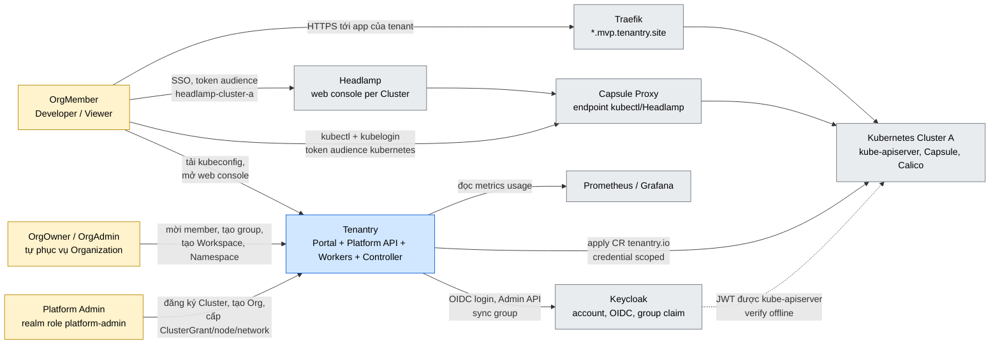
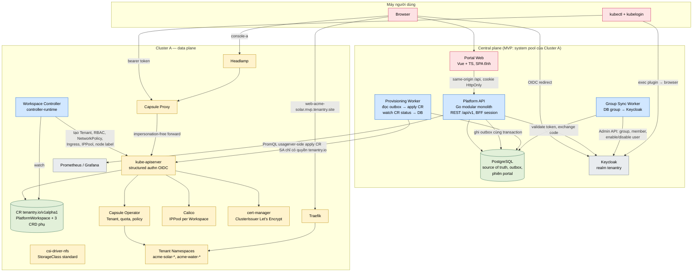
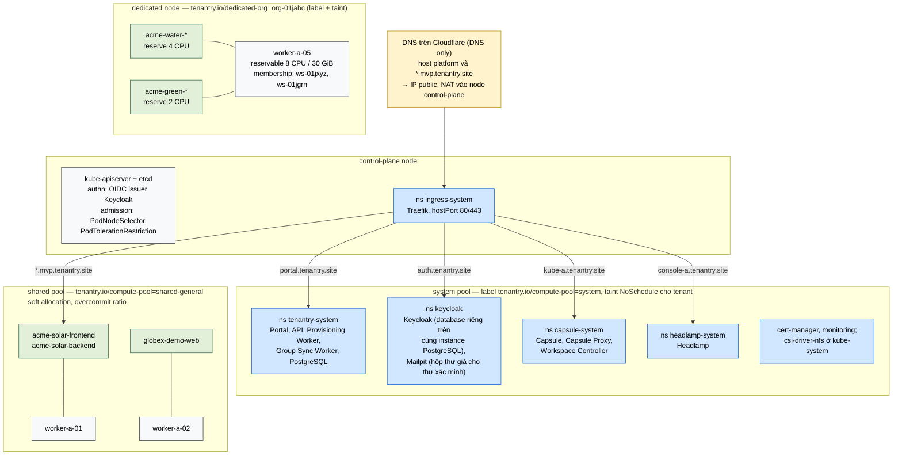
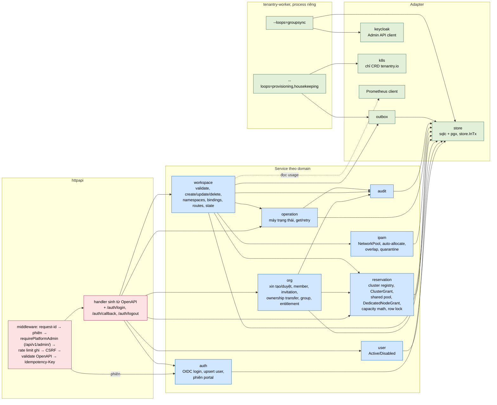
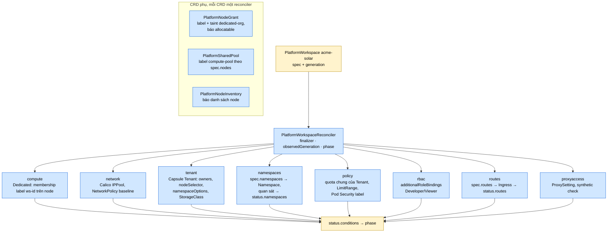

# 01 — Sơ đồ hệ thống: Context, Container, Deployment

> Góc nhìn, không định nghĩa gì mới: quy tắc ở `PRODUCT-PLAN.md`, phần còn lại theo bản đồ ở `docs/README.md`.
> Cách đọc: đi từ trên xuống — ai dùng hệ thống (Context) → hệ thống gồm những khối gì (Container) → chạy ở đâu (Deployment) → bên trong controller có gì (Component). Sau mỗi sơ đồ có mục **Điểm cần review**.

## 1. System Context — ai tương tác với Tenantry

**Mục đích:** xác định biên giới hệ thống, ba persona và các hệ ngoài mà Tenantry phụ thuộc.

**Điểm cần review**

- Tenantry **không** nằm trên đường dữ liệu kubectl/Headlamp: user đi thẳng vào Capsule Proxy bằng token Keycloak. Portal chỉ phát kubeconfig và link. Nếu Portal chết, người đã có kubeconfig vẫn làm việc được.
- Ba persona dùng **một** realm Keycloak; Admin chỉ khác ở realm role. Không có identity plane riêng.
- Mọi thứ Tenantry ghi vào Cluster đi qua đúng một cửa: các CRD `tenantry.io` — `PlatformWorkspace` và ba CRD phụ `PlatformNodeGrant`, `PlatformSharedPool`, `PlatformNodeInventory` (IMPLEMENTATION-PLAN mục 4.5). Đây là contract cho Phase 2 (Cluster Agent) nên cần được xem là API công khai nội bộ.

## 2. Container view — các khối chạy được

**Mục đích:** liệt kê process/deployment, ai gọi ai, và dữ liệu nằm ở đâu.

**Điểm cần review**

- **Hai worker là process riêng** (Provisioning, Group Sync) nhưng cùng codebase với API; scale/restart độc lập, không cần message broker: outbox trong PostgreSQL là hàng đợi.
- Provisioning Worker là **thành phần duy nhất** có credential vào Cluster, và credential đó chỉ có quyền trên các CRD `tenantry.io`. Controller (chạy trong cluster) mới là thứ có quyền tạo Tenant/IPPool/RBAC. Nếu API bị chiếm, kẻ tấn công không tạo được cluster-admin binding, nhưng điều khiển được cả hai worker qua PostgreSQL (`06-security-and-identity.md` mục 1).
- Portal Web là SPA tĩnh, gọi API same-origin qua cookie → không có CORS, không giữ token trong JS.
- Headlamp nói với Capsule Proxy bằng **token của user**; ServiceAccount của Headlamp không có quyền Kubernetes nào (plan 12.4, `make cluster-verify` kiểm).

## 3. Deployment view — MVP một Cluster

**Mục đích:** thấy rõ central plane nằm trên system pool, tenant workload nằm trên shared pool hoặc dedicated node, và các endpoint public.

Bảng endpoint public (TLS bởi cert-manager, Let's Encrypt). Mọi request đi qua Traefik; host của platform nằm ngoài apps domain `mvp.tenantry.site` nên không Route nào của tenant trùng hostname được:

| Hostname | Trỏ tới | Ai dùng | OIDC client |
|---|---|---|---|
| `portal.tenantry.site` | Portal Web + Platform API | mọi user, Admin | `portal` |
| `auth.tenantry.site` | Keycloak, chỉ `/realms/tenantry` và `/resources` | browser, kubelogin, Headlamp | — (issuer) |
| `kube-a.tenantry.site` | Capsule Proxy | kubectl, Headlamp | token của user từ `kubectl` hoặc `headlamp-cluster-a` |
| `console-a.tenantry.site` | Headlamp | browser | `headlamp-cluster-a` |
| `*.mvp.tenantry.site` | Route của tenant → app | người dùng cuối của tenant | — |

Không có hostname: admin console và realm `master` của Keycloak, Mailpit (`06-security-and-identity.md` mục 1).

**Điểm cần review**

- Traefik chạy trên node control-plane vì IP public được NAT vào đó (`05-network-and-scheduling.md` mục 7); mọi thành phần nền khác chạy trên system pool.
- Không trùng hostname không có nghĩa là tách site: Route của tenant cùng registrable domain `tenantry.site` với portal và Keycloak. Hệ quả và giới hạn: `06-security-and-identity.md` mục 1.
- System pool cần **taint** để tenant workload không rơi vào (Capsule Tenant nodeSelector không đủ nếu user bỏ được selector; taint là lớp bảo vệ thứ hai).
- Keycloak dùng **chung instance PostgreSQL, database riêng** để tiết kiệm tài nguyên lab; tách khi Phase 2.
- Phase 2 chỉ di chuyển khối `tenantry-system` + `keycloak` ra ngoài và thêm Cluster Agent vào `capsule-system`; các hostname theo Cluster (`kube-b`, `console-b`) được thêm theo mẫu.

## 4. Component view — bên trong Platform API

**Mục đích:** thấy ranh giới package của monolith và điểm đặt transaction reservation. Tên khối là tên package trong `backend/internal/`; danh sách package và quy tắc import định nghĩa ở IMPLEMENTATION-PLAN mục 2 và 2.1.

Quy tắc phụ thuộc (để giữ monolith không rối):

- `httpapi` chỉ gọi service của domain; không tự viết SQL, chỉ dùng kiểu dữ liệu của `store` để map ra response.
- Middleware chỉ kiểm `platform-admin` cho tiền tố `/api/v1/admin/`. Không có middleware kiểm role trong Organization: service resolve `org_id` từ row rồi kiểm membership (404) → role (403) → trạng thái Organization (409); `:force` và hành động admin khác nằm ngoài `/admin/` tự kiểm `platform-admin` (IMPLEMENTATION-PLAN mục 3.5).
- `workspace` là orchestrator của create/update/delete: nó gọi `reservation` và `ipam` **trong cùng một transaction** (`store.InTx`); hai package này nhận `*store.Queries` của transaction đang chạy, không tự mở transaction. Thứ tự lock: `02-data-model.md` mục 4.
- Service domain không gọi thẳng Keycloak hay Kubernetes, không import `keycloak` hay `k8s`. Thay đổi cho Cluster đi qua `outbox`; thay đổi cho Keycloak đi qua cột `sync_status` của `groups`/`group_members` (và trạng thái `users`) mà Group Sync Worker đọc. Cả hai được ghi cùng transaction với thay đổi nghiệp vụ.
- `org` gọi `reservation` để tạo grant khi Admin duyệt hoặc tạo thẳng Organization; `reservation` không import `org`.

**Điểm cần review**

- Cluster registry (trong `reservation`) ở MVP gần như tĩnh (một cluster) nhưng mọi service khác **phải** đọc endpoint/console URL từ đây, không hard-code, để Phase 2 chỉ thêm row.

## 5. Component view — bên trong Workspace Controller

**Mục đích:** một CR vào, nhiều output ra; mỗi output có Condition riêng để lỗi chỉ đúng chỗ. Sơ đồ chỉ minh họa: tên sub-reconciler, thứ tự chạy, Condition sở hữu và milestone định nghĩa ở IMPLEMENTATION-PLAN mục 4.1; thứ tự xóa (finalizer) ở mục 4.3; Condition bắt buộc để vào `Ready` ở `04-state-machines.md` mục 1.2.

**Điểm cần review**

- Controller **không** biết gì về quota của ClusterGrant hay capacity node: những invariant đó đã được API kiểm tra trước khi CR tồn tại. Controller chỉ render. Nếu thấy controller cần truy vấn DB thì thiết kế đang lệch.
- `namespaces` phải phân biệt Namespace do portal khai báo (`spec.namespaces`) và do kubectl tạo (chỉ observed) để không xóa nhầm Namespace của user khi họ xóa khỏi portal list.
- ServiceAccount của operator nằm trong Capsule `users` (group `system:serviceaccounts:<namespace của operator>`) và được render làm owner của mọi Tenant, nhờ vậy tạo được Namespace của `spec.namespaces` qua webhook Capsule. Đã chạy trên Capsule 0.13 của lab cũ; kiểm lại trên 0.15.x ở M6.
- Label/taint **cấp Organization** trên node (`tenantry.io/dedicated-org`) phải có từ lúc Admin grant node, trước khi có Workspace nào — nên không thể nằm trong `PlatformWorkspace`. Vì vậy có CRD phụ `PlatformNodeGrant`: operator kiểm node sạch, reconcile label/taint và báo `allocatable` về status (`03-flows.md` mục 2b). Label `tenantry.io/compute-pool=<pool-id>` của shared pool do `PlatformSharedPool` gắn/gỡ theo `spec.nodes`; `PlatformNodeInventory` báo danh sách node (IMPLEMENTATION-PLAN mục 4.5). Sub-reconciler `compute` của `PlatformWorkspace` chỉ thêm/gỡ membership label per Workspace.
