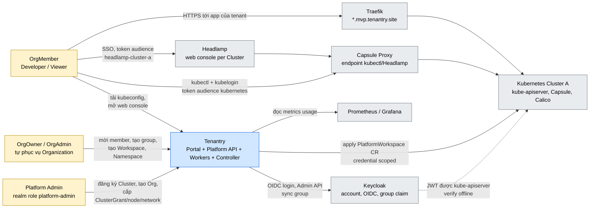
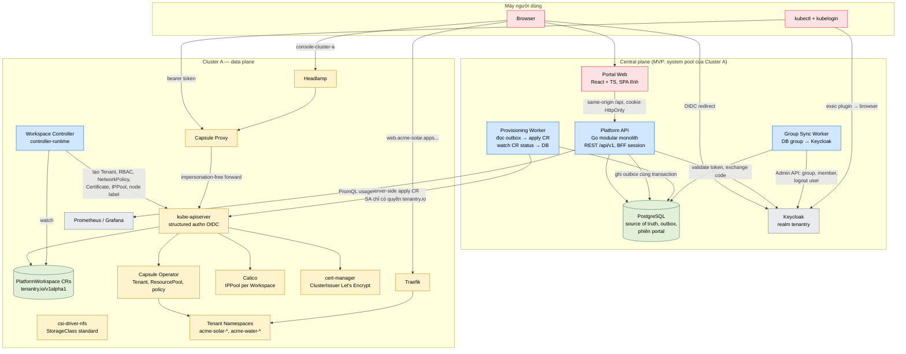
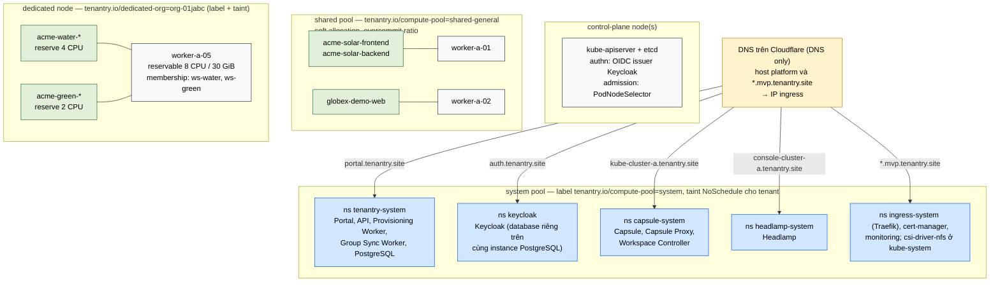
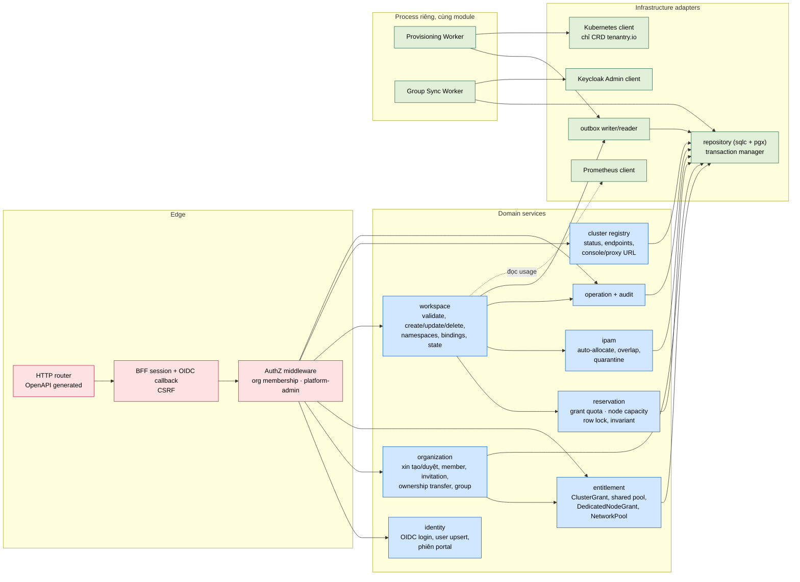
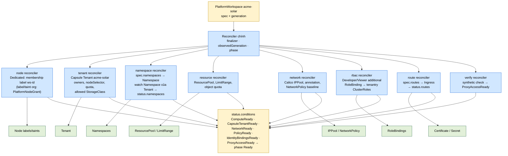

# 01 — Sơ đồ hệ thống: Context, Container, Deployment

> Góc nhìn, không định nghĩa gì mới: quy tắc ở `PRODUCT-PLAN.md`, phần còn lại theo bản đồ ở `docs/README.md`.
> Cách đọc: đi từ trên xuống — ai dùng hệ thống (Context) → hệ thống gồm những khối gì (Container) → chạy ở đâu (Deployment) → bên trong controller có gì (Component). Sau mỗi sơ đồ có mục **Điểm cần review**.

## 1. System Context — ai tương tác với Tenantry

**Mục đích:** xác định biên giới hệ thống, ba persona và các hệ ngoài mà Tenantry phụ thuộc.

**Điểm cần review**

- Tenantry **không** nằm trên đường dữ liệu kubectl/Headlamp: user đi thẳng vào Capsule Proxy bằng token Keycloak. Portal chỉ phát kubeconfig và link. Nếu Portal chết, người đã có kubeconfig vẫn làm việc được.
- Ba persona dùng **một** realm Keycloak; Admin chỉ khác ở realm role. Không có identity plane riêng.
- Mọi thứ Tenantry ghi vào Cluster đi qua đúng một cửa: CR `PlatformWorkspace`. Đây là contract cho Phase 2 (Cluster Agent) nên cần được xem là API công khai nội bộ.

## 2. Container view — các khối chạy được

**Mục đích:** liệt kê process/deployment, ai gọi ai, và dữ liệu nằm ở đâu.

**Điểm cần review**

- **Hai worker là process riêng** (Provisioning, Group Sync) nhưng cùng codebase với API; scale/restart độc lập, không cần message broker: outbox trong PostgreSQL là hàng đợi.
- Provisioning Worker là **thành phần duy nhất** có credential vào Cluster, và credential đó chỉ có quyền trên các CRD `tenantry.io`. Controller (chạy trong cluster) mới là thứ có quyền tạo Tenant/IPPool/RBAC. Nếu API bị chiếm, kẻ tấn công không tạo được cluster-admin binding.
- Portal Web là SPA tĩnh, gọi API same-origin qua cookie → không có CORS, không giữ token trong JS.
- Cần xác nhận Headlamp nói với Capsule Proxy bằng **token của user** (không dùng ServiceAccount có quyền), đúng như plan 12.4.

## 3. Deployment view — MVP một Cluster

**Mục đích:** thấy rõ central plane nằm trên system pool, tenant workload nằm trên shared pool hoặc dedicated node, và các endpoint public.

Bảng endpoint public (TLS bởi cert-manager, Let's Encrypt). Mọi request đi qua Traefik; host của platform nằm ngoài apps domain `mvp.tenantry.site` nên không Route nào của tenant trùng được:

| Hostname | Trỏ tới | Ai dùng | OIDC client |
|---|---|---|---|
| `portal.tenantry.site` | Portal Web + Platform API | mọi user, Admin | `portal` |
| `auth.tenantry.site` | Keycloak | browser, kubelogin, Headlamp | — (issuer) |
| `kube-cluster-a.tenantry.site` | Capsule Proxy | kubectl, Headlamp | `kubectl` |
| `console-cluster-a.tenantry.site` | Headlamp | browser | `headlamp-cluster-a` |
| `*.mvp.tenantry.site` | Route của tenant → app | người dùng cuối của tenant | — |

**Điểm cần review**

- System pool cần **taint** để tenant workload không rơi vào (Capsule Tenant nodeSelector không đủ nếu user bỏ được selector; taint là lớp bảo vệ thứ hai).
- Keycloak dùng **chung instance PostgreSQL, database riêng** để tiết kiệm tài nguyên lab; tách khi Phase 2.
- Phase 2 chỉ di chuyển khối `tenantry-system` + `keycloak` ra ngoài và thêm Cluster Agent vào `capsule-system`; các hostname theo Cluster (`kube-cluster-b`, `console-cluster-b`) được thêm theo mẫu.

## 4. Component view — bên trong Platform API

**Mục đích:** thấy ranh giới module của monolith và điểm đặt transaction reservation.

Quy tắc phụ thuộc (để giữ monolith không rối):

- `Edge` chỉ gọi `Domain`; không gọi `Infra` trực tiếp.
- `workspace` là orchestrator của create/update/delete: nó gọi `reservation` và `ipam` **trong cùng một transaction** do `Repo.transaction manager` cấp; hai module này không được tự mở transaction.
- `Domain` không gọi thẳng Keycloak hay Kubernetes, không module domain nào import `KCc` hay `K8sc`. Thay đổi cho Cluster đi qua `outbox`; thay đổi cho Keycloak đi qua cột `sync_status` của `groups`/`group_members` mà Group Sync Worker đọc. Cả hai được ghi cùng transaction với thay đổi nghiệp vụ.
- `organization` gọi `entitlement` để tạo grant khi Admin duyệt hoặc tạo thẳng Organization; `entitlement` không biết `organization`.

**Điểm cần review**

- Có nên tách `reservation` và `ipam` thành module riêng ngay từ M2 hay để trong `workspace`? Đề xuất tách ngay vì đây là hai chỗ có unit test nặng nhất (quota/capacity math, CIDR math) và cần test độc lập với HTTP.
- `Cluster registry` trong MVP gần như tĩnh (một cluster) nhưng mọi service khác **phải** đọc endpoint/console URL từ đây, không hard-code, để Phase 2 chỉ thêm row.

## 5. Component view — bên trong Workspace Controller

**Mục đích:** một CR vào, nhiều output ra; mỗi output có Condition riêng để lỗi chỉ đúng chỗ.

Thứ tự khi **tạo**: node → tenant → namespaces → resource → network → rbac → ingress-cert → verify. Thứ tự khi **xóa** (finalizer): ngược lại, và network chỉ được xóa IPPool sau khi Calico báo hết workload endpoint; node chỉ gỡ membership label sau khi không còn Pod của Workspace.

**Điểm cần review**

- Controller **không** biết gì về quota của ClusterGrant hay capacity node: những invariant đó đã được API kiểm tra trước khi CR tồn tại. Controller chỉ render. Nếu thấy controller cần truy vấn DB thì thiết kế đang lệch.
- `namespace reconciler` phải phân biệt Namespace do portal khai báo (`spec.namespaces`) và do kubectl tạo (chỉ observed) để không xóa nhầm Namespace của user khi họ xóa khỏi portal list.
- `verify reconciler` là bước tùy chọn nhưng đáng giữ: nó biến "Ready" thành lời khẳng định đã test, không chỉ là "đã apply xong".
- Label/taint **cấp Organization** trên node (`tenantry.io/dedicated-org`) phải có từ lúc Admin grant node, trước khi có Workspace nào — nên không thể nằm trong `PlatformWorkspace`. Vì vậy có CRD phụ `PlatformNodeGrant` do worker apply; controller kiểm node sạch, reconcile label/taint và báo `allocatable` về status (`03-flows.md` mục 2b). Capacity của shared pool đi cùng mẫu qua CRD phụ `PlatformSharedPool` (IMPLEMENTATION-PLAN mục 4.5). `node reconciler` của `PlatformWorkspace` chỉ thêm/gỡ membership label per Workspace.
