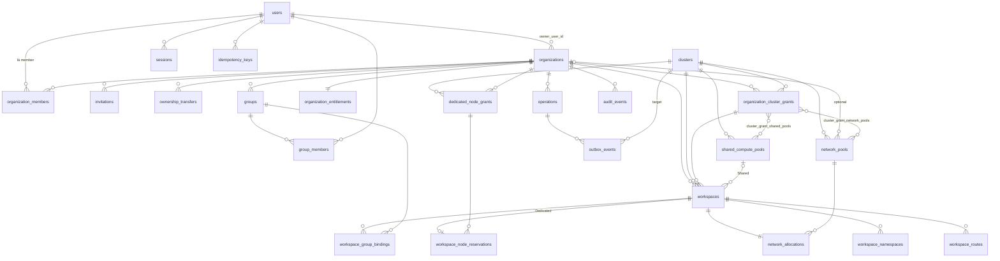
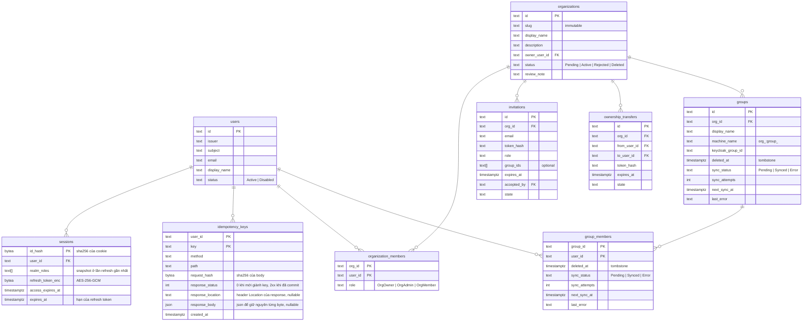
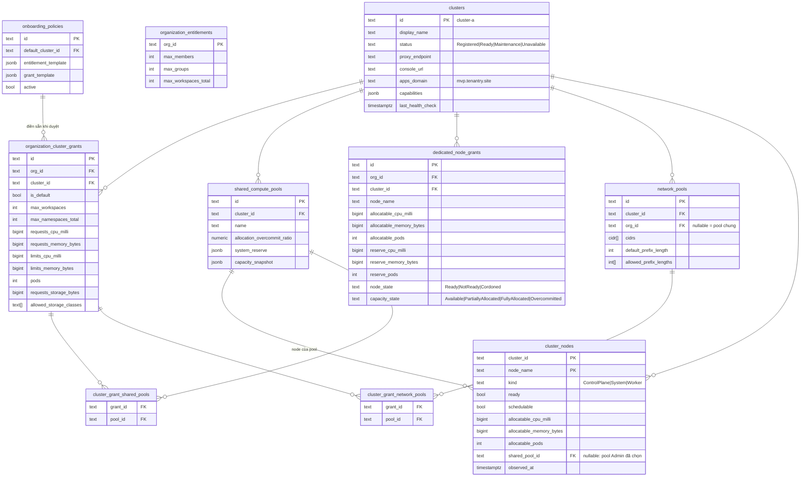
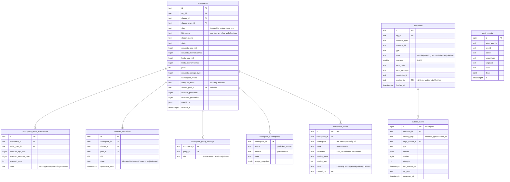
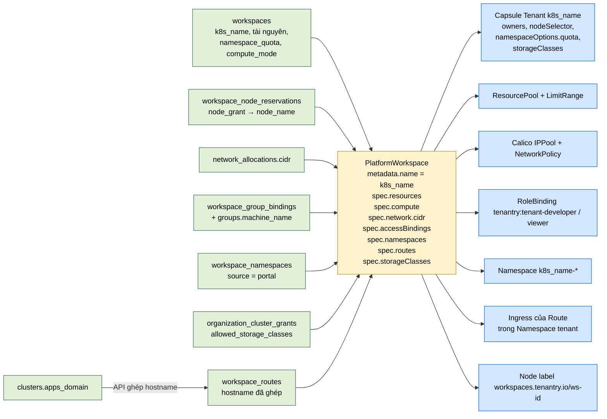

# 02 — Data model: bảng, constraint, invariant

> Nơi định nghĩa cho bảng, cột, constraint và thứ tự lock. DDL thật nằm ở `backend/migrations/`; bảng nào đã có migration thì file này phải khớp migration. Quy tắc nghiệp vụ đứng sau từng invariant ở `PRODUCT-PLAN.md` mục 4, 5.
> PostgreSQL là source of truth cho product state; Kubernetes chỉ giữ runtime state qua CR `PlatformWorkspace`.

Quy ước chung cho mọi bảng:

- **ID** là `text` chứa ULID có tiền tố (`org-`, `ws-`, `grp-`, `op-`, `netalloc-`, `nodegrant-`…); riêng `clusters.id` là tên do Admin đặt (`cluster-a`), `outbox_events.id` và `audit_events.id` là `bigint` tăng dần.
- **Thời gian** là `timestamptz`; bảng nào sửa được thì có `created_at`, `updated_at` (không vẽ lại trong ERD).
- **Lượng tài nguyên** lưu số nguyên theo đơn vị gốc: CPU là milliCPU, memory/storage là byte, cột `bigint`. API nhận và trả Kubernetes quantity (`"4"`, `8Gi`), đổi ở biên. Nhờ vậy `SUM` trong SQL là chính xác và không phải parse chuỗi dưới row lock.
- **Trạng thái** là `text` có `CHECK`; tập giá trị và cạnh chuyển định nghĩa ở `04-state-machines.md`.

## 1. ERD tổng thể

**Điểm cần review**

- `workspaces → organization_cluster_grants` là quan hệ **bắt buộc**: Workspace luôn thuộc đúng một grant (org × cluster). Đây là chỗ enforce "Cluster phải được cấp cho Organization".
- Reservation quota của ClusterGrant **không có bảng riêng**: nó là `SUM` các cột tài nguyên của `workspaces` trong grant, tính dưới row lock của grant. NodeReservation có bảng riêng vì có state và lifecycle riêng.
- `cluster_agents` (cluster_id, identity fingerprint, version, status, last_seen) chỉ tạo ở Phase 2.

## 2. Vùng Identity, phiên và Organization

| Invariant | Enforce bằng |
|---|---|
| Một account ↔ một identity Keycloak | `UNIQUE (issuer, subject)` |
| Slug Organization unique, yêu cầu bị từ chối nhả slug | `UNIQUE (slug) WHERE status <> 'Rejected'` |
| Mỗi user tối đa một yêu cầu `Pending` | `UNIQUE (owner_user_id) WHERE status = 'Pending'` |
| Đúng một OrgOwner mỗi Organization | `organizations.owner_user_id NOT NULL` (ít nhất một) + `UNIQUE (org_id) ON organization_members WHERE role = 'OrgOwner'` (nhiều nhất một) |
| Owner luôn là member | service: đổi `owner_user_id` và role hai bên trong một transaction |
| Group display name unique trong Organization (không tính group đã xóa), machine name unique toàn cục | `UNIQUE (org_id, display_name) WHERE deleted_at IS NULL`; `UNIQUE (machine_name)` |
| Không xóa group còn binding | service chặn trước khi đặt `deleted_at`; `FK ... ON DELETE RESTRICT` từ `workspace_group_bindings` là lưới an toàn |
| Member của group phải là member của Organization sở hữu group | service kiểm khi thêm; **không** FK sang `organization_members` (xem dưới) |
| Tối đa một transfer đang chờ mỗi Organization | `UNIQUE (org_id) ON ownership_transfers WHERE state = 'Proposed'` |
| Cùng `Idempotency-Key` không tạo hai lần | `PRIMARY KEY (user_id, key)` trên `idempotency_keys` |

**Xóa là xóa thật, trừ thứ còn phải đồng bộ ra ngoài:**

- Remove member khỏi Organization xóa hẳn row `organization_members`; lịch sử nằm ở `audit_events`.
- `groups` và `group_members` dùng **tombstone**: thao tác xóa đặt `deleted_at = now()` và `sync_status = 'Pending'` trong cùng transaction; Group Sync Worker gỡ trên Keycloak xong mới xóa hẳn row. Row có `deleted_at` không còn hiệu lực với mọi câu hỏi phân quyền và danh sách — mọi query nghiệp vụ lọc `deleted_at IS NULL`. Thêm lại một member đang là tombstone chỉ cần đặt `deleted_at = NULL`, `sync_status = 'Pending'`.
- Vì tombstone phải sống lâu hơn membership, `group_members` **không** có FK sang `organization_members`: remove member khỏi Organization xóa row membership ngay, đồng thời đặt tombstone cho mọi `group_members` của user trong Organization đó để worker còn việc mà làm.

**Phiên và idempotency:**

- `sessions`: cơ chế ở `06-security-and-identity.md` mục 3. Index trên `user_id` (thu hồi mọi phiên của một user) và `expires_at` (dọn rác).
- `idempotency_keys`: cơ chế ở `IMPLEMENTATION-PLAN.md` mục 3.4. Row được giành ở đầu transaction của request và điền response trước khi commit, cùng transaction với thay đổi nghiệp vụ; giữ 24 giờ rồi vòng `housekeeping` xóa.

## 3. Vùng Cluster & Entitlement

| Invariant | Enforce bằng |
|---|---|
| Một org có tối đa một default grant | `UNIQUE (org_id) WHERE is_default` |
| Một org × cluster có tối đa một grant | `UNIQUE (org_id, cluster_id)` |
| Node chỉ dedicated cho một org | `UNIQUE (cluster_id, node_name)` |
| Pool/NodeGrant/NetworkPool trong grant phải cùng `cluster_id` với grant | service + integration test |
| Pool riêng chỉ vào grant của đúng org | service khi Admin gán |
| Không giảm grant dưới tổng allocation hiện tại | transaction: lock grant, `SUM` cột tài nguyên của `workspaces` so với giá trị mới; CPU/RAM/Pod chỉ cộng Workspace Shared (plan 5.5) |
| Node thuộc tối đa một pool | một cột `cluster_nodes.shared_pool_id` |
| Node không vừa thuộc pool vừa dedicated | service: lock row `cluster_nodes` của node trước khi thêm vào pool hoặc tạo `dedicated_node_grants`; operator từ chối lần nữa trên Cluster |
| Compute mode dùng được | suy ra: Shared khi grant có `cluster_grant_shared_pools`, Dedicated khi có `dedicated_node_grants` của org trên cluster; không có cột riêng |
| Không revoke node grant còn reservation chưa `Released` | `FK ON DELETE RESTRICT` từ `workspace_node_reservations` + check state |

**Điểm cần review**

- `capacity_snapshot` của shared pool và `allocatable_*` của dedicated node là **dữ liệu chép từ Kubernetes**. Controller báo qua status của CR phụ (`PlatformNodeGrant` cho dedicated node, `PlatformSharedPool` cho shared pool, `PlatformNodeInventory` cho danh sách node trong `cluster_nodes`), worker chép về DB — worker không đọc Node trực tiếp. Chênh lệch với reservation → `Overcommitted`.
- `onboarding_policies.entitlement_template` và `grant_template` là JSON điền sẵn vào form duyệt; entitlement và grant đã cấp là snapshot, đổi policy sau đó không ảnh hưởng [5.1][5.2.1].
- `id` của `clusters`, `shared_compute_pools` và `network_pools` là tên do Platform Admin đặt (`cluster-a`, `shared-general`, `onboarding-pod-network`), không phải ULID. Chúng thành giá trị label và tên object trên Kubernetes nên phải là DNS label (CHECK trong schema). Hệ quả: tên pool là duy nhất trên toàn platform, không phải trong từng Cluster; Cluster thứ hai phải đặt tên pool khác.
- Grant phải có ít nhất một row `cluster_grant_network_pools` (service kiểm khi duyệt và khi sửa grant); `cluster_grant_shared_pools` được để trống.
- `shared_compute_pools` chưa có cột trạng thái: chưa có luồng nào cần nó. Thêm khi M5 định nghĩa được giá trị.

## 4. Vùng Workspace & Allocation

| Invariant | Enforce bằng |
|---|---|
| `k8s_name` global unique, không tái dùng trong thời gian quarantine | `UNIQUE (k8s_name) WHERE state <> 'Deleted'`; cửa sổ quarantine do service kiểm lúc tạo: từ chối nếu còn Workspace `Deleted` cùng tên mà `network_allocations` chưa `Released` |
| Namespace name unique toàn cluster và có tiền tố `k8s_name-` | `UNIQUE (cluster_id, name)`; tiền tố do service ghép, không nhận từ client |
| Một group tối đa một role mỗi Workspace | `PRIMARY KEY (workspace_id, group_id)` |
| Workspace luôn còn ≥1 TenantOwner binding | service trong transaction + test; không có constraint SQL thuận tiện |
| Dedicated Workspace có đúng một reservation đang giữ chỗ | `UNIQUE (workspace_id) WHERE state IN ('Pending','Active')` |
| Σ reservations trên node ≤ reservable | **transaction**: `SELECT ... FOR UPDATE` row `dedicated_node_grants`, `SUM` reservation chưa `Released`, so sánh, rồi insert |
| Σ allocation Shared trên pool ≤ ratio × reservable | **transaction**: lock row `shared_compute_pools`, `SUM` cột tài nguyên của `workspaces` trên pool |
| Σ allocation trong grant ≤ grant | **transaction**: lock row `organization_cluster_grants` |
| CIDR không overlap trong cluster | `EXCLUDE USING gist (cluster_id WITH =, cidr inet_ops WITH &&) WHERE (state <> 'Released')` (extension `btree_gist`) |
| Hostname của Route duy nhất toàn nền tảng | `UNIQUE (hostname) WHERE state <> 'Deleted'` trên `workspace_routes`; vi phạm trả `ROUTE_HOSTNAME_TAKEN` |
| Tối đa 20 Route mỗi Workspace | **transaction**: lock row `workspaces`, `COUNT` Route chưa `Deleted` |
| Event cùng resource giao đúng thứ tự | worker chỉ lấy event khi không còn event cũ hơn chưa giao cùng `ordering_key` |

Thứ tự lock cố định để tránh deadlock: `organization_cluster_grants` → `shared_compute_pools` hoặc `dedicated_node_grants` → `network_pools`. Mọi transaction create/resize/delete lock theo đúng thứ tự này.

**Ghi chú**

- "CIDR còn trống" không phải một state: đó là mọi khoảng trong pool không bị row nào khác `Released` phủ lên. Row `Released` được giữ làm lịch sử.
- "Reservation vẫn giữ khi provisioning `Failed`" thể hiện bằng việc row `workspaces` còn tồn tại ở state `Failed` và vẫn nằm trong `SUM`. Chỉ row `Deleted` mới bị loại khỏi `SUM`; mọi query tính tổng phải viết rõ điều kiện này.
- Exclusion constraint là **lớp bảo vệ cuối**; IPAM vẫn tự tính subnet trống dưới lock của `network_pools`. Khi constraint bắn (SQLSTATE `23P01`), API trả `CIDR_OVERLAP`, không phải 500.
- `outbox_events` chỉ mang thay đổi đẩy xuống Cluster, nên `target_cluster_id` là bắt buộc. Đồng bộ sang Keycloak **không** đi qua bảng này: Group Sync Worker đọc thẳng `sync_status` của `groups`/`group_members`.

## 5. Ánh xạ DB ↔ CR ↔ Kubernetes

**Mục đích:** biết trường nào ở DB sinh ra trường nào trong CR và object nào trong cluster; dùng khi review controller.

**Điểm cần review**

- CR chứa **giá trị đã resolve** (node name, CIDR, group subject, hostname của Route), không chứa ID tham chiếu về DB mà controller phải tra. Điều này giữ controller không phụ thuộc DB và là nền cho Cluster Agent Phase 2.
- Nếu Admin đổi `allowed_storage_classes` của grant, mọi Workspace trong grant cần re-render CR → một "fan-out" trong service entitlement sinh nhiều outbox event. Task của M5/M7.
