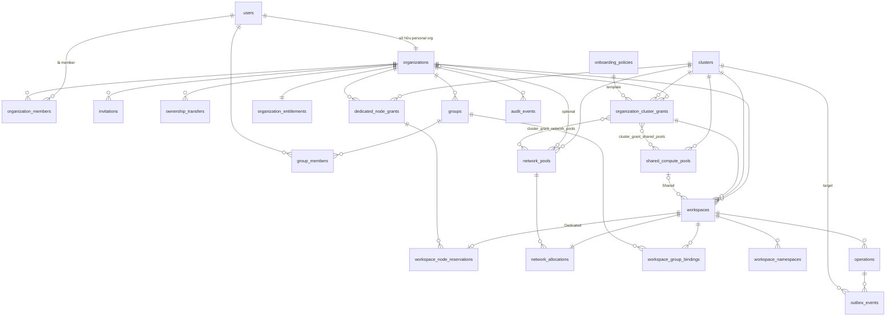
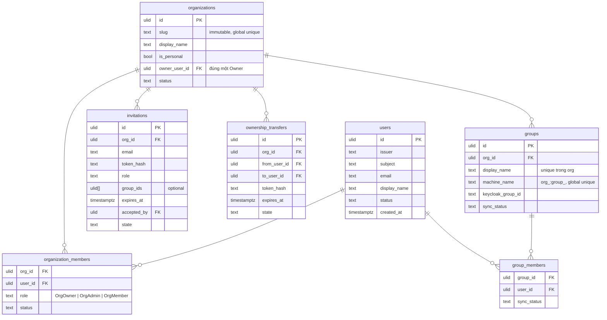
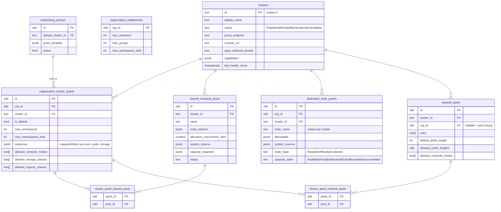
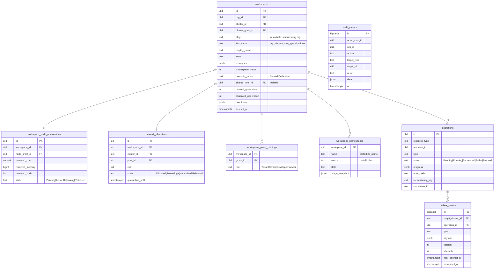
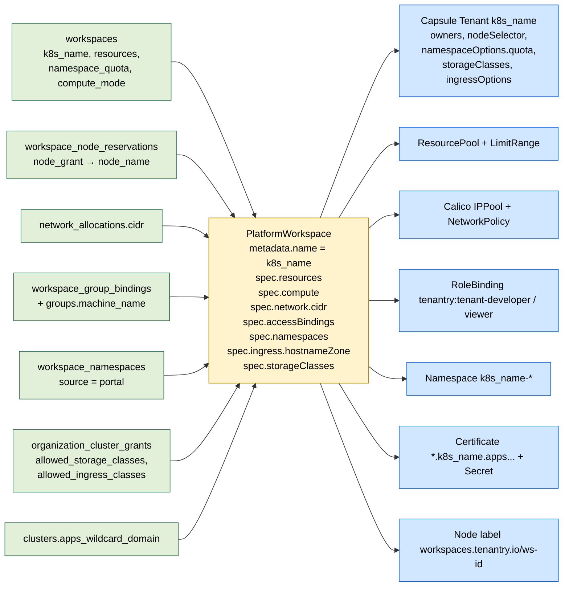

# 02 — Data model: ERD và invariant

> Nguồn sự thật: `docs/PRODUCT-PLAN.md` v0.6, mục 4, 5, 15. PostgreSQL là source of truth cho product state; Kubernetes chỉ giữ runtime state qua CR `PlatformWorkspace`.
> Cách đọc: ERD tổng → ERD theo từng vùng nghiệp vụ → bảng invariant và cách enforce (constraint vs transaction). Sau mỗi sơ đồ có **Điểm cần review**.

## 1. ERD tổng thể

**Mục đích:** nhìn một lần toàn bộ entity và quan hệ; chi tiết cột ở các mục sau.

**Điểm cần review**

- `workspaces → organization_cluster_grants` là quan hệ **bắt buộc**: Workspace luôn thuộc đúng một grant (org × cluster). Đây là chỗ enforce "Cluster phải được cấp cho Organization".
- `network_pools.organization_id` nullable: pool chung cho onboarding. Grant tham chiếu pool qua bảng nối; pool riêng chỉ được tham chiếu bởi grant của đúng org (check ở service layer + trigger đơn giản).
- Reservation quota của ClusterGrant **không có bảng riêng**: nó được suy ra bằng `SUM(workspaces.resources)` trong grant, kiểm tra dưới row lock của grant. NodeReservation thì có bảng riêng vì cần state riêng và lifecycle riêng.

## 2. Vùng Identity & Organization

Constraint quan trọng:

| Invariant | Enforce bằng |
|---|---|
| Một account ↔ một identity Keycloak | `UNIQUE (issuer, subject)` |
| Một user có đúng một personal org | `UNIQUE (owner_user_id) WHERE is_personal` |
| Đúng một OrgOwner mỗi org | `organizations.owner_user_id NOT NULL` + `UNIQUE (org_id) ON organization_members WHERE role = 'OrgOwner'` |
| Owner luôn là member | trigger/service: khi set `owner_user_id` phải có row member role Owner |
| Group display name unique trong org, machine name unique toàn cục | hai `UNIQUE` |
| Không xóa group còn binding | `FK ... ON DELETE RESTRICT` từ `workspace_group_bindings` |
| Email invite phải khớp email verified khi accept | service layer (đọc claim `email_verified`) |

**Điểm cần review**

- `group_members.user_id` chỉ được trỏ tới user **là member của org sở hữu group** — không diễn tả được bằng FK đơn; cần check ở service + test. Có chấp nhận không, hay dùng FK composite `(org_id, user_id)` sang `organization_members`? Đề xuất: FK composite, an toàn hơn và không tốn gì.
- Khi remove member: cascade xóa `group_members` (đồng thời ghi outbox sync Keycloak). Cần chốt là cascade DB hay service — đề xuất service, vì phải sinh outbox.

## 3. Vùng Cluster & Entitlement

| Invariant | Enforce bằng |
|---|---|
| Một org có tối đa một default grant | `UNIQUE (org_id) WHERE is_default` |
| Một org × cluster có tối đa một grant | `UNIQUE (org_id, cluster_id)` |
| Node chỉ dedicated cho một org | `UNIQUE (cluster_id, node_name)` |
| Pool/NodeGrant/NetworkPool trong grant phải cùng `cluster_id` với grant | trigger hoặc check ở service + integration test |
| Pool riêng chỉ vào grant của đúng org | check ở service khi Admin gán |
| Không giảm grant dưới tổng allocation hiện tại | transaction: lock grant, `SUM(workspaces.resources)` so với giá trị mới |
| Không revoke node grant còn reservation Active | `FK ON DELETE RESTRICT` từ `workspace_node_reservations` + check state |

**Điểm cần review**

- `capacity_snapshot` của shared pool và `allocatable` của dedicated node là **dữ liệu chép từ Kubernetes**; ai cập nhật? Đề xuất: Provisioning Worker poll Node mỗi N phút và ghi lại; chênh lệch với reservation → chuyển `Overcommitted`. Cần chốt tần suất và ai chịu trách nhiệm (worker hay controller báo qua CR status).
- `onboarding_policies.grant_template` là JSON; khi Admin đổi policy, grant đã cấp **không** đổi theo (snapshot tại thời điểm tạo). Đúng ý định chứ?

## 4. Vùng Workspace & Allocation

| Invariant | Enforce bằng |
|---|---|
| `k8s_name` global unique, không tái dùng trong quarantine | `UNIQUE (k8s_name)` trên cả row `deleted_at IS NOT NULL` cho tới khi hết quarantine (soft row) |
| Namespace name unique toàn cluster và có tiền tố `k8s_name-` | `UNIQUE (cluster_id, name)` + `CHECK (name LIKE k8s_name || '-%')` qua trigger |
| Một group tối đa một role mỗi Workspace | `PRIMARY KEY (workspace_id, group_id)` |
| Workspace luôn còn ≥1 TenantOwner binding | service check trong transaction + test; không có constraint SQL thuận tiện |
| Dedicated Workspace có đúng một reservation Active | `UNIQUE (workspace_id) WHERE state IN ('Pending','Active')` |
| Σ reservations trên node ≤ reservable | **transaction**: `SELECT ... FOR UPDATE` row `dedicated_node_grants`, tính `SUM` các reservation Active/Pending, so sánh, rồi insert |
| Σ allocation Shared trên pool ≤ ratio × reservable | **transaction**: lock row `shared_compute_pools`, `SUM(workspaces.resources)` trên pool |
| Σ allocation trong grant ≤ grant.resources | **transaction**: lock row `organization_cluster_grants` |
| CIDR không overlap trong cluster | `EXCLUDE USING gist (cluster_id WITH =, cidr inet_ops WITH &&) WHERE state <> 'Released'` (cần extension `btree_gist`) |
| Idempotency | `UNIQUE (idempotency_key)` trên `operations` |

Thứ tự lock cố định để tránh deadlock: `organization_cluster_grants` → `shared_compute_pools` hoặc `dedicated_node_grants` → `network_pools`. Mọi transaction create/resize/delete phải lock theo đúng thứ tự này.

**Điểm cần review**

- `workspaces.resources` là JSONB (cpu/mem/pods/storage). Tính `SUM` trên JSONB chậm hơn cột riêng; với vài chục Workspace không thành vấn đề, nhưng nếu muốn index thì nên tách 6 cột numeric. Đề xuất: **tách cột** ngay từ đầu, JSONB chỉ dùng cho `conditions`/`progress`.
- CIDR exclusion constraint là **lớp bảo vệ cuối**; IPAM service vẫn tự tính subnet trống trước. Cần test rằng khi hai request đồng thời chọn cùng subnet, một request nhận `CIDR_OVERLAP` sạch sẽ (map lỗi 23P01) thay vì 500.
- Reservation grant không có bảng riêng nên "reservation vẫn giữ khi provisioning Failed" được thể hiện bằng việc **row `workspaces` vẫn tồn tại với state Failed** và được tính vào SUM. Chỉ khi `Deleted` mới loại khỏi SUM. Đơn giản nhưng phải viết rõ trong query.

## 5. Ánh xạ DB ↔ CR ↔ Kubernetes

**Mục đích:** biết trường nào ở DB sinh ra trường nào trong CR và object nào trong cluster; dùng khi review controller.

**Điểm cần review**

- CR chứa **giá trị đã resolve** (node name, CIDR, group subject, hostname zone), không chứa ID tham chiếu về DB mà controller phải tra. Điều này giữ controller stateless với DB và là nền cho Cluster Agent Phase 2.
- Nếu Admin đổi `allowed_storage_classes` của grant, mọi Workspace trong grant cần re-render CR → cần một "fan-out" trong service entitlement sinh nhiều outbox event. Cần ghi nhận thành task ở M5/M7.
