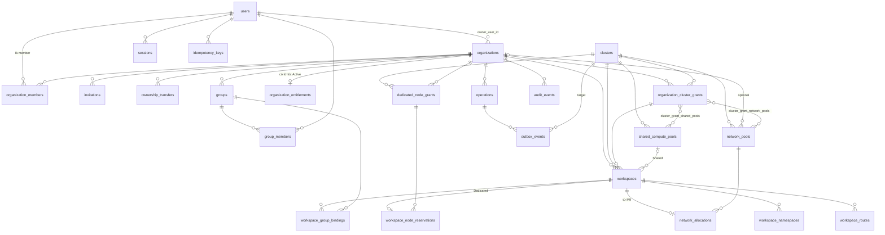
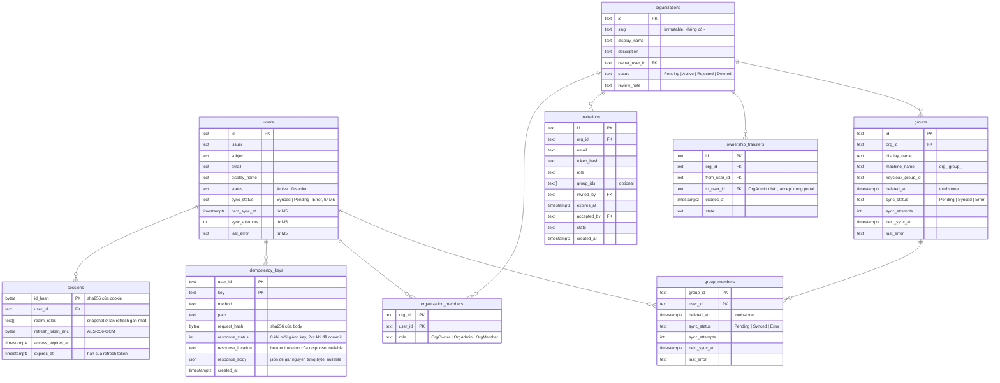
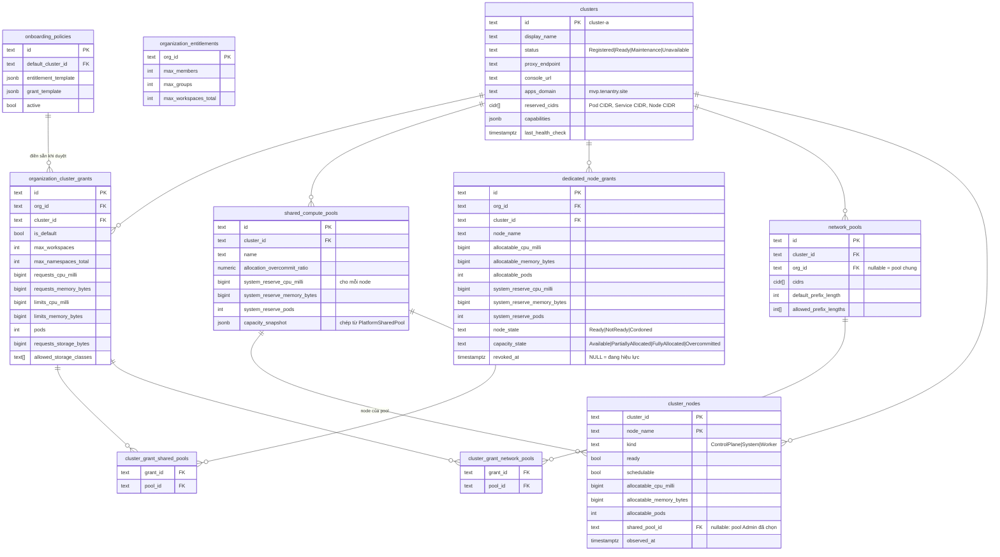
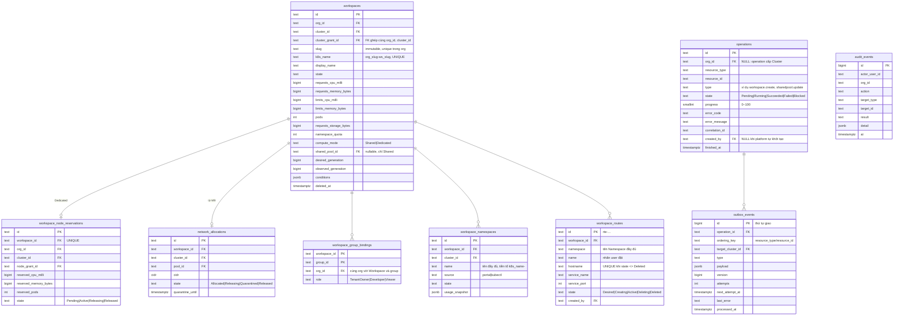
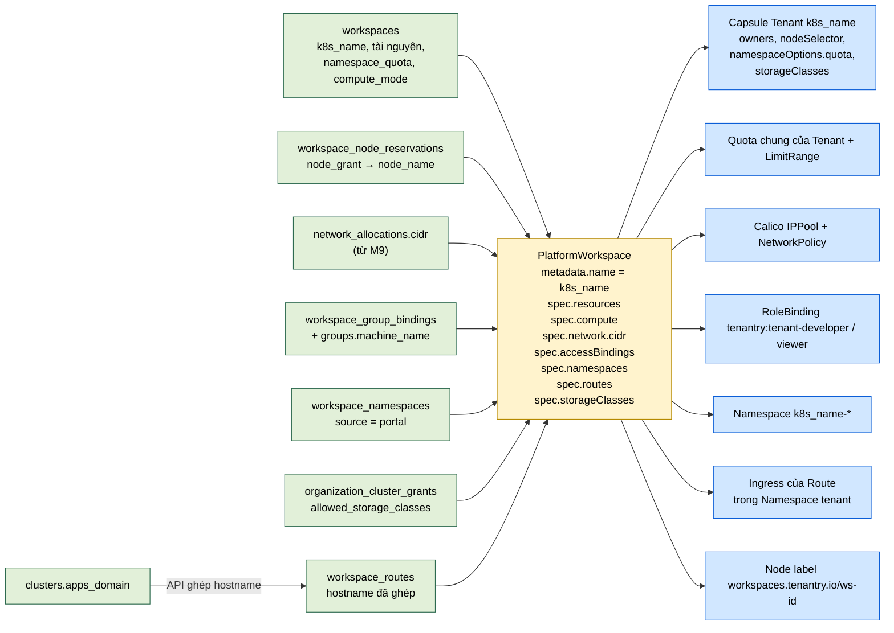

# 02 — Data model: bảng, constraint, invariant

> Nơi định nghĩa cho bảng, cột, constraint và thứ tự lock. DDL thật nằm ở `backend/migrations/`; bảng nào đã có migration thì file này phải khớp migration. Quy tắc nghiệp vụ đứng sau từng invariant ở `PRODUCT-PLAN.md` mục 4, 5.
> PostgreSQL là source of truth cho product state; Kubernetes chỉ giữ runtime state qua các CR `tenantry.io` (`PlatformWorkspace` và ba CRD phụ).

Quy ước chung cho mọi bảng:

- **ID** là `text` chứa ULID chữ thường có tiền tố (`usr-`, `org-`, `grp-`, `grant-`, `op-`, `ws-`, `netalloc-`, `nodegrant-`…). Ngoại lệ: `clusters.id`, `shared_compute_pools.id`, `network_pools.id` là tên do Platform Admin đặt (DNS label, mục 3); `outbox_events.id` và `audit_events.id` là `bigint` tăng dần.
- **Thời gian** là `timestamptz`. Phần lớn bảng có `created_at` và `updated_at` nhưng không phải mọi bảng (ví dụ `sessions`, `network_pools` không có `updated_at`, `organization_entitlements` chỉ có `updated_at`); ERD không vẽ các cột này, xem migration.
- **Lượng tài nguyên** lưu số nguyên theo đơn vị gốc: CPU là milliCPU, memory/storage là byte, cột `bigint`. API nhận và trả Kubernetes quantity (`"4"`, `8Gi`), đổi ở biên. Nhờ vậy `SUM` trong SQL là chính xác và không phải parse chuỗi dưới row lock. Ngoại lệ duy nhất: hai cột `jsonb` của `shared_compute_pools` (mục 3), cũng chứa số nguyên theo đơn vị gốc chứ không chứa quantity.
- **Trạng thái** là `text` có `CHECK`; tập giá trị và cạnh chuyển định nghĩa ở `04-state-machines.md`.

## 1. ERD tổng thể

**Điểm cần review**

- `workspaces → organization_cluster_grants` là quan hệ **bắt buộc**: Workspace luôn thuộc đúng một grant (org × cluster). FK ghép `(cluster_grant_id, org_id, cluster_id)` (mục 4) là chỗ enforce "Cluster phải được cấp cho chính Organization đó".
- Reservation quota của ClusterGrant **không có bảng riêng và không có state**: nó là `SUM` các cột tài nguyên của `workspaces` chưa `Deleted` trong grant (CPU/RAM/Pod chỉ cộng Workspace Shared), tính dưới row lock của grant. Chỉ NodeReservation (`workspace_node_reservations`, Dedicated) có bảng và state `Pending/Active/Releasing/Released` (`04-state-machines.md` mục 3).
- `cluster_agents` (cluster_id, identity fingerprint, version, status, last_seen) chỉ tạo ở Phase 2.

## 2. Vùng Identity, phiên và Organization

| Invariant | Enforce bằng |
|---|---|
| Một account ↔ một identity Keycloak | `UNIQUE (issuer, subject)` |
| Slug Organization unique, yêu cầu bị từ chối nhả slug | `UNIQUE (slug) WHERE status <> 'Rejected'` |
| Slug Organization không có `-` (`^[a-z][a-z0-9]*$`, 3–20 ký tự), nên `<org>-<ws>` là duy nhất theo cấu tạo và tiền tố `<org>-` của hai Organization không bao giờ lồng nhau | `CHECK` trên cột; từ cấm kiểm trong Go |
| Mỗi user tối đa một yêu cầu `Pending` | `UNIQUE (owner_user_id) WHERE status = 'Pending'` |
| Đúng một OrgOwner mỗi Organization | `organizations.owner_user_id NOT NULL` (ít nhất một) + `UNIQUE (org_id) ON organization_members WHERE role = 'OrgOwner'` (nhiều nhất một) |
| Owner luôn là member | service: transfer chạy trong một transaction, hạ Owner cũ thành `OrgAdmin` **trước** rồi mới nâng người nhận thành `OrgOwner` (index một-Owner không deferrable được), đổi `owner_user_id` cùng transaction |
| Group display name unique trong Organization (không tính group đã xóa), machine name unique toàn cục | `UNIQUE (org_id, display_name) WHERE deleted_at IS NULL`; `UNIQUE (machine_name)` |
| Không xóa group còn binding | service: xóa group khóa row `groups` `FOR UPDATE`, kiểm không còn binding rồi mới đặt `deleted_at`; tạo binding khóa row `groups` `FOR SHARE` và kiểm `deleted_at IS NULL`. `FK ... ON DELETE RESTRICT` từ `workspace_group_bindings` chỉ bắn khi worker xóa hẳn tombstone, không phải lớp chặn chính |
| Member của group phải là member của Organization sở hữu group, và không `Disabled` | service kiểm khi thêm, trong cùng transaction `SELECT ... FROM organization_members WHERE org_id = $1 AND user_id = $2 FOR SHARE` và `SELECT ... FROM users WHERE id = $2 FOR SHARE`; **không** FK sang `organization_members` (xem dưới). Lock này tuần tự hóa việc thêm với remove member/disable user, nên không thể có `group_members` sống của người đã bị gỡ |
| Tối đa một transfer đang chờ mỗi Organization | `UNIQUE (org_id) ON ownership_transfers WHERE state = 'Proposed'` |
| Tối đa một lời mời đang chờ cho mỗi email trong một Organization | `UNIQUE (org_id, lower(email)) ON invitations WHERE state = 'Pending'`; mời lại thì service chuyển lời mời cũ sang `Revoked` trong cùng transaction |
| Cùng `Idempotency-Key` không tạo hai lần | `PRIMARY KEY (user_id, key)` trên `idempotency_keys` |

**Xóa là xóa thật, trừ thứ còn phải đồng bộ ra ngoài:**

- Remove member khỏi Organization xóa hẳn row `organization_members`; lịch sử nằm ở `audit_events`.
- `groups` và `group_members` dùng **tombstone**: thao tác xóa đặt `deleted_at = now()` và `sync_status = 'Pending'` trong cùng transaction; Group Sync Worker gỡ trên Keycloak xong mới xóa hẳn row. Row có `deleted_at` không còn hiệu lực với mọi câu hỏi phân quyền và danh sách — mọi query nghiệp vụ lọc `deleted_at IS NULL`. Thêm lại một member đang là tombstone chỉ cần đặt `deleted_at = NULL`, `sync_status = 'Pending'`.
- Vì tombstone phải sống lâu hơn membership, `group_members` **không** có FK sang `organization_members`. Remove member khỏi Organization làm hai bước trong một transaction, đúng thứ tự: `DELETE` row `organization_members` **trước** (lấy row lock, nên một lần thêm vào group đang chạy song song phải chờ hoặc bị chặn), rồi một câu lệnh **sau** đặt tombstone cho mọi `group_members` sống của user trong Organization đó. Câu lệnh sau thấy cả row vừa được thêm bởi transaction đã commit trước nó, nên worker còn việc mà làm và không sót row nào.

**Disable user:** `users.sync_status` (thêm ở M5) mang việc đồng bộ trạng thái `enabled` lên Keycloak. Disable/enable đặt `status`, xóa `sessions` của user (khi disable) và đặt `sync_status = 'Pending'` trong một transaction; Group Sync Worker đặt `enabled` trên Keycloak rồi chuyển `Synced`, lỗi thì `Error` và backoff theo `next_sync_at` như `groups` (`06-security-and-identity.md` mục 3.2).

**Phiên và idempotency:**

- `sessions`: cơ chế ở `06-security-and-identity.md` mục 3. Index trên `user_id` (thu hồi mọi phiên của một user) và `expires_at` (dọn rác).
- `idempotency_keys`: cơ chế ở `IMPLEMENTATION-PLAN.md` mục 3.4. Row được giành ở đầu transaction của request và điền response trước khi commit, cùng transaction với thay đổi nghiệp vụ; giữ 24 giờ rồi vòng `housekeeping` xóa. Response mang bí mật dùng một lần (link/token mời) **không** được lưu nguyên văn: `response_body` giữ response đã bỏ bí mật, replay trả invitation không kèm link và UI báo "link đã tạo trước đó, tạo link mới (và thu hồi link cũ)". Nhờ vậy DB chỉ giữ `invitations.token_hash`, không giữ token dùng được.

## 3. Vùng Cluster & Entitlement

| Invariant | Enforce bằng |
|---|---|
| Số member ≤ `max_members`, số group sống ≤ `max_groups`, số Workspace chưa `Deleted` ≤ `max_workspaces_total` | **transaction**: `SELECT organization_entitlements ... FOR UPDATE` rồi `COUNT` và so: `max_members` lúc tạo và lúc accept invitation, `max_groups` lúc tạo group (không tính tombstone), `max_workspaces_total` trong transaction tạo Workspace; vượt → `409 ENTITLEMENT_EXCEEDED` |
| Không giảm entitlement dưới mức đang dùng; `max_groups` ≥ 3 (ba group mặc định cũng tính) | service khi sửa entitlement, dưới cùng lock `organization_entitlements` → `409 ENTITLEMENT_BELOW_USAGE`; khi duyệt, `max_groups` < 3 bị từ chối; `CHECK (max_groups >= 3)` |
| Tối đa một onboarding policy đang dùng | `UNIQUE ((true)) WHERE active` |
| Một org có tối đa một default grant | `UNIQUE (org_id) WHERE is_default` |
| Một org × cluster có tối đa một grant | `UNIQUE (org_id, cluster_id)` |
| Node chỉ dedicated cho một org | `UNIQUE (cluster_id, node_name) WHERE revoked_at IS NULL` |
| Shared pool/NetworkPool gán vào grant phải cùng `cluster_id` với grant | service + integration test |
| Pool riêng chỉ vào grant của đúng org | service khi Admin gán |
| NetworkPool của một Cluster không overlap nhau, không overlap `clusters.reserved_cidrs` | service khi tạo/sửa NetworkPool, dưới `SELECT clusters ... FOR UPDATE` |
| Không giảm grant dưới tổng allocation hiện tại | transaction: lock grant, `SUM` cột tài nguyên của `workspaces` so với giá trị mới; CPU/RAM/Pod chỉ cộng Workspace Shared (plan 5.5); thấp hơn → `409 CLUSTER_GRANT_BELOW_ALLOCATION` |
| Node thuộc tối đa một pool | một cột `cluster_nodes.shared_pool_id` |
| Node không vừa thuộc pool vừa dedicated | service: lock row `cluster_nodes` của node trước khi thêm vào pool hoặc tạo `dedicated_node_grants`; operator từ chối lần nữa trên Cluster |
| Compute mode dùng được | suy ra: Shared khi grant có `cluster_grant_shared_pools`, Dedicated khi có `dedicated_node_grants` của org trên cluster; không có cột riêng |
| Không revoke node grant còn reservation chưa `Released` | revoke là xóa mềm: đặt `revoked_at` trong transaction khóa row `dedicated_node_grants` `FOR UPDATE` và kiểm không còn reservation `Pending/Active/Releasing`. Row không bị xóa nên `FK ... ON DELETE RESTRICT` từ `workspace_node_reservations` chỉ là lưới an toàn |

**Điểm cần review**

- `capacity_snapshot` của shared pool và `allocatable_*` của dedicated node là **dữ liệu chép từ Kubernetes**. Controller báo qua status của CR phụ (`PlatformNodeGrant` cho dedicated node, `PlatformSharedPool` cho shared pool, `PlatformNodeInventory` cho danh sách node trong `cluster_nodes`), worker chép về DB — worker không đọc Node trực tiếp. Chênh lệch với reservation → `Overcommitted`.
- `onboarding_policies.entitlement_template` và `grant_template` là JSON điền sẵn vào form duyệt; entitlement và grant đã cấp là snapshot, đổi policy sau đó không ảnh hưởng [5.1][5.2.1].
- Như M5 đã làm: `system_reserve` của shared pool là ba cột số (`CHECK ≥ 0`) như `dedicated_node_grants`, không phải jsonb, để `SUM` dưới lock không phải parse; `cluster_nodes` có FK ghép `(shared_pool_id, cluster_id)` nên pool phải cùng Cluster, và `CHECK` chỉ node `Worker` mới vào pool; `dedicated_node_grants` **không** có FK tới `organization_cluster_grants`, vì row đã thu hồi sống lâu hơn grant để làm lịch sử cho reservation (service kiểm grant khi cấp node; xóa grant khi còn node chưa thu hồi trả `409 CONFLICT` kèm `details.dedicatedNodes`). Grant là upsert theo `(org_id, cluster_id)`; grant mới là default chỉ khi là grant đầu tiên của Organization.
- `id` của `clusters`, `shared_compute_pools` và `network_pools` là tên do Platform Admin đặt (`cluster-a`, `shared-general`, `onboarding-pod-network`), không phải ULID. Chúng thành giá trị label và tên object trên Kubernetes nên phải là DNS label (CHECK trong schema). Hệ quả: tên pool là duy nhất trên toàn platform, không phải trong từng Cluster; Cluster thứ hai phải đặt tên pool khác. `system` bị cấm làm id của shared pool vì đó là giá trị label `tenantry.io/compute-pool` của system pool (service từ chối khi tạo).
- Grant phải có ít nhất một row `cluster_grant_network_pools` (service kiểm khi duyệt và khi sửa grant); `cluster_grant_shared_pools` được để trống.
- `shared_compute_pools` không có cột trạng thái và không có node selector: node của pool là các row `cluster_nodes` có `shared_pool_id` trỏ về pool, label do operator gắn theo `PlatformSharedPool.spec.nodes`. `system_reserve` là lượng giữ cho hệ thống **trên mỗi node** của pool; công thức reservable ở `05-network-and-scheduling.md` mục 4.
- `dedicated_node_grants.system_reserve_*` là systemReserve của node (không phải tổng đã reserve; tổng đó là `SUM` của `workspace_node_reservations`).
- `clusters.reserved_cidrs` giữ các dải đã dùng trong Cluster (Pod CIDR và pool Calico mặc định, Service CIDR, Node CIDR; lab: `192.168.0.0/16`, `10.96.0.0/12`) để kiểm NetworkPool không đè lên.

## 4. Vùng Workspace & Allocation

| Invariant | Enforce bằng |
|---|---|
| `k8s_name` global unique, không tái dùng trong thời gian quarantine | `UNIQUE (k8s_name)`. Row `Deleted` còn sống tới khi CIDR của nó `Released` rồi mới bị xóa hẳn (ghi chú dưới), nên chính constraint này chặn tái dùng trong quarantine |
| Slug Workspace không lồng tiền tố với slug của Workspace khác chưa `Deleted` cùng Organization tại ranh giới `-` (`solar` và `solar-prod`), vì Capsule `forceTenantPrefix` sẽ cho Workspace này tạo Namespace trong vùng tên của Workspace kia | service khi tạo, trong transaction đã khóa `organization_entitlements` (cùng lock đếm `max_workspaces_total`) → `409 SLUG_TAKEN`, `details` chỉ Workspace trùng. Giữa hai Organization không cần kiểm vì slug Organization không có `-` (mục 2); `UNIQUE (k8s_name)` là lưới an toàn |
| Workspace dùng grant của chính Organization, trên đúng Cluster của nó | FK ghép `(cluster_grant_id, org_id, cluster_id) → organization_cluster_grants (id, org_id, cluster_id)`; `ON DELETE RESTRICT`, nên grant chỉ xóa được khi không còn row Workspace nào |
| Group của binding thuộc cùng Organization với Workspace | cột `workspace_group_bindings.org_id` + FK ghép `(workspace_id, org_id) → workspaces (id, org_id)` và `(group_id, org_id) → groups (id, org_id)` |
| NodeReservation trỏ node grant của cùng Organization, cùng Cluster | FK ghép `(workspace_id, org_id, cluster_id) → workspaces` và `(node_grant_id, org_id, cluster_id) → dedicated_node_grants`; service kiểm `revoked_at IS NULL` dưới lock của node grant |
| Namespace name unique toàn cluster và có tiền tố `k8s_name-` | `UNIQUE (cluster_id, name) WHERE state <> 'Deleted'`; client gửi hậu tố (`frontend`), service ghép tiền tố |
| Một group tối đa một role mỗi Workspace | `PRIMARY KEY (workspace_id, group_id)` |
| Workspace luôn còn ≥1 TenantOwner binding | service trong transaction + test; không có constraint SQL thuận tiện |
| Dedicated Workspace có tối đa một NodeReservation | `UNIQUE (workspace_id)`: resize sửa amount trên chính row đó; row bị xóa cùng Workspace |
| Σ reservations trên node ≤ reservable | **transaction**: `SELECT ... FOR UPDATE` row `dedicated_node_grants`, `SUM` reservation `Pending/Active/Releasing`, so sánh, rồi insert/update; vượt → `409 DEDICATED_NODE_INSUFFICIENT_CAPACITY` |
| Σ allocation Shared trên pool ≤ ratio × reservable | **transaction**: lock row `shared_compute_pools` (Workspace Shared luôn khóa pool), `SUM` cột tài nguyên của `workspaces` chưa `Deleted` trên pool; vượt → `409 COMPUTE_POOL_CAPACITY_EXCEEDED` |
| Σ allocation trong grant ≤ grant | **transaction**: lock row `organization_cluster_grants`, `SUM` Workspace chưa `Deleted` (CPU/RAM/Pod chỉ cộng Workspace Shared); vượt → `409 CLUSTER_GRANT_QUOTA_EXCEEDED` kèm `details.resource` |
| CIDR không overlap trong cluster | `EXCLUDE USING gist (cluster_id WITH =, cidr inet_ops WITH &&) WHERE (state <> 'Released')` (extension `btree_gist`) |
| Hostname của Route duy nhất toàn nền tảng | `UNIQUE (hostname) WHERE state <> 'Deleted'` trên `workspace_routes`; vi phạm trả `ROUTE_HOSTNAME_TAKEN` |
| Tối đa 20 Route mỗi Workspace | **transaction**: lock row `workspaces`, `COUNT` Route chưa `Deleted` |
| Event cùng resource giao đúng thứ tự | worker chỉ lấy event khi không còn event cũ hơn chưa giao cùng `ordering_key` |

**Thứ tự lock** — nơi định nghĩa duy nhất, file khác trỏ về đây. Thứ tự cố định để tránh deadlock:

`organizations` → `organization_entitlements` → `clusters` (`FOR SHARE`) → `organization_cluster_grants` → `workspaces` → `cluster_nodes` → `shared_compute_pools` hoặc `dedicated_node_grants` → `network_pools`, rồi tới các row của mục 2: `groups` → `organization_members` → `users`.

Transaction nào bỏ qua một bậc thì vẫn giữ thứ tự các bậc còn lại. Ví dụ tạo Workspace: `organization_entitlements` (đếm `max_workspaces_total`, kiểm slug lồng tiền tố) → `clusters` → grant → shared pool (Shared) hoặc DedicatedNodeGrant (Dedicated) → NetworkPool (từ M9) → `groups` của binding (`FOR SHARE`). Duyệt Organization: `organizations` → `clusters`.

**Ghi chú**

- **Xóa hẳn row Workspace.** Khi allocation sang `Released` (vòng `housekeeping`), cùng transaction đó xóa hẳn row `workspaces`; allocation, NodeReservation, binding, Namespace và Route của nó bị xóa theo bằng `ON DELETE CASCADE`. Lịch sử nằm ở `audit_events` (xóa là xóa thật, mục 2). Workspace tạo ở M6–M8 không có `network_allocations` (chưa có IPAM): delete bỏ qua quarantine, row bị xóa ngay khi sang `Deleted` và `k8s_name` dùng lại được ngay.
- Mỗi FK ghép cần `UNIQUE` trên đúng bộ cột ở bảng đích: `UNIQUE (id, org_id, cluster_id)` trên `organization_cluster_grants`, `workspaces`, `dedicated_node_grants`; `UNIQUE (id, org_id)` trên `workspaces`, `groups`.
- "CIDR còn trống" không phải một state: đó là mọi khoảng trong pool không bị row `network_allocations` nào chưa `Released` phủ lên.
- "Reservation vẫn giữ khi provisioning `Failed`" thể hiện bằng việc row `workspaces` còn tồn tại ở state `Failed` và vẫn nằm trong `SUM`. Chỉ row `Deleted` mới bị loại khỏi `SUM`; mọi query tính tổng phải viết rõ điều kiện này. Vòng đời NodeReservation: `04-state-machines.md` mục 3.
- Exclusion constraint là **lớp bảo vệ cuối**; IPAM vẫn tự tính subnet trống dưới lock của `network_pools`. Khi constraint bắn (SQLSTATE `23P01`), API trả `CIDR_OVERLAP`, không phải 500.
- `outbox_events` chỉ mang thay đổi đẩy xuống Cluster, nên `target_cluster_id` là bắt buộc. Đồng bộ sang Keycloak **không** đi qua bảng này: Group Sync Worker đọc thẳng `sync_status` của `groups`/`group_members`.
- `operations.org_id` để trống cho operation cấp Cluster (ví dụ `sharedpool.update`); chỉ Platform Admin xem được những operation đó.

## 5. Ánh xạ DB ↔ CR ↔ Kubernetes

**Mục đích:** biết trường nào ở DB sinh ra trường nào trong CR và object nào trong cluster; dùng khi review controller.

**Điểm cần review**

- CR chứa **giá trị đã resolve** (node name, CIDR, group subject, hostname của Route), không chứa ID tham chiếu về DB mà controller phải tra. Điều này giữ controller không phụ thuộc DB và là nền cho Cluster Agent Phase 2.
- Nếu Admin đổi `allowed_storage_classes` của grant, mọi Workspace trong grant cần re-render CR → một "fan-out" trong service `reservation` sinh nhiều outbox event. Làm ở M7 (`IMPLEMENTATION-PLAN.md` M7).
