# Tenantry — 03. Luồng nghiệp vụ và kỹ thuật

Tài liệu này vẽ 13 luồng chính của Tenantry dưới dạng `sequenceDiagram`. Đây là **góc nhìn**, không định nghĩa gì mới: quy tắc ở `PRODUCT-PLAN.md` (số trong ngoặc vuông như [5.3] trỏ về đó), trạng thái ở `04-state-machines.md`, schema ở `02-data-model.md`, phiên và thu hồi quyền ở `06-security-and-identity.md`.
Mỗi luồng có ba phần: **Mục đích** một dòng, **sơ đồ Mermaid** đánh số bước bằng `autonumber`, và **Điểm cần review** liệt kê quyết định/bất biến mà luồng phụ thuộc cùng nhánh lỗi — người review đi từng bước và tick từng bullet.
Nhánh lỗi, nhánh tùy chọn và xử lý đồng thời được vẽ bằng `alt` / `opt` / `loop` / `par`; số bước dùng để trích dẫn khi góp ý.
Ví dụ xuyên suốt: Organization `acme` (id `org-01jabc`), Workspace `solar` → tên Kubernetes `acme-solar`, Cluster `cluster-a`, node dedicated `worker-a-05` qua `nodegrant-a1`, các Workspace Dedicated `water` và `green`.
Chỗ nào plan chưa quy định, tài liệu chọn phương án đơn giản nhất nhất quán với plan và đánh dấu **(giả định)** để người review quyết định giữ hay đổi.

## Chú giải participant

Tên và alias được giữ nguyên trong mọi sơ đồ; sơ đồ nào không cần participant nào thì bỏ qua nhưng không đổi tên.

| Alias | Tên trong sơ đồ | Vai trò trong Tenantry |
|---|---|---|
| `U` | User / Browser | Người dùng cuối, OrgOwner, Platform Admin hoặc trình duyệt của họ |
| `SPA` | Portal SPA | Frontend React, gọi Platform API qua cookie phiên |
| `API` | Platform API | Backend Go kiêm BFF: authz, validation, reservation, operation, phiên |
| `DB` | PostgreSQL | Source of truth cho product state, outbox, phiên portal |
| `KC` | Keycloak | Account, OIDC, group claim, realm role `platform-admin` |
| `PW` | Outbox / Provisioning Worker | Đọc `outbox_events`, apply `PlatformWorkspace` CR bằng credential scoped, đồng bộ status về DB |
| `GS` | Group Sync Worker | Đồng bộ group/membership từ DB sang Keycloak, logout user khi thu hồi quyền |
| `K8S` | kube-apiserver | API server của Cluster chứa Workspace |
| `CTRL` | Workspace Controller | controller-runtime trong Cluster, reconcile CR `tenantry.io` |
| `CAP` | Capsule | Capsule Operator: Tenant, ResourcePool, TenantResource, admission |
| `CAL` | Calico | IPPool, IPAM, NetworkPolicy enforcement |
| `PROXY` | Capsule Proxy | Endpoint `kube-cluster-a.tenantry.site`, filter cluster-scoped |
| `HL` | Headlamp | Web console per Cluster, client OIDC `headlamp-cluster-a` |
| `KL` | kubectl + kubelogin | CLI của user với exec plugin OIDC, client `kubectl` |
| `ING` | Traefik | Shared ingress controller, cert wildcard `*.mvp.tenantry.site` |

---

## 1. Đăng nhập lần đầu và xin tạo Organization

### 1a. First login / sign-up: chỉ tạo user record và phiên

**Mục đích:** Một account đăng ký qua Keycloak; callback chỉ upsert user và tạo phiên portal. Không Organization nào được tạo tự động [4.2][8.1][8.3].


**Điểm cần review**

- Bước 13: identity key duy nhất là `(issuer, sub)`; email/display name chỉ là snapshot [4.1]. Upsert nên login hai lần, hoặc hai callback song song, không tạo hai user.
- Bước 10–12: `email_verified=true` là điều kiện tạo phiên, để flow Invitation (mục 3) tin được email của phiên (Keycloak required action Verify Email).
- Bước 3, 7, 14, 16: cơ chế cookie, phiên, refresh và logout định nghĩa ở `06-security-and-identity.md` mục 3; sơ đồ này không lặp lại.
- User có `users.status = Disabled` không qua được bước 16 ở request kế tiếp: API trả 401 và xóa phiên.

### 1b. Xin tạo Organization → Platform Admin duyệt hoặc từ chối

**Mục đích:** User gửi yêu cầu (Organization `Pending`, giữ chỗ slug, người xin là OrgOwner); Admin duyệt kèm ClusterGrant điền sẵn từ onboarding policy, hoặc từ chối kèm lý do và nhả slug [4.2][5.2.1][16.5]. Trạng thái: `04-state-machines.md` mục 11.

```mermaid
sequenceDiagram
  autonumber
  participant U as User / Browser
  participant SPA as Portal SPA
  participant API as Platform API
  participant DB as PostgreSQL
  participant GS as Group Sync Worker
  participant KC as Keycloak

  U->>SPA: Alice nhập slug acme, display name, mô tả
  SPA->>API: POST /api/v1/organizations
  API->>API: Validate slug (định dạng, từ cấm)
  API->>DB: BEGIN
  API->>DB: INSERT organizations status=Pending, owner=alice
  API->>DB: INSERT organization_members role OrgOwner
  alt Slug đã bị giữ
    API->>DB: ROLLBACK
    API-->>SPA: 409 SLUG_TAKEN
  else Alice đang có một yêu cầu Pending khác
    API->>DB: ROLLBACK
    API-->>SPA: 409 ORG_REQUEST_PENDING
  else Hợp lệ
    API->>DB: COMMIT
    API-->>SPA: 201 Organization Pending
    SPA-->>U: Màn "đang chờ duyệt"
  end
  Note over U,SPA: Platform Admin mở khu Admin, hàng đợi duyệt
  SPA->>API: GET /api/v1/admin/organizations?status=Pending
  API->>API: Check platform-admin trong phiên
  API-->>SPA: Yêu cầu của Alice + grant điền sẵn từ onboarding policy
  alt Admin duyệt (có thể sửa grant trước)
    SPA->>API: POST /admin/organizations/org-01jabc:approve
    API->>DB: BEGIN, SELECT organizations FOR UPDATE
    API->>DB: Check Cluster, pool, network refs cùng cluster_id
    API->>DB: UPDATE organizations status=Active
    API->>DB: INSERT organization_entitlements
    API->>DB: INSERT organization_cluster_grants is_default=true
    API->>DB: INSERT groups admins, developers, viewers (Pending)
    API->>DB: INSERT group_members alice vào admins (Pending)
    API->>DB: INSERT audit OrgApproved, COMMIT
    API-->>SPA: 200 Organization Active + grant
    GS->>DB: Lấy group, group_member sync_status=Pending
    GS->>KC: Tạo group org_01jabc:group_..., add Alice vào admins
    GS->>DB: UPDATE sync_status=Synced
  else Admin từ chối
    SPA->>API: POST /admin/organizations/org-01jabc:reject kèm lý do
    API->>DB: UPDATE status=Rejected, review_note; INSERT audit
    API-->>SPA: 200
    Note over U,SPA: Alice thấy lý do, slug acme được nhả, gửi được yêu cầu mới
  end
```

**Điểm cần review**

- Bước 5–10: hai nhánh lỗi đến từ hai partial unique index (slug, một `Pending` mỗi user), không phải từ `SELECT` trước khi insert — nên hai request đồng thời vẫn chỉ một thắng.
- Bước 18–24 là **một** transaction: Organization không bao giờ `Active` mà thiếu entitlement, default grant hay group mặc định.
- Bước 19: onboarding policy trỏ default Cluster không tồn tại hoặc không `Ready` thì Admin không duyệt được với grant mặc định; phải chọn Cluster khác hoặc sửa policy trước.
- Bước 26–28 chạy bất đồng bộ; Alice vào wizard ngay được nhưng tạo Workspace sẽ bị `GROUP_SYNC_PENDING` tới khi group `admins` sync xong [16.5][17.1].
- Grant đã cấp là snapshot của policy tại lúc duyệt [5.2.1].

---

## 2. Platform Admin tạo thẳng Organization cho khách và nâng entitlement

### 2a. Tạo thẳng Organization kèm Owner và ClusterGrant ban đầu

**Mục đích:** Platform Admin (realm role `platform-admin`) tạo Organization `Active` ngay cho khách, không qua bước xin–duyệt: gán đúng một OrgOwner và ClusterGrant ban đầu trong một thao tác [4.2][16.5].

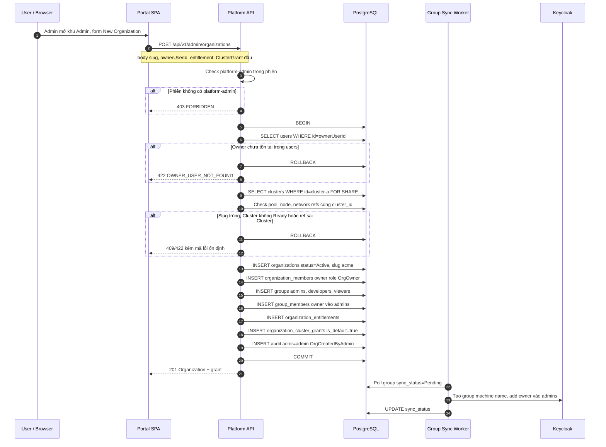

**Điểm cần review**

- Bước 4: authz admin ở backend theo realm role, không tin flag từ frontend [4.1][10.1].
- Bước 8–11: Owner phải là user đã login ít nhất một lần; plan ghi "owner (email/user)" nhưng chưa nói cách xử lý email chưa đăng ký. Chọn: từ chối với `OWNER_USER_NOT_FOUND` (giả định); phương án thay thế là tạo invitation role OrgOwner nhưng sẽ vi phạm "đúng một OrgOwner" trong lúc chờ.
- Bước 12–13: mọi ref trong grant (shared pool, NetworkPool, node grant, StorageClass) phải cùng `cluster_id` với grant; NetworkPool riêng phải có `organizationId` đúng Org hoặc null [5.2][7.1][15].
- Bước 18–24: cùng một transaction, giống cạnh approve ở mục 1b, để Org không bao giờ `Active` mà thiếu Owner hoặc thiếu default grant.
- Mã lỗi `OWNER_USER_NOT_FOUND` không có trong danh sách [16.5] (giả định).

### 2b. Nâng quota ClusterGrant và cấp dedicated node

**Mục đích:** Admin nâng quota nhưng không được hạ dưới tổng allocation hiện tại; cấp node là một Operation: controller kiểm node sạch tenant workload của Organization khác rồi mới gắn label/taint Organization [6.3][6.4]. API không có credential nào vào Cluster — mọi thứ đi qua CR `PlatformNodeGrant`.

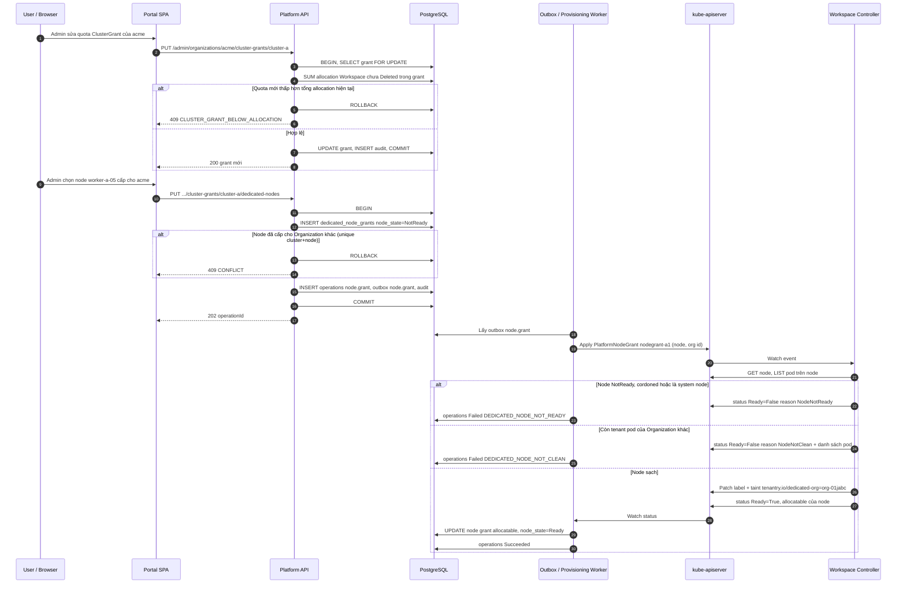

**Điểm cần review**

- Bước 3–7: đối xứng với rule Workspace không giảm quota dưới usage.
- Bước 13 và 30: grant mới có `node_state=NotReady` cho tới khi controller xác nhận, nên wizard chưa cho chọn node và reservation bị `DEDICATED_NODE_NOT_READY` — không cần thêm state nào cho "đang cấp".
- Bước 23–27: "pod lạ" = pod thuộc Namespace có label `tenantry.io/organization-id` khác acme; pod hệ thống (CNI, CSI, monitoring, DaemonSet) không tính [6.3]. Pod tenant không có label (drift) coi là lạ để an toàn. Operation `Failed` thì Admin drain node rồi retry.
- Controller tiếp tục cập nhật `status.allocatable` và Ready của `PlatformNodeGrant`; worker chép về DB, đó là nguồn của `capacity_state` và drift `Overcommitted` (`04-state-machines.md` mục 5).
- Unique `(cluster_id, node_name)` chặn cấp cùng node cho hai Organization; revoke node grant bị chặn khi còn reservation chưa `Released` [6.3].

---

## 3. Invitation: tạo link → invitee login → accept theo email đã verify

**Mục đích:** Owner tạo invite link one-time có expiry; membership chỉ được tạo khi email đã verify của account đang login khớp email trong invitation [9.1].

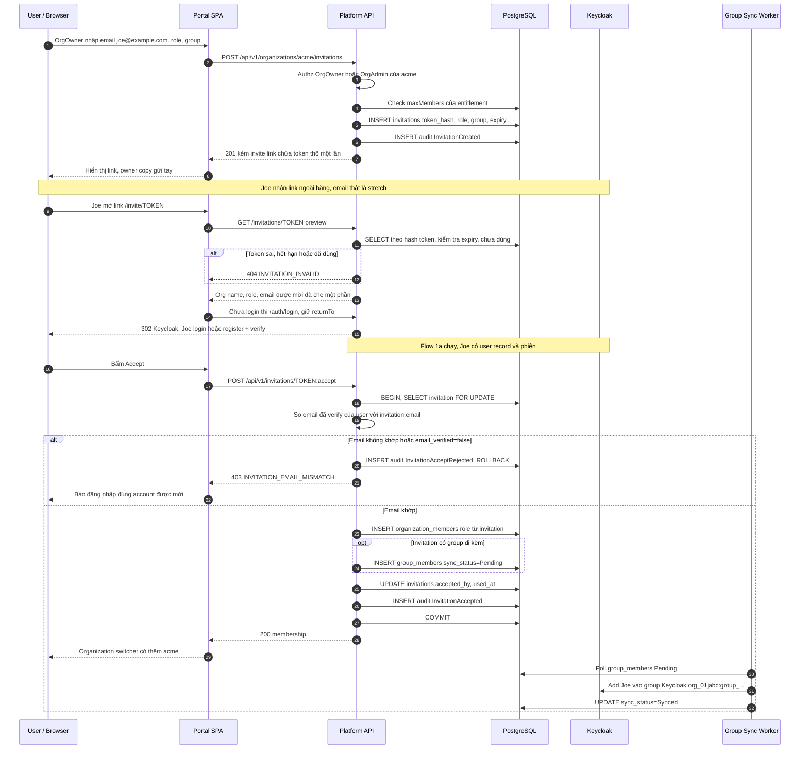

**Điểm cần review**

- Bước 5 và 7: DB chỉ lưu hash; token thô chỉ xuất hiện đúng một lần trong response 201 và không được log [20.1].
- Bước 22–26: so khớp với email đã verify trong `users` (chép từ ID token lúc login), so sánh case-insensitive; không có nhánh "owner xác nhận identity" [9.1]. Invitation không bị đốt khi mismatch để Joe có thể login lại đúng account (giả định).
- Bước 21: `SELECT FOR UPDATE` + cột `used_at` bảo đảm one-time khi hai tab cùng bấm Accept.
- Bước 4: `maxMembers` được check lúc tạo invite và check lại lúc accept (bước 27) vì số member có thể đổi trong lúc chờ (giả định).
- Nếu Joe đã là member acme, accept trả 409 và không tạo membership trùng; role không bị hạ/nâng ngầm (giả định).

---

## 4. Gỡ user khỏi group → Keycloak sync → logout → contract thu hồi

**Mục đích:** Gỡ user khỏi group là một tombstone trong DB; Group Sync Worker gỡ trên Keycloak, bảo trì group `tenantry:tenant-users` và logout user; token cũ vẫn hợp lệ tới TTL 5 phút [9.3][11.4]. Contract và hệ quả: `06-security-and-identity.md` mục 5.

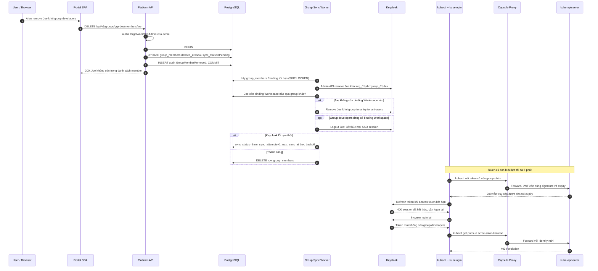

**Điểm cần review**

- Bước 5–7: sau commit, Joe mất group ngay với portal (mọi query lọc `deleted_at IS NULL`); row tombstone chỉ còn là việc chờ worker. Nếu Keycloak lỗi lâu thì Kubernetes vẫn thấy group cũ khi Joe login lại — cần alert `sync lag` [21.2].
- Bước 10–12: `tenantry:tenant-users` là điều kiện Capsule coi subject là Capsule user; chỉ gỡ khi user không còn **bất kỳ** binding Workspace nào trên platform, không tính theo Cluster [9.3].
- Bước 13–14: logout chặn refresh/new token, không làm JWT đã phát hành hết hạn sớm. Nó kết thúc **mọi** phiên của Joe: portal, Headlamp và kubectl của các Organization khác cũng phải login lại. Bước 20–22 là hành vi đúng thiết kế, phải ghi trên UI [19.2].
- Bước 15–18: retry với backoff; mọi lời gọi Keycloak ở bước 9–14 idempotent nên chạy lại từ đầu là an toàn.
- Remove member khỏi Organization và member tự rời (mục 11b) đi cùng đường này cho mọi group của Organization mà user thuộc.
- Đo "thời gian từ group change tới token mới có hiệu lực" là một chỉ số đánh giá [24.6].

---

## 5. Tạo Workspace Shared: transaction reservation → outbox → CR → controller → Ready

**Mục đích:** Một request tạo Workspace Shared đi qua validate, một transaction khóa ClusterGrant + soft-check pool + auto-allocate CIDR + ghi outbox, rồi worker apply CR và controller reconcile toàn bộ tài nguyên [5.3][7.2][14.3][17.1].

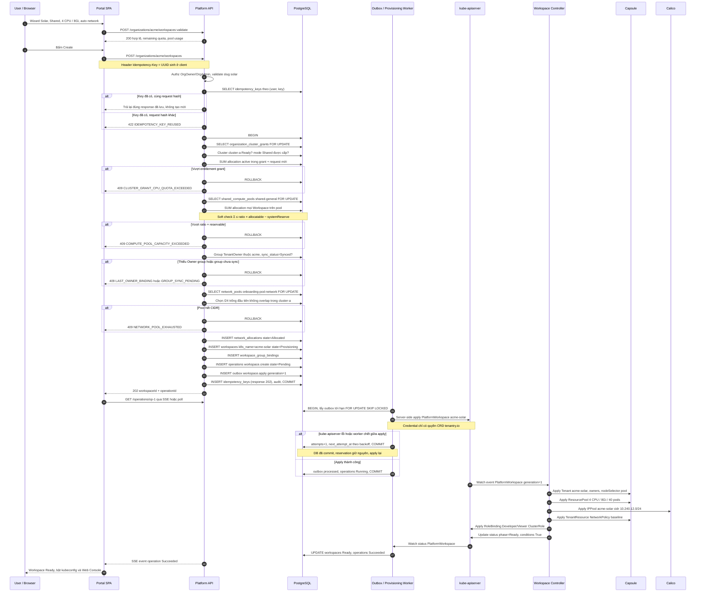

**Điểm cần review**

- Bước 8–12: `Idempotency-Key` tra theo `(user, key)`; row được ghi trong chính transaction tạo Workspace, nên retry của client nhận lại đúng response cũ và không tạo Workspace thứ hai [14.4]. Cơ chế: `IMPLEMENTATION-PLAN.md` mục 3.4.
- Bước 12–24 là **một** transaction: lock grant, shared pool, NetworkPool đều `FOR UPDATE` và đúng thứ tự đó (pool cũng phải khóa ghi, nếu không hai Organization cùng tạo trên một pool sẽ cùng đọc một tổng và cùng vượt trần); unique/exclusion constraint trên `network_allocations` là lớp chặn overlap thứ hai [5.3][7.2].
- Bước 20: shared là soft allocation — vượt `ratio × reservable` mới từ chối; portal cảnh báo khi pool gần trần nhưng Pod `Pending` khi mọi Workspace dùng hết quota là hành vi chấp nhận [6.2].
- Bước 42–47: "DB đã commit nhưng apply thất bại" được cứu bằng outbox retry; reservation **không** bị release vì controller lỗi tạm thời [17]. Server-side apply với field manager riêng bảo đảm apply lại không tạo trùng.
- Bước 49–54: controller không đọc DB; mọi thứ cần thiết nằm trong `spec` của CR.
- `Validating` và `Reserving` chỉ tồn tại trong request; row `workspaces` đầu tiên được ghi đã ở `Provisioning` (`04-state-machines.md` mục 1).

---

## 6. Tạo Workspace Dedicated: row lock chống overbook và membership label

**Mục đích:** Hai request đồng thời cùng reserve capacity trên `worker-a-05`; row lock trên `dedicated_node_grants` bảo đảm request thứ hai đọc lại tổng reservation và bị từ chối `DEDICATED_NODE_INSUFFICIENT_CAPACITY`; controller gắn membership label lên node [5.3][6.3][6.4][15].

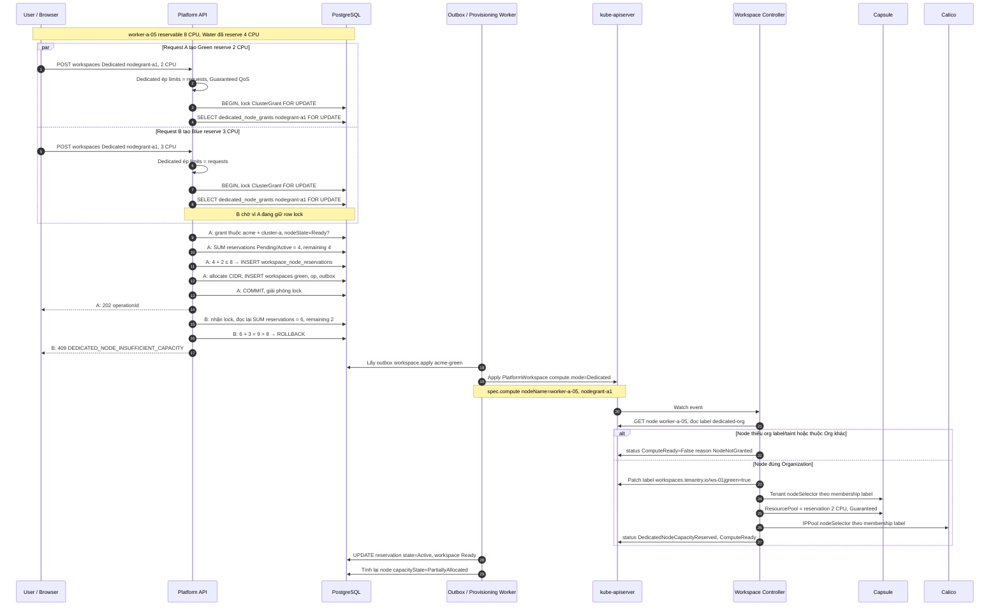

**Điểm cần review**

- Bước 4 và 9: cả hai transaction lock **cùng row** `dedicated_node_grants`; invariant `Σ reservation ≤ allocatable − systemReserve` được enforce bằng lock + đọc lại sau khi nhận lock (bước 17), không bằng `CHECK` [15]. Thứ tự lock luôn là ClusterGrant → node grant → NetworkPool để tránh deadlock (giả định).
- Bước 12: reservation `Pending` được tính vào tổng ngay khi commit, không chờ Workspace Ready; đây là lý do "reservation giữ nguyên khi provisioning lỗi" [17].
- Bước 2 và 7: Dedicated là hard reservation, ratio cố định 1, `requests = limits`; client gửi limits khác bị từ chối [5.4][16.4].
- Bước 24–31: controller chỉ **thêm** label membership của Workspace, không đụng label Organization và label của Water [6.4]. Admission trong Cluster inject toleration Organization và chặn user tự đặt `nodeName`/toleration [6.4].
- Bước 25–26: nếu node bị Admin đổi Org hoặc mất label (drift), Workspace chuyển `Degraded`/`Failed` với condition rõ, không tự chọn node khác [6.3][17].
- Response B nên kèm `remaining` để portal gợi ý allocation vừa đủ (giả định về payload lỗi).

---

## 7. Namespace: tạo từ portal qua CR và Namespace tạo bằng kubectl hiện lên portal

### 7a. Tạo Namespace từ portal

**Mục đích:** Portal không gọi Kubernetes bằng token user; authz ở API (OrgOwner/OrgAdmin hoặc member group TenantOwner), patch `spec.namespaces` qua outbox, controller tạo Namespace dưới Tenant, `status.namespaces` sync về DB [4.5][FR-06].

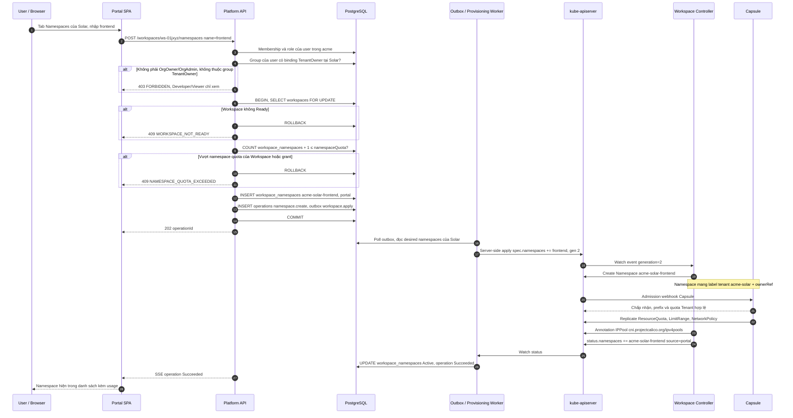

**Điểm cần review**

- Bước 3–6: authz hai nguồn — role Organization **hoặc** binding TenantOwner của group user thuộc; Developer/Viewer chỉ đọc. Đây là logic DB, không hỏi Kubernetes.
- Bước 12–15: quota Namespace check ở DB (đếm cả Namespace `source=kubectl`) và được Capsule check lại ở bước 25; nếu hai lớp lệch nhau (ví dụ kubectl vừa tạo thêm), controller báo condition thay vì tạo lén.
- Bước 22: controller tạo Namespace dưới Tenant với label tenant; controller là ServiceAccount không thuộc `oidc:tenantry:tenant-users` nên Capsule coi là admin path — cần test webhook chấp nhận và gắn đúng Tenant (giả định cần xác minh với Capsule).
- Bước 27: annotation IPPool do controller đặt; tenant bị Capsule cấm sửa annotation này [7.3].
- NFR: Namespace create p95 dưới 15 giây [23]; mã `NAMESPACE_QUOTA_EXCEEDED` chưa có trong plan (giả định).

### 7b. Namespace tạo bằng kubectl hiện lên portal qua status sync

**Mục đích:** Owner tạo Namespace bằng kubectl/Headlamp vẫn đi qua Capsule; controller quan sát và ghi `status.namespaces` với `source=kubectl`, worker sync về DB, portal hiển thị [4.5][14.2].

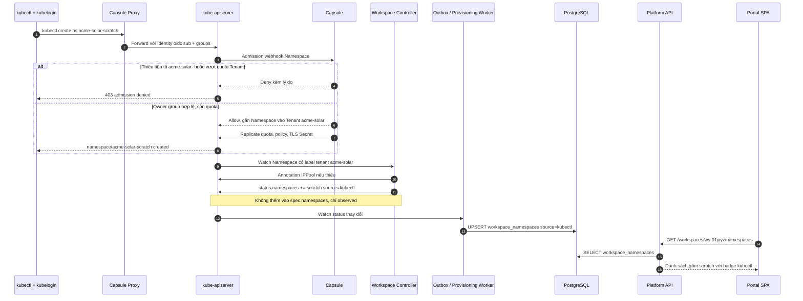

**Điểm cần review**

- Bước 12–14: controller watch Namespace theo label tenant của Capsule, không theo tên; Namespace `source=kubectl` không được đưa vào `spec.namespaces` để tránh controller "nhận nuôi" rồi xóa khi user bỏ khỏi portal.
- Xóa Namespace `source=kubectl` từ portal: API thêm tên vào `spec.namespacesToDelete`, controller xóa rồi dọn; Namespace có PVC yêu cầu gõ tên [4.5].
- Bước 13: annotation IPPool cho Namespace tạo ngoài portal — plan nói Namespace của Workspace có annotation chọn pool [7.3]; controller phải bù nếu Capsule replication chưa đặt (giả định).
- Nếu Namespace bị xóa bằng kubectl, controller gỡ khỏi `status.namespaces`; nếu tên đó có trong `spec.namespaces`, controller tạo lại (desired thắng) — cần xác nhận hành vi này là mong muốn.

---

## 8. kubectl access: kubeconfig → kubelogin → Capsule Proxy → RBAC/Capsule

**Mục đích:** Kubeconfig không chứa static token; kubelogin lấy token client `kubectl` qua SSO Keycloak, request đi Capsule Proxy được filter cluster-scoped và RBAC/Capsule quyết định quyền trong Workspace [11][8.4].

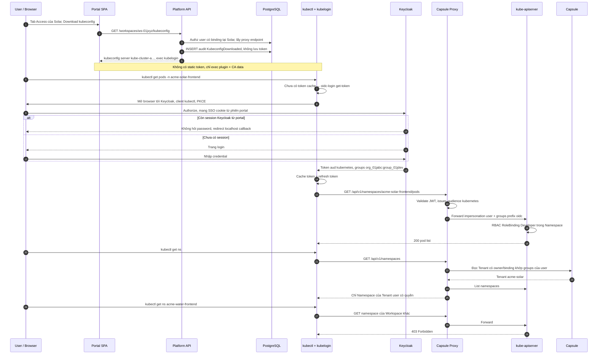

**Điểm cần review**

- Bước 3–5: endpoint proxy lấy từ `workspace.cluster_id` → `clusters.proxy_endpoint`; user không nhập endpoint; kubeconfig chứa Workspace ID chỉ để đặt context [11.1][11.2].
- Bước 10–12: SSO hoạt động vì cùng realm và cùng browser; client `kubectl` là public + PKCE, audience `kubernetes`; token `portal-api` không bao giờ được dùng cho Kubernetes [8.4].
- Bước 19–20: Capsule Proxy validate JWT rồi forward bằng impersonation; structured authentication của kube-apiserver cũng phải chấp nhận audience `kubernetes` để direct API và Proxy cho cùng kết quả ngoài phần filter [8.4][20.3].
- Bước 24–28: filter list cluster-scoped (Namespace, Node, PV, StorageClass) là việc của Proxy; RBAC không thể làm điều này cho `list` toàn cluster. Node `list` mặc định không được cấp trong Shared mode [6.2].
- Bước 29–32: từ chối đến từ RBAC của kube-apiserver, không phải Proxy; test `kubectl auth can-i` cho matrix TenantOwner/Developer/Viewer [10.5].

---

## 9. Headlamp web console qua SSO

**Mục đích:** Portal mở đúng Headlamp của Cluster chứa Workspace; Headlamp dùng OIDC client `headlamp-cluster-a` với SSO Keycloak, gửi token user tới Capsule Proxy cùng Cluster; không truyền token qua URL [12].

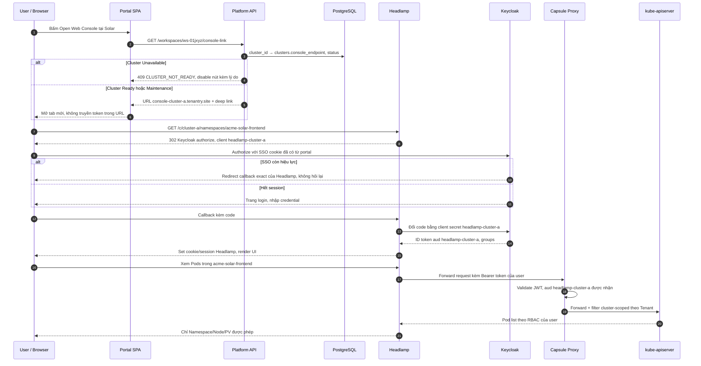

**Điểm cần review**

- Bước 3–8: URL console lấy từ Cluster registry; Cluster `Maintenance` vẫn cho mở console, chỉ `Unavailable` mới disable [6.1][12.4].
- Bước 10–18: mỗi Cluster một client `headlamp-{clusterId}` confidential, callback exact, audience riêng; structured authentication của Cluster phải chấp nhận audience này [8.4]. Phase 2 thêm Cluster là thêm client.
- Bước 20–23: Headlamp là identity-aware proxy — ServiceAccount của Headlamp không có quyền workload; mọi quyền là của token user [12.4].
- Deep link theo Namespace là tiện ích; user có nhiều Workspace trong Cluster sẽ thấy tất cả resource được phép — không phải lỗi isolation [12.5].
- Không iframe, không fork; mở tab mới để tránh CSP/cookie/callback trong frame [12.2][12.3].

---

## 10. Route: đưa app của tenant ra HTTPS

### 10a. Tạo Route trên portal → Ingress → request tới Pod

**Mục đích:** User khai báo Route trên portal; API ghép hostname và ghi `spec.routes` qua outbox; controller dựng Ingress; request đi qua Traefik với cert wildcard của platform [7.6].

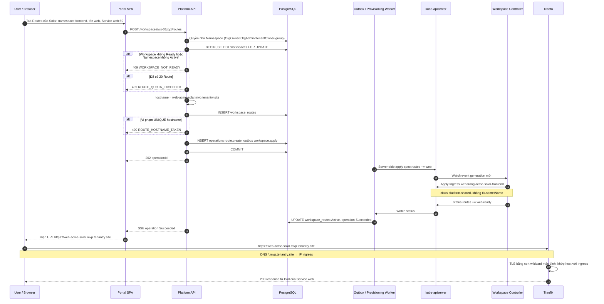

**Điểm cần review**

- Bước 3–4: cùng luật authz và cùng row lock `workspaces` với tạo Namespace (mục 7a); đếm Route dưới lock đó.
- Bước 9–13: user không nhập hostname; trùng chỉ xảy ra khi hai cặp (tên, Workspace) ghép ra cùng một chuỗi, và constraint ở DB quyết định.
- Bước 19–20: controller chạy bằng ServiceAccount được luật admission cho phép ghi Ingress; cần test Capsule không từ chối Ingress do controller tạo trong Namespace của Tenant.
- Bước 28: NetworkPolicy baseline phải cho phép traffic từ namespace `ingress-system` [7.4]; nếu Service không có Pod, Traefik trả 503 và Route vẫn `Active`.
- Mã `ROUTE_QUOTA_EXCEEDED`, `ROUTE_HOSTNAME_TAKEN` thêm vào OpenAPI khi làm M11.

### 10b. Tenant tự tạo Ingress hoặc Certificate bị admission từ chối

**Mục đích:** Route là đường duy nhất mở HTTP ra ngoài; tenant không tự chiếm hostname hay xin cert được [7.6][20.3].

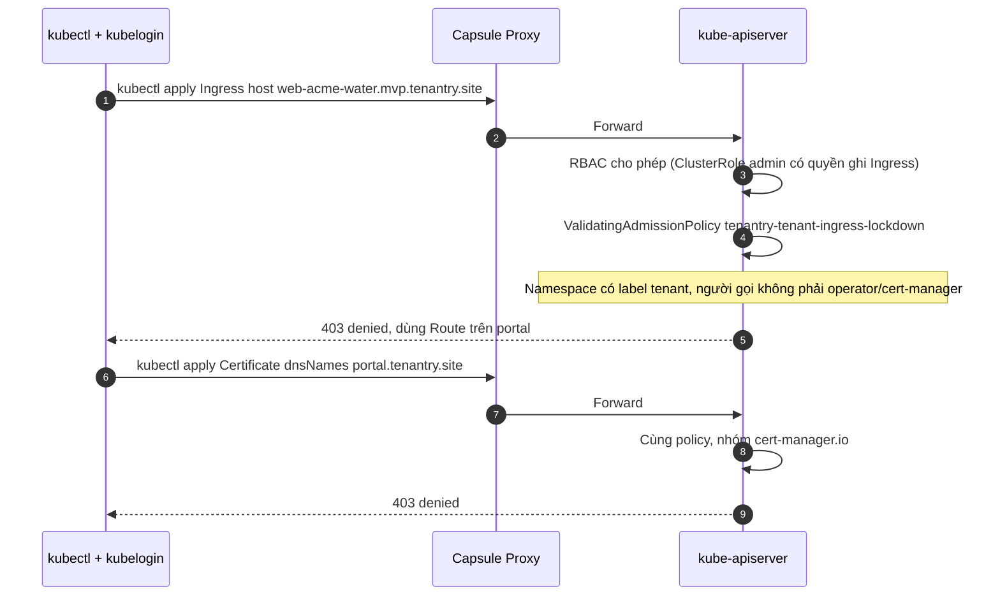

**Điểm cần review**

- Bước 3–4: chặn ở admission chứ không ở RBAC, vì RBAC chỉ cộng quyền và `admin` là role gộp sẵn; định nghĩa policy ở `05-network-and-scheduling.md` mục 7.
- Bước 7–10: không chặn `Certificate` thì tenant dùng được ClusterIssuer của platform để xin cert cho hostname bất kỳ dưới `tenantry.site`.
- Test isolation "tenant không tạo được Ingress/Certificate" [24.4].
- Custom domain là luồng riêng sau MVP, không có nhánh ở đây [7.6].

---

## 11. Transfer ownership hai bước và member tự rời Organization

### 11a. Transfer ownership: Owner đề nghị, OrgAdmin nhận xác nhận

**Mục đích:** Đúng một OrgOwner mỗi Organization; Owner đề nghị cho một OrgAdmin, người nhận xác nhận, đổi role hai bên trong một transaction [9.2][16.1]. Trạng thái: `04-state-machines.md` mục 8.

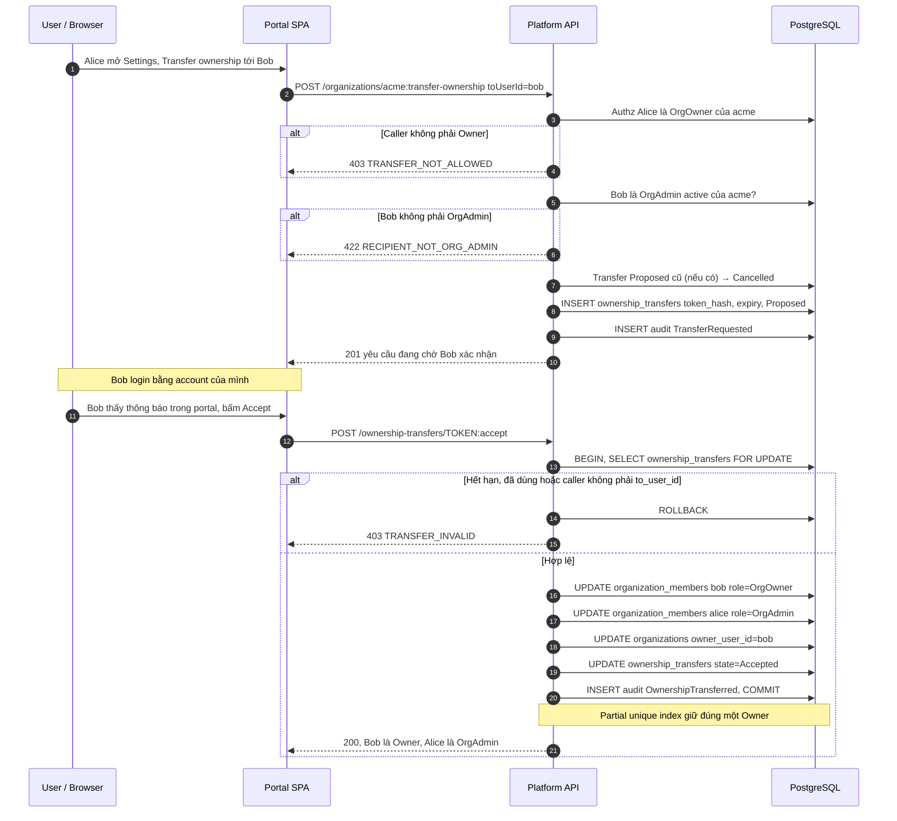

**Điểm cần review**

- Bước 3–9: chỉ Owner gọi được `:transfer-ownership`; OrgAdmin tự gọi là threat case phải test [20.3]. Người nhận bắt buộc là OrgAdmin hiện tại [9.2].
- Bước 21–25: đổi role hai bên trong một transaction để không có thời điểm nào Org có 0 hoặc 2 Owner; partial unique index trên `organization_members` role Owner là lớp bảo vệ DB [15].
- Bước 10: tối đa một transfer `Proposed` mỗi Org, đề nghị mới thay đề nghị cũ; nếu Bob mất role OrgAdmin trước khi accept, bước 17 kiểm tra lại và từ chối.
- Token xác nhận hiển thị trong portal của Bob (thông báo in-app), không cần gửi link vì Bob đã là member (giả định); mã lỗi trong luồng này chưa có trong [16.5] (giả định).
- Owner cũ thành OrgAdmin, không bị mất membership; group membership và binding không đổi [9.2].

### 11b. Member tự rời Organization

**Mục đích:** OrgMember/OrgAdmin tự rời Organization; Owner phải transfer trước; rời kéo theo gỡ mọi group của Organization đó [9.4].

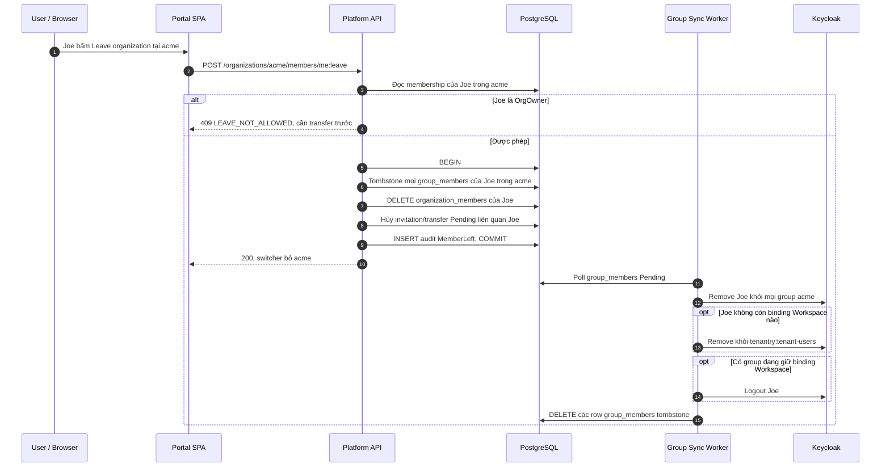

**Điểm cần review**

- Bước 3–5: chỉ một điều kiện chặn — Joe là Owner thì phải transfer trước [9.4].
- Bước 7–10: row membership bị xóa hẳn nên Joe mất quyền portal ở acme ngay; lịch sử nằm ở audit. Rời Org không xóa account Keycloak; Joe vẫn thuộc các Org khác [9.4].
- Bước 12–19: cùng đường sync/logout như mục 4; contract token cũ tới TTL áp dụng y hệt.
- Owner remove member (`DELETE /members/{userId}`) dùng cùng nhánh `else`, thêm rule "không remove được OrgOwner" [9.4].

---

## 12. Delete Workspace: confirm → cordon → xóa → chờ finalizer → release có thứ tự

**Mục đích:** Xóa ngay và mất dữ liệu PVC sau confirm gõ tên; controller dọn theo thứ tự an toàn, CIDR chỉ release sau khi Calico sạch và đi qua `Quarantined`; finalizer kẹt → `Blocked`, chỉ Platform Admin `:force` [7.5][17.4].

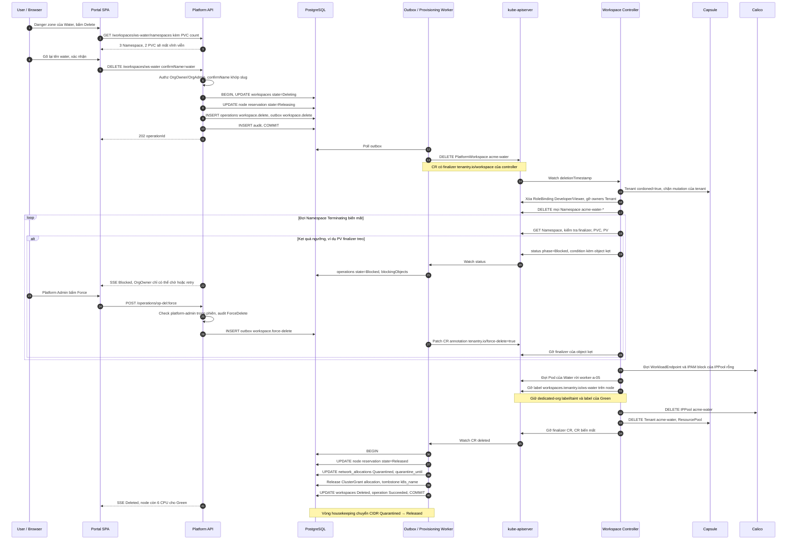

**Điểm cần review**

- Bước 4–6: confirm gõ lại tên; chọn so với slug `water` (giả định — plan nói "tên Workspace"). UI phải liệt kê số Namespace/PVC trước khi cho bấm [17.4].
- Bước 8 và 41–44: reservation sang `Releasing` ngay khi nhận lệnh nhưng chỉ `Released` sau khi controller dọn xong; capacity node chỉ hoàn lại lúc đó [17]. Green vẫn chạy, org label/taint không đổi [6.3][6.4].
- Bước 20–31: `Blocked` là trạng thái chờ có thông tin object kẹt; OrgOwner chỉ chờ/retry, `:force` yêu cầu `platform-admin` và được audit [16.5]. Force đi bằng annotation, không bằng `spec`, để không sinh generation mới.
- Bước 32–35: thứ tự bắt buộc — Calico sạch → gỡ membership label → xóa IPPool → Tenant; không release CIDR khi còn WorkloadEndpoint [7.4][7.5].
- Bước 43 và 47: CIDR qua `Quarantined` rồi mới `Released`; trong lúc đó `k8s_name` cũng chưa dùng lại được [17.4]. Độ dài quarantine cấu hình được, mặc định 10 phút.
- Worker chết giữa bước 40–44: transaction DB atomic; khi restart, worker thấy CR đã biến mất và workspace còn `Deleting` → chạy lại bước 40 (xem mục 13b).

---

## 13. Lan truyền trạng thái Operation và phục hồi sau restart

### 13a. Worker ↔ CR status ↔ DB ↔ portal

**Mục đích:** Một Operation phản chiếu status của CR theo generation; condition cụ thể chỉ ra component lỗi; retry đi lại qua outbox mà không tạo resource trùng [14.3][14.4][17].

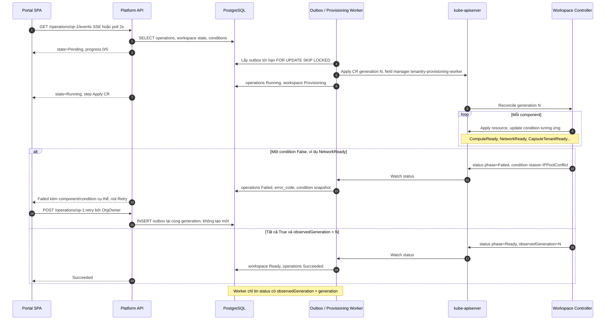

**Điểm cần review**

- Bước 4: `SKIP LOCKED` cho phép chạy nhiều worker replica mà không xử lý trùng một event. Không cần lease: row lock được giữ suốt transaction giao event, worker chết thì transaction rollback và lock tự nhả.
- Bước 13–15: không dùng một cờ `error` chung; mỗi condition có `reason` để portal chỉ ra component lỗi [14.4][23].
- Bước 17–18: retry của OrgOwner/OrgAdmin chỉ tạo outbox event mới cùng generation; Platform Admin retry/force mọi operation. Reservation không đổi khi retry [17].
- Bước 25: worker bỏ qua status có `observedGeneration < generation` để không đánh dấu `Ready` từ thế hệ cũ trong lúc update.
- SSE hay poll là lựa chọn triển khai; contract là `GET /operations/{id}` trả cùng payload [14.3][16.5].

### 13b. Worker và controller restart giữa chừng

**Mục đích:** Sau restart, worker apply lại outbox chưa processed và resync mọi Workspace đang chuyển trạng thái; controller reconcile lại từ spec, so `observedGeneration`, không dựa vào in-memory state [14.4][23][24.5].

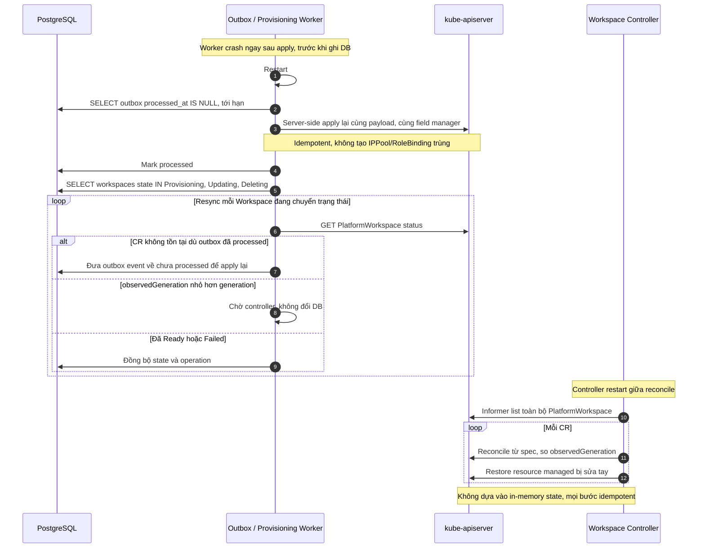

**Điểm cần review**

- Bước 3–5: "processed" chỉ được ghi **sau** khi apply thành công; nếu crash giữa hai bước thì apply lại là an toàn nhờ server-side apply cùng field manager [14.4].
- Bước 9–10: với Workspace `Deleting` mà CR đã biến mất, "CR không tồn tại" nghĩa là xóa xong → chạy phần release DB của mục 12 (bước 40–44), không apply lại.
- Bước 18–20: controller-runtime requeue toàn bộ sau restart; drift do sửa tay resource managed được restore [14.4]; reconcile phải idempotent với cùng generation.
- Kịch bản test bắt buộc: worker chết giữa apply và retry không duplicate; controller restart giữa provisioning; kube-apiserver tạm lỗi sau DB commit [24.5].
- Reconcile latency theo số Workspace 10/20/50 là chỉ số đánh giá [24.6].
