# Tenantry — 03. Luồng nghiệp vụ và kỹ thuật

Tài liệu này vẽ 13 luồng chính của Tenantry dưới dạng `sequenceDiagram`. Đây là **góc nhìn**, không định nghĩa gì mới: quy tắc ở `PRODUCT-PLAN.md` (số trong ngoặc vuông như [5.3] trỏ về đó), trạng thái ở `04-state-machines.md`, schema ở `02-data-model.md`, phiên và thu hồi quyền ở `06-security-and-identity.md`.
Mỗi luồng có ba phần: **Mục đích** một dòng, **sơ đồ Mermaid** đánh số bước bằng `autonumber`, và **Điểm cần review** liệt kê quyết định/bất biến mà luồng phụ thuộc cùng nhánh lỗi — người review đi từng bước và tick từng bullet.
Nhánh lỗi, nhánh tùy chọn và xử lý đồng thời được vẽ bằng `alt` / `opt` / `loop` / `par`; số bước dùng để trích dẫn khi góp ý.
Ví dụ xuyên suốt: Organization `acme` (id `org-01jabc`), Workspace `solar` → tên Kubernetes `acme-solar`, Cluster `cluster-a`, node dedicated `worker-a-05` qua `nodegrant-a1`, các Workspace Dedicated `water` và `green`.
Sơ đồ vẽ trạng thái đích của MVP; bước chỉ có từ một milestone về sau thì ghi "(từ Mx)" (milestone ở `IMPLEMENTATION-PLAN.md`). Câu hỏi còn mở trỏ về `REVIEW-CHECKLIST.md` bằng mã của nó; tài liệu này không tự chọn phương án.
Audit action viết theo dạng `<resource>.<verb>` như hằng số trong `backend/internal/audit/audit.go`.

## Chú giải participant

Tên và alias được giữ nguyên trong mọi sơ đồ; sơ đồ nào không cần participant nào thì bỏ qua nhưng không đổi tên.

| Alias | Tên trong sơ đồ | Vai trò trong Tenantry |
|---|---|---|
| `U` | User / Browser | Người dùng cuối, OrgOwner, Platform Admin hoặc trình duyệt của họ |
| `SPA` | Portal SPA | Frontend Vue, gọi Platform API qua cookie phiên |
| `API` | Platform API | Backend Go kiêm BFF: authz, validation, reservation, operation, phiên |
| `DB` | PostgreSQL | Source of truth cho product state, outbox, phiên portal |
| `KC` | Keycloak | Account, OIDC, group claim, realm role `platform-admin` |
| `PW` | Outbox / Provisioning Worker | Đọc `outbox_events`, apply `PlatformWorkspace` CR bằng credential scoped, đồng bộ status về DB |
| `GS` | Group Sync Worker | Đồng bộ group/membership từ DB sang Keycloak, logout user khi thu hồi quyền |
| `K8S` | kube-apiserver | API server của Cluster chứa Workspace |
| `CTRL` | Workspace Controller | controller-runtime trong Cluster, reconcile CR `tenantry.io` |
| `CAP` | Capsule | Capsule Operator: Tenant (kèm quota chung), TenantResource, admission |
| `CAL` | Calico | IPPool, IPAM, NetworkPolicy enforcement |
| `PROXY` | Capsule Proxy | Endpoint `kube-a.tenantry.site`, filter cluster-scoped |
| `HL` | Headlamp | Web console per Cluster, client OIDC `headlamp-cluster-a` |
| `KL` | kubectl + kubelogin | CLI của user với exec plugin OIDC, client `kubectl` |
| `ING` | Traefik | Shared ingress controller, cert wildcard `*.mvp.tenantry.site` |

---

## 1. Đăng nhập lần đầu và xin tạo Organization

### 1a. First login / sign-up: chỉ tạo user record và phiên

**Mục đích:** Một account đăng ký qua Keycloak; callback chỉ upsert user và tạo phiên portal. Không Organization nào được tạo tự động [4.2][8.1][8.3].

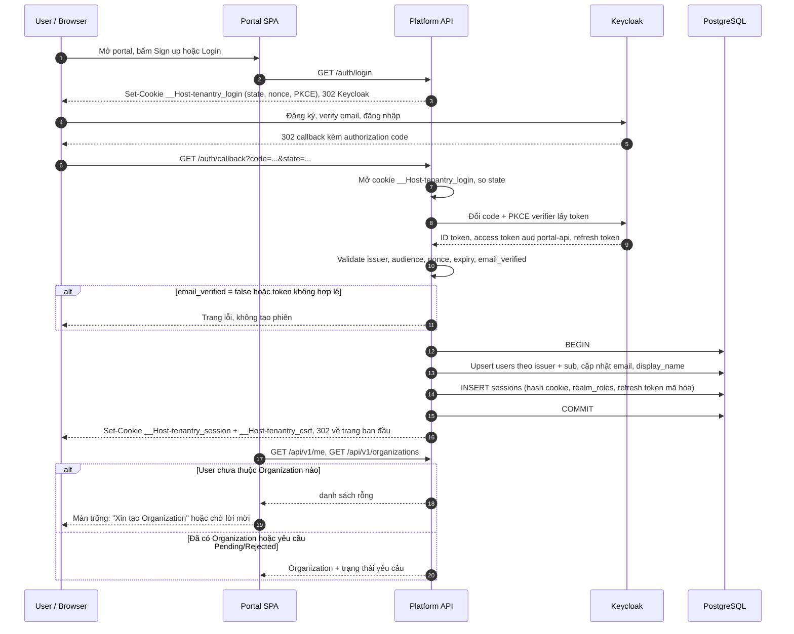

**Điểm cần review**

- Bước 13: identity key duy nhất là `(issuer, sub)`; email/display name chỉ là snapshot [4.1]. Upsert nên login hai lần, hoặc hai callback song song, không tạo hai user.
- Bước 10–11: `email_verified=true` là điều kiện tạo phiên, để flow Invitation (mục 3) tin được email của phiên (Keycloak required action Verify Email). Thư xác minh ở cụm MVP đi vào Mailpit, xem `06-security-and-identity.md` mục 3.
- Bước 3, 7, 14, 16: cơ chế cookie, phiên, refresh và logout định nghĩa ở `06-security-and-identity.md` mục 3; sơ đồ này không lặp lại.
- User có `users.status = Disabled` không qua được request kế tiếp (bước 17): API trả 401 và xóa phiên.

### 1b. Xin tạo Organization → Platform Admin duyệt hoặc từ chối

**Mục đích:** User gửi yêu cầu (Organization `Pending`, giữ chỗ slug, người xin là OrgOwner); Admin duyệt kèm ClusterGrant điền sẵn từ onboarding policy, hoặc từ chối kèm lý do và nhả slug [4.2][5.2.1][16.5]. Trạng thái: `04-state-machines.md` mục 11.

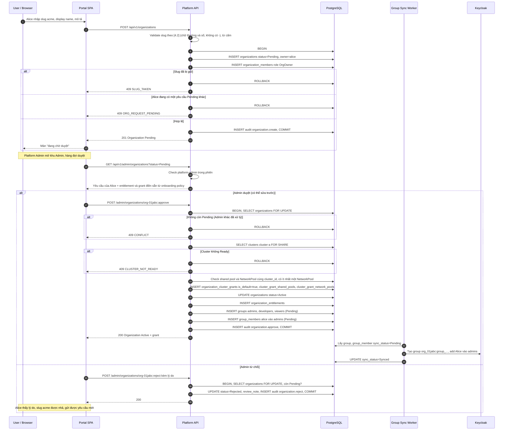

**Điểm cần review**

- Bước 5–10: hai nhánh lỗi đến từ hai partial unique index (slug, một `Pending` mỗi user), không phải từ `SELECT` trước khi insert — nên hai request đồng thời vẫn chỉ một thắng.
- Bước 18–30 là **một** transaction: Organization không bao giờ `Active` mà thiếu entitlement, default grant hay group mặc định. Lock đi theo thứ tự cố định ở `02-data-model.md` mục 4 (`organizations` → `clusters`).
- Bước 18–20 và 36: duyệt và từ chối đều khóa row Organization và chỉ chạy khi còn `Pending`, nên hai Admin xử lý cùng lúc thì người sau nhận `409`.
- Bước 21–23: Cluster phải `Ready`; onboarding policy trỏ default Cluster không tồn tại hoặc không `Ready` thì Admin phải chọn Cluster khác hoặc sửa policy trước.
- Bước 32–34 chạy bất đồng bộ; Alice vào wizard ngay được nhưng tạo Workspace sẽ bị `GROUP_SYNC_PENDING` tới khi group `admins` sync xong [16.5][17.1].
- Grant đã cấp là snapshot của policy tại lúc duyệt [5.2.1].

---

## 2. Platform Admin tạo thẳng Organization cho khách và nâng entitlement

### 2a. Tạo thẳng Organization kèm Owner và ClusterGrant ban đầu

**Mục đích:** Platform Admin (realm role `platform-admin`) tạo Organization `Active` ngay cho khách, không qua bước xin–duyệt: gán đúng một OrgOwner và ClusterGrant ban đầu trong một thao tác [4.2][16.5].

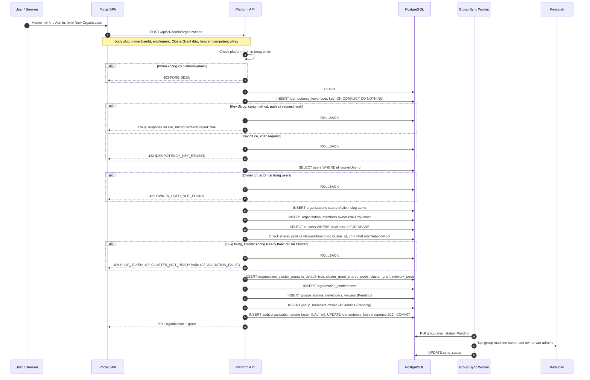

**Điểm cần review**

- Bước 3–4: authz admin ở backend theo realm role, không tin flag từ frontend [4.1][10.1].
- Bước 6–10 và 24: `Idempotency-Key` bắt buộc với mọi `POST /admin/*` tạo resource; giành ngay sau `BEGIN`, response ghi vào row trước `COMMIT`, như mục 5 (`IMPLEMENTATION-PLAN.md` mục 3.4).
- Bước 11–13: Owner phải là user đã login ít nhất một lần, nếu không trả `OWNER_USER_NOT_FOUND` (`04-state-machines.md` mục 11). Tạo invitation role OrgOwner thay thế sẽ vi phạm "đúng một OrgOwner" trong lúc chờ.
- Bước 16–19: mọi ref trong grant (shared pool, NetworkPool, StorageClass) phải cùng `cluster_id` với grant, grant có ít nhất một NetworkPool, NetworkPool riêng chỉ vào grant của đúng Org (`02-data-model.md` mục 3) [5.2][7.1]. Dedicated node không nằm trong thao tác này: cấp sau qua mục 2b.
- Bước 5–24 là một transaction, giống cạnh approve ở mục 1b, để Org không bao giờ `Active` mà thiếu Owner, default grant hay group mặc định.

### 2b. Nâng quota ClusterGrant và cấp dedicated node

**Mục đích:** Admin nâng quota nhưng không được hạ dưới tổng đã giữ chỗ; cấp node là một Operation: controller kiểm node không còn Pod tenant nào rồi mới gắn label/taint Organization [6.3][6.4]. API không có credential nào vào Cluster — mọi thứ đi qua CR `PlatformNodeGrant`.

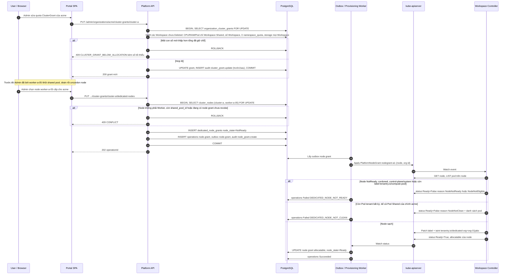

**Điểm cần review**

- Bước 3–8: đối xứng với rule Workspace không giảm quota dưới usage; con số nào tính trên Workspace nào theo [5.5]. Phép `SUM` có từ M7, cùng transaction giữ chỗ (`IMPLEMENTATION-PLAN.md` M5, M7).
- Bước 11–13: API khóa row `cluster_nodes` trước khi tạo grant (thứ tự lock ở `02-data-model.md` mục 4), nên một node không thể vừa vào shared pool vừa được cấp dedicated; unique `(cluster_id, node_name)` của grant chưa revoke là lưới an toàn. Operator kiểm lại trên Cluster ở bước 21–25.
- Bước 14 và 29: grant mới có `node_state=NotReady` cho tới khi controller xác nhận, nên wizard chưa cho chọn node và reservation bị `DEDICATED_NODE_NOT_READY` — không cần thêm state nào cho "đang cấp".
- Bước 21–25: node phải `Ready`, schedulable, không phải control-plane/system, không mang label `tenantry.io/compute-pool` và không còn Pod tenant nào (Pod trong Namespace có label `capsule.clastix.io/tenant`), kể cả Pod Shared của chính acme; Pod hệ thống (CNI, CSI, monitoring, DaemonSet) không tính [6.3]. Quy trình của Admin: bớt node khỏi pool trên portal → drain → uncordon → cấp; node không còn label pool nên Pod Shared không quay lại. Operation `Failed` thì Admin dọn node rồi retry.
- Controller tiếp tục cập nhật `status.allocatable` và Ready của `PlatformNodeGrant`; worker chép về DB, đó là nguồn của `capacity_state` và drift `Overcommitted` (`04-state-machines.md` mục 5).
- Revoke node grant đặt `revoked_at` và bị chặn khi còn reservation chưa `Released` [6.3] (`02-data-model.md` mục 3).
- Sơ đồ là trạng thái từ M8, khi operator kiểm node và gắn label/taint. M5 chỉ ghi DB, chưa có Operation/outbox; từ M6 worker dựng `PlatformNodeGrant` từ DB lúc khởi động và mỗi lần resync (`IMPLEMENTATION-PLAN.md` M5, M6).

---

## 3. Invitation: tạo link → invitee login → accept theo email đã verify

**Mục đích:** Owner tạo invite link one-time có expiry; membership chỉ được tạo khi email đã verify của account đang login khớp email trong invitation [9.1].

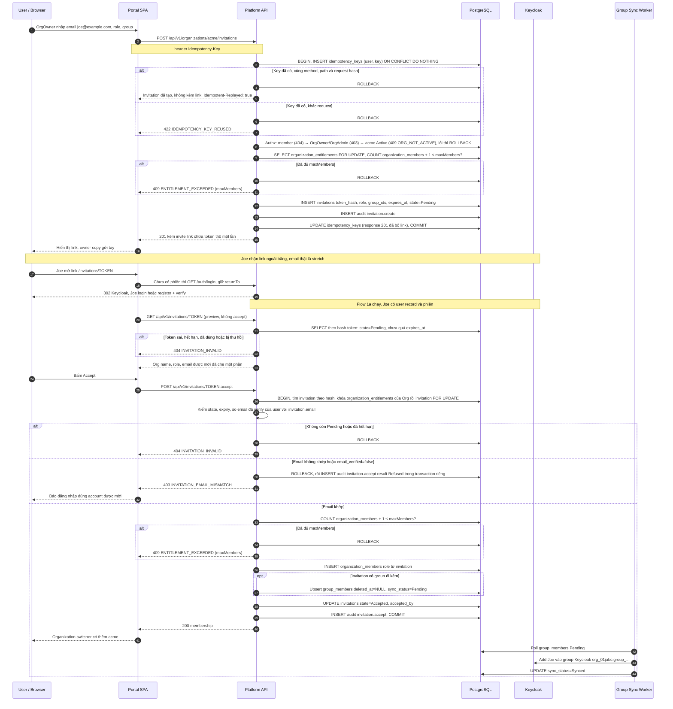

**Điểm cần review**

- Bước 3–7 và 14: `Idempotency-Key` bắt buộc với `POST …/invitations`, giành ngay sau `BEGIN` như mục 5. Response lưu trong `idempotency_keys` **không** chứa link/token, nên replay chỉ trả invitation và UI báo "link đã tạo trước đó, tạo link mới (và thu hồi link cũ)" (`IMPLEMENTATION-PLAN.md` mục 3.4).
- Bước 12 và 15: DB chỉ lưu hash; token thô chỉ xuất hiện đúng một lần trong response 201 và không được log [20.1].
- Bước 8: thứ tự kiểm membership (404) → role (403) → trạng thái (409) [9.2]; Organization chưa `Active` không mời được.
- Bước 9–11 và 33–35: `maxMembers` kiểm lúc tạo invite và kiểm lại lúc accept, dưới lock `organization_entitlements` (`02-data-model.md` mục 4), vì số member có thể đổi trong lúc chờ và hai accept đồng thời không được cùng lọt.
- Bước 17–23: preview chỉ dành cho người đã login và không accept.
- Bước 26 và 38: khóa row invitation rồi chuyển `state` `Pending → Accepted` bảo đảm one-time khi hai tab cùng bấm Accept (`04-state-machines.md` mục 7).
- Bước 27–32: so khớp với email đã verify trong `users` (chép từ ID token lúc login), so sánh case-insensitive; không có nhánh "owner xác nhận identity" [9.1]. Mismatch không đốt invitation để Joe login lại đúng account. Audit của lần bị từ chối ghi sau `ROLLBACK` trong transaction riêng, nếu không sẽ mất theo rollback.
- Bước 37: Joe có thể còn row tombstone trong `group_members` từ lần rời trước, nên dùng upsert (`02-data-model.md` mục 2).
- Nếu Joe đã là member acme, accept trả 409, không tạo membership trùng và không đổi role ngầm.

---

## 4. Gỡ user khỏi group → Keycloak sync → logout → contract thu hồi

**Mục đích:** Gỡ user khỏi group là một tombstone trong DB; Group Sync Worker gỡ trên Keycloak, bảo trì group `tenantry:tenant-users` và logout user; token cũ vẫn hợp lệ tới TTL 5 phút [9.3][11.4]. Contract và hệ quả: `06-security-and-identity.md` mục 5.

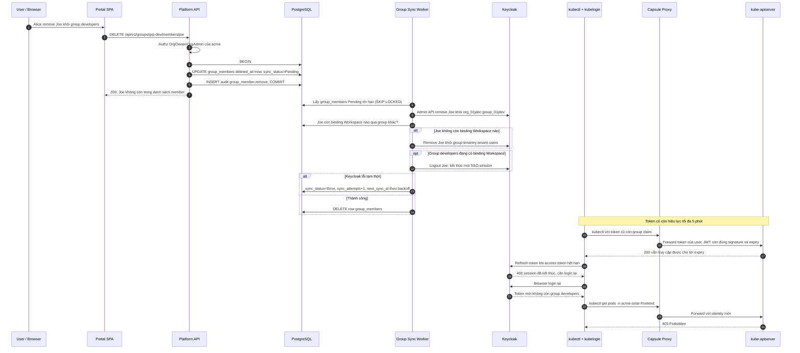

**Điểm cần review**

- Bước 5–7: sau commit, Joe mất group ngay với portal (mọi query lọc `deleted_at IS NULL`); row tombstone chỉ còn là việc chờ worker. Nếu Keycloak lỗi lâu thì Kubernetes vẫn thấy group cũ khi Joe login lại — cần alert `sync lag` [21.2].
- Bước 10–11: `tenantry:tenant-users` là điều kiện Capsule coi subject là Capsule user; chỉ gỡ khi user không còn **bất kỳ** binding Workspace nào trên platform, không tính theo Cluster [9.3].
- Bước 12: logout chặn refresh/new token, không làm JWT đã phát hành hết hạn sớm. Nó kết thúc **mọi** phiên của Joe: portal, Headlamp và kubectl của các Organization khác cũng phải login lại. Bước 18–21 là hành vi đúng thiết kế, phải ghi trên UI [19.2].
- Bước 13–14: retry với backoff; mọi lời gọi Keycloak ở bước 9, 11, 12 idempotent nên chạy lại từ đầu là an toàn.
- Bước 15–24: contract "mất quyền Kubernetes chậm nhất sau TTL" chỉ đúng vì TenantOwner không tự bind được user hay group ngoài Organization bằng RoleBinding của riêng họ (luật admission ở `06-security-and-identity.md` mục 4).
- Remove member khỏi Organization và member tự rời (mục 11b) đi cùng đường này cho mọi group của Organization mà user thuộc.
- Đo "thời gian từ group change tới token mới có hiệu lực" là một chỉ số đánh giá [24.6].

---

## 5. Tạo Workspace Shared: transaction reservation → outbox → CR → controller → Ready

**Mục đích:** Một request tạo Workspace Shared đi qua validate, một transaction khóa entitlement + ClusterGrant + soft-check pool + auto-allocate CIDR + ghi outbox, rồi worker apply CR và controller reconcile toàn bộ tài nguyên [5.3][7.2][14.3][17.1].

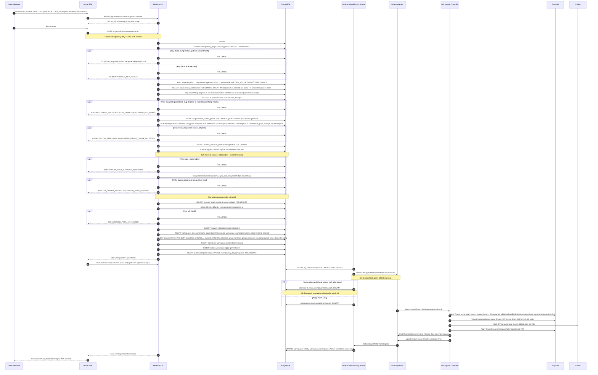

**Điểm cần review**

- Bước 6–11 và 38: `Idempotency-Key` được giành theo `(user, key)` ngay đầu transaction tạo Workspace và response được ghi vào row trước khi commit, nên retry của client nhận lại đúng response cũ và không tạo Workspace thứ hai [14.4]. Cơ chế: `IMPLEMENTATION-PLAN.md` mục 3.4.
- Bước 6–38 là **một** transaction, lock theo thứ tự cố định ở `02-data-model.md` mục 4: `organization_entitlements` (13) → `clusters` FOR SHARE (15) → grant (18) → shared pool (22) → NetworkPool (29) → `groups` FOR SHARE (35). Pool cũng phải khóa ghi, nếu không hai Organization cùng tạo trên một pool sẽ cùng đọc một tổng và cùng vượt trần; exclusion constraint trên `network_allocations` là lớp chặn overlap thứ hai [5.3][7.2].
- Bước 12: thứ tự kiểm membership (404) → role (403) → trạng thái (409) [9.2].
- Bước 13–17: `maxWorkspacesTotal` kiểm dưới lock `organization_entitlements`; lock này cũng xếp hàng mọi lần tạo Workspace của acme, nên kiểm slug lồng tiền tố ở bước 14 không bị race. Slug lồng tiền tố tại dấu `-` (`solar` và `solar-prod`) bị từ chối vì `forceTenantPrefix` của Capsule sẽ cho Workspace này tạo Namespace trong vùng tên của Workspace kia [4.4]; `UNIQUE (k8s_name)` là lưới an toàn.
- Bước 18–21: Shared dùng được khi grant có shared pool [5.2]. Workspace Shared trừ CPU/RAM/Pod vào quota của grant; số Workspace, Σ `namespace_quota` và storage trừ vào grant với cả hai mode. Vượt grant trả `CLUSTER_GRANT_QUOTA_EXCEEDED` với `details.resource`, `limit`, `allocated`, `requested`.
- Bước 22–25: shared là soft allocation — vượt `ratio × reservable` mới từ chối; portal cảnh báo khi pool gần trần nhưng Pod `Pending` khi mọi Workspace dùng hết quota là hành vi chấp nhận [6.2].
- Bước 29–33 và 48–49 có từ M9: Workspace tạo ở M6–M8 không có `network_allocations`, IPPool hay NetworkPolicy baseline, nên chưa được cô lập mạng (`IMPLEMENTATION-PLAN.md` M9).
- Bước 34: body có thể kèm `namespaces` (hậu tố, ví dụ `frontend`); số lượng không vượt `namespaceQuota`, được tạo cùng Workspace qua `spec.namespaces`.
- Bước 35: tập binding thay đổi nên mọi `group_members` còn sống của các group được bind chuyển `Pending`, để Group Sync tính lại `tenantry:tenant-users` ([9.3], `IMPLEMENTATION-PLAN.md` mục 5.2).
- Bước 41–44: "DB đã commit nhưng apply thất bại" được cứu bằng outbox retry; reservation **không** bị release vì controller lỗi tạm thời [17]. Server-side apply với field manager riêng bảo đảm apply lại không tạo trùng.
- Bước 45–51: controller không đọc DB; mọi thứ cần thiết nằm trong `spec` của CR. ServiceAccount của operator là owner của mọi Tenant nên tạo được Namespace qua Capsule. Tenant `nodeSelector` có từ M8.
- `Validating` và `Reserving` chỉ tồn tại trong request; row `workspaces` đầu tiên được ghi đã ở `Provisioning` (`04-state-machines.md` mục 1).

---

## 6. Tạo Workspace Dedicated: row lock chống overbook và membership label

**Mục đích:** Hai request đồng thời cùng reserve capacity trên `worker-a-05`; transaction khóa theo thứ tự cố định nên request thứ hai chờ, đọc lại tổng reservation dưới lock và bị từ chối `DEDICATED_NODE_INSUFFICIENT_CAPACITY`; controller gắn membership label lên node [5.3][6.3][6.4]. Sơ đồ là trạng thái từ M8.

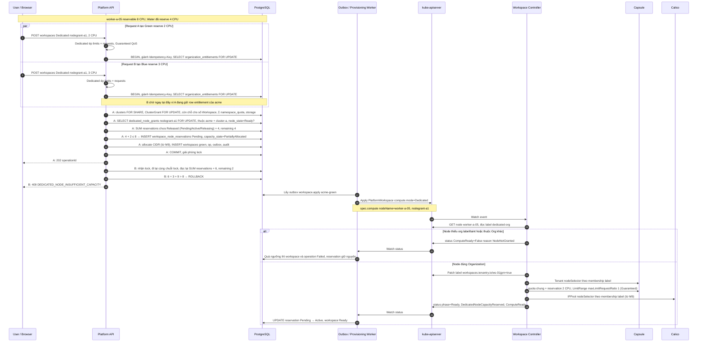

**Điểm cần review**

- Bước 3 và 6: transaction tạo Workspace khóa theo thứ tự cố định ở `02-data-model.md` mục 4 (`organization_entitlements` → `clusters` → ClusterGrant → `dedicated_node_grants` → NetworkPool), nên hai request của cùng Organization xếp hàng ngay ở row entitlement. Row `dedicated_node_grants` vẫn phải khóa vì resize, revoke và worker (chép allocatable) cũng ghi vào nó. Invariant `Σ reservation ≤ allocatable − systemReserve` được enforce bằng lock + đọc lại sau khi nhận lock (bước 14), không bằng `CHECK`.
- Bước 7: Workspace Dedicated không trừ CPU/RAM/Pod vào grant; chỉ số Workspace, Σ `namespace_quota` và storage tính chung với Shared [5.2].
- Bước 9: tổng gồm mọi reservation chưa `Released`, kể cả `Releasing` của Workspace đang xóa — capacity chỉ hoàn lại khi Workspace đó đã dọn xong (`04-state-machines.md` mục 3).
- Bước 10: reservation `Pending` được tính vào tổng ngay khi commit, không chờ Workspace Ready, và `capacity_state` tính lại trong cùng transaction; đây là lý do "reservation giữ nguyên khi provisioning lỗi" [17].
- Bước 2 và 5: Dedicated là hard reservation, ratio cố định 1, `requests = limits`; client gửi limits khác bị từ chối [5.4][16.4]. LimitRange với `maxLimitRequestRatio` 1 giữ Guaranteed QoS cho từng container.
- Bước 24–28: controller chỉ **thêm** label membership của Workspace, không đụng label Organization và label của Water [6.4]. `PodNodeSelector` và `PodTolerationRestriction` (annotation trên Namespace Dedicated) inject selector và toleration của Organization; kubelet kiểm lại nodeSelector nên `nodeName` không đưa Pod ra khỏi node được (`05-network-and-scheduling.md` mục 2).
- Bước 20–23: nếu node bị Admin đổi Org hoặc mất label (drift), Workspace chuyển `Degraded`/`Failed` với condition rõ, không tự chọn node khác [6.3][17].
- Bước 30: reservation `Pending → Active` khi Workspace `Ready` lần đầu (`04-state-machines.md` mục 3).
- Response B kèm `details.remaining` (CPU/RAM/Pod còn lại của node) để portal gợi ý allocation vừa đủ.

---

## 7. Namespace: tạo từ portal qua CR và Namespace tạo bằng kubectl hiện lên portal

### 7a. Tạo Namespace từ portal

**Mục đích:** Portal không gọi Kubernetes bằng token user; authz ở API (OrgOwner/OrgAdmin hoặc member group TenantOwner), patch `spec.namespaces` qua outbox, controller tạo Namespace dưới Tenant, `status.namespaces` sync về DB [4.5][FR-06].

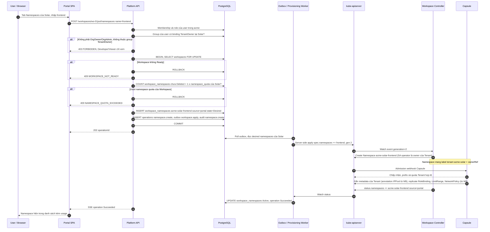

**Điểm cần review**

- Bước 3–5: authz hai nguồn — role Organization **hoặc** binding TenantOwner của group user thuộc; Developer/Viewer chỉ đọc. Đây là logic DB, không hỏi Kubernetes.
- Bước 6–8: Workspace đang có Operation chạy cũng trả `WORKSPACE_NOT_READY` (`04-state-machines.md` mục 2).
- Bước 9–11: quota Namespace check ở DB theo `namespace_quota` của Workspace (đếm cả Namespace `source=kubectl`); trần của grant là Σ `namespace_quota`, đã kiểm lúc tạo/resize Workspace [5.3]. Capsule kiểm lại ở bước 20–21; nếu hai lớp lệch nhau (ví dụ kubectl vừa tạo thêm), controller báo condition thay vì tạo lén.
- Bước 12 và 17: `workspace_namespaces.name` giữ tên đầy đủ, `spec.namespaces` giữ hậu tố (`02-data-model.md`).
- Bước 19: ServiceAccount của operator là Capsule user và owner của mọi Tenant, nên Namespace đi đúng đường owner của Capsule (prefix, quota Tenant); cấu hình Capsule `users` và kiểm lại trên Capsule 0.15.x ở M6 (`IMPLEMENTATION-PLAN.md` M6).
- Bước 22: annotation IPPool do Capsule gắn từ `Tenant.namespaceOptions.additionalMetadata` mà controller render, không phải controller patch Namespace; tenant bị Capsule cấm sửa annotation này [7.3]. Namespace mới dùng chung quota của Workspace, không nhận phần riêng ([5.4]).
- NFR: Namespace create p95 dưới 15 giây [23]; mã `NAMESPACE_QUOTA_EXCEEDED` thêm vào enum `ErrorCode` khi làm endpoint.

### 7b. Namespace tạo bằng kubectl hiện lên portal qua status sync

**Mục đích:** Owner tạo Namespace bằng kubectl/Headlamp vẫn đi qua Capsule; controller quan sát và ghi `status.namespaces` với `source=kubectl`, worker sync về DB, portal hiển thị [4.5][14.2].

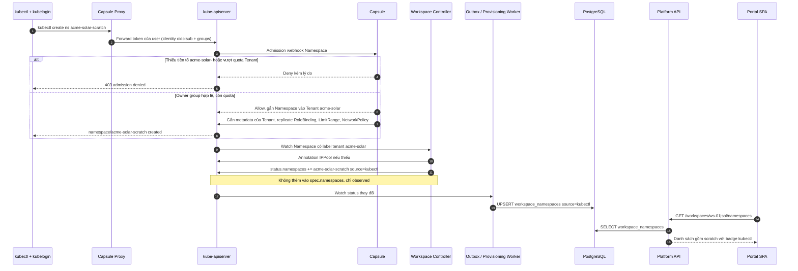

**Điểm cần review**

- Bước 9–11: controller watch Namespace theo label tenant của Capsule, không theo tên; Namespace `source=kubectl` không được đưa vào `spec.namespaces` để tránh controller "nhận nuôi" rồi xóa khi user bỏ khỏi portal.
- Bước 7: không có Secret TLS nào được replicate vào Namespace của tenant; cert wildcard chỉ nằm ở namespace của platform (`05-network-and-scheduling.md` mục 7).
- Xóa Namespace `source=kubectl` từ portal: API thêm tên đầy đủ vào `spec.namespacesToDelete`, controller xóa rồi dọn; Namespace có PVC yêu cầu gõ tên [4.5].
- Bước 10: Capsule gắn annotation IPPool từ metadata của Tenant (từ M9); controller tự gắn nếu thấy Namespace của Tenant thiếu annotation (Namespace tạo bằng kubectl khi Capsule chưa kịp), test ở M9.
- Nếu Namespace bị xóa bằng kubectl, controller gỡ khỏi `status.namespaces`; với `source=portal`, API bỏ tên khỏi `spec.namespaces` và cảnh báo, controller **không** tạo lại (`04-state-machines.md` mục 9.2).

---

## 8. kubectl access: kubeconfig → kubelogin → Capsule Proxy → RBAC/Capsule

**Mục đích:** Kubeconfig không chứa static token; kubelogin lấy token client `kubectl` qua SSO Keycloak, request đi Capsule Proxy được filter cluster-scoped và RBAC/Capsule quyết định quyền trong Workspace [11][8.4].

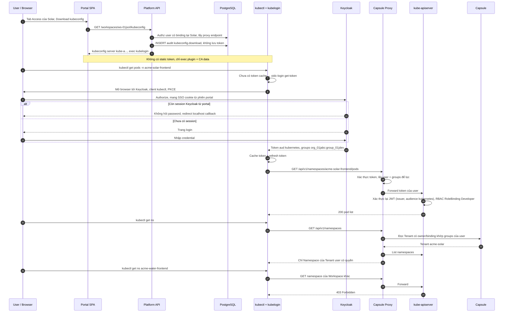

**Điểm cần review**

- Bước 3–5: endpoint proxy lấy từ `workspace.cluster_id` → `clusters.proxy_endpoint`; user không nhập endpoint; kubeconfig chứa Workspace ID chỉ để đặt context [11.1][11.2].
- Bước 8–13: SSO hoạt động vì cùng realm và cùng browser; client `kubectl` là public + PKCE, audience `kubernetes`; token `portal-api` không bao giờ được dùng cho Kubernetes [8.4].
- Bước 16–18: Capsule Proxy xác thực token để biết user thuộc Tenant nào rồi forward chính token đó, không impersonation (`05-network-and-scheduling.md` mục 8); kube-apiserver xác thực lại theo structured authentication, nên direct API và Proxy cho cùng kết quả ngoài phần filter [8.4][20.3]. Proxy forward token hay impersonation chưa được kiểm trên lab; kiểm bằng audit log của kube-apiserver trong e2e của M11.
- Bước 20–25: filter list cluster-scoped (Namespace, Node, PV, StorageClass) là việc của Proxy; RBAC không thể làm điều này cho `list` toàn cluster. Node `list` mặc định không được cấp trong Shared mode [6.2].
- Bước 26–29: từ chối đến từ RBAC của kube-apiserver, không phải Proxy; test `kubectl auth can-i` cho matrix TenantOwner/Developer/Viewer [10.5].

---

## 9. Headlamp web console qua SSO

**Mục đích:** Portal mở đúng Headlamp của Cluster chứa Workspace; Headlamp dùng OIDC client `headlamp-cluster-a` với SSO Keycloak, gửi token user tới Capsule Proxy cùng Cluster; không truyền token qua URL [12].

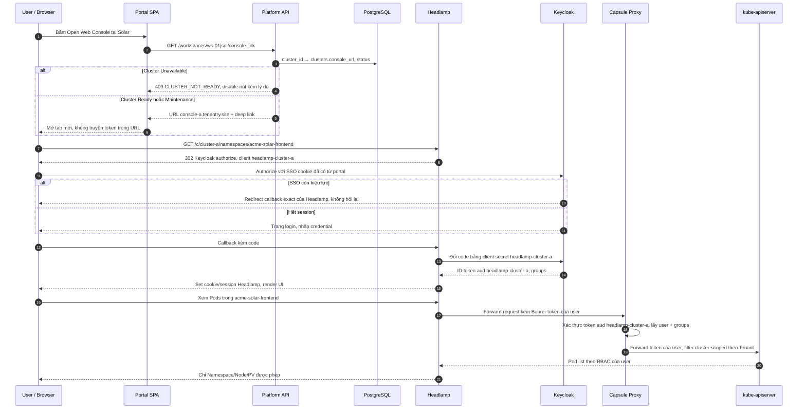

**Điểm cần review**

- Bước 3–6: URL console lấy từ Cluster registry; Cluster `Maintenance` vẫn cho mở console, chỉ `Unavailable` mới disable [6.1][12.4].
- Bước 7–15: mỗi Cluster một client `headlamp-{clusterId}` confidential, callback exact, audience riêng; structured authentication của Cluster phải chấp nhận audience này [8.4]. Phase 2 thêm Cluster là thêm client.
- Bước 16–21: Headlamp là identity-aware proxy — ServiceAccount của Headlamp không có quyền workload; mọi quyền là của token user [12.4].
- Deep link theo Namespace là tiện ích; user có nhiều Workspace trong Cluster sẽ thấy tất cả resource được phép — không phải lỗi isolation [12.5].
- Không iframe, không fork; mở tab mới để tránh CSP/cookie/callback trong frame [12.2][12.3].

---

## 10. Route: đưa app của tenant ra HTTPS

### 10a. Tạo Route trên portal → Ingress → request tới Pod

**Mục đích:** User khai báo Route trên portal; API ghép hostname và ghi `spec.routes` qua outbox; controller dựng Ingress; request đi qua Traefik với cert wildcard của platform [7.6].

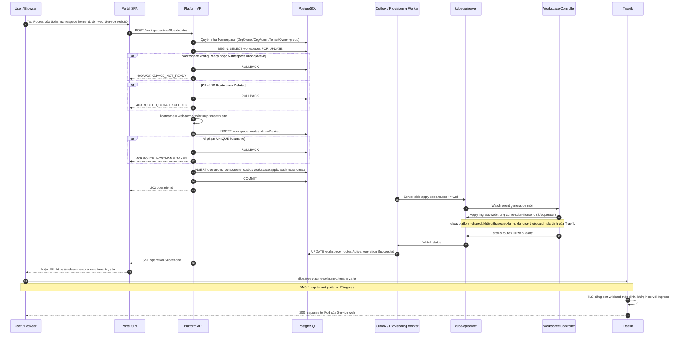

**Điểm cần review**

- Bước 3–8: cùng luật authz và cùng row lock `workspaces` với tạo Namespace (mục 7a); đếm Route dưới lock đó.
- Bước 9–12: user không nhập hostname; trùng chỉ xảy ra khi hai cặp (tên, Workspace) ghép ra cùng một chuỗi, và constraint ở DB quyết định.
- Bước 18: Ingress do operator tạo. Luật `tenantry-tenant-ingress-lockdown` chỉ áp cho người gọi có username `oidc:`, nên operator và các controller của Kubernetes (xóa Ingress khi xóa Namespace) không bị chặn (`05-network-and-scheduling.md` mục 7). Test M11: Capsule không từ chối Ingress do operator tạo; xóa Namespace/Workspace có Route vẫn hoàn tất.
- Bước 24–26: TLS dừng ở Traefik bằng cert wildcard mặc định; không có Secret TLS hay private key nào trong Namespace của tenant [7.6]. NetworkPolicy baseline (từ M9) phải cho phép traffic từ namespace `ingress-system` [7.4]; nếu Service không có Pod, Traefik trả 503 và Route vẫn `Active`.
- Mã `ROUTE_QUOTA_EXCEEDED`, `ROUTE_HOSTNAME_TAKEN` thêm vào OpenAPI khi làm M11.

### 10b. Tenant tự tạo Ingress hoặc Certificate bị admission từ chối

**Mục đích:** Route là đường duy nhất mở HTTP ra ngoài; tenant không tự chiếm hostname hay xin cert được [7.6][20.3].

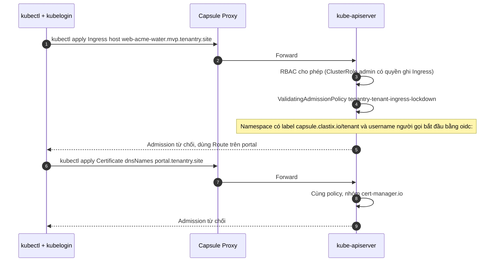

**Điểm cần review**

- Bước 3–4: chặn ở admission chứ không ở RBAC, vì RBAC chỉ cộng quyền và `admin` là role gộp sẵn; định nghĩa policy ở `05-network-and-scheduling.md` mục 7. Mã HTTP trả về do `validations[].reason` của policy quyết định: mặc định `Invalid` (422), đặt `reason: Forbidden` thì 403.
- Bước 6–9: không chặn `Certificate` thì tenant dùng được ClusterIssuer của platform để xin cert cho hostname bất kỳ dưới `tenantry.site`.
- Test isolation "tenant không tạo được Ingress/Certificate" [24.4].
- Custom domain là luồng riêng sau MVP, không có nhánh ở đây [7.6].

---

## 11. Transfer ownership hai bước và member tự rời Organization

### 11a. Transfer ownership: Owner đề nghị, OrgAdmin nhận xác nhận

**Mục đích:** Đúng một OrgOwner mỗi Organization; Owner đề nghị cho một OrgAdmin, người nhận xác nhận, đổi role hai bên trong một transaction [9.2][16.1]. Trạng thái: `04-state-machines.md` mục 8.

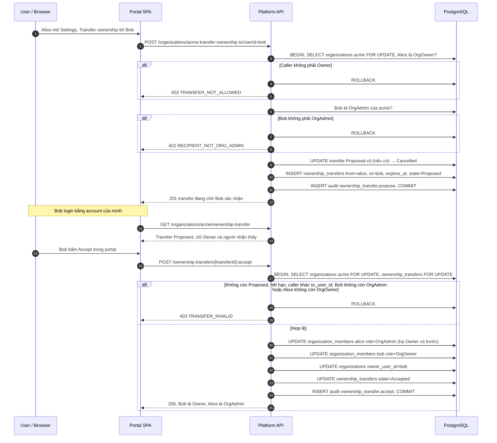

**Điểm cần review**

- Bước 3–8: chỉ Owner gọi được `:transfer-ownership`; OrgAdmin tự gọi là threat case phải test [20.3]. Người nhận bắt buộc là OrgAdmin hiện tại [9.2].
- Bước 9–10: tối đa một transfer `Proposed` mỗi Org (partial unique index), đề nghị mới thay đề nghị cũ. Owner hủy hoặc người nhận từ chối bằng `DELETE /ownership-transfers/{transferId}` → `Cancelled`.
- Bước 13–16: transfer là thông báo trong portal, không có token hay link: người nhận thấy nó qua `GET …/ownership-transfer` và accept bằng `transferId`; API chỉ nhận khi caller là `to_user_id` (`04-state-machines.md` mục 8).
- Bước 17–19: dưới lock, accept kiểm lại mọi guard: còn `Proposed`, chưa hết hạn, Bob vẫn là OrgAdmin, Alice vẫn là OrgOwner. Lock row Organization trước cũng xếp hàng accept với mục 11b, nên người nhận không thể vừa thành Owner vừa rời Org.
- Bước 20–24: một transaction nên không lúc nào Org có 0 hoặc 2 Owner. Thứ tự bắt buộc: hạ Owner cũ trước rồi mới nâng người nhận, vì partial unique index "một OrgOwner mỗi Org" trên `organization_members` không deferrable (`02-data-model.md` mục 2); làm ngược thì câu `UPDATE` đầu đã vi phạm index.
- Owner cũ thành OrgAdmin, không bị mất membership; group membership và binding không đổi [9.2].
- Mã `TRANSFER_NOT_ALLOWED`, `RECIPIENT_NOT_ORG_ADMIN`, `TRANSFER_INVALID` thêm vào enum `ErrorCode` khi làm endpoint.

### 11b. Member tự rời Organization

**Mục đích:** OrgMember/OrgAdmin tự rời Organization; Owner phải transfer trước; rời kéo theo gỡ mọi group của Organization đó [9.4].

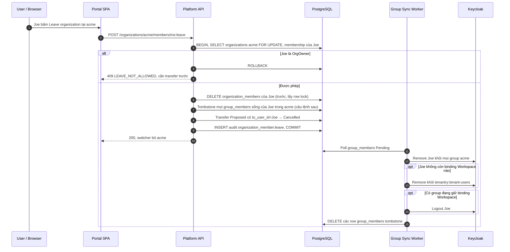

**Điểm cần review**

- Bước 3–5: chỉ một điều kiện chặn — Joe là Owner thì phải transfer trước [9.4]. Role được đọc dưới lock row Organization, cùng lock với accept transfer ở mục 11a.
- Bước 6–10: xóa membership **trước** rồi mới tombstone group member, đúng thứ tự ở `02-data-model.md` mục 2 (chặn race với thêm vào group). Row membership bị xóa hẳn nên Joe mất quyền portal ở acme ngay; lịch sử nằm ở audit. Rời Org không xóa account Keycloak; Joe vẫn thuộc các Org khác [9.4].
- Bước 8: transfer đang chờ Joe nhận bị hủy (`04-state-machines.md` mục 8).
- Bước 11–15: cùng đường sync/logout như mục 4; contract token cũ tới TTL áp dụng y hệt.
- Owner remove member (`DELETE /members/{userId}`) dùng cùng nhánh `else`, thêm rule "không remove được OrgOwner" [9.4].

---

## 12. Delete Workspace: confirm → gỡ quyền → xóa → chờ finalizer → release có thứ tự

**Mục đích:** Xóa ngay và mất dữ liệu PVC sau confirm gõ tên; finalizer gỡ quyền tenant rồi dọn theo thứ tự an toàn, CIDR chỉ release sau khi Calico sạch và đi qua `Quarantined`; finalizer kẹt → Operation `Blocked`, OrgOwner/OrgAdmin retry, chỉ Platform Admin `:force` [7.5][17.4].

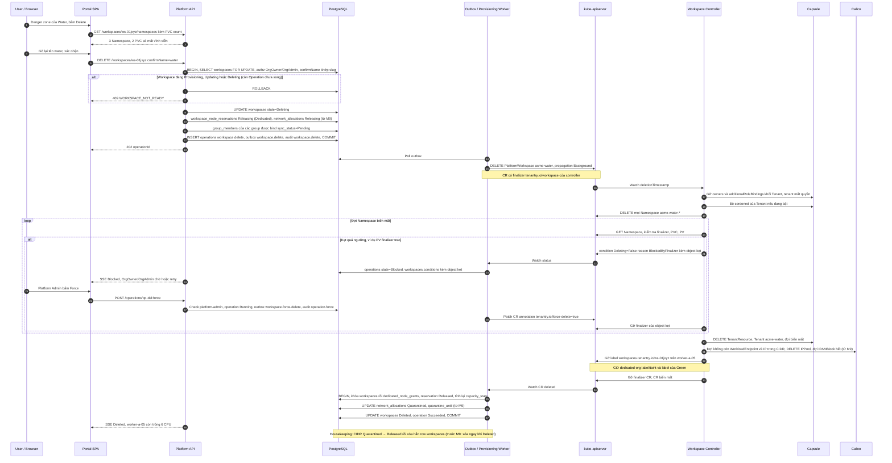

**Điểm cần review**

- Bước 4–6: confirm gõ lại slug Workspace (`water`). UI phải liệt kê số Namespace/PVC trước khi cho bấm [17.4].
- Bước 6–8: DELETE khi Workspace còn Operation chưa xong trả `WORKSPACE_NOT_READY`, không có cancel; muốn bỏ một lần tạo dở thì chờ `Failed` rồi DELETE (`04-state-machines.md` mục 1). Không cordon trước khi xóa: finalizer gỡ quyền tenant ngay ở bước 17.
- Bước 10 và 35–36: reservation và CIDR sang `Releasing` ngay khi nhận lệnh và vẫn tính vào capacity; chỉ `Released`/`Quarantined` trong transaction của worker khi CR đã biến mất (`04-state-machines.md` mục 3, 4). ClusterGrant không có row reservation: Workspace `Deleted` ra khỏi `SUM` của grant ở bước 37 (`02-data-model.md` mục 4). Green vẫn chạy, org label/taint không đổi [6.3][6.4].
- Bước 11: tập binding thay đổi nên Group Sync tính lại `tenantry:tenant-users` cho member của các group được bind.
- Bước 20–29: `Blocked` là condition `Deleting=False` reason `BlockedByFinalizer` trên CR, worker map thành Operation `Blocked`. OrgOwner/OrgAdmin retry (`Blocked → Running`, controller báo lại nếu vẫn kẹt); `:force` chỉ dành cho Platform Admin và được audit [16.5]. Force đi bằng annotation, không bằng `spec`, để không sinh generation mới.
- Bước 17–33: thứ tự bắt buộc (`IMPLEMENTATION-PLAN.md` mục 4.3): gỡ quyền tenant → bỏ `cordoned` (cordon của Capsule chặn cả lệnh ghi của operator; kiểm lại trên 0.15.x ở M6) → xóa Namespace và đợi → xóa Tenant và đợi → Calico sạch rồi xóa IPPool → gỡ membership label → gỡ finalizer. Không release CIDR khi còn WorkloadEndpoint [7.4][7.5]. CR là cluster-scoped; ownerReference chỉ là lưới an toàn.
- Bước 36: CIDR qua `Quarantined` rồi mới `Released`; trong lúc đó `k8s_name` cũng chưa dùng lại được [17.4]. Độ dài quarantine cấu hình được (`04-state-machines.md` mục 4). Workspace tạo trước M9 không có CIDR nên không qua quarantine, `k8s_name` dùng lại ngay khi `Deleted`. Row `workspaces` bị xóa hẳn khi CIDR `Released`; lịch sử nằm ở audit (`02-data-model.md`).
- Worker chết giữa bước 35–37: transaction DB atomic; khi restart, worker thấy CR đã biến mất và Workspace còn `Deleting` → chạy lại bước 35–37 (xem mục 13b).

---

## 13. Lan truyền trạng thái Operation và phục hồi sau restart

### 13a. Worker ↔ CR status ↔ DB ↔ portal

**Mục đích:** Một Operation phản chiếu status của CR theo generation; condition cụ thể chỉ ra component lỗi; retry đi lại qua outbox mà không tạo resource trùng [14.3][14.4][17].

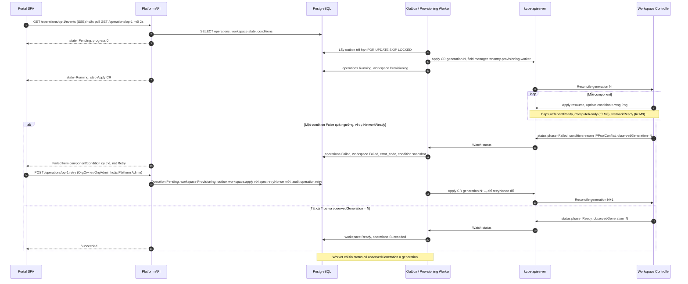

**Điểm cần review**

- Bước 4: `SKIP LOCKED` cho phép chạy nhiều worker replica mà không xử lý trùng một event. Không cần lease: row lock được giữ suốt transaction giao event, worker chết thì transaction rollback và lock tự nhả.
- Bước 9: condition nào chưa có sub-reconciler ở milestone hiện tại thì không được set và không bắt buộc để vào `Ready` (`04-state-machines.md` mục 1.2).
- Bước 10–13: không dùng một cờ `error` chung; mỗi condition có `reason` để portal chỉ ra component lỗi [14.4][23]. Operation `Failed` không tự chuyển `Succeeded`; Workspace giữ `Failed` tới khi có retry.
- Bước 14–17: retry một lỗi do controller báo ghi `spec.retryNonce` mới vào payload, nên generation tăng lên N+1 và controller reconcile lại; status cũ (`observedGeneration = N`, `Failed`) không còn khớp generation nên worker bỏ qua. Reservation và CIDR không đổi khi retry [17]. `:retry` nhận cả Operation `Blocked` (mục 12); `:force` chỉ dành cho Platform Admin (`04-state-machines.md` mục 2).
- Bước 18–20 và Note cuối: worker bỏ qua status có `observedGeneration < generation` để không đánh dấu `Ready` từ thế hệ cũ trong lúc update.
- SSE hay poll là lựa chọn triển khai; `GET /operations/{id}` và `GET /operations/{id}/events` trả cùng payload [14.3][16.5].

### 13b. Worker và controller restart giữa chừng

**Mục đích:** Sau restart, worker apply lại outbox chưa processed và resync mọi Workspace đang chuyển trạng thái; controller reconcile lại từ spec, so `observedGeneration`, không dựa vào in-memory state [14.4][23][24.5].

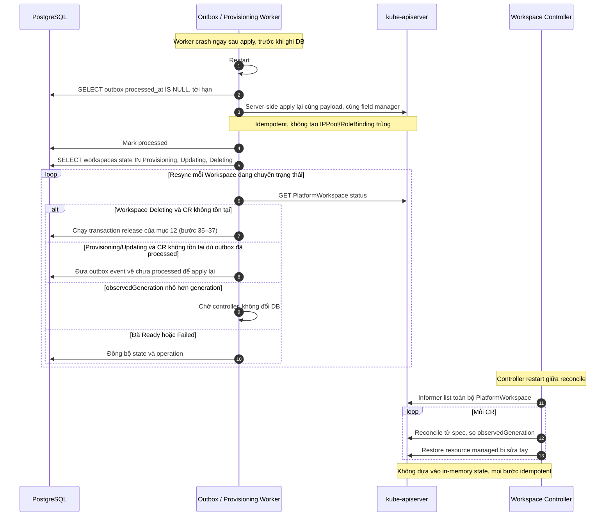

**Điểm cần review**

- Bước 2–4: "processed" chỉ được ghi **sau** khi apply thành công; nếu crash giữa hai bước thì apply lại là an toàn nhờ server-side apply cùng field manager [14.4].
- Bước 6–8: với Workspace `Deleting`, CR không tồn tại nghĩa là xóa xong → chạy phần release DB của mục 12 (bước 35–37), không apply lại; với `Provisioning`/`Updating` thì apply lại.
- Bước 11–13: controller-runtime requeue toàn bộ sau restart; drift do sửa tay resource managed được restore [14.4]; reconcile phải idempotent với cùng generation.
- Kịch bản test bắt buộc: worker chết giữa apply và retry không duplicate; controller restart giữa provisioning; kube-apiserver tạm lỗi sau DB commit [24.5].
- Reconcile latency theo số Workspace 10/20/50 là chỉ số đánh giá [24.6].
