# 04 — State machines của Tenantry

> Nơi định nghĩa cho trạng thái và cạnh chuyển của mọi entity. Quy tắc nghiệp vụ nền ở `PRODUCT-PLAN.md` mục 4, 6, 7, 9, 14, 17; cột lưu trạng thái và thứ tự lock ở `02-data-model.md`.
> Câu hỏi còn mở nằm ở `REVIEW-CHECKLIST.md`; chỗ nào phụ thuộc câu hỏi mở thì ghi "→ REVIEW-CHECKLIST <mã>".

## 0. Quy ước chung

| Ký hiệu | Ý nghĩa |
|---|---|
| **Platform API** | Backend Go, nơi chạy authorize/validate/transaction; ghi Operation và outbox |
| **Provisioning Worker** | Đọc outbox, apply `PlatformWorkspace` CR bằng credential scoped, poll status CR về DB |
| **Workspace Controller** | controller-runtime trong Cluster, reconcile Capsule Tenant (kèm quota chung)/IPPool/RBAC/policy/node label |
| **Group Sync Worker** | Sync group/membership PostgreSQL → Keycloak Admin API |
| **IPAM** | Phần của Platform API cấp/thu CIDR từ NetworkPool |
| **OrgOwner/OrgAdmin** | Actor phía khách hàng; **Platform Admin** = realm role `platform-admin` |
| `k8s_name` | `<org-slug>-<ws-slug>`, ví dụ `acme-solar`; là tên Tenant, tiền tố Namespace, tên CR |

Nguyên tắc xuyên suốt (plan 5.3, 14, 17):

- PostgreSQL là source of truth cho product state; Kubernetes chỉ biết desired state qua CR và trả observed state qua `status`.
- Mọi bước đổi capacity (Σ trên ClusterGrant, NodeReservation, NetworkAllocation) diễn ra trong **một transaction có row lock**, theo thứ tự lock cố định ở `02-data-model.md` mục 4; state machine dưới đây mô tả trạng thái *sau* commit.
- Phần Workspace giữ trên ClusterGrant **không có row và không có state riêng**: nó là Σ cột tài nguyên của các Workspace chưa `Deleted` trong grant (mục 3).
- Reservation/CIDR **không** được release chỉ vì controller báo lỗi tạm thời; chỉ delete đã dọn xong trong Cluster (CR đã biến mất) mới release.
- Một phần trạng thái chỉ xuất hiện từ milestone có phần code tương ứng (mục 1.2): NetworkAllocation từ M9, NodeReservation từ M8.

---

## 1. Workspace lifecycle

**Mục đích:** mô tả toàn bộ vòng đời một Workspace từ lúc OrgOwner submit wizard tới khi bị xóa, ai kích hoạt từng cạnh và Condition nào phải True để vào `Ready`.

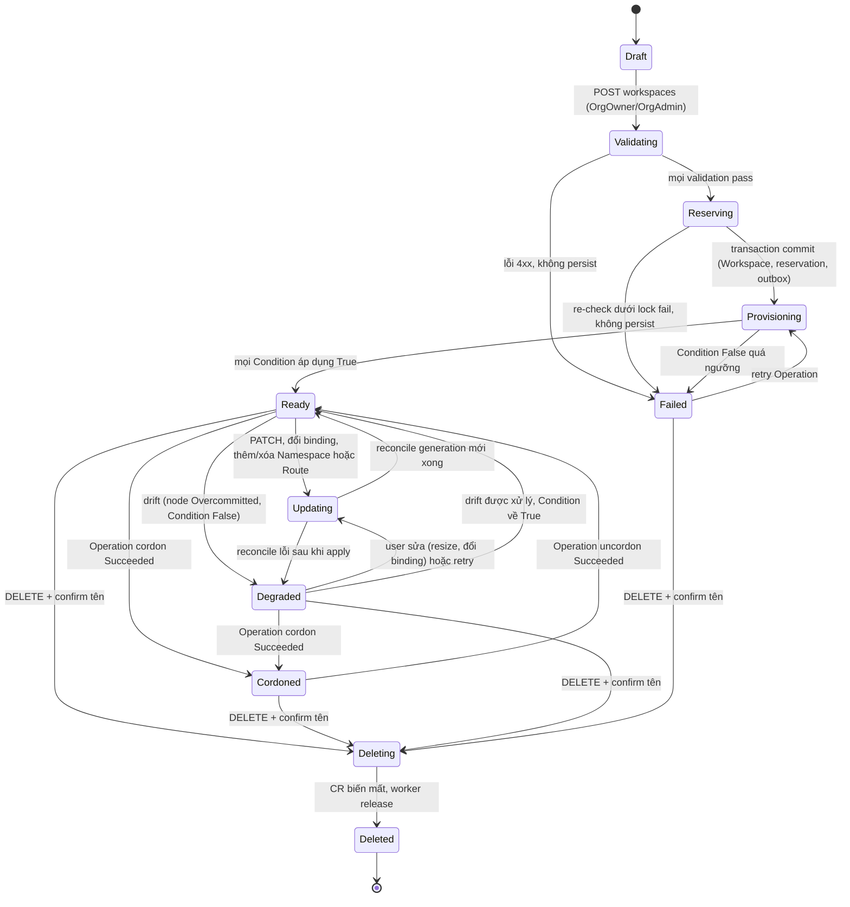

### 1.1 Bảng chuyển trạng thái

| From | Event / Guard | To | Side effects |
|---|---|---|---|
| `[*]` | Wizard submit hoặc `POST /workspaces:validate` (dry-run) | `Draft` | Chưa ghi DB. `Draft` chỉ tồn tại trong request, wizard dở không được lưu |
| `Draft` | `POST /organizations/{orgId}/workspaces` với `Idempotency-Key`; actor là OrgOwner/OrgAdmin của đúng Organization | `Validating` | Bắt đầu chạy 17.1 bước 1–8 |
| `Validating` | Organization `Active`; tên/slug hợp lệ, unique và không lồng tiền tố với slug của Workspace chưa `Deleted` khác trong Organization [4.4]; Cluster thuộc ClusterGrant và `Ready`; compute mode dùng được (Shared: grant có shared pool và pool hợp lệ; Dedicated: Organization có node grant, node `Ready` và đủ remaining); có ít nhất một Owner group; group thuộc Org và đã `Synced`; `maxWorkspacesTotal` của entitlement và quota ClusterGrant đủ theo phạm vi từng con số [5.2] | `Reserving` | Không side effect ngoài log |
| `Validating` | Bất kỳ guard trên fail | `Failed` | Trả HTTP 4xx với error code (`ORG_NOT_ACTIVE`, `SLUG_TAKEN`, `CLUSTER_NOT_READY`, `ENTITLEMENT_EXCEEDED`, `CLUSTER_GRANT_QUOTA_EXCEEDED`, `DEDICATED_NODE_INSUFFICIENT_CAPACITY`, `CIDR_OVERLAP`, `GROUP_SYNC_PENDING`, ...). Không có row Workspace: `Failed` trước commit chỉ là kết quả API |
| `Reserving` | Transaction: lock theo thứ tự 02 mục 4 (entitlement → `clusters` FOR SHARE → ClusterGrant → shared pool nếu Shared hoặc DedicatedNodeGrant nếu Dedicated → NetworkPool → `groups` FOR SHARE); re-check invariant 5.3 dưới lock | `Provisioning` | Commit đồng thời: row Workspace (các cột tài nguyên của nó chính là phần giữ trên grant), NodeReservation `Pending` (Dedicated), NetworkAllocation `Allocated` (từ M9), Operation `workspace.create` `Pending`, outbox event, audit |
| `Reserving` | Re-check dưới lock fail (concurrent request đã lấy capacity/CIDR) | `Failed` | Rollback toàn bộ, trả 409 kèm code; không giữ gì |
| `Provisioning` | Provisioning Worker apply CR; Workspace Controller reconcile; worker thấy `status.phase: Ready`, `observedGeneration` khớp, mọi Condition áp dụng (mục 1.2) True | `Ready` | Operation `Succeeded`; NodeReservation `Pending → Active`; portal bật kubeconfig/Headlamp link; audit |
| `Provisioning` | Condition False quá ngưỡng thời gian/retry của Operation | `Failed` | Operation `Failed` kèm Condition/component lỗi; **giữ** row Workspace (phần giữ trên grant), NodeReservation và NetworkAllocation (mục 3.2) |
| `Ready` | Thay đổi sinh generation CR mới: `PATCH /workspaces/{id}` (display name, resources, `namespaceQuota`), `PUT`/`DELETE` binding, thêm/xóa Namespace hoặc Route. Resize chạy lại validation và lock trong cùng transaction | `Updating` | Operation mới `Pending`; cột tài nguyên của Workspace đổi ngay; NodeReservation tăng thì nâng amount ngay, giảm thì giữ amount cũ (mục 3.1) |
| `Updating` | Worker thấy `observedGeneration == generation` và Condition True | `Ready` | Operation `Succeeded`; nếu là giảm Dedicated, worker hạ amount NodeReservation trong cùng transaction |
| `Updating` | Reconcile lỗi sau khi apply (ví dụ quota chung không giảm được vì usage) | `Degraded` | Operation `Failed`; Condition chỉ rõ component; NodeReservation giữ amount cũ |
| `Ready` / `Degraded` | `POST /workspaces/{id}:cordon` bởi OrgOwner/OrgAdmin; Operation `workspace.cordon` `Succeeded` | `Cordoned` | CR `spec.cordoned: true` → `Tenant.spec.cordoned`; mutation của tenant bị Capsule chặn, workload vẫn chạy. Trong lúc Operation chạy Workspace giữ state cũ |
| `Cordoned` | `POST /workspaces/{id}:uncordon` bởi OrgOwner/OrgAdmin; Operation `workspace.uncordon` `Succeeded` | `Ready` | Ngược lại; Condition False thì đi tiếp sang `Degraded` |
| `Ready` / `Cordoned` / `Degraded` / `Failed` | `DELETE` kèm confirm gõ lại slug Workspace (`water`); portal đã hiển thị số Namespace/PVC sẽ mất | `Deleting` | Operation `workspace.delete` `Pending`; NodeReservation `Pending`/`Active` → `Releasing`; NetworkAllocation `Allocated → Releasing` (từ M9). Thu quyền tenant và dọn Cluster là việc của finalizer (mục 10) |
| `Deleting` | Worker thấy CR đã biến mất (finalizer đã dọn Namespace/PVC/Tenant/IPPool/RBAC và gỡ membership label) | `Deleted` | Một transaction: NodeReservation `Released`; CIDR `Quarantined` (từ M9); Workspace `Deleted` nên rời khỏi Σ của grant; Operation `Succeeded`; audit. Row Workspace được xóa hẳn theo `02-data-model.md` mục 4 |
| `Deleting` | Finalizer/PVC kẹt quá ngưỡng | (giữ `Deleting`) | Condition `Deleting=False` reason `BlockedByFinalizer` → Operation `Blocked` kèm object đang giữ; OrgOwner/OrgAdmin retry, Platform Admin `:force` |
| `Ready` | Worker/controller phát hiện drift ngoài chu trình update: DedicatedNodeGrant `Overcommitted`, node `NotReady`/`Cordoned`, Condition nào đó chuyển False, managed resource bị xóa tay và chưa restore | `Degraded` | Không đổi reservation; portal hiển thị Condition lỗi và remediation |
| `Degraded` | Drift được xử lý (Admin sửa system reserve, node Ready lại, controller restore xong) | `Ready` | Tự động, không cần Operation của user |
| `Degraded` | User thực hiện thay đổi có chủ đích (giảm allocation, đổi binding) hoặc retry Operation update `Failed` | `Updating` | Như `Ready → Updating` |

**Một Operation mỗi lúc.** Khi Workspace còn Operation ở `Pending`/`Running`/`Blocked` (đang `Provisioning`, `Updating`, `Deleting`, hoặc cordon/uncordon chưa xong), mọi DELETE, PATCH, cordon, thêm/xóa binding, Namespace, Route trả `409 WORKSPACE_NOT_READY`. Không có cancel: muốn bỏ một create, chờ Operation `Failed` rồi DELETE.

### 1.2 Conditions bắt buộc True để vào `Ready`

| Condition | Ai set | Từ | Nghĩa |
|---|---|---|---|
| `ClusterReady` | Platform API (từ Cluster registry) | M6 | Cluster đang `Ready` tại thời điểm provision |
| `ClusterGrantValid` | Platform API | M6 | `cluster_id` thuộc ClusterGrant của Organization, còn trong quota |
| `CapsuleTenantReady` | Workspace Controller | M6 | Tenant `acme-solar` tồn tại; `namespaceOptions`, `storageClasses.allowed` và rules registry/QoS/Service (gồm cấm `NodePort`/`LoadBalancer`/`ExternalName`) render đúng generation |
| `IdentityBindingsReady` | Workspace Controller | M6 | Owner/Developer/Viewer binding render xong; group subject đã tồn tại trong Keycloak (`Synced`) |
| `ResourcesReserved` | Platform API | M7 | Phần giữ trên ClusterGrant đã commit |
| `PolicyReady` | Workspace Controller | M7 | Quota chung `Tenant.spec.rules[].quota[]` → `GlobalResourceQuota` ([5.4]), LimitRange, Pod Security label đã áp |
| `ComputeReady` | Workspace Controller | M8 | Shared: Tenant nodeSelector trỏ đúng pool. Dedicated: node có org label/taint và membership label của Workspace |
| `DedicatedNodeCapacityReserved` | Platform API | M8 | Chỉ Dedicated: NodeReservation đã commit, node còn `Ready` |
| `NetworkReady` | Workspace Controller | M9 | Calico IPPool tồn tại đúng CIDR, Namespace annotation được inject, baseline NetworkPolicy replicate |
| `ProxyAccessReady` | Workspace Controller | M11 | RoleBinding có label reflection để Capsule Proxy lọc đúng; endpoint Proxy trả 200 cho synthetic check |

Cách tính: `Ready` ⇔ mọi Condition áp dụng đều `True` **và** `status.observedGeneration == metadata.generation`. Condition của sub-reconciler chưa xây (cột "Từ") thì không được set và không bắt buộc. `DedicatedNodeCapacityReserved` không áp dụng cho Shared. Synthetic verification trong Cluster thêm vào ở M11 cùng `ProxyAccessReady`.

**Workspace tạo trước M9 không được cô lập mạng.** Workspace tạo ở M6–M8 không có row `network_allocations`, không có IPPool riêng và baseline NetworkPolicy; delete của nó bỏ qua `Quarantined`, và `k8s_name` dùng lại được ngay khi Workspace `Deleted`. Trước M8 Tenant chưa có nodeSelector và không có NodeReservation.

### 1.3 `Failed` trước và sau commit

`Failed` từ `Validating`/`Reserving` chỉ là kết quả HTTP: không có row nên không có cạnh đi ra. `Draft`, `Validating`, `Reserving` cũng chỉ tồn tại trong request; row `workspaces` đầu tiên được ghi đã ở `Provisioning`.

`Failed` từ `Provisioning` là một row thật, vẫn giữ phần trên grant, NodeReservation và NetworkAllocation để retry không cấp trùng (mục 3.2). Đường ra duy nhất là retry Operation (OrgOwner/OrgAdmin/Platform Admin) về `Provisioning`, hoặc DELETE vào `Deleting`. Operation `Failed` không tự sang `Succeeded` khi CR sau đó tự Ready; Workspace giữ `Failed` tới khi có retry (mục 2).

### 1.4 `PlatformWorkspace.status.phase`

`status.phase` ∈ `Provisioning` | `Ready` | `Updating` | `Degraded` | `Failed` | `Deleting`; controller suy ra từ Condition (IMPLEMENTATION-PLAN mục 4.1). Không có phase `Blocked`: delete kẹt là Condition `Deleting=False` reason `BlockedByFinalizer`, worker map thành Operation `Blocked`. Worker chỉ tin status có `observedGeneration == generation`.

**Điểm cần review**

- `Cordoned` map sang `Tenant.spec.cordoned`: xác nhận trên Capsule 0.15.x, kể cả việc cordon có chặn ghi của chính controller hay không (lab bản đầu, Capsule 0.13.10: có chặn); kiểm ở M6 (`IMPLEMENTATION-PLAN.md` M6).
- Cluster `Unavailable` không đổi state Workspace, portal chỉ hiển thị "unknown" (plan 6.1). Worker đặt Condition `ClusterReady=Unknown` cho mọi Workspace của Cluster đó để UI tách khỏi `Degraded`; Cluster `Ready` lại thì gỡ.

---

## 2. Operation

**Mục đích:** mô tả trạng thái một Operation và ai được retry/force. Loại Operation (`operations.type`) dùng đúng các tên: `workspace.create`, `workspace.update`, `workspace.cordon`, `workspace.uncordon`, `workspace.delete`, `namespace.create`, `namespace.delete`, `route.create`, `route.delete`, `node.grant`, `node.revoke`, `sharedpool.update`.

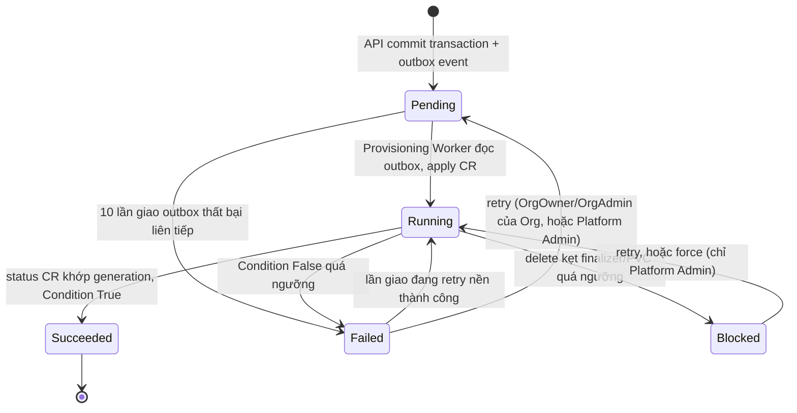

### 2.1 Bảng chuyển trạng thái

| From | Event / Guard | To | Side effects |
|---|---|---|---|
| `[*]` | Transaction của API commit thành công | `Pending` | Row `operations` (resource, type, correlation ID), row `outbox_events` (`target_cluster_id`, payload version, attempts=0) |
| `Pending` | Provisioning Worker lấy outbox event (`FOR UPDATE SKIP LOCKED`), apply CR server-side vào đúng `target_cluster_id` thành công | `Running` | `outbox_events.processed_at`; Operation có nhiều event thì chuyển ở event đầu tiên giao được |
| `Pending` | Giao một event thất bại 10 lần liên tiếp | `Failed` | `error_code = APPLY_FAILED`; worker **vẫn** tiếp tục giao ở backoff tối đa, giao được thì Operation về `Running`. Event của Cluster `Unavailable` không được giao và `attempts` không tăng, nên Operation giữ `Pending` (mục 6) |
| `Running` | Worker poll `status`: `phase` đích đạt, `observedGeneration` khớp, không Condition False | `Succeeded` | Cập nhật observed state Workspace/Namespace record trong DB; Workspace đổi state tương ứng (mục 1) |
| `Running` | Condition False kéo dài quá ngưỡng (cấu hình được, mặc định 10 phút) hoặc lỗi không-retry (CRD apply bị 403 vì credential scoped sai) | `Failed` | `error_code` ổn định + Condition/component lỗi; Workspace sang `Failed` (create) hoặc `Degraded` (update) |
| `Running` (type `workspace.delete`) | Condition `Deleting=False` reason `BlockedByFinalizer`: Namespace ở `Terminating` quá ngưỡng vì finalizer/PVC/PV chưa release | `Blocked` | Message của Condition `Deleting` liệt kê object đang giữ, chép vào `workspaces.conditions`; portal hiển thị |
| `Failed` | `POST /operations/{id}:retry` bởi OrgOwner/OrgAdmin của Organization sở hữu hoặc Platform Admin | `Pending` | Event chưa giao được đặt lại `attempts = 0` và giao ngay. Nếu lỗi do controller báo (mọi event đã giao), service ghi event apply mới với `spec.retryNonce` mới trong payload (generation mới), để controller reconcile lại và worker phân biệt được status sau retry. **Không** tạo reservation/CIDR mới |
| `Blocked` | `POST /operations/{id}:retry` (cùng actor như trên) | `Running` | Controller thử lại bước delete; object còn kẹt thì báo `Blocked` lần nữa |
| `Blocked` | `POST /operations/{id}:force` bởi Platform Admin | `Running` | Worker patch annotation `tenantry.io/force-delete=true`; controller thôi chờ Namespace kẹt và đi tiếp tới xóa Tenant (ghi Event), không gỡ finalizer của PVC vì operator không có quyền trên PVC; object còn kẹt do Platform Admin dọn bằng tay; audit event `force` bắt buộc |

Ràng buộc: mỗi Workspace có tối đa một Operation ở `Pending`/`Running`/`Blocked`; request mới trả `WORKSPACE_NOT_READY` (mục 1.1). Operation `Failed` không tự sang `Succeeded`. Operation không thuộc Organization nào (`sharedpool.update`, `org_id` NULL) chỉ Platform Admin xem và retry.

**Điểm cần review**

- `Blocked` chỉ dành cho delete; update giảm quota bị kẹt vì usage thì đi `Failed`, user giảm usage rồi retry.

---

## 3. Reservation: phần giữ trên ClusterGrant và NodeReservation

**Mục đích:** mô tả capacity Workspace giữ trên ClusterGrant (mọi mode) và trên DedicatedNodeGrant (Dedicated mode), và lý do provisioning thất bại vẫn giữ capacity.

**Phần giữ trên ClusterGrant không có row và không có state.** Nó là Σ cột tài nguyên của các Workspace chưa `Deleted` trong grant (`02-data-model.md` mục 4), theo phạm vi [5.2]: CPU/RAM/Pod chỉ cộng Workspace Shared; số Workspace, `namespaceQuota` và `requests.storage` cộng mọi Workspace. "Giữ" là row Workspace tồn tại và chưa `Deleted`; "trả lại" là Workspace sang `Deleted` ở cuối delete (mục 1.1). Máy trạng thái dưới đây chỉ áp dụng cho `workspace_node_reservations` (Dedicated, từ M8).

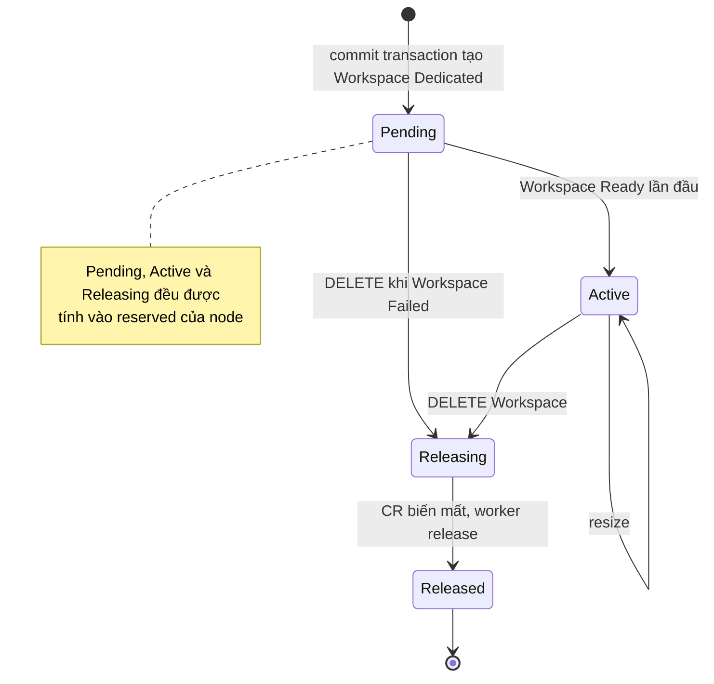

### 3.1 Bảng chuyển trạng thái

| From | Event / Guard | To | Side effects |
|---|---|---|---|
| `[*]` | Transaction tạo Workspace Dedicated: lock ClusterGrant rồi `dedicated_node_grants` (thứ tự 02 mục 4); re-check `reserved + new ≤ reservable` theo từng chiều CPU/RAM/Pod | `Pending` | Row `workspace_node_reservations` với amount = `requests.cpu/memory` và `pods` (`requests.storage` không trừ vào node); tính lại `remaining` và capacity state (mục 5) |
| `Pending` | Workspace `Provisioning → Ready` lần đầu | `Active` | Condition `DedicatedNodeCapacityReserved` True. Không đổi amount |
| `Active` | `PATCH` resize: transaction lock lại cùng các row. Tăng: chỉ khi còn remaining, nâng amount ngay trong transaction PATCH. Giảm: chỉ khi usage của quota chung cho phép; amount **giữ nguyên**, worker hạ amount trong transaction ghi Operation update `Succeeded` | `Active` | Amount trong DB không bao giờ thấp hơn `hard` đang áp trong Cluster; update `Failed` thì giữ amount cũ; audit `NodeReservation update` |
| `Pending` / `Active` | DELETE Workspace (`Failed`, `Ready`, `Cordoned` hoặc `Degraded`; mục 1.1) | `Releasing` | Vẫn **tính vào reserved**; API từ chối reservation mới nếu vượt |
| `Releasing` | Worker thấy CR biến mất: finalizer đã chờ Pod rời node và gỡ membership label (mục 10) | `Released` | Cùng transaction đưa Workspace sang `Deleted`; `remaining` tăng lại; capacity state tính lại; audit `NodeReservation release`. Node vẫn thuộc Organization |

### 3.2 Vì sao `Failed` provisioning vẫn giữ reservation

Sau commit, DB đã hứa với Organization rằng Workspace này có 4 CPU trên `worker-a-05` và một `/24`. Nếu release ngay khi controller báo lỗi:

1. một request khác có thể lấy đúng phần capacity đó;
2. retry của Operation gốc sẽ apply CR với quota 4 CPU lên node đã hết chỗ → overbook thật sự trên node, vi phạm hard reservation (plan 5.3);
3. CIDR có thể được cấp cho Workspace khác trong khi IPPool cũ vẫn tồn tại trong Cluster → overlap.

Vì vậy capacity chỉ rời trạng thái "đang giữ" khi user chủ động delete và chỉ `Released` khi CR đã biến mất. Lỗi tạm thời của controller không phải sự kiện release.

**Điểm cần review**

- Reservation `Pending` của Workspace `Failed` không có TTL; portal nhắc trên Overview của Organization và trên trang node cho tới khi user retry hoặc xóa.

---

## 4. NetworkAllocation / CIDR

**Mục đích:** mô tả vòng đời một CIDR trong NetworkPool (từ M9): cấp cho Workspace, thu hồi qua quarantine rồi mới tái sử dụng. "Còn trống" không phải một state: một khoảng địa chỉ còn trống khi không có row nào chưa `Released` phủ lên nó.


### 4.1 Bảng chuyển trạng thái

| From | Event / Guard | To | Side effects |
|---|---|---|---|
| `[*]` | IPAM trong transaction tạo Workspace: pool thuộc grant và đúng Cluster; prefix ∈ `allowedPrefixLengths` (mặc định `defaultPrefixLength`); không overlap `clusters.reserved_cidrs` (Pod CIDR mặc định, Service CIDR, Node CIDR) và allocation khác (mọi state trừ `Released`) trong Cluster; còn đủ địa chỉ | `Allocated` | Row `network_allocations` (workspace_id, cluster_id, pool_id, CIDR); exclusion constraint chống race; CR `spec.network.cidr` |
| `Allocated` | Workspace Controller tạo IPPool `assignmentMode: Manual`, Namespace annotation | (giữ `Allocated`) | Condition `NetworkReady` True |
| `Allocated` | Transaction DELETE Workspace (mục 1.1) | `Releasing` | CIDR vẫn bị coi là chiếm; không thể cấp lại |
| `Releasing` | Worker thấy CR biến mất. Trước đó finalizer đã chờ không còn địa chỉ đang cấp trong các IPAMBlock thuộc CIDR, xóa IPPool qua `projectcalico.org/v3` và chờ IPAMBlock của nó biến mất (kiểm chứng trên lab) | `Quarantined` | Cùng transaction đưa Workspace sang `Deleted`; `quarantine_until = now + T`, T cấu hình được, mặc định 10 phút; audit |
| `Quarantined` | Vòng `housekeeping` thấy `quarantine_until` đã qua | `Released` | CIDR và `k8s_name` của Workspace dùng lại được; row Workspace xử lý theo `02-data-model.md` mục 4 |

Không có cạnh `Allocated → Released` trực tiếp: Workspace `Failed` sau commit vẫn giữ `Allocated` (mục 3.2). Rollback trước commit không tạo row nên không cần state. Workspace tạo trước M9 không có row nào ở đây (mục 1.2).

**Điểm cần review**

- Pool chung `onboarding-pod-network` (organizationId null) được nhiều grant tham chiếu — overlap check theo Cluster đã đủ, UI "IP used/available" cho Organization chỉ hiện phần của chính nó và số còn trống của pool, không lộ allocation của Organization khác.
- Requested CIDR (advanced) đè lên pool đã có allocation `Quarantined` phải trả `CIDR_OVERLAP` chứ không phải `CIDR_OUTSIDE_ALLOWED_POOL` — thứ tự validate: thuộc pool trước (`CIDR_OUTSIDE_ALLOWED_POOL`), overlap sau (`CIDR_OVERLAP`).

---

## 5. DedicatedNodeGrant: capacity state và node health

**Mục đích:** mô tả hai trục trạng thái độc lập của một node đã grant cho Organization — capacity (suy ra từ reservation) và health (quan sát từ Node) — và cách drift kéo Workspace sang `Degraded`.

### 5.1 Capacity state

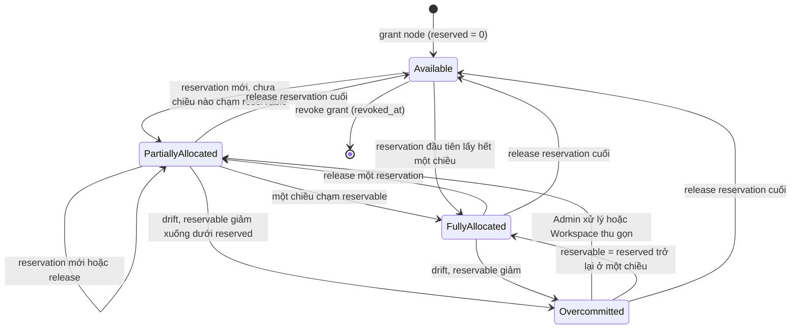

Công thức (plan 6.3), tính riêng từng chiều CPU, RAM, Pod:

```text
reservable = allocatable - systemReserve
reserved   = sum(NodeReservation ở Pending/Active/Releasing)
remaining  = max(reservable - reserved, 0)
```

Capacity state gộp ba chiều như sau: `Overcommitted` nếu có chiều reserved > reservable; ngược lại `FullyAllocated` nếu có chiều reserved = reservable (hết CPU dù còn RAM vẫn là `FullyAllocated`, như `05-network-and-scheduling.md` mục 3); `Available` nếu reserved = 0 ở mọi chiều; còn lại `PartiallyAllocated`. Trước khi controller báo `allocatable` lần đầu (row mới ghi, `node_state = NotReady`), capacity là `Available`.

| From | Event / Guard | To | Side effects |
|---|---|---|---|
| `[*]` | Platform Admin `PUT .../dedicated-nodes`. API ghi row `dedicated_node_grants` (`node_state=NotReady`); từ M6 kèm Operation `node.grant`. Controller của `PlatformNodeGrant` (đầy đủ ở M8) kiểm node `Ready`, schedulable, không phải system/control-plane, không mang label `tenantry.io/compute-pool`, **không còn Pod tenant nào** (kể cả Pod Shared của chính Organization); chưa đạt thì Operation `Failed` kèm lý do (`DEDICATED_NODE_NOT_READY`, `DEDICATED_NODE_NOT_CLEAN` kèm danh sách Pod) | `Available` | Controller gắn label + taint `tenantry.io/dedicated-org=<org-id>` và báo allocatable; worker chép `node_state`, allocatable về DB; audit. Quy trình của Admin: bớt node khỏi pool trên portal → drain → uncordon → cấp (`05-network-and-scheduling.md` mục 1) |
| `Available` / `PartiallyAllocated` | Transaction tạo/resize Workspace (mục 3) với `reserved + new ≤ reservable` ở mọi chiều | `PartiallyAllocated` / `FullyAllocated` | `remaining` cập nhật; membership label `workspaces.tenantry.io/<ws-id>=true` do controller gắn khi reconcile |
| bất kỳ | Request có `reserved + new > reservable` ở một chiều | (không đổi) | Trả `DEDICATED_NODE_INSUFFICIENT_CAPACITY`; không ghi gì |
| `PartiallyAllocated` / `FullyAllocated` / `Overcommitted` | NodeReservation `Releasing → Released` | state tính lại theo công thức | `remaining` tăng; label membership của Workspace đã được finalizer gỡ; org label/taint **giữ nguyên** |
| `PartiallyAllocated` / `FullyAllocated` | Capacity snapshot refresh (controller báo allocatable qua `PlatformNodeGrant.status`, worker chép về DB) hoặc Admin tăng `systemReserve`; kết quả có chiều `reserved > reservable` | `Overcommitted` | Chặn reservation mới (`DEDICATED_NODE_INSUFFICIENT_CAPACITY`); mọi Workspace có NodeReservation trên node → `Degraded` (Condition `DedicatedNodeCapacityReserved=False`, reason `Overcommitted`); không evict, không di chuyển |
| `Overcommitted` | Admin xử lý (giảm `systemReserve`, node tăng allocatable) hoặc Organization thu gọn/xóa Workspace tới khi mọi chiều `reserved ≤ reservable` | `PartiallyAllocated` / `FullyAllocated` / `Available` | Workspace liên quan `Degraded → Ready` tự động |
| `Available` | Platform Admin thu hồi grant (bỏ node khỏi `PUT .../dedicated-nodes`); guard: không còn NodeReservation nào chưa `Released` | `[*]` | Xóa mềm: `revoked_at = now()` (02 mục 3); từ M6 Operation `node.revoke`, controller gỡ org label/taint; audit |

### 5.2 Node health

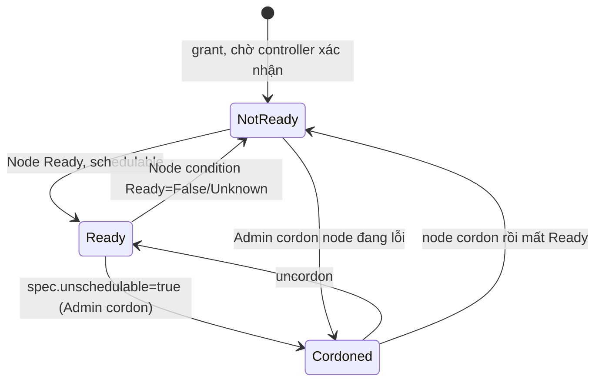

Node đang `Cordoned` mà kubelet mất Ready thì chuyển `NotReady` (cạnh `Cordoned → NotReady`); Ready lại thì về `Cordoned` nếu vẫn còn cordon.

| Health | Ảnh hưởng lên grant/Workspace |
|---|---|
| `Ready` | Node chọn được trong wizard nếu capacity còn; Workspace `Ready` |
| `NotReady` | Wizard disable kèm lý do; reservation mới bị `DEDICATED_NODE_NOT_READY`; Workspace trên node → `Degraded` với `ComputeReady=False`; reservation giữ nguyên |
| `Cordoned` | Như `NotReady` về reservation mới; Pod đang chạy giữ nguyên; dùng khi Admin bảo trì node hoặc chuẩn bị revoke |

### 5.3 Drift → Overcommitted → Workspace Degraded

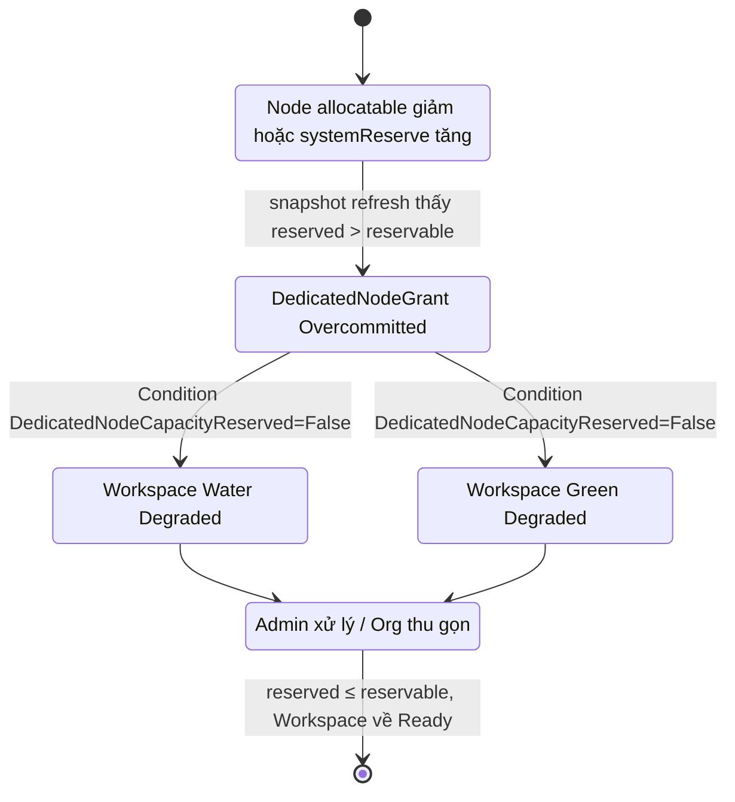

Capacity state lưu ở cột `dedicated_node_grants.capacity_state` (02 mục 3), service tính lại trong mọi transaction đổi reservation hoặc allocatable.

---

## 6. Cluster

**Mục đích:** mô tả vòng đời Cluster trong registry và thao tác nào bị chặn ở từng trạng thái. Ở MVP mọi chuyển trạng thái do Platform Admin đặt tay (`PATCH /admin/clusters/{clusterId}`); worker chỉ ghi `last_health_check` (IMPLEMENTATION-PLAN mục 5.1), không tự đổi status.

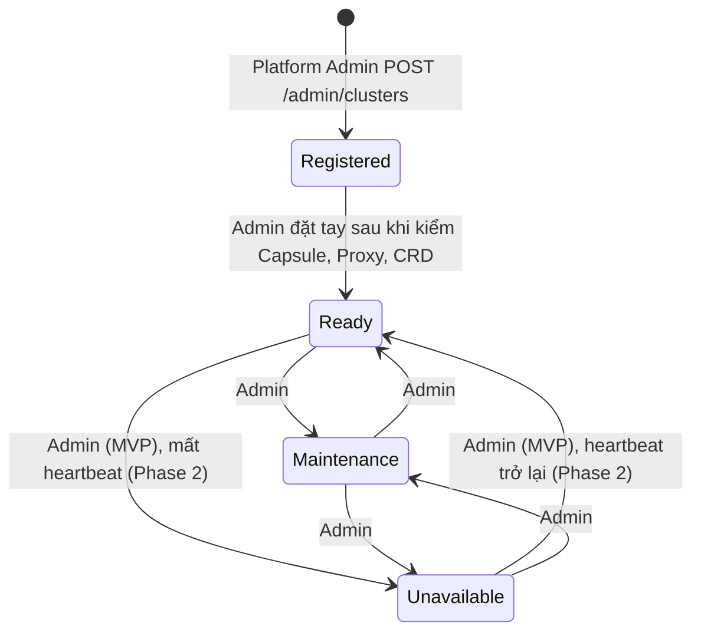

| State | Cho phép | Bị chặn |
|---|---|---|
| `Registered` | Admin sửa metadata, endpoint, apps domain, `reserved_cidrs` | Tạo/duyệt ClusterGrant và tạo Workspace → `409 CLUSTER_NOT_READY` |
| `Ready` | Mọi thao tác: create/resize/delete Workspace, kubectl/Headlamp, tạo/duyệt ClusterGrant | — |
| `Maintenance` | Workspace hiện có **vẫn chạy và truy cập được** (kubectl/Headlamp/app); delete và retry vẫn xử lý | Create Workspace, resize, tạo/duyệt ClusterGrant → `CLUSTER_NOT_READY`; wizard ẩn/disable Cluster |
| `Unavailable` | Portal, Keycloak, Organization/member/group vẫn hoạt động | Như `Maintenance`; `Open Web Console` disable; Workspace ở Cluster này hiển thị "unknown"; outbox event cho Cluster này không được giao và `attempts` không tăng, nên Operation giữ `Pending` |
| mọi state | — | Unregister Cluster hoặc xóa ClusterGrant khi còn Workspace/reservation hoạt động; đổi default Cluster chỉ ảnh hưởng Workspace tạo sau |

**Điểm cần review**

- Cluster `Unavailable` giữa lúc delete: Operation giữ `Running`, không tính timeout trong lúc Cluster `Unavailable`; Cluster `Ready` lại thì worker đọc tiếp status của CR.

---

## 7. Invitation

**Mục đích:** mô tả vòng đời invite link và guard "email đã verify phải khớp".

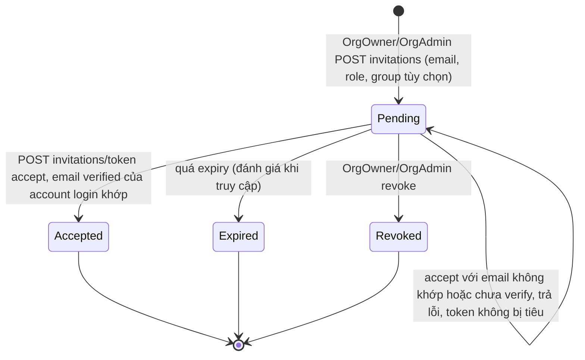

| From | Event / Guard | To | Side effects |
|---|---|---|---|
| `[*]` | `POST /organizations/{orgId}/invitations`; guard: Organization `Active` (nếu không `409 ORG_NOT_ACTIVE`); `maxMembers` kiểm dưới lock `organization_entitlements` (nếu đầy `ENTITLEMENT_EXCEEDED`); đã có lời mời `Pending` cho cùng email thì lời mời cũ chuyển `Revoked` trong cùng transaction | `Pending` | Row `invitations` với `token_hash`, `expiry`, role, group tùy chọn; portal hiển thị link một lần; audit |
| `Pending` | `POST /invitations/{token}:accept` bởi account đang login; guard: hash khớp, chưa expiry, `email_verified=true` và email token khớp email invitation (so sánh chuẩn hóa lowercase); `maxMembers` kiểm lại dưới lock | `Accepted` | Row `organization_members`; thêm vào group nếu invite chọn → Group Sync `Pending`; `accepted_by`; audit |
| `Pending` | Accept nhưng email không khớp hoặc chưa verify | `Pending` | Trả lỗi rõ; **không** tạo membership; không tiêu token, để đúng người vẫn dùng được link |
| `Pending` | `now > expiry` | `Expired` | Accept trả lỗi; UI cho tạo lại |
| `Pending` | `DELETE /invitations/{invitationId}` bởi OrgOwner/OrgAdmin | `Revoked` | Accept trả lỗi; audit |

**Điểm cần review**

- Accept sai email không tự thu hồi lời mời ở MVP; mỗi lần sai ghi một audit `invitation.accept` kết quả `Refused`, Owner thấy và tự thu hồi nếu nghi ngờ.
- Người nhận đã là member thì accept trả `409`, không tạo membership trùng và không đổi role ngầm.
- Invitation cho email đã có account khác đang login (mismatch) — thông điệp UI cần chỉ rõ "đăng nhập bằng đúng email".

---

## 8. OwnershipTransfer

**Mục đích:** mô tả luồng hai bước chuyển OrgOwner sang một OrgAdmin. Mọi bước diễn ra trong portal, không có token hay link.

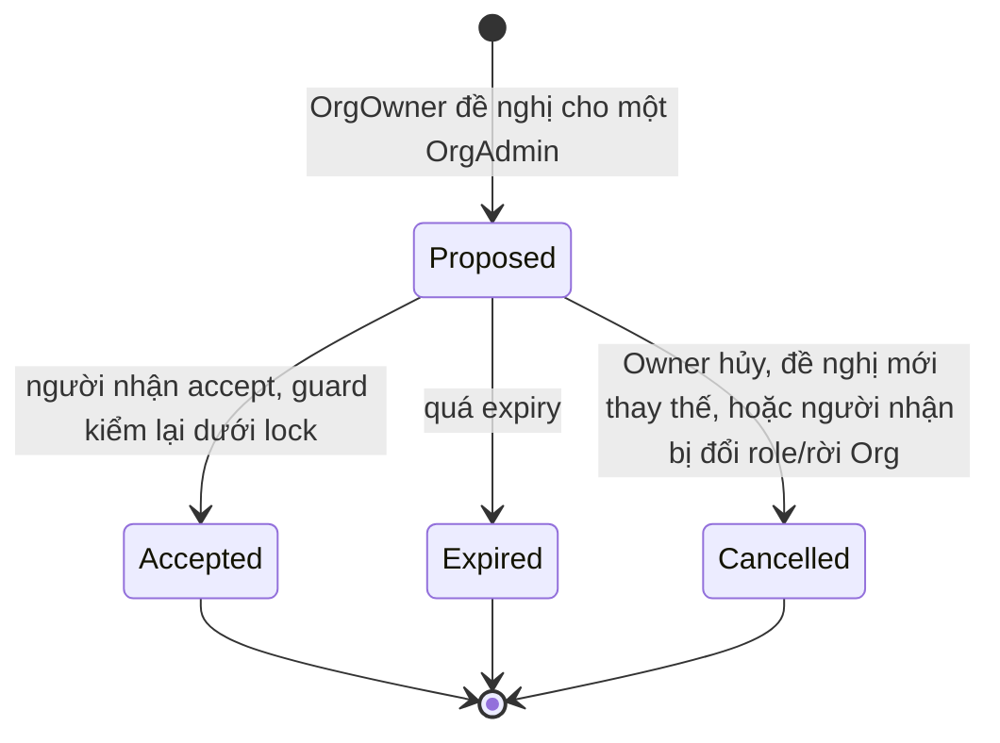

| From | Event / Guard | To | Side effects |
|---|---|---|---|
| `[*]` | `POST /organizations/{orgId}:transfer-ownership` với body `toUserId`; guard: actor là Owner; người nhận là OrgAdmin của Org | `Proposed` | Transfer `Proposed` cũ của Org (nếu có) chuyển `Cancelled`; row `ownership_transfers` mới có `expires_at`, không token; Owner và người nhận thấy đề nghị qua `GET /organizations/{orgId}/ownership-transfer`; audit |
| `Proposed` | `POST /ownership-transfers/{transferId}:accept` bởi đúng `to_user_id`; transaction lock row transfer và kiểm lại: vẫn `Proposed`, chưa hết hạn, người nhận vẫn là OrgAdmin, người đề nghị vẫn là OrgOwner | `Accepted` | Một transaction, đúng thứ tự: hạ Owner cũ thành `OrgAdmin` **trước**, rồi nâng người nhận thành `OrgOwner` (partial unique index "một Owner" không deferrable), đổi `organizations.owner_user_id`; audit |
| `Proposed` | Hết `expires_at` | `Expired` | — |
| `Proposed` | `DELETE /ownership-transfers/{transferId}` bởi Owner (hủy) hoặc người nhận (từ chối); hoặc người nhận bị đổi role/bị remove/tự rời Org | `Cancelled` | Audit kèm lý do |

Mỗi Organization có tối đa một transfer `Proposed` (partial unique index, 02 mục 2), nên không thể có hai người cùng accept. Sau `Accepted`, Owner cũ trở thành OrgAdmin (plan 4.2), không có tùy chọn "rời hẳn".

---

## 9. Group sync status, Namespace record và Route record

### 9.1 Group sync status

**Mục đích:** mô tả cách `groups` và `group_members` hội tụ sang Keycloak. Mỗi row mang hai thứ: **hướng** mong muốn (`deleted_at IS NULL` = phải tồn tại, khác NULL = phải biến mất) và **tiến độ** đồng bộ (`sync_status`).

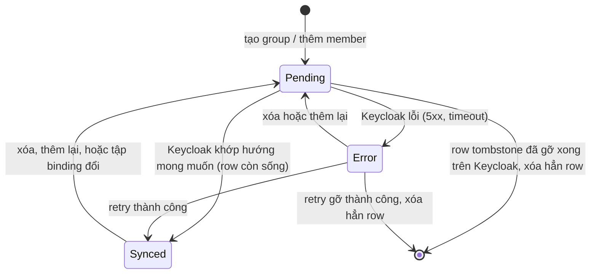

| From | Event / Guard | To | Side effects |
|---|---|---|---|
| `[*]` | Tạo group (machine name `org_<id>:group_<id>`) hoặc thêm member; guard: Organization `Active`; tạo group kiểm `maxGroups` dưới lock `organization_entitlements` (tombstone không tính) | `Pending` | Row mới, `deleted_at = NULL` |
| `Synced` / `Error` | Gỡ member, remove/leave Organization, xóa group (guard: group không còn AccessBinding) | `Pending` | **Tombstone**: `deleted_at = now()`. Từ lúc này row không còn hiệu lực với portal; chỉ còn là việc chờ worker làm |
| `Pending` / `Error` (tombstone) | Thêm lại đúng member đó | `Pending` | `deleted_at = NULL`; worker sẽ đảm bảo membership tồn tại |
| `Synced` | Transaction đổi tập binding (tạo/xóa Workspace, `PUT`/`DELETE` binding, xóa group) | `Pending` | Mọi `group_members` còn sống của các group bị ảnh hưởng, để worker tính lại group `tenantry:tenant-users` của các user đó |
| `Pending` / `Error` | Worker lấy row tới hạn `next_sync_at`. Row sống: đảm bảo group/membership **có** trên Keycloak. Tombstone: đảm bảo **không còn** | `Synced` (row sống) hoặc xóa hẳn row (tombstone) | Lưu `keycloak_group_id`; cập nhật group platform `tenantry:tenant-users` theo số binding còn lại của user; không logout user (`06-security-and-identity.md` mục 5) |
| `Pending` / `Error` | Keycloak lỗi | `Error` | `sync_attempts++`, `next_sync_at = now + backoff`, `last_error`; metric "group sync lag/error" |

Mọi lời gọi Keycloak của worker đều idempotent (tạo group đã có, thêm member đã có, gỡ member đã gỡ đều là thành công), nên worker chết giữa chừng chỉ cần chạy lại.

Tác động lên các máy khác: bind group vào Workspace hoặc tạo Workspace với group chưa `Synced` → `GROUP_SYNC_PENDING`; Condition `IdentityBindingsReady` chỉ True khi mọi group trong `accessBindings` đều `Synced`.

### 9.2 Namespace record (`workspace_namespaces`)

**Mục đích:** mô tả trạng thái một Namespace trong Workspace theo góc nhìn portal, gồm Namespace khai báo qua `spec.namespaces` và Namespace tạo bằng kubectl/Headlamp chỉ quan sát được. `spec.namespaces` và body tạo giữ hậu tố (`frontend`); `spec.namespacesToDelete`, `status.namespaces`, `workspace_namespaces.name` và `{name}` trong đường dẫn API giữ tên đầy đủ (`acme-solar-frontend`).

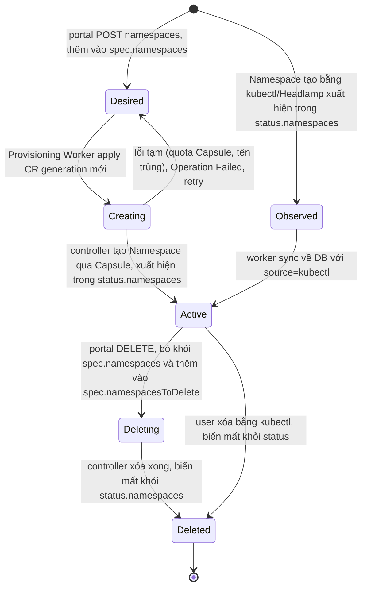

| From | Event / Guard | To | Side effects |
|---|---|---|---|
| `[*]` | `POST /workspaces/{id}/namespaces` bởi OrgOwner/OrgAdmin hoặc member group `TenantOwner`; guard: Workspace `Ready` và không có Operation đang chạy (`WORKSPACE_NOT_READY`), tên hợp lệ, chưa vượt `namespaceQuota` (đếm cả Namespace kubectl) | `Desired` | Row `source=portal, state=Desired`, `name = acme-solar-frontend`; CR `spec.namespaces` thêm `frontend`; Operation `namespace.create` |
| `Desired` | Worker apply CR | `Creating` | — |
| `Creating` | Controller tạo Namespace `acme-solar-frontend` (owner = Tenant; Capsule inject annotation IPPool, label tenant, Pod Security); `status.namespaces` có entry `source: portal` | `Active` | Operation `Succeeded`; usage snapshot bắt đầu |
| `Creating` | Capsule từ chối (quota, prefix) | `Desired` | Operation `Failed` kèm lý do; user retry hoặc xóa khỏi spec |
| `[*]` | Controller thấy Namespace có label tenant `acme-solar` nhưng không nằm trong `spec.namespaces` | `Observed` | `status.namespaces` entry `source: kubectl` |
| `Observed` | Worker sync `status` về DB | `Active` | Row `source=kubectl`; portal hiển thị badge nguồn; tính vào `namespaceQuota` |
| `Active` | `DELETE /workspaces/{id}/namespaces/{name}` (tên đầy đủ); nếu có PVC bắt confirm gõ tên; áp dụng cho cả `source=kubectl` | `Deleting` | Bỏ hậu tố khỏi `spec.namespaces` (nếu có), thêm tên đầy đủ vào `spec.namespacesToDelete`; Route trong Namespace bị bỏ khỏi `spec.routes` cùng transaction; Operation `namespace.delete` |
| `Deleting` | Controller xóa Namespace, dọn `spec.namespacesToDelete`, entry biến mất khỏi `status.namespaces` | `Deleted` | Operation `Succeeded`; kẹt finalizer quá ngưỡng → Operation `Failed` kèm object đang giữ, retry khi object tự hết (`Blocked` chỉ có ở `workspace.delete`, mục 2) |
| `Active` | User `kubectl delete ns` | `Deleted` (chỉ `source=kubectl`) | Worker sync thấy biến mất. `source=portal`: Namespace còn trong `spec.namespaces` nên controller tạo lại ngay (khai báo, như mọi drift khác), rỗng; muốn bỏ hẳn thì xóa từ portal |

Developer/Viewer gọi endpoint ghi nhận `403 FORBIDDEN` (`03-flows.md` mục 7a).

**Điểm cần review**

- `Observed` chỉ có trong CR; DB không lưu nó: worker thấy Namespace tạo bằng kubectl thì ghi thẳng `Active` với `source=kubectl`.

---

### 9.3 Route record (`workspace_routes`)

**Mục đích:** trạng thái một Route theo góc nhìn portal. Route chỉ được khai báo từ portal qua `spec.routes`; tenant không ghi được Ingress nên không có nguồn `kubectl` như Namespace.

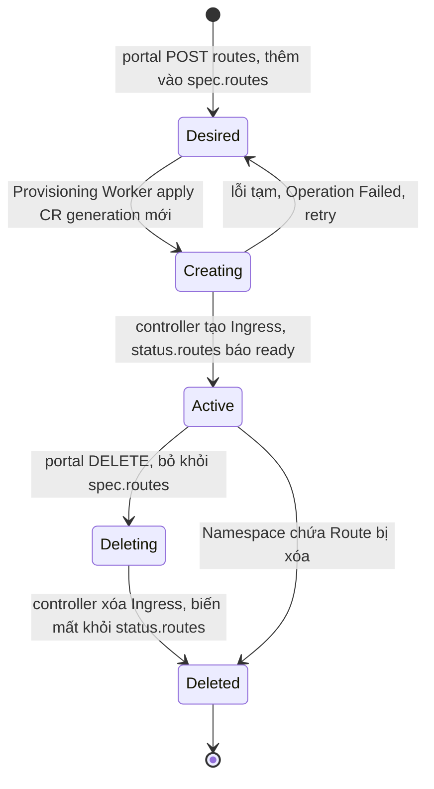

| From | Event / Guard | To | Side effects |
|---|---|---|---|
| `[*]` | `POST /workspaces/{id}/routes` bởi OrgOwner/OrgAdmin hoặc member group `TenantOwner`; guard: Workspace `Ready` và không có Operation đang chạy, Namespace `Active`, tên hợp lệ, nhãn đầu của hostname ≤ 63 ký tự, chưa quá 20 Route, hostname chưa ai giữ | `Desired` | Row với `hostname` đã ghép; CR `spec.routes` thêm entry; Operation `route.create` |
| `Desired` | Worker apply CR | `Creating` | — |
| `Creating` | Controller tạo Ingress trong Namespace; `status.routes` có entry `ready: true` | `Active` | Operation `Succeeded`; portal hiện URL |
| `Creating` | Apply Ingress lỗi | `Desired` | Operation `Failed` kèm lý do; user retry hoặc xóa |
| `Active` | `DELETE /workspaces/{id}/routes/{routeId}` | `Deleting` | Bỏ khỏi `spec.routes`; Operation `route.delete` |
| `Deleting` | Controller xóa Ingress không còn trong `spec.routes` | `Deleted` | Operation `Succeeded`; hostname được nhả |
| `Active` | Namespace chứa Route chuyển `Deleting`/`Deleted` | `Deleted` | Xóa từ portal: API bỏ Route khỏi `spec.routes` trong cùng transaction xóa Namespace. Xóa bằng kubectl: worker bỏ Route khi sync thấy Namespace biến mất. Ingress bị namespace controller xóa theo Namespace (luật admission không chặn việc này, `05-network-and-scheduling.md` mục 7) |

Ghi chú:

- `Active` nghĩa là Ingress đã tồn tại, **không** bảo đảm Service đích có Pod chạy; khi đó URL trả 503. Portal không đọc Service của tenant.
- Service và cổng không sửa được sau khi tạo; muốn đổi thì xóa Route và tạo lại.
- Custom domain (sau MVP) thêm state `PendingVerification` đứng trước `Desired`: Route chỉ vào `spec.routes` sau khi bản ghi TXT khớp.

---

## 10. Cross-machine: create và delete

**Mục đích:** cho thấy bốn máy trạng thái Workspace, Operation, NodeReservation và NetworkAllocation chuyển động cùng nhau trong hai luồng chính, để kiểm tra không có bước nào release capacity/CIDR sớm. Phần giữ trên ClusterGrant đi theo state Workspace (mục 3).

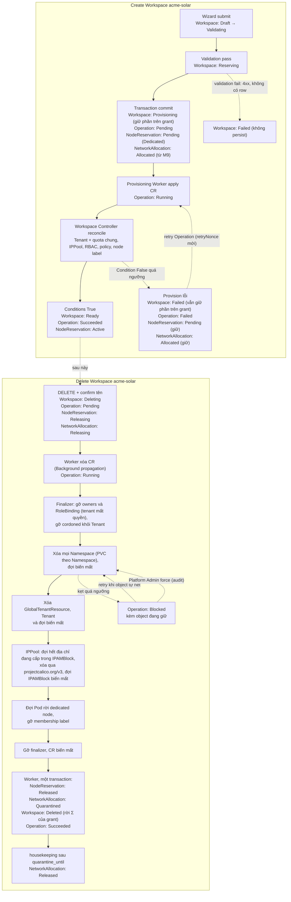

Bất biến cần giữ khi đọc sơ đồ:

1. Không ô nào trước `D9` đổi NodeReservation sang `Released`, CIDR sang `Quarantined` hoặc Workspace sang `Deleted`: worker chỉ biết Cluster đã sạch khi CR biến mất.
2. `C7` giữ nguyên phần trên grant, NodeReservation và NetworkAllocation; đường duy nhất ra khỏi `C7` là retry (về `C4`) hoặc DELETE (vào `D1`).
3. `DB` (Blocked) không đổi state của Workspace/NodeReservation/NetworkAllocation; nó chỉ dừng Operation.
4. `D10` là bước nền, không thuộc Operation của user; Operation `Succeeded` tại `D9`.
5. Workspace tạo trước M9 bỏ qua `D6` và `D10`; trước M8 bỏ qua `D7` và NodeReservation (mục 1.2).

**Điểm cần review**

- `D10` không có Operation riêng; housekeeping ghi một audit khi CIDR chuyển `Released`.
- Cluster `Unavailable` giữa `D3`–`D8`: Operation giữ `Running` (mục 6).

---

## 11. Organization

**Mục đích:** vòng đời một Organization từ lúc user xin tới lúc xóa [4.2].

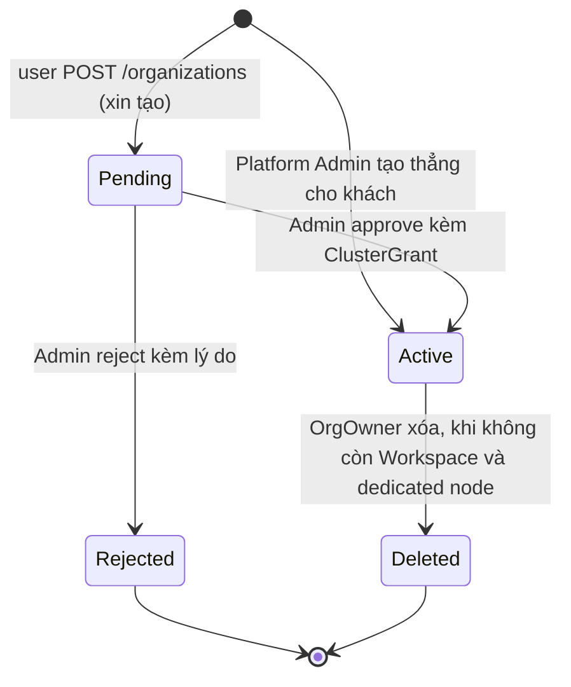

| From | Event / Guard | To | Side effects |
|---|---|---|---|
| `[*]` | `POST /organizations`; guard: slug hợp lệ [4.2] và chưa bị giữ, user chưa có yêu cầu `Pending` nào | `Pending` | Row `organizations` + membership `OrgOwner` cho người xin; slug được giữ chỗ |
| `[*]` | `POST /admin/organizations`; guard: Owner là user đã login ít nhất một lần; Cluster của grant `Ready` | `Active` | Như cạnh approve dưới đây, trong một transaction |
| `Pending` | `POST /admin/organizations/{id}:approve`; guard: Cluster của grant `Ready` (nếu không `409 CLUSTER_NOT_READY`) | `Active` | Một transaction: entitlement, ClusterGrant (điền sẵn từ onboarding policy), ba group mặc định `admins`/`developers`/`viewers`, Owner vào `admins` (Group Sync `Pending`); audit |
| `Pending` | `POST /admin/organizations/{id}:reject` kèm lý do | `Rejected` | `review_note`; slug được nhả; người xin gửi được yêu cầu mới |
| `Active` | `DELETE /organizations/{orgId}` bởi OrgOwner; guard: không còn row `workspaces` nào của Organization (Workspace `Deleted` vẫn giữ row tới khi CIDR hết quarantine, `02-data-model.md` mục 4) và không còn DedicatedNodeGrant (Admin thu hồi trước), sai thì `409 ORGANIZATION_NOT_EMPTY`; transaction khóa `organizations` rồi `organization_entitlements` `FOR UPDATE` (thứ tự 02 mục 4) để xếp hàng với tạo Workspace, mời member, tạo group | `Deleted` | Một transaction, không có state `Deleting`: status `Deleted`, xóa các ClusterGrant, hủy invitation và transfer đang chờ, tombstone mọi group và group member để gỡ khỏi Keycloak; audit. Organization `Deleted` trả 404 ở mọi endpoint |

Organization `Pending`/`Rejected` chỉ hiện với người xin. Mọi endpoint cần Organization đã duyệt (mời member, tạo group, tạo Workspace, đọc `/entitlement`, `/usage`) trả `409 ORG_NOT_ACTIVE` (thứ tự kiểm ở plan 9.2).
