# 04 — State machines của Tenantry

> Nơi định nghĩa cho trạng thái và cạnh chuyển của mọi entity. Quy tắc nghiệp vụ nền ở `PRODUCT-PLAN.md` mục 4, 6, 7, 9, 14, 17; cột lưu trạng thái ở `02-data-model.md`.
> Chỗ nào plan chưa nói rõ, tài liệu chọn phương án đơn giản nhất còn nhất quán và đánh dấu **(giả định)** để tác giả duyệt.

## 0. Quy ước chung

| Ký hiệu | Ý nghĩa |
|---|---|
| **Platform API** | Backend Go, nơi chạy authorize/validate/transaction; ghi Operation và outbox |
| **Provisioning Worker** | Đọc outbox, apply `PlatformWorkspace` CR bằng credential scoped, poll status CR về DB |
| **Workspace Controller** | controller-runtime trong Cluster, reconcile Capsule Tenant/ResourcePool/IPPool/RBAC/policy/node label |
| **Group Sync Worker** | Sync group/membership PostgreSQL → Keycloak Admin API |
| **IPAM** | Phần của Platform API cấp/thu CIDR từ NetworkPool |
| **OrgOwner/OrgAdmin** | Actor phía khách hàng; **Platform Admin** = realm role `platform-admin` |
| `k8s_name` | `<org-slug>-<ws-slug>`, ví dụ `acme-solar`; là tên Tenant, tiền tố Namespace, tên CR |

Nguyên tắc xuyên suốt (plan 5.3, 14, 17):

- PostgreSQL là source of truth cho product state; Kubernetes chỉ biết desired state qua CR và trả observed state qua `status`.
- Mọi bước đổi capacity (ClusterGrant reservation, NodeReservation, NetworkAllocation) diễn ra trong **một transaction có row lock**; state machine dưới đây mô tả trạng thái *sau* commit.
- Reservation/CIDR **không** được release chỉ vì controller báo lỗi tạm thời; chỉ delete/admin cleanup đã dọn xong trong Cluster mới release.

---

## 1. Workspace lifecycle

**Mục đích:** mô tả toàn bộ vòng đời một Workspace từ lúc OrgOwner submit wizard tới khi bị xóa, ai kích hoạt từng cạnh và Condition nào phải True để vào `Ready`.

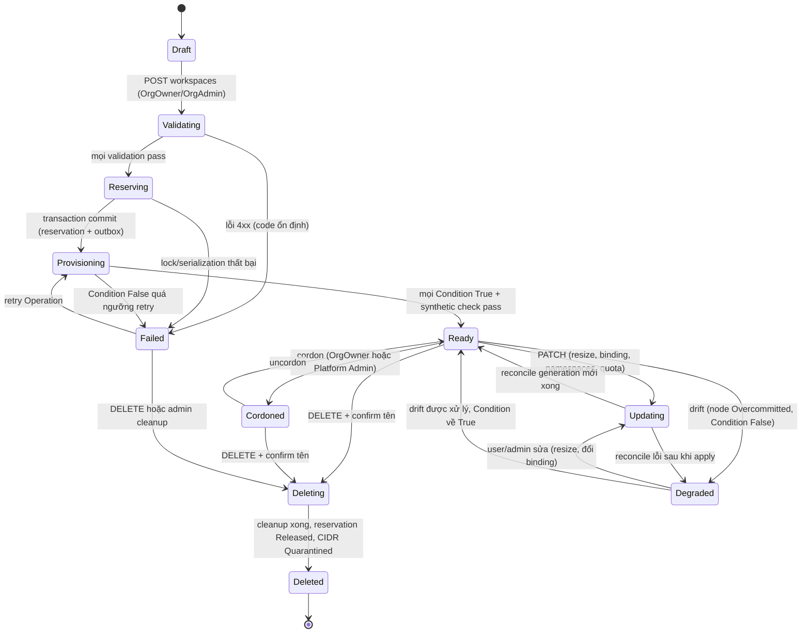

### 1.1 Bảng chuyển trạng thái

| From | Event / Guard | To | Side effects |
|---|---|---|---|
| `[*]` | Wizard submit hoặc `POST /workspaces:validate` (dry-run) | `Draft` | Chưa ghi DB. `Draft` chỉ tồn tại trong request (giả định: không persist Draft) |
| `Draft` | `POST /organizations/{orgId}/workspaces` với `Idempotency-Key`; actor là OrgOwner/OrgAdmin của đúng Organization | `Validating` | Bắt đầu chạy 17.1 bước 1–8 |
| `Validating` | Tên/slug hợp lệ và unique; Cluster thuộc ClusterGrant và `Ready`; compute mode được grant; Shared: pool hợp lệ, Dedicated: node `Ready` và đủ remaining; có ít nhất một Owner group; group thuộc Org và đã `Synced`; entitlement/ClusterGrant budget đủ | `Reserving` | Không side effect ngoài log |
| `Validating` | Bất kỳ guard trên fail | `Failed` | Trả HTTP 4xx với error code (`CLUSTER_NOT_READY`, `DEDICATED_NODE_INSUFFICIENT_CAPACITY`, `CIDR_OVERLAP`, `GROUP_SYNC_PENDING`, ...). Không có row Workspace (giả định: Failed trước commit chỉ là kết quả API, không phải row) |
| `Reserving` | Transaction: lock ClusterGrant, DedicatedNodeGrant (nếu Dedicated), range của NetworkPool; re-check invariant 5.3 dưới lock | `Provisioning` | Commit đồng thời: Workspace row, ClusterGrant reservation `Pending`, NodeReservation `Pending` (Dedicated), NetworkAllocation `Allocated`, Operation `Pending`, outbox event, audit |
| `Reserving` | Re-check dưới lock fail (concurrent request đã lấy capacity/CIDR) | `Failed` | Rollback toàn bộ, trả 409 kèm code; không giữ gì |
| `Provisioning` | Provisioning Worker apply CR; Workspace Controller reconcile; worker poll `status` thấy `phase: Ready`, `observedGeneration` khớp, mọi Condition mục 1.2 True; synthetic verification trong Cluster pass | `Ready` | Operation `Succeeded`; reservation `Pending → Active`; portal bật kubeconfig/Headlamp link; audit |
| `Provisioning` | Condition False quá ngưỡng thời gian/retry của Operation | `Failed` | Operation `Failed` kèm Condition/component lỗi; **giữ** reservation và NetworkAllocation (xem mục 3) |
| `Ready` | `PATCH /workspaces/{id}` (display name, resources, namespaceQuota, bindings, `spec.namespaces`, policy profile); resize đi lại Validating/Reserving trong cùng transaction | `Updating` | Generation mới trên CR; Operation mới `Pending`; reservation `Active` được cập nhật amount trong cùng transaction |
| `Updating` | Worker thấy `observedGeneration == generation` và Condition True | `Ready` | Operation `Succeeded` |
| `Updating` | Reconcile lỗi sau khi apply (ví dụ ResourcePool không giảm được vì usage) | `Degraded` | Operation `Failed`; Condition chỉ rõ component |
| `Ready` | Cordon bởi OrgOwner hoặc Platform Admin | `Cordoned` | CR `spec.cordoned: true` → Capsule `Tenant.spec.cordoned` (giả định field mapping); mutation của tenant user bị chặn, workload vẫn chạy |
| `Cordoned` | Uncordon cùng actor | `Ready` | Ngược lại |
| `Ready` / `Cordoned` | `DELETE` với body gõ lại đúng `k8s_name`; portal đã hiển thị số Namespace/PVC sẽ mất | `Deleting` | Operation `delete` `Pending`; tự cordon nếu chưa; revoke binding; reservation `Active → Releasing`; NetworkAllocation `Allocated → Releasing` |
| `Deleting` | Controller báo Namespace/PVC/IPPool/Tenant/RBAC đã xóa; Pod đã rời dedicated node; Calico IPAM block đã release | `Deleted` | Xóa membership label; NodeReservation và ClusterGrant reservation `Released`; CIDR `Quarantined`; tombstone giữ `k8s_name`; audit |
| `Deleting` | Finalizer/PVC kẹt quá ngưỡng | (giữ `Deleting`) | Operation `Blocked` kèm object đang giữ; chỉ Platform Admin `:force` |
| `Ready` | Worker/controller phát hiện drift ngoài chu trình update: DedicatedNodeGrant `Overcommitted`, node `NotReady`/`Cordoned`, Condition nào đó chuyển False, managed resource bị xóa tay và chưa restore | `Degraded` | Không đổi reservation; portal hiển thị Condition lỗi và remediation |
| `Degraded` | Drift được xử lý (Admin sửa system reserve, node Ready lại, controller restore xong) | `Ready` | Tự động, không cần Operation của user |
| `Degraded` | User/Admin thực hiện thay đổi có chủ đích (giảm allocation, đổi binding) | `Updating` | Như `Ready → Updating` |

### 1.2 Conditions bắt buộc True để vào `Ready`

| Condition | Ai set | Nghĩa |
|---|---|---|
| `ClusterReady` | Platform API (từ Cluster registry) | Cluster đang `Ready` tại thời điểm provision |
| `ClusterGrantValid` | Platform API | `cluster_id` thuộc ClusterGrant của Organization, còn trong budget |
| `ResourcesReserved` | Platform API | ClusterGrant reservation đã commit |
| `DedicatedNodeCapacityReserved` | Platform API | Chỉ Dedicated mode: NodeReservation đã commit, node còn `Ready` |
| `IdentityBindingsReady` | Workspace Controller | Owner/Developer/Viewer binding render xong; group subject đã tồn tại trong Keycloak (`Synced`) |
| `ComputeReady` | Workspace Controller | Shared: Tenant nodeSelector trỏ đúng pool. Dedicated: node có org label/taint và membership label của Workspace |
| `NetworkReady` | Workspace Controller | Calico IPPool tồn tại đúng CIDR, Namespace annotation được inject, baseline NetworkPolicy replicate |
| `CapsuleTenantReady` | Workspace Controller | Tenant `acme-solar` tồn tại, ResourcePool/namespaceOptions render đúng generation |
| `PolicyReady` | Workspace Controller | Rules (registry/QoS/Service), Pod Security label, storage allow-list, luật cấm Service `NodePort`/`LoadBalancer` đã áp |
| `ProxyAccessReady` | Workspace Controller | RoleBinding có label reflection để Capsule Proxy lọc đúng; endpoint Proxy trả 200 cho synthetic check |

Cách tính: `Ready` ⇔ tất cả Condition áp dụng đều `True` **và** `status.observedGeneration == metadata.generation`. Thiếu `DedicatedNodeCapacityReserved` với Shared mode không tính là lỗi.

### 1.3 `Failed` trước và sau commit

`Failed` từ `Validating`/`Reserving` chỉ là kết quả HTTP: không có row nên không có cạnh đi ra. `Draft`, `Validating`, `Reserving` cũng chỉ tồn tại trong request; row `workspaces` đầu tiên được ghi đã ở `Provisioning`.

`Failed` từ `Provisioning` là một row thật, vẫn giữ reservation và NetworkAllocation để retry không cấp trùng (mục 3.2). Đường ra duy nhất là retry Operation (OrgOwner/OrgAdmin/Platform Admin) về `Provisioning`, hoặc DELETE vào `Deleting`.

**Điểm cần review**

- `Draft` có cần persist để hỗ trợ "lưu wizard dở" không, hay chỉ là trạng thái logic trong request như giả định ở đây?
- Reservation chuyển `Pending → Active` khi Workspace `Ready` (mục 3) hay ngay khi commit? Tài liệu chọn khi `Ready`, nhưng cả hai đều tính vào capacity.
- `Cordoned` map sang `Tenant.spec.cordoned` của Capsule — cần xác nhận version Capsule 0.15.x hỗ trợ và hành vi với Namespace đang tồn tại.
- Cluster `Unavailable` không đổi state Workspace, portal chỉ hiển thị "unknown" (plan 6.1). Có muốn thêm Condition `ClusterReady=Unknown` để UI phân biệt với `Degraded`?

---

## 2. Operation

**Mục đích:** mô tả trạng thái một Operation (create/update/cordon/uncordon/delete/namespace-create/namespace-delete) và ai được retry/force.

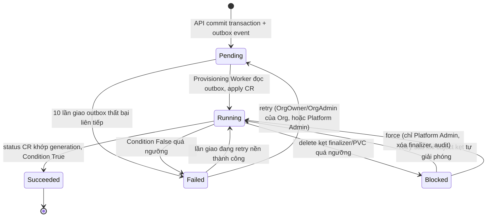

### 2.1 Bảng chuyển trạng thái

| From | Event / Guard | To | Side effects |
|---|---|---|---|
| `[*]` | Transaction của API commit thành công | `Pending` | Row `operations` (resource, type, correlation ID), row `outbox_events` (`target_cluster_id`, payload version, attempts=0) |
| `Pending` | Provisioning Worker lấy outbox event (`FOR UPDATE SKIP LOCKED`), apply CR server-side vào đúng `target_cluster_id` thành công | `Running` | `outbox_events.processed_at`; Operation có nhiều event thì chuyển ở event đầu tiên giao được |
| `Pending` | Giao một event thất bại 10 lần liên tiếp | `Failed` | `error_code = APPLY_FAILED`; worker **vẫn** tiếp tục giao ở backoff tối đa, giao được thì Operation về `Running` |
| `Running` | Worker poll `status`: `phase` đích đạt, `observedGeneration` khớp, không Condition False | `Succeeded` | Cập nhật observed state Workspace/Namespace record trong DB; Workspace đổi state tương ứng (mục 1) |
| `Running` | Condition False kéo dài quá ngưỡng (ví dụ 10 phút) hoặc lỗi không-retry (CRD apply bị 403 vì credential scoped sai) | `Failed` | `error_code` ổn định + Condition/component lỗi; Workspace sang `Failed` (create) hoặc `Degraded` (update) |
| `Running` (type=delete) | Namespace ở `Terminating` quá ngưỡng vì finalizer/PVC/PV chưa release | `Blocked` | `progress.blockedBy` = danh sách object đang giữ; portal hiển thị; OrgOwner chỉ có thể chờ/retry |
| `Failed` | `POST /operations/{id}:retry` bởi OrgOwner/OrgAdmin của Organization sở hữu hoặc Platform Admin | `Pending` | Event chưa giao được đặt lại `attempts = 0` và giao ngay; nếu lỗi do controller báo (mọi event đã giao) thì service ghi lại event apply cùng generation. **Không** tạo reservation/CIDR mới; apply idempotent |
| `Blocked` | Retry và object kẹt đã biến mất (ví dụ user tự xóa PVC ngoài) | `Running` | Tiếp tục bước delete còn lại |
| `Blocked` | `POST /operations/{id}:force` bởi Platform Admin | `Running` | Worker/controller xóa finalizer của object kẹt; audit event `force` bắt buộc |

Ràng buộc: mỗi Workspace chỉ có tối đa một Operation ở `Pending`/`Running`/`Blocked` (giả định), request mới trả `WORKSPACE_NOT_READY`.

**Điểm cần review**

- Ngưỡng thời gian chuyển `Running → Failed` và `Running → Blocked` nên là config (per type) hay hằng số?
- `Blocked` chỉ dành cho delete; nếu update giảm quota bị kẹt vì usage thì đi `Failed` — chấp nhận không?
- Có cần state `Cancelled` cho Operation `Pending` chưa được worker nhận (ví dụ user bấm xóa ngay sau khi tạo)?

---

## 3. Reservation (ClusterGrant reservation và NodeReservation)

**Mục đích:** mô tả vòng đời phần capacity Workspace giữ trên ClusterGrant (mọi mode) và trên DedicatedNodeGrant (Dedicated mode), và lý do provisioning thất bại vẫn giữ reservation.

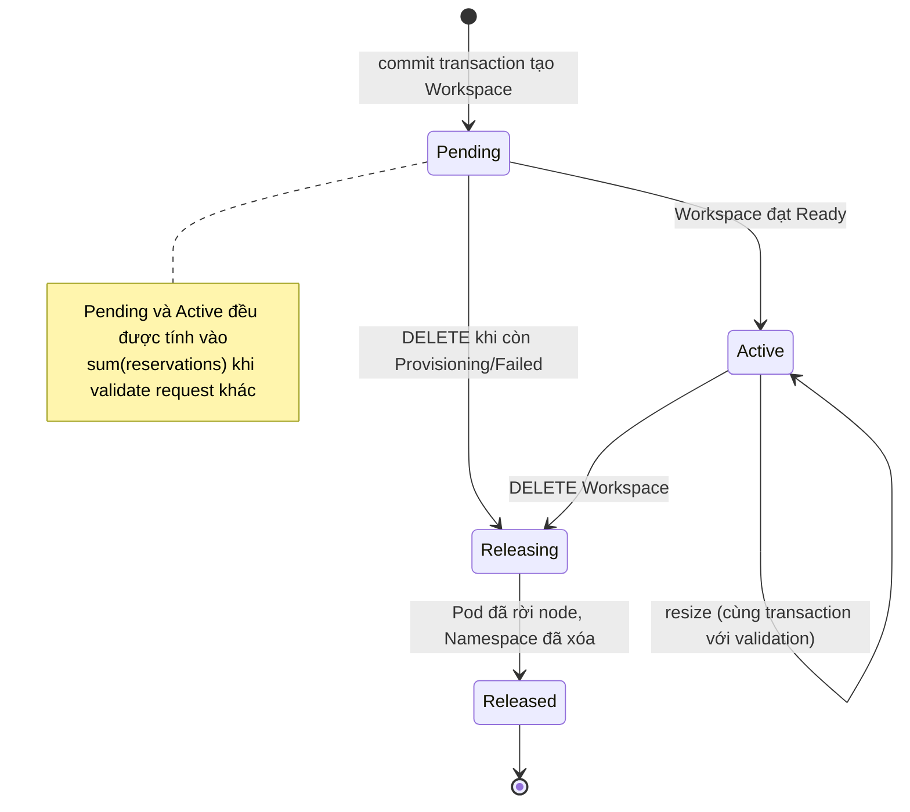

### 3.1 Bảng chuyển trạng thái

| From | Event / Guard | To | Side effects |
|---|---|---|---|
| `[*]` | Transaction tạo Workspace: lock row `organization_cluster_grants` (và `dedicated_node_grants` nếu Dedicated); re-check `Σ ≤ entitlement` và `Σ + new ≤ reservable` | `Pending` | Row `workspace_node_reservations` (Dedicated) và reservation trên ClusterGrant với amount = `requests.cpu/memory/pods` (+ `requests.storage` chỉ trên ClusterGrant). Cập nhật `remaining` của DedicatedNodeGrant và capacity state (mục 5) |
| `Pending` | Workspace `Provisioning → Ready` | `Active` | Condition `ResourcesReserved`/`DedicatedNodeCapacityReserved` True. Không đổi amount |
| `Active` | `PATCH` resize: transaction lock lại cùng các row; tăng chỉ khi còn remaining, giảm chỉ khi ResourcePool usage/claim cho phép | `Active` | Amount mới; `remaining` node tính lại; audit `NodeReservation update` |
| `Pending` / `Active` | Bắt đầu delete workflow (bước 2 của 17.4) | `Releasing` | Vẫn **tính vào capacity**; API từ chối reservation mới nếu vượt |
| `Releasing` | Controller báo: mọi Pod của Workspace đã rời node (Dedicated), Namespace đã xóa hết, membership label đã gỡ | `Released` | `remaining` tăng lại; capacity state tính lại; ClusterGrant `allocated` giảm; audit `NodeReservation release`. Node vẫn thuộc Organization |

### 3.2 Vì sao `Failed` provisioning vẫn giữ reservation

Sau commit, DB đã hứa với Organization rằng Workspace này có 4 CPU trên `worker-a-05` và một `/24`. Nếu release ngay khi controller báo lỗi:

1. một request khác có thể lấy đúng phần capacity đó;
2. retry của Operation gốc sẽ apply CR với ResourcePool 4 CPU lên node đã hết chỗ → overbook thật sự trên node, vi phạm hard reservation (plan 5.3);
3. CIDR có thể được cấp cho Workspace khác trong khi IPPool cũ vẫn tồn tại trong Cluster → overlap.

Vì vậy reservation chỉ rời `Pending/Active` khi user chủ động delete (hoặc Platform Admin cleanup) và chỉ `Released` khi Cluster đã sạch. Lỗi tạm thời của controller không phải sự kiện release.

**Điểm cần review**

- Chọn `Pending → Active` tại `Ready` (như trên) hay ngay khi commit và bỏ `Pending`? Giữ `Pending` giúp UI phân biệt "đang chờ" với "đang dùng".
- `requests.storage` không trừ vào NodeReservation (plan 5.4) — bảng đã phản ánh, xác nhận UI hiển thị đúng hai hàng khác nhau.
- Resize giảm với Dedicated: cần controller xác nhận ResourcePool mới đã áp an toàn trước khi giảm amount trong DB, hay giảm DB trước rồi reconcile? Tài liệu chọn cùng transaction (giảm DB trước) vì giảm không gây overbook.
- Có cần TTL cho reservation `Pending` của Workspace `Failed` để Admin được nhắc dọn?

---

## 4. NetworkAllocation / CIDR

**Mục đích:** mô tả vòng đời một CIDR trong NetworkPool: cấp cho Workspace, thu hồi qua quarantine rồi mới tái sử dụng. "Còn trống" không phải một state: một khoảng địa chỉ còn trống khi không có row nào khác `Released` phủ lên nó.

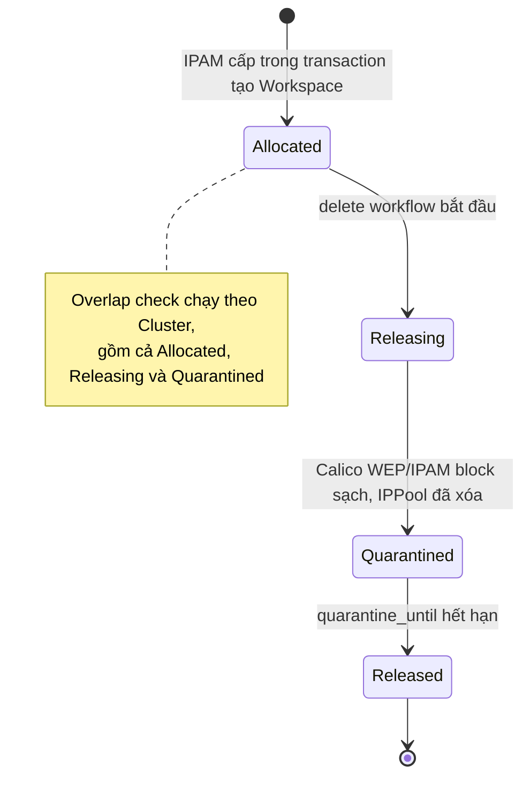

### 4.1 Bảng chuyển trạng thái

| From | Event / Guard | To | Side effects |
|---|---|---|---|
| `[*]` | IPAM trong transaction tạo Workspace: pool thuộc grant và đúng Cluster; compute mode tương thích; prefix ∈ `allowedPrefixLengths` (mặc định `defaultPrefixLength`); không overlap Pod CIDR Cluster, Service CIDR, allocation khác (mọi state trừ `Released`) trong Cluster; còn đủ địa chỉ | `Allocated` | Row `network_allocations` (workspace_id, cluster_id, pool_id, CIDR); exclusion constraint chống race; CR `spec.network.cidr` |
| `Allocated` | Workspace Controller tạo IPPool `assignmentMode: Manual`, Namespace annotation | (giữ `Allocated`) | Condition `NetworkReady` True |
| `Allocated` | Delete workflow bắt đầu (bước 2 của 17.4) | `Releasing` | CIDR vẫn bị coi là chiếm; không thể cấp lại |
| `Releasing` | Controller: Namespace đã xóa, Calico WorkloadEndpoint và IPAM block của pool đã release, IPPool đã xóa | `Quarantined` | `quarantine_until = now + T`, T cấu hình được, mặc định 10 phút; audit |
| `Quarantined` | Vòng `housekeeping` thấy `quarantine_until` đã qua | `Released` | Row giữ làm lịch sử; CIDR và `k8s_name` của Workspace dùng lại được |

Không có cạnh `Allocated → Released` trực tiếp: Workspace `Failed` sau commit vẫn giữ `Allocated` (mục 3.2). Rollback trước commit không tạo row nên không cần state.

**Điểm cần review**

- Thời gian quarantine T: chọn theo `blockSize`/tốc độ Calico GC hay hằng số?
- Pool chung `onboarding-pod-network` (organizationId null) được nhiều grant tham chiếu — overlap check theo Cluster đã đủ, nhưng UI "IP used/available" nên hiển thị per pool hay per Organization?
- Requested CIDR (advanced) đè lên pool đã có allocation `Quarantined` phải trả `CIDR_OVERLAP` chứ không phải `CIDR_OUTSIDE_ALLOWED_POOL` — xác nhận thứ tự validate.

---

## 5. DedicatedNodeGrant: capacity state và node health

**Mục đích:** mô tả hai trục trạng thái độc lập của một node đã grant cho Organization — capacity (suy ra từ reservation) và health (quan sát từ Node) — và cách drift kéo Workspace sang `Degraded`.

### 5.1 Capacity state

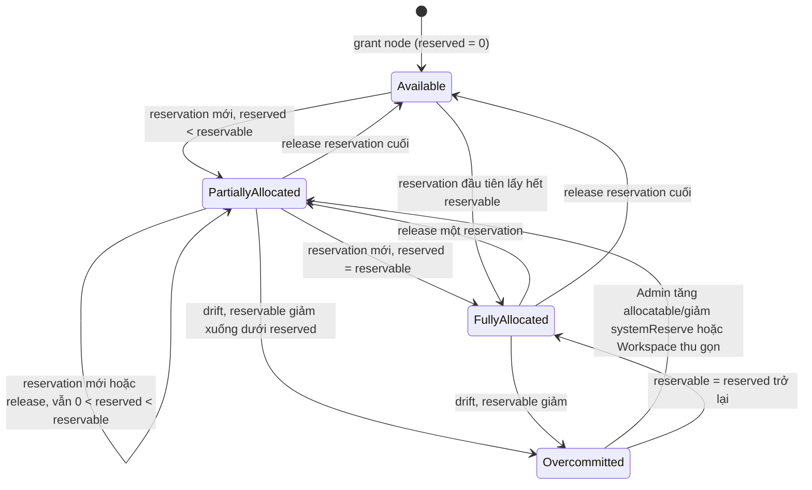

Công thức (plan 6.3):

```text
reservable = allocatable - systemReserve
reserved   = sum(NodeReservation ở Pending/Active/Releasing)
remaining  = max(reservable - reserved, 0)
```

| From | Event / Guard | To | Side effects |
|---|---|---|---|
| `[*]` | Platform Admin `PUT .../dedicated-nodes` → Operation `node.grant`. Controller của `PlatformNodeGrant` kiểm node `Ready`, schedulable, không phải system/control-plane, **không còn Pod tenant của Organization khác**; chưa sạch thì Operation `Failed` kèm danh sách Pod | `Available` | Row `dedicated_node_grants` có `node_state=NotReady` tới khi controller xác nhận; controller gắn label + taint `tenantry.io/dedicated-org=<org-id>` và báo allocatable; audit |
| `Available` / `PartiallyAllocated` | Transaction tạo/resize Workspace (mục 3) với `reserved + new ≤ reservable` | `PartiallyAllocated` / `FullyAllocated` | `remaining` cập nhật; membership label `workspaces.tenantry.io/<ws-id>=true` do controller gắn khi reconcile |
| bất kỳ | Request có `reserved + new > reservable` | (không đổi) | Trả `DEDICATED_NODE_INSUFFICIENT_CAPACITY`; không ghi gì |
| `PartiallyAllocated` / `FullyAllocated` | NodeReservation `Releasing → Released` | `PartiallyAllocated` / `Available` | `remaining` tăng; label membership của Workspace bị gỡ; org label/taint **giữ nguyên** |
| `PartiallyAllocated` / `FullyAllocated` | Capacity snapshot refresh (controller báo allocatable qua `PlatformNodeGrant.status`, worker chép về DB) hoặc Admin tăng `systemReserve`; kết quả `reserved > reservable` | `Overcommitted` | Chặn reservation mới (`DEDICATED_NODE_INSUFFICIENT_CAPACITY`); mọi Workspace có NodeReservation trên node → `Degraded` (Condition `DedicatedNodeCapacityReserved=False`, reason `Overcommitted`); không evict, không di chuyển |
| `Overcommitted` | Admin xử lý (giảm `systemReserve`, node tăng allocatable) hoặc Organization thu gọn/xóa Workspace tới khi `reserved ≤ reservable` | `PartiallyAllocated` / `FullyAllocated` | Workspace liên quan `Degraded → Ready` tự động |
| bất kỳ | Platform Admin revoke/move grant | (chặn) | Chỉ được khi không còn reservation `Pending/Active/Releasing`; khi revoke, controller gỡ org label/taint |

### 5.2 Node health

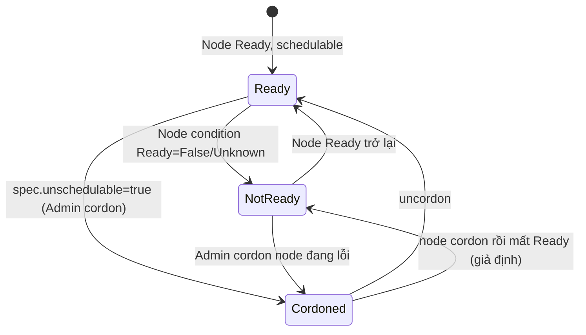

| Health | Ảnh hưởng lên grant/Workspace |
|---|---|
| `Ready` | Node chọn được trong wizard nếu capacity còn; Workspace `Ready` |
| `NotReady` | Wizard disable kèm lý do; reservation mới bị `DEDICATED_NODE_NOT_READY`; Workspace trên node → `Degraded` với `ComputeReady=False` (giả định: plan chỉ nói không tự thay node); reservation giữ nguyên |
| `Cordoned` | Như `NotReady` về reservation mới; Pod đang chạy giữ nguyên; dùng khi Admin bảo trì node hoặc chuẩn bị revoke |

### 5.3 Drift → Overcommitted → Workspace Degraded

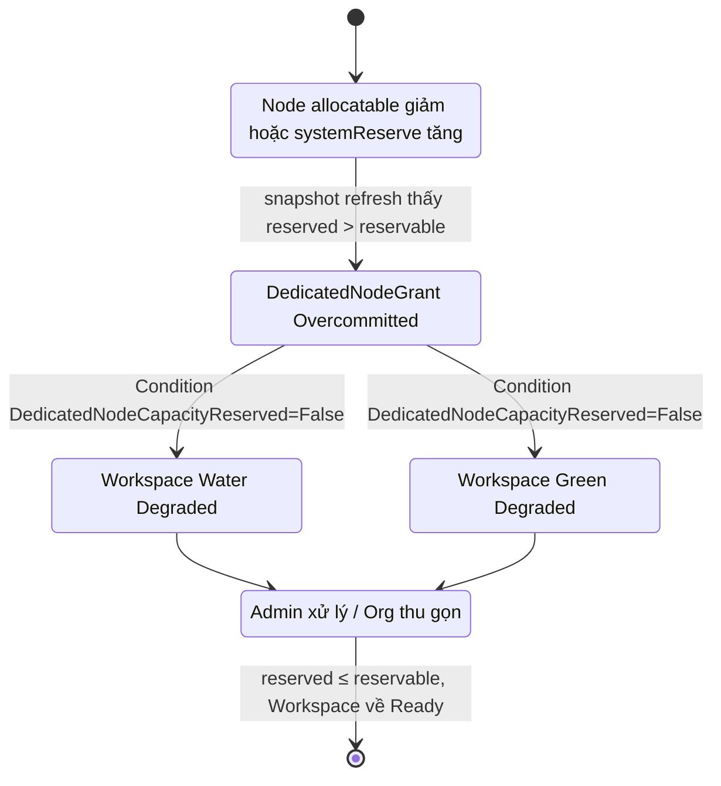

**Điểm cần review**

- Capacity state là **derived** (tính từ reservation + snapshot) — nên lưu cột trong DB để query nhanh hay tính lúc đọc? Tài liệu giả định lưu cột và tính lại trong mỗi transaction.
- `NotReady → Workspace Degraded` là giả định; nếu không muốn đổi state Workspace khi node lỗi, chỉ cần hiển thị health trên node card.
- Điều kiện "node không còn Pod tenant của Organization khác" kiểm tra bằng label `tenantry.io/organization-id` trên Namespace của Pod — cần loại trừ system DaemonSet (CNI/CSI/monitoring).

---

## 6. Cluster

**Mục đích:** mô tả vòng đời Cluster trong registry và thao tác nào bị chặn ở từng trạng thái.

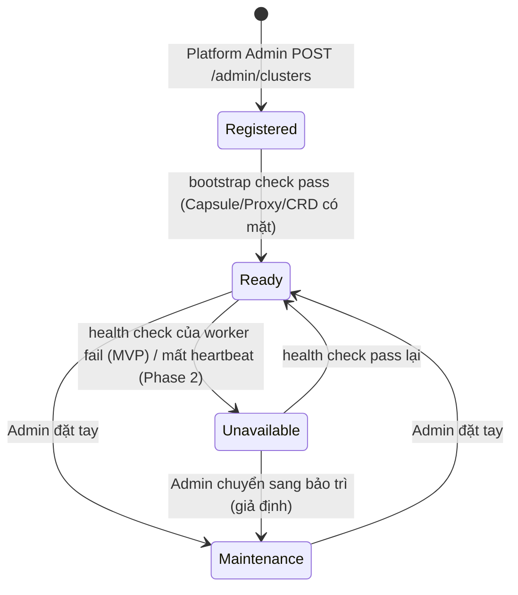

| State | Cho phép | Bị chặn |
|---|---|---|
| `Registered` | Admin sửa metadata, endpoint, apps domain; chạy bootstrap | Không nhận ClusterGrant hiệu lực; không tạo Workspace (giả định: grant có thể tạo trước nhưng wizard chưa liệt kê) |
| `Ready` | Mọi thao tác: create/resize/delete Workspace, kubectl/Headlamp | — |
| `Maintenance` | Workspace hiện có **vẫn chạy và truy cập được** (kubectl/Headlamp/app); delete và retry vẫn xử lý (giả định) | Create Workspace và resize → `CLUSTER_NOT_READY`; wizard ẩn/disable Cluster |
| `Unavailable` | Portal, Keycloak, Organization/member/group vẫn hoạt động | Create/resize → `CLUSTER_NOT_READY`; `Open Web Console` disable; Workspace ở Cluster này hiển thị "unknown"; outbox event cho Cluster này chờ (Operation giữ `Pending`) |
| mọi state | — | Unregister Cluster hoặc xóa ClusterGrant khi còn Workspace/reservation hoạt động; đổi default Cluster chỉ ảnh hưởng Workspace tạo sau |

**Điểm cần review**

- Ai chuyển `Registered → Ready`: Admin bấm tay sau khi kiểm tra, hay worker tự kiểm CRD/Capsule rồi chuyển? Tài liệu giả định worker check + Admin xác nhận.
- Health check MVP: định nghĩa "fail" là gì (kube-apiserver không trả 200 trong N lần liên tiếp)?
- `Unavailable → Maintenance` là cạnh giả định để Admin "đóng băng" Cluster đang lỗi thay vì để nó flap; plan chỉ có `Unavailable → Ready`.
- Operation `Pending` cho Cluster `Unavailable` có timeout để sang `Failed` không, hay chờ vô hạn?

---

## 7. Invitation

**Mục đích:** mô tả vòng đời invite link và guard "email đã verify phải khớp".

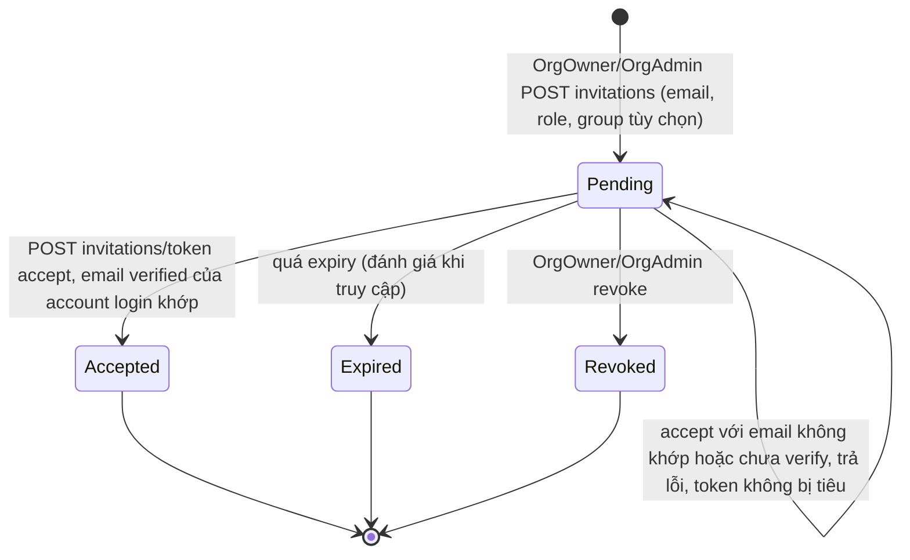

| From | Event / Guard | To | Side effects |
|---|---|---|---|
| `[*]` | `POST /organizations/{orgId}/invitations`; guard `maxMembers` chưa đầy | `Pending` | Row `invitations` với `token_hash`, `expiry`, role, group tùy chọn; portal hiển thị link một lần; audit |
| `Pending` | `POST /invitations/{token}:accept` bởi account đang login; guard: hash khớp, chưa expiry, `email_verified=true` và email token khớp email invitation (so sánh chuẩn hóa lowercase — giả định) | `Accepted` | Row `organization_members`; thêm vào group nếu invite chọn → Group Sync `Pending`; `accepted_by`; audit |
| `Pending` | Accept nhưng email không khớp hoặc chưa verify | `Pending` | Trả lỗi rõ; **không** tạo membership; không tiêu token (giả định — để đúng người nhận vẫn dùng được link) |
| `Pending` | `now > expiry` | `Expired` | Accept trả lỗi; UI cho tạo lại |
| `Pending` | OrgOwner/OrgAdmin bấm revoke | `Revoked` | Accept trả lỗi; audit |

**Điểm cần review**

- Số lần accept sai email tối đa trước khi tự `Revoked` (chống dò)? Tài liệu chưa đặt.
- Nếu người nhận đã là member: `Accepted` idempotent hay báo lỗi?
- Invitation cho email đã có account khác đang login (mismatch) — thông điệp UI cần chỉ rõ "đăng nhập bằng đúng email".

---

## 8. OwnershipTransfer

**Mục đích:** mô tả luồng hai bước chuyển OrgOwner sang một OrgAdmin.

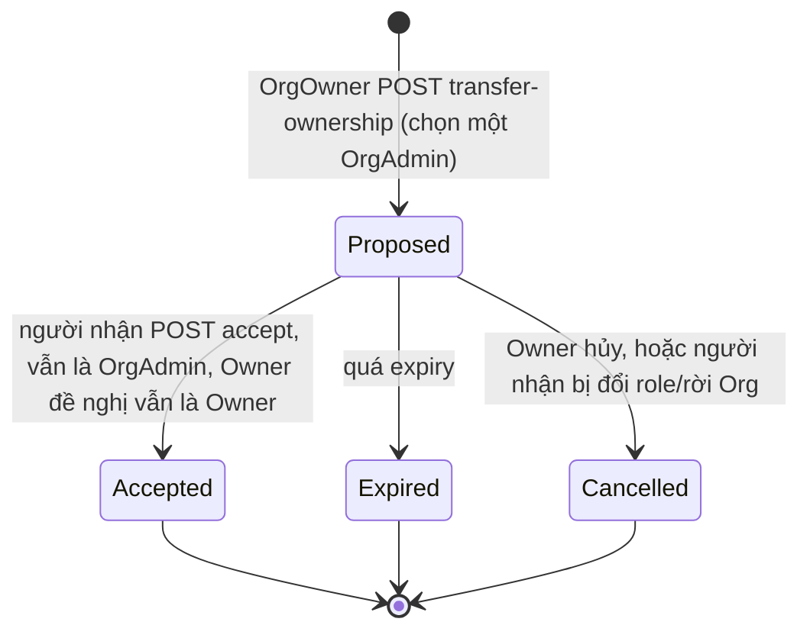

| From | Event / Guard | To | Side effects |
|---|---|---|---|
| `[*]` | `POST /organizations/{orgId}:transfer-ownership`; guard: actor là Owner; người nhận là OrgAdmin của Org | `Proposed` | Transfer `Proposed` cũ của Org (nếu có) chuyển `Cancelled`; row `ownership_transfers` mới (`token_hash`, `expiry`); portal hiển thị cho người nhận; audit |
| `Proposed` | `POST /ownership-transfers/{token}:accept` bởi đúng `to_user_id`; re-check hai guard trên trong transaction | `Accepted` | Một transaction: người nhận → `OrgOwner`, Owner cũ → `OrgAdmin`, `organizations.owner_user_id` đổi; audit |
| `Proposed` | Hết `expiry` | `Expired` | — |
| `Proposed` | Owner hủy; hoặc người nhận bị đổi role/bị remove/tự rời Org | `Cancelled` | Audit kèm lý do |

**Điểm cần review**

- Mỗi Organization tối đa một transfer `Proposed` (partial unique index); đề nghị mới thay thế đề nghị cũ, nên không thể có hai người cùng accept.
- Sau `Accepted`, Owner cũ trở thành OrgAdmin (plan 4.2) — không có tuỳ chọn "rời hẳn".

---

## 9. Group sync status, Namespace record và Route record

### 9.1 Group sync status

**Mục đích:** mô tả cách `groups` và `group_members` hội tụ sang Keycloak. Mỗi row mang hai thứ: **hướng** mong muốn (`deleted_at IS NULL` = phải tồn tại, khác NULL = phải biến mất) và **tiến độ** đồng bộ (`sync_status`).

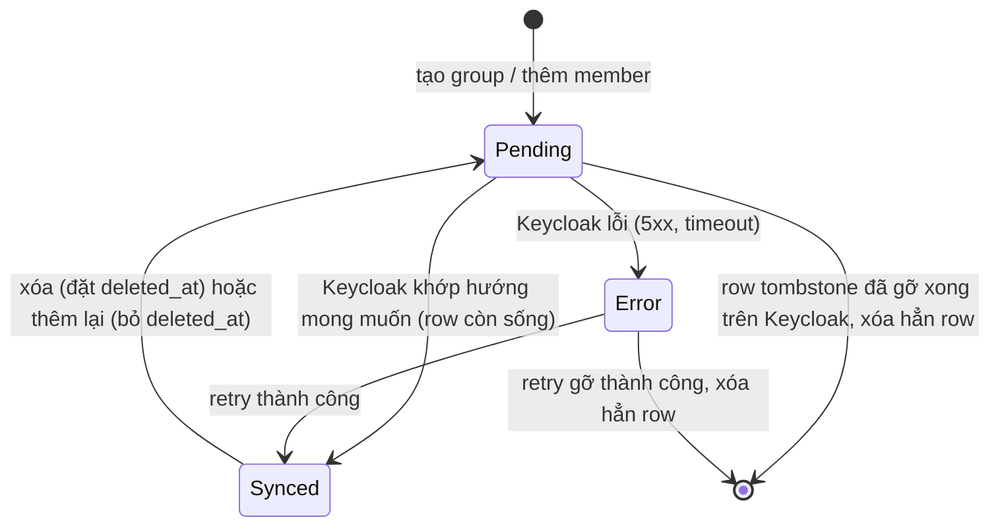

| From | Event / Guard | To | Side effects |
|---|---|---|---|
| `[*]` | Tạo group (machine name `org_<id>:group_<id>`) hoặc thêm member | `Pending` | Row mới, `deleted_at = NULL` |
| `Synced` | Gỡ member, remove/leave Organization, xóa group (guard: group không còn AccessBinding) | `Pending` | **Tombstone**: `deleted_at = now()`. Từ lúc này row không còn hiệu lực với portal; chỉ còn là việc chờ worker làm |
| `Pending` (tombstone) | Thêm lại đúng member đó | `Pending` | `deleted_at = NULL`; worker sẽ đảm bảo membership tồn tại |
| `Pending` / `Error` | Worker lấy row tới hạn `next_sync_at`. Row sống: đảm bảo group/membership **có** trên Keycloak. Tombstone: đảm bảo **không còn** | `Synced` (row sống) hoặc xóa hẳn row (tombstone) | Lưu `keycloak_group_id`; cập nhật group platform `tenantry:tenant-users` theo số binding còn lại của user; tombstone của member thuộc group đang có binding Workspace → logout user trên Keycloak (hệ quả: `06-security-and-identity.md` mục 5) |
| `Pending` / `Error` | Keycloak lỗi | `Error` | `sync_attempts++`, `next_sync_at = now + backoff`, `last_error`; metric "group sync lag/error" |

Mọi lời gọi Keycloak của worker đều idempotent (tạo group đã có, thêm member đã có, gỡ member đã gỡ đều là thành công), nên worker chết giữa chừng chỉ cần chạy lại.

Tác động lên các máy khác: bind group vào Workspace hoặc tạo Workspace với group chưa `Synced` → `GROUP_SYNC_PENDING`; Condition `IdentityBindingsReady` chỉ True khi mọi group trong `accessBindings` đều `Synced`.

### 9.2 Namespace record (`workspace_namespaces`)

**Mục đích:** mô tả trạng thái một Namespace trong Workspace theo góc nhìn portal, gồm Namespace khai báo qua `spec.namespaces` và Namespace tạo bằng kubectl/Headlamp chỉ quan sát được.

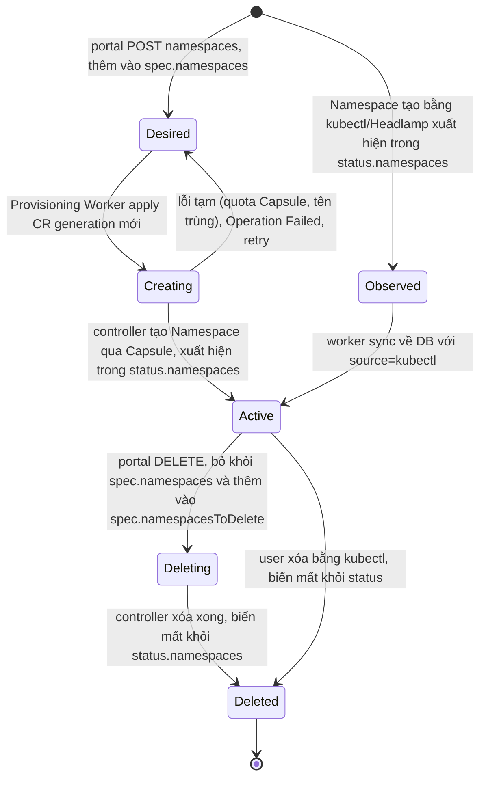

| From | Event / Guard | To | Side effects |
|---|---|---|---|
| `[*]` | `POST /workspaces/{id}/namespaces` bởi OrgOwner/OrgAdmin hoặc member group `TenantOwner`; guard: tên hợp lệ, chưa vượt `namespaceQuota` (đếm cả Namespace kubectl) | `Desired` | Row `source=portal, state=Desired`; CR `spec.namespaces` thêm `frontend`; Operation `namespace-create` |
| `Desired` | Worker apply CR | `Creating` | — |
| `Creating` | Controller tạo Namespace `acme-solar-frontend` (owner = Tenant; Capsule inject annotation IPPool, label tenant, Pod Security); `status.namespaces` có entry `source: portal` | `Active` | Operation `Succeeded`; usage snapshot bắt đầu |
| `Creating` | Capsule từ chối (quota, prefix) | `Desired` | Operation `Failed` kèm lý do; user retry hoặc xóa khỏi spec |
| `[*]` | Controller thấy Namespace có label tenant `acme-solar` nhưng không nằm trong `spec.namespaces` | `Observed` | `status.namespaces` entry `source: kubectl` |
| `Observed` | Worker sync `status` về DB | `Active` | Row `source=kubectl`; portal hiển thị badge nguồn; tính vào `namespaceQuota` |
| `Active` | `DELETE /workspaces/{id}/namespaces/{name}`; nếu có PVC bắt confirm gõ tên; áp dụng cho cả `source=kubectl` (giả định) | `Deleting` | Bỏ khỏi `spec.namespaces` (nếu có), thêm vào `spec.namespacesToDelete`; Operation `namespace-delete` |
| `Deleting` | Controller xóa Namespace, dọn `spec.namespacesToDelete`, entry biến mất khỏi `status.namespaces` | `Deleted` | Operation `Succeeded`; kẹt finalizer → Operation `Blocked` (mục 2) |
| `Active` | User `kubectl delete ns` | `Deleted` | Worker sync thấy biến mất; nếu là `source=portal`, controller **không** tạo lại (giả định: portal bỏ khỏi `spec.namespaces` và cảnh báo) |

**Điểm cần review**

- Namespace `source=portal` bị xóa bằng kubectl: controller tạo lại (desired state) hay portal đồng bộ theo thực tế như giả định? Hai lựa chọn cho hai UX khác nhau.
- Namespace `source=kubectl` có được xóa từ portal không? Giả định có, vì actor đã là TenantOwner.
- Developer/Viewer chỉ xem: API trả 403 code gì?
- `Observed` là trạng thái tạm (chỉ trong CR), có cần hiện trong DB hay gộp thẳng vào `Active`?

---

### 9.3 Route record (`workspace_routes`)

**Mục đích:** trạng thái một Route theo góc nhìn portal. Route chỉ được khai báo từ portal qua `spec.routes`; tenant không ghi được Ingress nên không có nguồn `kubectl` như Namespace.

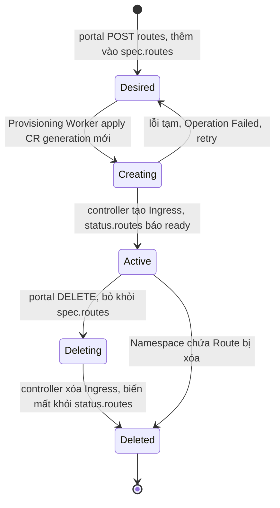

| From | Event / Guard | To | Side effects |
|---|---|---|---|
| `[*]` | `POST /workspaces/{id}/routes` bởi OrgOwner/OrgAdmin hoặc member group `TenantOwner`; guard: Workspace `Ready`, Namespace `Active`, tên hợp lệ, nhãn đầu của hostname ≤ 63 ký tự, chưa quá 20 Route, hostname chưa ai giữ | `Desired` | Row với `hostname` đã ghép; CR `spec.routes` thêm entry; Operation `route.create` |
| `Desired` | Worker apply CR | `Creating` | — |
| `Creating` | Controller tạo Ingress trong Namespace; `status.routes` có entry `ready: true` | `Active` | Operation `Succeeded`; portal hiện URL |
| `Creating` | Apply Ingress lỗi | `Desired` | Operation `Failed` kèm lý do; user retry hoặc xóa |
| `Active` | `DELETE /workspaces/{id}/routes/{routeId}` | `Deleting` | Bỏ khỏi `spec.routes`; Operation `route.delete` |
| `Deleting` | Controller xóa Ingress không còn trong `spec.routes` | `Deleted` | Operation `Succeeded`; hostname được nhả |
| `Active` | Namespace chứa Route chuyển `Deleting`/`Deleted` | `Deleted` | API bỏ Route khỏi `spec.routes` trong cùng transaction xóa Namespace |

Ghi chú:

- `Active` nghĩa là Ingress đã tồn tại, **không** bảo đảm Service đích có Pod chạy; khi đó URL trả 503. Portal không đọc Service của tenant.
- Service và cổng không sửa được sau khi tạo; muốn đổi thì xóa Route và tạo lại.
- Custom domain (sau MVP) thêm state `PendingVerification` đứng trước `Desired`: Route chỉ vào `spec.routes` sau khi bản ghi TXT khớp.

---

## 10. Cross-machine: create và delete

**Mục đích:** cho thấy bốn máy trạng thái Workspace, Operation, Reservation và NetworkAllocation chuyển động cùng nhau trong hai luồng chính, để tác giả kiểm tra không có bước nào release capacity/CIDR sớm.

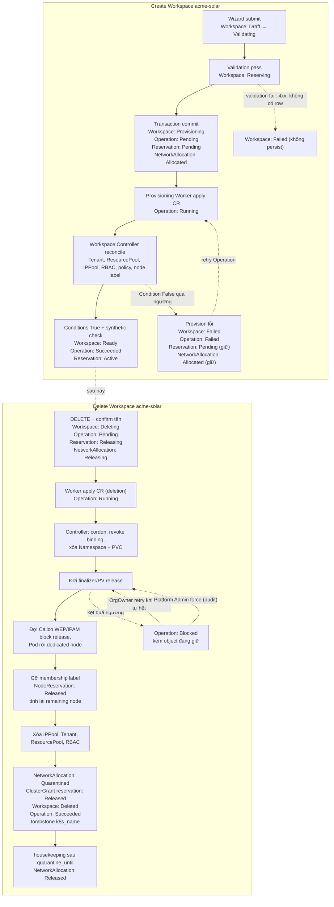

Bất biến cần giữ khi đọc sơ đồ:

1. Không ô nào trước `D6` đổi NodeReservation sang `Released`; không ô nào trước `D8` đổi ClusterGrant reservation sang `Released` hoặc CIDR sang `Quarantined`.
2. `C7` giữ nguyên Reservation và NetworkAllocation; đường duy nhất ra khỏi `C7` là retry (về `C4`) hoặc DELETE (vào `D1`).
3. `DB` (Blocked) không đổi state của Workspace/Reservation/NetworkAllocation; nó chỉ dừng Operation.
4. `D9` là bước nền, không thuộc Operation của user; Operation `Succeeded` tại `D8`.

**Điểm cần review**

- Thứ tự `D6` (release NodeReservation) trước `D7` (xóa Tenant) theo đúng 17.4 bước 8–9; nếu muốn xóa Tenant trước để chắc chắn không còn Pod, cần đổi thứ tự trong plan.
- `D8` release ClusterGrant reservation cùng lúc với quarantine CIDR — hay release sớm hơn ngay sau `D6` để Organization tạo Workspace mới nhanh hơn?
- Có cần Operation con cho `D9` để audit thời điểm CIDR thật sự khả dụng?
- Khi Cluster `Unavailable` giữa `D3`–`D7`, Operation giữ `Running` hay chuyển `Blocked`? Tài liệu chưa định.

---

## 11. Organization

**Mục đích:** vòng đời một Organization từ lúc user xin tới lúc xóa [4.2].

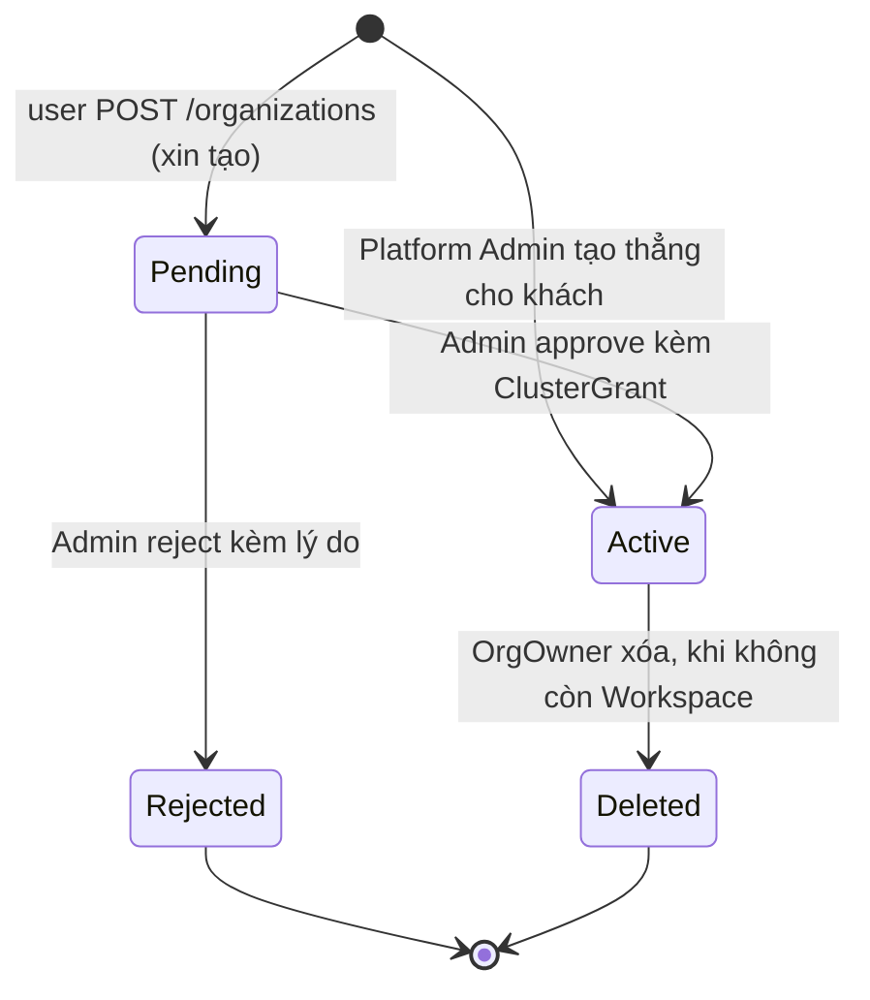

| From | Event / Guard | To | Side effects |
|---|---|---|---|
| `[*]` | `POST /organizations`; guard: slug hợp lệ và chưa bị giữ, user chưa có yêu cầu `Pending` nào | `Pending` | Row `organizations` + membership `OrgOwner` cho người xin; slug được giữ chỗ |
| `[*]` | `POST /admin/organizations`; guard: Owner là user đã login ít nhất một lần | `Active` | Như cạnh approve dưới đây, trong một transaction |
| `Pending` | `POST /admin/organizations/{id}:approve` | `Active` | Một transaction: entitlement, ClusterGrant (điền sẵn từ onboarding policy), ba group mặc định `admins`/`developers`/`viewers`, Owner vào `admins` (Group Sync `Pending`); audit |
| `Pending` | `POST /admin/organizations/{id}:reject` kèm lý do | `Rejected` | `review_note`; slug được nhả; người xin gửi được yêu cầu mới |
| `Active` | OrgOwner xóa; guard: không còn Workspace nào | `Deleted` | Đồng bộ, không có state `Deleting`; group của Org thành tombstone để gỡ khỏi Keycloak |

Organization `Pending`/`Rejected` chỉ hiện với người xin; không mời member, không tạo group hay Workspace được.
