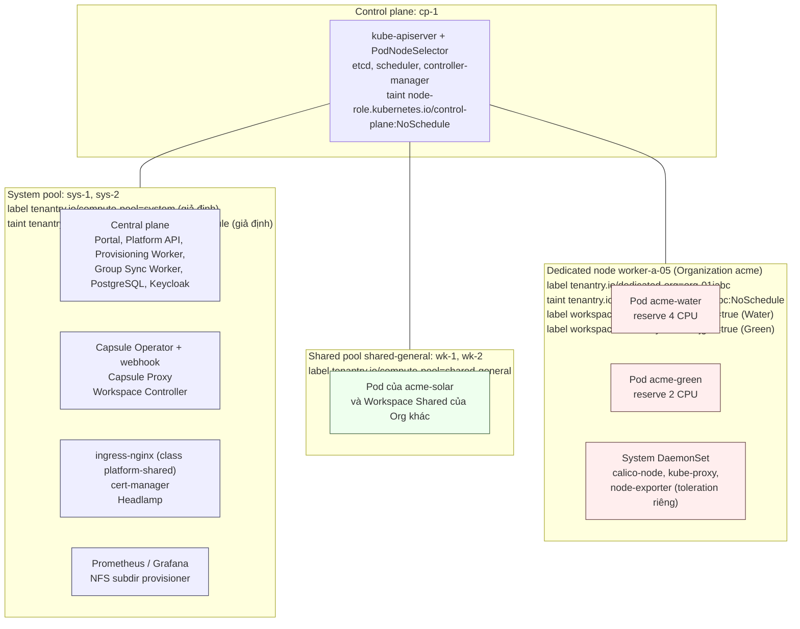
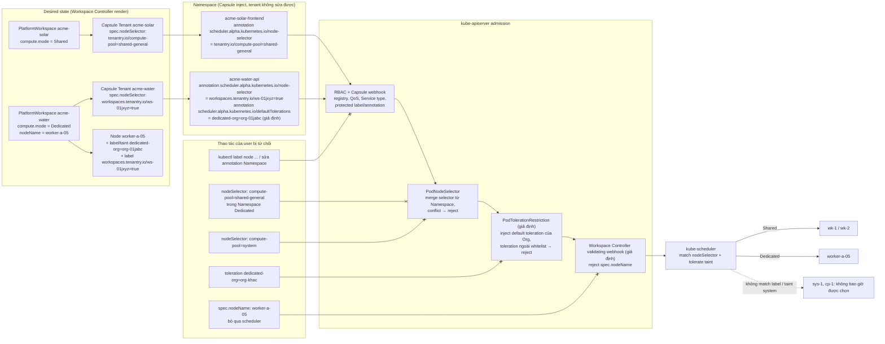
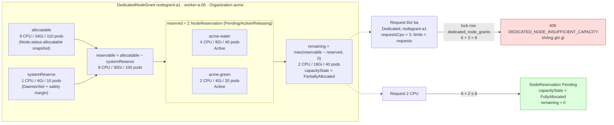
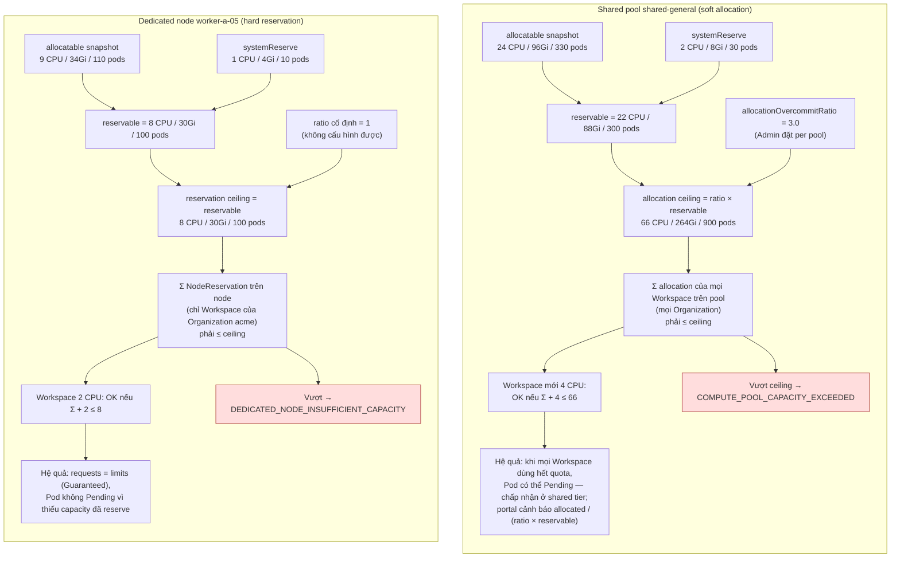
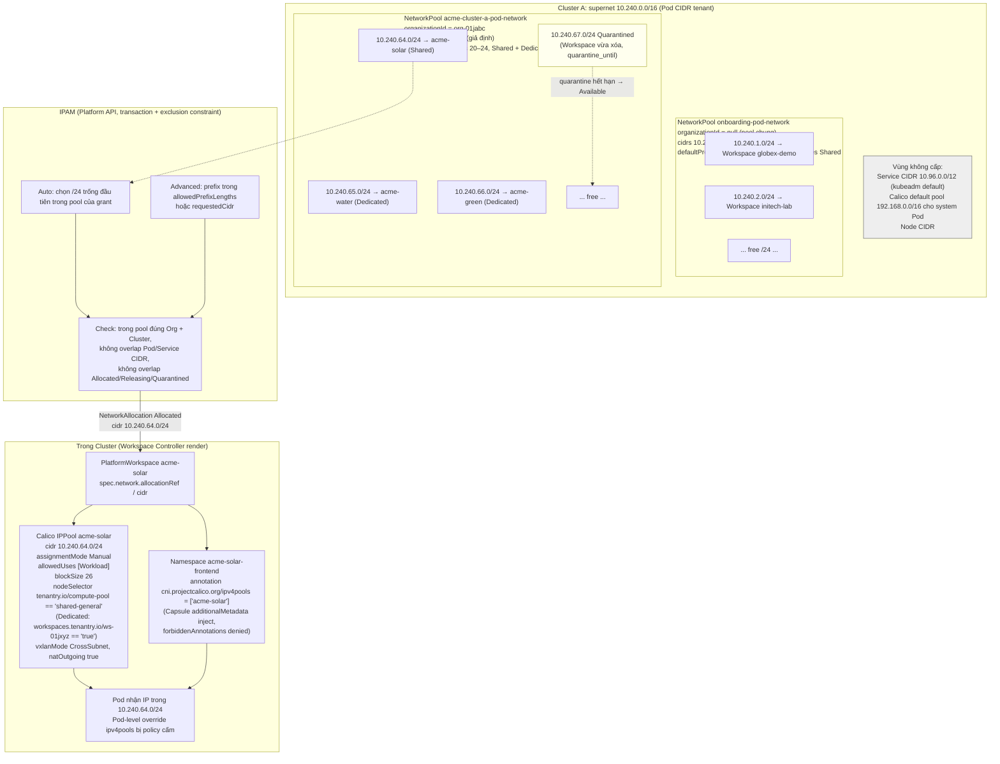
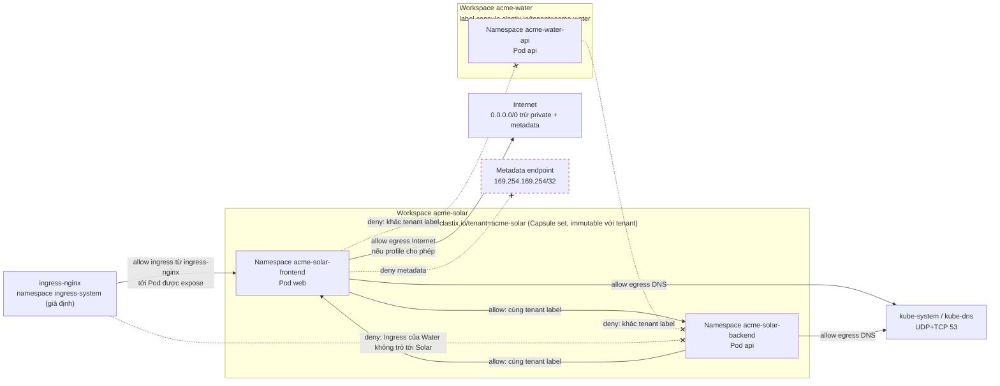
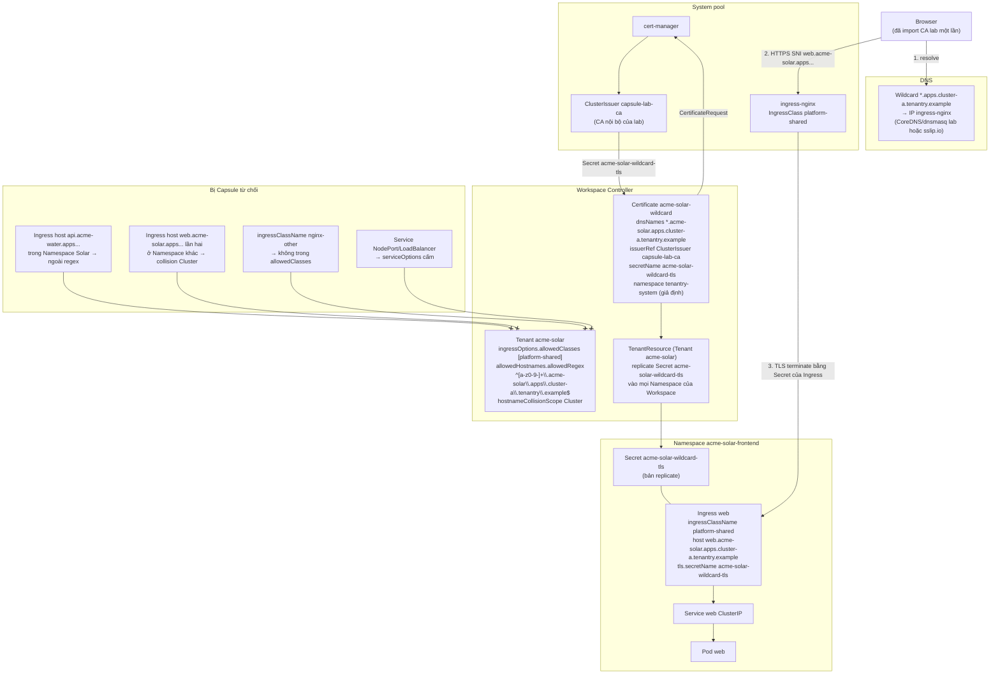
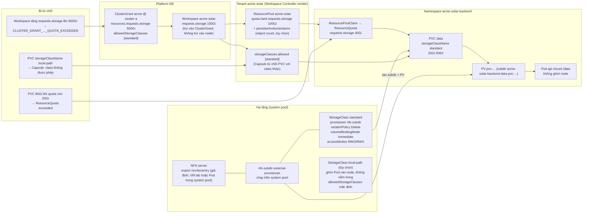

# 05 — Network, scheduling, ingress, access và storage

> Nơi định nghĩa cho node layout, capacity model, IP plan, NetworkPolicy, Ingress/TLS và storage; quy tắc nghiệp vụ nền ở `PRODUCT-PLAN.md` mục 6, 7, 11, 12, 18. Sơ đồ bám theo lab hiện có trong repo (Calico IPPool `Manual` per tenant, `PodNodeSelector`, NetworkPolicy replicate qua `GlobalTenantResource`) và thay tên lab (`solar`, `water`, `capsule.clastix.io/tenant=solar`) bằng tên Tenantry (`acme-solar`, `tenantry.io/...`).
> Chỗ plan chưa nói rõ được đánh dấu **(giả định)**.

Ví dụ dùng xuyên suốt:

| Thực thể | Giá trị |
|---|---|
| Cluster | `cluster-a`, wildcard domain `*.apps.cluster-a.tenantry.example` |
| Organization | slug `acme`, id `org-01jabc` |
| Workspace Shared | `acme-solar` (`ws-01jsol`), pool `shared-general`, CIDR `10.240.12.0/24` |
| Workspace Dedicated | `acme-water` (`ws-01jxyz`, reserve 4 CPU) và `acme-green` (`ws-01jgrn`, reserve 2 CPU) trên node `worker-a-05` |
| Dedicated node | `worker-a-05`, allocatable 9 CPU, systemReserve 1 CPU → reservable 8 CPU |
| NetworkPool | `onboarding-pod-network` (chung) và `acme-cluster-a-pod-network` (riêng), cùng supernet `10.240.0.0/16` |

---

## 1. Node layout của Cluster demo

**Mục đích:** cho thấy node nào chạy gì, label/taint nào tách system pool, shared pool và dedicated node, và membership label per Workspace cùng tồn tại trên một node.

Ánh xạ với lab hiện tại: lab gắn `capsule.clastix.io/tenant=solar` lên `wk1,wk2` và `=water` lên `wk3` (scripts/40-platform.sh), tức mỗi tenant một pool cứng. Tenantry tách thành hai kiểu: pool chung `tenantry.io/compute-pool=shared-general` cho Shared mode và label/taint theo Organization + membership label theo Workspace cho Dedicated mode (plan 6.2, 6.4).

**Điểm cần review**

- System pool trong lab hiện chưa có node riêng; đề xuất label/taint `tenantry.io/compute-pool=system` là giả định để tenant workload không thể vào system node (plan 6.5 chỉ nói "không được schedule vào system/control-plane nodes").
- Cluster demo tối thiểu cần bao nhiêu node: 1 control-plane + 1–2 system + 2 shared + 1 dedicated = 5–6 node; đủ tài nguyên lab không?
- Trên dedicated node, system DaemonSet cần toleration cho taint `tenantry.io/dedicated-org` — phải thêm vào Helm values của Calico/monitoring/NFS client, và tính vào `systemReserve`.
- Có cho phép một node vừa là shared pool vừa là dedicated không? Plan hàm ý không (grant yêu cầu node sạch); nên enforce ở API.

---

## 2. Chuỗi enforcement scheduling: Shared và Dedicated

**Mục đích:** theo dõi một Pod từ Tenant spec tới scheduler, chỉ ra lớp nào inject selector/toleration và lớp nào từ chối các thao tác vượt rào của user.

Bảng tương ứng với lab hiện tại:

| Lớp | Lab (Solar/Water) | Tenantry |
|---|---|---|
| Tenant nodeSelector | `capsule.clastix.io/tenant: solar` | Shared: `tenantry.io/compute-pool: shared-general`; Dedicated: `workspaces.tenantry.io/<ws-id>: "true"` |
| Node label | script gắn tay `capsule.clastix.io/tenant=solar` lên wk1,wk2 | Admin gắn pool label một lần; Workspace Controller gắn/gỡ org label+taint và membership label |
| Admission | `PodNodeSelector` bật trong `60-enable-oidc.sh`; test `tests/wrong-node-pod.yaml` | Giữ `PodNodeSelector`; thêm toleration injection và chặn `nodeName` |
| Node visibility | Capsule Proxy lọc Node theo `Tenant.spec.nodeSelector` | Shared: không grant Node `List` (portal chỉ show pool summary); Dedicated: Proxy chỉ trả node có membership label |

**Điểm cần review**

- Cơ chế inject toleration: `PodTolerationRestriction` (admission plugin có sẵn của kube-apiserver, cấu hình qua annotation Namespace) là lựa chọn đơn giản nhất cho kubeadm lab; thay thế là mutating webhook riêng trong Workspace Controller. Cần chốt một trong hai.
- `spec.nodeName` bỏ qua scheduler và kubelet không kiểm tra taint `NoSchedule`, nên **bắt buộc** có lớp reject `nodeName` (A4); Capsule không làm việc này.
- Nếu `PodNodeSelector`/`PodTolerationRestriction` bị tắt, enforcement hỏng im lặng — plan 6.4 yêu cầu test bắt buộc; test nên chạy trong `90-verify.sh`.
- Với Shared mode, nếu Organization có nhiều Workspace cùng pool, `PodNodeSelector` không tách Workspace với nhau — đúng ý định (cô lập bằng Namespace/NetworkPolicy/quota), cần nói rõ trong luận văn.

---

## 3. Mô hình capacity của dedicated node

**Mục đích:** minh họa phép tính `reservable = allocatable − systemReserve`, hai reservation Water 4 CPU + Green 2 CPU, và request thứ ba 3 CPU bị từ chối.

Quy tắc đi kèm (plan 5.4, 6.3):

- Dedicated bắt buộc Guaranteed QoS: API đặt `limits = requests`, từ chối nếu client gửi limits khác; reservation dùng chính `requests.cpu/memory` và `pods`.
- Capsule ResourcePool của Workspace không được lớn hơn NodeReservation; controller render `hard` bằng đúng reservation.
- `requests.storage` được trừ vào ClusterGrant, **không** trừ vào node.
- Xóa `acme-water` release 4 CPU; `acme-green` và org label/taint trên node không bị ảnh hưởng.

**Điểm cần review**

- `systemReserve` do Admin nhập tay hay tính từ tổng request của DaemonSet đang chạy trên node cộng margin? Plan nói "bao gồm request của system DaemonSet dự kiến", nên có thể tự gợi ý rồi Admin xác nhận.
- Snapshot `allocatable` refresh khi nào; nếu node reboot với ít CPU hơn thì đi vào nhánh `Overcommitted` (xem 04-state-machines mục 5).
- Pods reservation: `pods` của Workspace là trần ResourcePool, nhưng Pod thực tế còn bị giới hạn bởi `max-pods` của kubelet — có nên cảnh báo khi Σ pods reserved > allocatable pods không?

---

## 4. Shared pool soft allocation vs Dedicated hard reservation

**Mục đích:** đặt cạnh nhau hai công thức để thấy Shared là trần có overcommit, Dedicated là giữ chỗ thật.

| Tiêu chí | Shared | Dedicated |
|---|---|---|
| Ý nghĩa allocation | Trần ResourcePool (quota) | Giữ chỗ trên node cụ thể |
| Ceiling | `ratio × (allocatable − systemReserve)`, ratio per pool | `allocatable − systemReserve`, ratio = 1 |
| Ai chia sẻ | Mọi Organization có pool trong grant | Chỉ Workspace của Organization được grant node |
| QoS | `requests < limits` theo ratio policy của pool | `requests = limits` bắt buộc |
| Khi vượt | `COMPUTE_POOL_CAPACITY_EXCEEDED` | `DEDICATED_NODE_INSUFFICIENT_CAPACITY` |
| Rủi ro runtime | Pod Pending khi mọi tenant dùng hết quota | Không có, nếu snapshot đúng; drift → `Overcommitted` |

**Điểm cần review**

- Shared ceiling tính trên `requests` hay `limits`? Tài liệu giả định trên `requests` (khớp reservation invariant 5.3 dùng "allocation"); `limits` được kiểm bằng ratio `limits/requests` riêng của pool.
- Khi Admin hạ `allocationOvercommitRatio` xuống dưới Σ hiện tại: chặn (đối xứng với ClusterGrant) hay cho phép và hiển thị cảnh báo? Plan chỉ chặn với ClusterGrant.
- Pool usage thực (Prometheus) nên hiển thị bên cạnh ceiling để Admin có cơ sở điều chỉnh ratio — cần metric per pool label.

---

## 5. Kế hoạch địa chỉ IP

**Mục đích:** cho thấy supernet Cluster, hai loại NetworkPool, `/24` per Workspace được cấp tự động, và cách CIDR biến thành Calico IPPool + Namespace annotation.

So với lab: lab dùng `/18` cứng cho Solar (`10.240.0.0/18`) và Water (`10.240.64.0/18`) với `nodeSelector: capsule.clastix.io/tenant == "solar"`; Tenantry giữ nguyên mọi field IPPool (`Manual`, `Workload`, `blockSize 26`, `vxlanMode CrossSubnet`, `natOutgoing`) nhưng CIDR đến từ NetworkAllocation và selector theo pool/Workspace.

**Điểm cần review**

- Cách chia supernet giữa pool chung và pool riêng (`/18` mỗi loại) là giả định; plan chỉ đưa ví dụ một pool `10.240.0.0/16`. Cần chốt để tránh pool chung và pool riêng overlap ngay trong cấu hình Admin.
- `blockSize 26` với `/24` cho 4 block: trên shared pool 2 node là đủ; Workspace Shared có nhiều node hơn số block sẽ hết block dù còn IP — cân nhắc `blockSize 27/28` hoặc `defaultPrefixLength 23`.
- `natOutgoing: true` nghĩa là egress Internet được SNAT; kết hợp với NetworkPolicy "internet egress theo profile" (mục 6) — hai lớp cần khớp.
- Service CIDR và Node CIDR được kiểm tra trong IPAM bằng cấu hình `clusters` (cần thêm cột hoặc lấy từ `kubeadm-config`).

---

## 6. Network policy baseline per Namespace

**Mục đích:** liệt kê rule baseline mà mọi Namespace nhận qua replication, và minh họa traffic được phép/bị chặn giữa Workspace `acme-solar` và `acme-water`.

Bộ rule replicate (kế thừa `manifests/tenant-resources.yaml`, mở rộng theo plan 7.4), tất cả qua `GlobalTenantResource`/`TenantResource` với `resyncPeriod` để controller restore khi bị xóa tay:

| # | NetworkPolicy | Nội dung | Nguồn label |
|---|---|---|---|
| 1 | `tenant-default-deny` | `podSelector: {}`, `policyTypes: [Ingress, Egress]`, không rule → deny all | — |
| 2 | `tenant-allow-same-workspace` | ingress + egress `namespaceSelector: capsule.clastix.io/tenant = {{tenant.name}}` | Label do Capsule gắn khi tạo Namespace; tenant không sửa được (Capsule webhook) |
| 3 | `tenant-allow-dns` | egress tới `kube-system` `k8s-app=kube-dns` UDP/TCP 53 | Lab đã có |
| 4 | `tenant-allow-ingress-controller` | ingress từ `namespaceSelector: kubernetes.io/metadata.name=ingress-system` (giả định tên) | Namespace label bất biến của Kubernetes |
| 5 | `tenant-allow-internet-egress` | egress `ipBlock 0.0.0.0/0` `except [10.0.0.0/8, 172.16.0.0/12, 192.168.0.0/16, 169.254.169.254/32]` — chỉ replicate khi policy profile của Workspace bật (giả định: profile `internet-egress` mặc định bật cho MVP) | — |
| 6 | (ẩn trong #5) deny metadata | `169.254.169.254/32` nằm trong `except` nên không có rule nào cho phép | — |

Nguyên tắc "không tin label tenant tự sửa": mọi selector chỉ dùng `capsule.clastix.io/tenant` (Capsule set), `kubernetes.io/metadata.name` (Kubernetes set) hoặc label trong namespace system mà tenant không có quyền — không dùng Pod label do user tự đặt.

**Điểm cần review**

- Lab hiện không có rule Internet egress (Pod tenant không ra ngoài được); Tenantry thêm rule #5 theo profile — chốt mặc định bật hay tắt cho onboarding Organization.
- Rule #4 cho phép mọi Pod trong Namespace nhận traffic từ ingress-nginx, không chỉ Pod "được expose"; muốn chặt hơn cần Pod label do user đặt (không tin được) hoặc chấp nhận trade-off này.
- Ingress của Workspace Water trỏ backend sang Service của Solar bị chặn ở lớp Capsule (Ingress chỉ tham chiếu Service cùng Namespace theo Kubernetes) — không cần rule mạng riêng, nhưng nên ghi thành test.
- Calico NetworkPolicy (CRD) có thể thay Kubernetes NetworkPolicy để dùng `GlobalNetworkPolicy` một lần thay vì replicate — plan chọn replicate qua Capsule để gắn với Tenant lifecycle; giữ hay đổi?

---

## 7. Ingress và TLS

**Mục đích:** theo dõi request HTTPS từ browser tới Pod, và luồng cấp wildcard Certificate per Workspace từ CA lab rồi replicate Secret vào mọi Namespace.

Chuỗi bảo vệ hostname: (1) regex `allowedHostnames` khóa tenant trong vùng `*.acme-solar.apps...`; (2) `hostnameCollisionScope: Cluster` chặn hai Ingress cùng host ở bất kỳ Namespace nào; (3) `allowedIngressClasses` của ClusterGrant → `allowedClasses` của Tenant; (4) Service `NodePort`/`LoadBalancer`/`ExternalName` bị cấm nên Ingress là đường expose duy nhất.

**Điểm cần review**

- Certificate đặt ở Namespace của controller (`tenantry-system`) rồi replicate Secret, hay đặt trực tiếp trong Namespace đầu tiên của Workspace? Đặt ở controller namespace tránh tenant xóa/sửa Certificate; đây là giả định.
- Capsule `TenantResource` replicate Secret kèm private key vào Namespace tenant — TenantOwner đọc được key wildcard của chính Workspace mình; chấp nhận (key chỉ bao vùng của họ) hay dùng cert-manager per-Ingress annotation thay thế?
- Regex `allowedHostnames` phải escape dấu chấm; controller render từ `k8s_name` và wildcard domain của Cluster — cần unit test render.
- DNS wildcard trong lab: CoreDNS `hosts`/`template` plugin hay sslip.io; ảnh hưởng tới hostname thật dùng trong demo.
- cert-manager trong lab hiện dùng cho Keycloak (`capsule-lab-root-ca` trong `identity-system`); ClusterIssuer `capsule-lab-ca` cần được `10-cert-manager.sh` tạo theo M1.

---

## 8. Đường truy cập Kubernetes API

**Mục đích:** cho thấy kubectl (kubelogin) và Headlamp đều đi qua Capsule Proxy với OIDC client/audience riêng, Proxy lọc gì, và token portal không bao giờ chạm Kubernetes API.

```mermaid
flowchart LR
  subgraph KC["Keycloak realm capsule"]
    C1["client kubectl<br/>public + PKCE, localhost callback<br/>audience kubernetes<br/>group mapper: có"]
    C2["client headlamp-cluster-a<br/>confidential, callback console-cluster-a<br/>audience headlamp-cluster-a<br/>group mapper: có"]
    C3["client portal<br/>confidential BFF + PKCE<br/>audience portal-api<br/>group mapper: không"]
  end

  U1["kubectl + kubelogin<br/>kubeconfig từ portal:<br/>server https://kube-cluster-a.tenantry.example<br/>exec kubectl oidc-login"]
  U2["Browser → Headlamp<br/>https://console-cluster-a.tenantry.example<br/>SSO từ session portal"]
  U3["Browser → Portal"]

  U1 -->|"browser login"| C1
  U2 -->|"Authorization Code"| C2
  U3 -->|"Authorization Code"| C3

  C1 -->|"ID token aud=kubernetes<br/>groups [org_01jabc:group_01jadm, tenantry:tenant-users]"| U1
  C2 -->|"ID token aud=headlamp-cluster-a<br/>groups ..."| U2
  C3 -->|"token aud=portal-api"| U3

  subgraph CLUSTERA["Cluster A"]
    PX["Capsule Proxy<br/>public HTTPS (kubectl)<br/>+ ClusterIP (Headlamp)<br/>authPreferredTypes BearerToken"]
    API["kube-apiserver<br/>AuthenticationConfiguration:<br/>issuer id.tenantry.example/realms/tenantry<br/>audiences [kubernetes, headlamp-cluster-a]<br/>username claim sub, prefix oidc:<br/>groups claim groups, prefix oidc:"]
    RBAC["RBAC + Capsule webhook<br/>owner group → Tenant owner<br/>Developer/Viewer → custom ClusterRole<br/>oidc:tenantry:tenant-users = Capsule user group"]
    PAPI["Platform API"]
    HL["Headlamp<br/>không có cluster-admin SA<br/>kubernetes host = Capsule Proxy service"]
  end

  U1 -->|"Bearer token"| PX
  U2 -->|"Bearer token"| HL
  HL -->|"Bearer token của user"| PX
  PX -->|"forward token, lọc response"| API
  API --> RBAC
  U3 -->|"session cookie"| PAPI
  PAPI -. "không bao giờ gọi kube-apiserver bằng token user;<br/>Provisioning Worker dùng SA scoped chỉ trên CRD tenantry.io" .-> API

  subgraph FILTER["Capsule Proxy lọc (cluster-scoped LIST)"]
    F1["Namespace: chỉ Namespace của Tenant user sở hữu/được bind"]
    F2["Node: theo Tenant.spec.nodeSelector<br/>(Shared: không grant List → rỗng; Dedicated: node membership)"]
    F3["StorageClass / IngressClass: theo allow-list của Tenant"]
    F4["PersistentVolume, PriorityClass, RuntimeClass: theo Tenant"]
    F5["Namespaced resource: không lọc, RBAC thuần quyết định"]
  end
  PX --- FILTER
```

| Đường | OIDC client | Audience | Đi qua | Ghi chú |
|---|---|---|---|---|
| kubectl | `kubectl` | `kubernetes` | kubeconfig → Capsule Proxy public endpoint | Không static token; kubelogin cache/refresh |
| Headlamp | `headlamp-cluster-a` | `headlamp-cluster-a` | Headlamp → Capsule Proxy ClusterIP | Một instance per Cluster; SSO nhờ session Keycloak từ portal |
| Portal | `portal` | `portal-api` | Portal BFF → Platform API | Token không hợp lệ với kube-apiserver vì audience không khớp |
| Provisioning Worker | (ServiceAccount) | — | apiserver trực tiếp | Chỉ quyền trên CRD `tenantry.io`; Phase 2 thay bằng Cluster Agent |

**Điểm cần review**

- Lab hiện dùng `username.claim: preferred_username`, `prefix: ""`, audiences `[headlamp, kubernetes]`; plan yêu cầu `sub` + prefix `oidc:` và audience `headlamp-{clusterId}`. Đổi prefix làm mọi RoleBinding/Tenant owner phải mang `oidc:`; cần cập nhật `60-enable-oidc.sh`, `tenants.yaml`, `values/capsule.yaml` (`userGroups`) cùng lúc.
- Với Shared mode "không grant Node List" (plan 6.2) nhưng Proxy vẫn lọc theo nodeSelector: Headlamp trang Nodes sẽ rỗng hoặc lỗi 403 — chọn hành vi nào cho UX.
- Capsule Proxy cần hai Service/Ingress (public cho kubectl, ClusterIP cho Headlamp) hay một public endpoint cho cả hai? Sơ đồ vẽ hai để Headlamp không đi vòng ra ngoài.
- Thời hạn token và contract thu hồi quyền: `06-security-and-identity.md` mục 3 và 5.

---

## 9. Storage

**Mục đích:** theo dõi PVC của tenant từ StorageClass `standard` (NFS subdir provisioner) tới ba lớp giới hạn: allow-list StorageClass của Tenant, `requests.storage` của ResourcePool, và `requests.storage` của ClusterGrant.

Lifecycle khi xóa Workspace (plan 17.4): xóa Namespace → PVC bị xóa theo → `reclaimPolicy Delete` → provisioner xóa subdir (hoặc archive theo cấu hình `archiveOnDelete` — giả định tắt để "xóa hết" đúng nghĩa). PVC kẹt finalizer (`kubernetes.io/pvc-protection` khi Pod còn dùng, hoặc NFS server không phản hồi) → Operation `Blocked`, chỉ Platform Admin `:force`.

**Điểm cần review**

- Capsule Proxy lọc StorageClass theo allow-list, nên Headlamp chỉ hiện `standard`; cần xác nhận với Capsule 0.13.x rằng `storageClasses.allowed` hỗ trợ cả tên và regex.
- `archiveOnDelete` của NFS provisioner: tắt (mất dữ liệu thật, khớp cảnh báo UI) hay bật (giữ subdir để cứu, nhưng tốn dung lượng NFS và mâu thuẫn với "xóa hết")?
- Lab hiện không có StorageClass (README "Lưu ý về dữ liệu"): Keycloak/Prometheus/PostgreSQL của central plane cũng nên dùng `standard` hay một class riêng để tenant và system không chung một NFS export?
- `requests.storage` không có ở LimitRange mặc định; có nên đặt `max` per PVC trong LimitRange (type `PersistentVolumeClaim`) để một PVC không nuốt cả quota Workspace?
