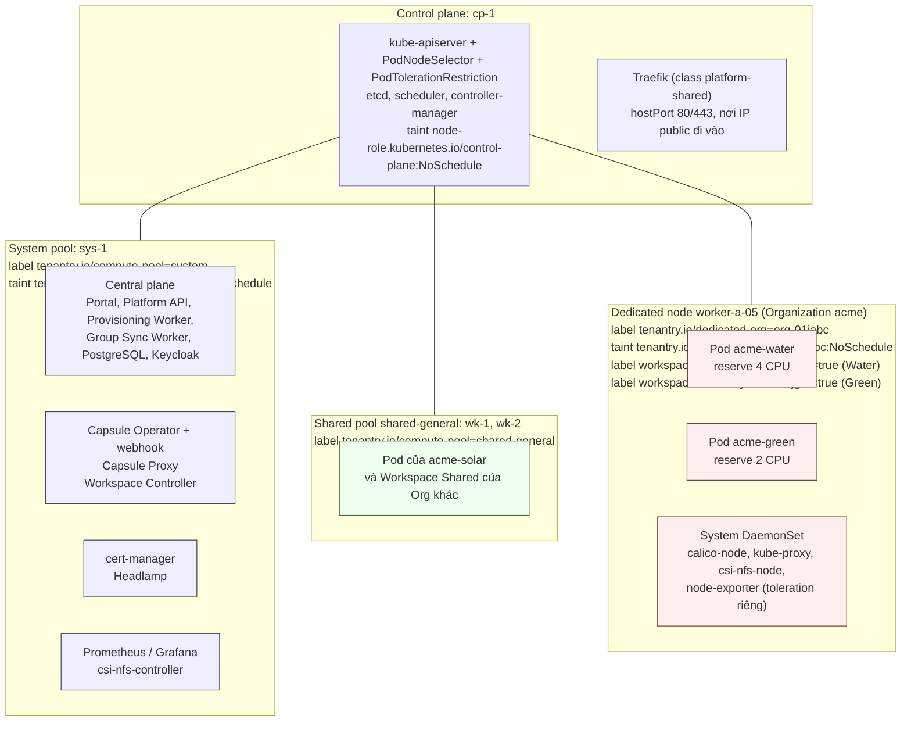
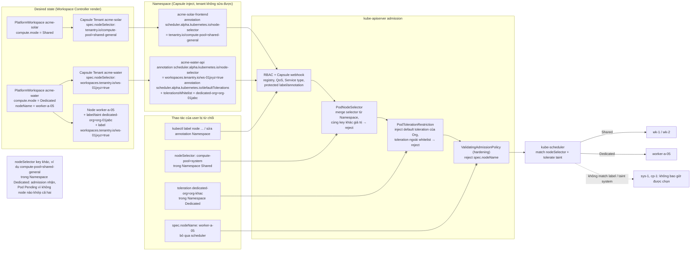
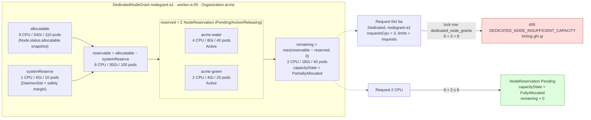
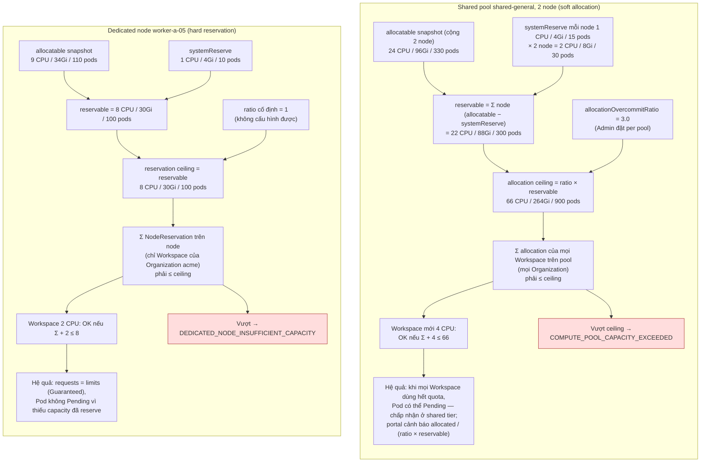
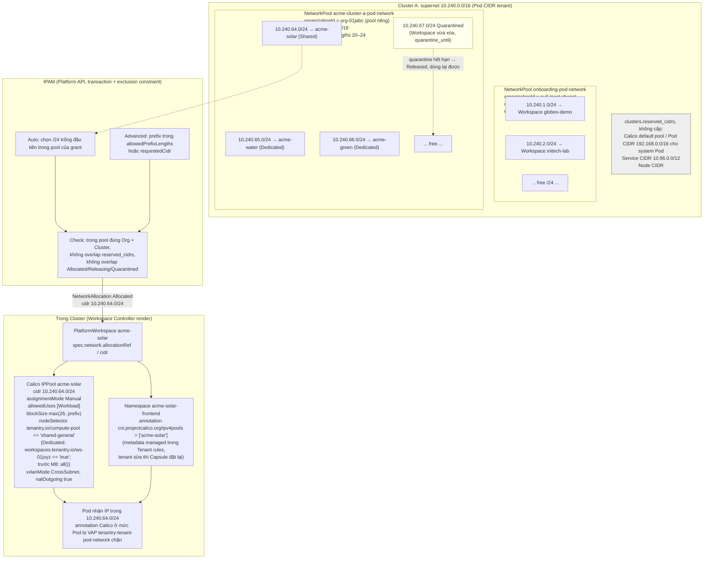
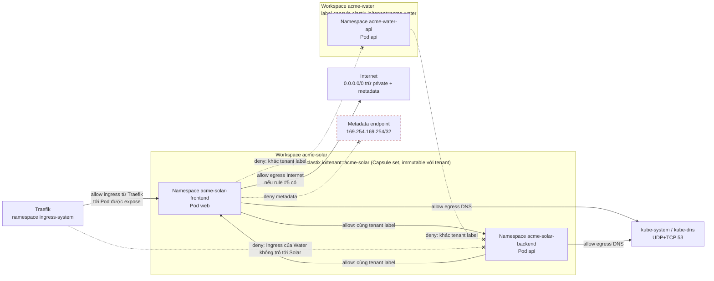
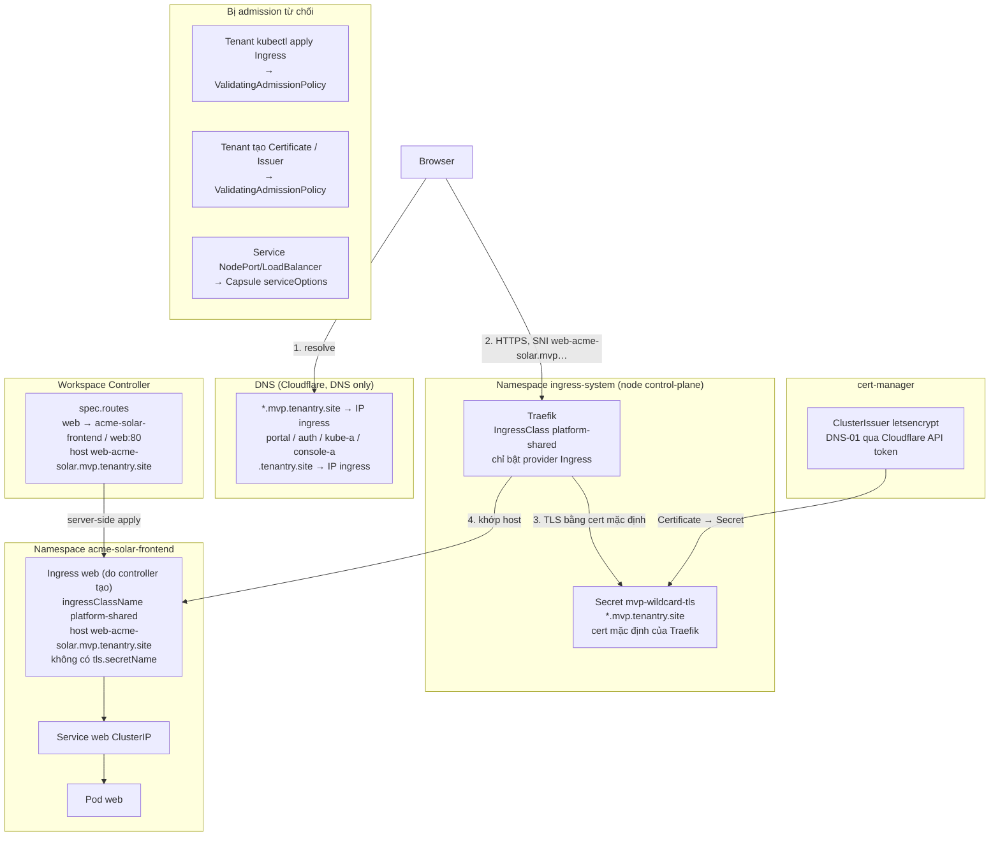
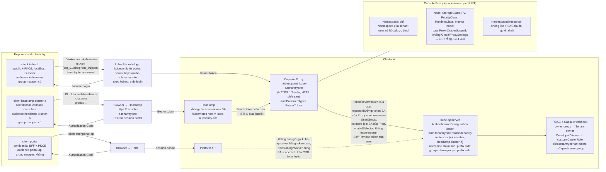
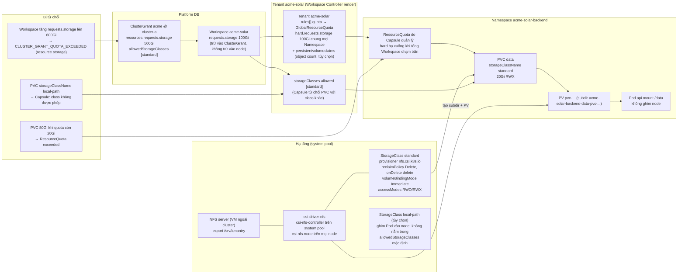

# 05 — Network, scheduling, ingress, access và storage

> Nơi định nghĩa cho node layout, capacity model, IP plan, NetworkPolicy, Route/Ingress/TLS và storage; quy tắc nghiệp vụ nền ở `PRODUCT-PLAN.md` mục 6, 7, 11, 12, 18. Sơ đồ kế thừa cách làm của lab bản đầu (nhánh `feat/tenantry-scaffold`) (Calico IPPool `Manual` per tenant, `PodNodeSelector`, NetworkPolicy replicate qua `GlobalTenantResource`) và thay tên lab (`solar`, `water`, `capsule.clastix.io/tenant=solar`) bằng tên Tenantry (`acme-solar`, `tenantry.io/...`).
> Câu hỏi còn mở nằm ở `REVIEW-CHECKLIST.md`; chỗ nào phụ thuộc câu hỏi mở thì ghi "→ REVIEW-CHECKLIST <mã>".

Ví dụ dùng xuyên suốt:

| Thực thể | Giá trị |
|---|---|
| Cluster | `cluster-a`, apps domain `mvp.tenantry.site` |
| Organization | slug `acme`, id `org-01jabc` |
| Workspace Shared | `acme-solar` (`ws-01jsol`), pool `shared-general`, CIDR `10.240.64.0/24` |
| Workspace Dedicated | `acme-water` (`ws-01jxyz`, reserve 4 CPU) và `acme-green` (`ws-01jgrn`, reserve 2 CPU) trên node `worker-a-05` |
| Dedicated node | `worker-a-05`, allocatable 9 CPU, systemReserve 1 CPU → reservable 8 CPU |
| NetworkPool | `onboarding-pod-network` (chung, `10.240.0.0/18`) và `acme-cluster-a-pod-network` (riêng, `10.240.64.0/18`), cùng supernet `10.240.0.0/16` |

Ví dụ ở đây giả sử Admin đã cấp thêm pool riêng `acme-cluster-a-pod-network` cho `acme`, nên CIDR của acme nằm trong `10.240.64.0/18`. Kịch bản demo (`PRODUCT-PLAN.md` mục 28, M9) chỉ dùng grant mặc định, nên ở đó Solar và Water lấy `/24` từ pool chung `onboarding-pod-network`.

---

## 1. Node layout của Cluster demo

**Mục đích:** cho thấy node nào chạy gì, label/taint nào tách system pool, shared pool và dedicated node, và membership label per Workspace cùng tồn tại trên một node.

Ánh xạ với lab bản đầu: lab gắn `capsule.clastix.io/tenant=solar` lên `wk1,wk2` và `=water` lên `wk3` (scripts/40-platform.sh), tức mỗi tenant một pool cứng. Tenantry tách thành hai kiểu: pool chung `tenantry.io/compute-pool=shared-general` cho Shared mode và label/taint theo Organization + membership label theo Workspace cho Dedicated mode (plan 6.2, 6.4).

**Cụm MVP.** Một node worker riêng làm system pool, mang label `tenantry.io/compute-pool=system` và taint `tenantry.io/compute-pool=system:NoSchedule` (`deploy/cluster/10-nodes.sh`); mọi Pod của central plane và thành phần nền khai nodeSelector cùng toleration cho taint đó. Hai worker còn lại là shared pool. Ngoại lệ duy nhất: Traefik chạy trên node control-plane, nơi IP public đi vào (mục 7). Phase 2 tách central plane (Portal, API, worker, PostgreSQL, Keycloak) sang một cụm riêng; mỗi cụm tenant vẫn giữ một system pool nhỏ cho thành phần theo cụm: Capsule, Capsule Proxy, operator, Traefik, cert-manager, Headlamp.

**Ai gắn label/taint nào.**

| Label/taint trên Node | Ai gắn và gỡ | Từ |
|---|---|---|
| `tenantry.io/compute-pool=system` + taint | `deploy/cluster/10-nodes.sh` | M1 |
| `tenantry.io/compute-pool=<pool-id>` của shared pool | M1–M5: `10-nodes.sh` gắn cho `SHARED_NODES` (tạm), `tenantry-seed` ghi vào `cluster_nodes.shared_pool_id`. Từ M6: reconciler của `PlatformSharedPool` gắn/gỡ theo `spec.nodes`, script thôi gắn | M1 / M6 |
| `tenantry.io/dedicated-org=<org-id>` + taint | Reconciler của `PlatformNodeGrant` | M8 |
| `workspaces.tenantry.io/<ws-id>=true` | Sub-reconciler `compute` của Workspace Controller | M8 |

- Platform Admin chọn node của shared pool trên portal. Danh sách node lấy từ `PlatformNodeInventory` (một object mỗi cụm, do chart operator tạo; worker chép về `cluster_nodes`). Ở M5 việc thêm/bớt node của pool và cấp dedicated node chỉ ghi DB (vòng provisioning khi đó chỉ log rồi đánh dấu event đã giao, nên Operation sẽ mất); từ M6 worker dựng `PlatformSharedPool` và `PlatformNodeGrant` từ DB lúc khởi động và ở mỗi lần resync.
- Một node hoặc thuộc một shared pool, hoặc là dedicated, không bao giờ cả hai (plan 6.3). API chặn trước bằng `cluster_nodes` (lock row node, `02-data-model.md` mục 3); operator chặn lần hai trên Cluster: `PlatformSharedPool` từ chối node control-plane, system hoặc đang dedicated, `PlatformNodeGrant` từ chối node còn mang label `tenantry.io/compute-pool`.
- Id pool `system` bị cấm: đó là giá trị label của system pool.
- Quy trình chuyển node từ shared pool sang dedicated: bớt node khỏi pool trên portal → drain → uncordon → cấp cho Organization. Không còn label pool thì Pod Shared không quay lại được; controller của `PlatformNodeGrant` đòi node `Ready`, schedulable và không còn Pod tenant nào (`04-state-machines.md` mục 5.1).
- Trên dedicated node, `calico-node`, `kube-proxy` và `csi-nfs-node` mặc định đã tolerate mọi taint; DaemonSet monitoring (M12) cần thêm toleration cho `tenantry.io/dedicated-org`. Request của chúng tính vào `systemReserve`.

**Điểm cần review**

- Cụm lab có 4 node: `fdp-k8s-cp1` (control-plane, Traefik), `fdp-k8s-wk1` (system pool), `fdp-k8s-wk2` và `fdp-k8s-wk3` (shared pool), mỗi worker 3 CPU. Không có node thứ năm: ở phần demo Dedicated, Admin bớt `wk3` khỏi shared pool rồi cấp cho `acme` (`PRODUCT-PLAN.md` mục 28), nên shared pool còn `wk2`. Sơ đồ trên và các ví dụ `worker-a-05` (9 CPU) chỉ để minh họa, số liệu demo thật ở PRODUCT-PLAN mục 28.

---

## 2. Chuỗi enforcement scheduling: Shared và Dedicated

**Mục đích:** theo dõi một Pod từ Tenant spec tới scheduler, chỉ ra lớp nào inject selector/toleration và lớp nào từ chối các thao tác vượt rào của user.

Bảng tương ứng với lab bản đầu:

| Lớp | Lab (Solar/Water) | Tenantry |
|---|---|---|
| Tenant nodeSelector | `capsule.clastix.io/tenant: solar` | Shared: `tenantry.io/compute-pool: shared-general`; Dedicated: `workspaces.tenantry.io/<ws-id>: "true"` |
| Node label | script gắn tay `capsule.clastix.io/tenant=solar` lên wk1,wk2 | Bảng "Ai gắn label/taint nào" ở mục 1 |
| Admission | `PodNodeSelector` bật trong `60-enable-oidc.sh`; test `tests/wrong-node-pod.yaml` | `PodNodeSelector` + `PodTolerationRestriction` bật ở M1 (`deploy/cluster/70-apiserver.sh`); VAP chặn `nodeName` là hardening |
| Node visibility | Capsule Proxy gate `ProxyClusterScoped`, không `GlobalProxySettings` (mục 8) | Shared và Dedicated: LIST Node qua Proxy rỗng, GET 403; portal hiển thị pool summary và node card |

Quy tắc:

- Vị trí Pod do hai admission plugin có sẵn của kube-apiserver ép, `PodNodeSelector` và `PodTolerationRestriction`, cấu hình qua annotation Namespace; bật cùng lúc ở M1 để chỉ khởi động lại kube-apiserver một lần. Từ M8 ba annotation `scheduler.alpha.kubernetes.io/{node-selector,defaultTolerations,tolerationsWhitelist}` là metadata managed trong `Tenant.spec.rules[]` ở mọi Workspace (tenant sửa thì Capsule đặt lại). Whitelist phải gồm các taint `node.kubernetes.io/*` mà Kubernetes tự thêm vào Pod, nếu không mọi Pod bị từ chối. Namespace Dedicated: `defaultTolerations` là toleration của Organization, whitelist gồm toleration đó và các taint `node.kubernetes.io/*`. Namespace Shared: `defaultTolerations` rỗng, whitelist chỉ gồm các taint `node.kubernetes.io/*`, nên Pod Shared không tolerate được taint nào khác.
- `PodNodeSelector` merge selector của Namespace vào mọi Pod và chỉ từ chối khi cùng key khác giá trị; selector khác key được nhận và Pod nằm `Pending`. Kubelet kiểm lại nodeSelector khi nhận Pod, nên `spec.nodeName` (bỏ qua scheduler, và kubelet không xét taint `NoSchedule`) vẫn không đặt được Pod ra ngoài pool hoặc node của nó: kubelet từ chối với lý do `NodeAffinity`. VAP chặn `nodeName` (A4) chỉ để báo lỗi rõ ngay lúc tạo, là hardening, không phải lớp bắt buộc. Capsule không có luật nào về `nodeName`.
- Label/taint của Node: từ M8 một VAP chỉ cho ServiceAccount `tenantry-operator` đổi key `tenantry.io/*` và `workspaces.tenantry.io/*` trên Node (tenant vốn không có quyền ghi Node).
- Nếu `PodNodeSelector`/`PodTolerationRestriction` bị tắt, enforcement hỏng im lặng — plan 6.4 yêu cầu test bắt buộc, chạy trong `make cluster-verify`.
- Với Shared mode, nếu Organization có nhiều Workspace cùng pool, `PodNodeSelector` không tách Workspace với nhau — đúng ý định (cô lập bằng Namespace/NetworkPolicy/quota), cần nói rõ trong luận văn.

---

## 3. Mô hình capacity của dedicated node

**Mục đích:** minh họa phép tính `reservable = allocatable − systemReserve`, hai reservation Water 4 CPU + Green 2 CPU, và request thứ ba 3 CPU bị từ chối.

Quy tắc đi kèm (plan 5.4, 6.3):

- Dedicated bắt buộc Guaranteed QoS: API đặt `limits = requests`, từ chối nếu client gửi limits khác; reservation dùng chính `requests.cpu/memory` và `pods`. Mỗi Namespace của Workspace Dedicated có LimitRange `maxLimitRequestRatio: {cpu: 1, memory: 1}` và `default` = `defaultRequest` cho container (M8), nên từng container cũng có limits = requests.
- Quota chung của Workspace Dedicated không được lớn hơn NodeReservation; controller render `hard` bằng đúng reservation.
- `requests.storage` được trừ vào ClusterGrant, **không** trừ vào node.
- Capacity state so theo từng chiều: hết CPU dù còn RAM vẫn là `FullyAllocated` (định nghĩa ở `04-state-machines.md` mục 5.1).
- Snapshot `allocatable` đến từ status của `PlatformNodeGrant`, worker chép về DB khi status đổi và ở lần resync định kỳ (IMPLEMENTATION-PLAN mục 5.1); node reboot với ít CPU hơn thì đi vào nhánh `Overcommitted`.
- Xóa `acme-water` release 4 CPU; `acme-green` và org label/taint trên node không bị ảnh hưởng.

**Điểm cần review**

- `systemReserve` (một giá trị cho mỗi node) do Admin nhập tay hay tính từ tổng request của DaemonSet đang chạy trên node cộng margin? Plan nói "bao gồm request của system DaemonSet dự kiến", MVP để Admin nhập tay; portal gợi ý từ request của DaemonSet để Phase 2.

---

## 4. Shared pool soft allocation vs Dedicated hard reservation

**Mục đích:** đặt cạnh nhau hai công thức để thấy Shared là trần có overcommit, Dedicated là giữ chỗ thật.

| Tiêu chí | Shared | Dedicated |
|---|---|---|
| Ý nghĩa allocation | Trần quota chung của Tenant | Giữ chỗ trên node cụ thể |
| Ceiling | `ratio × Σ node (allocatable − systemReserve)`, ratio per pool | `allocatable − systemReserve`, ratio = 1 |
| Trừ vào quota CPU/RAM/Pod của ClusterGrant | Có | Không; chỉ số Workspace, Namespace và storage tính chung |
| Ai chia sẻ | Mọi Organization có pool trong grant | Chỉ Workspace của Organization được grant node |
| QoS | `limits ≥ requests`, giới hạn bởi quota của Workspace và quota limits của grant; không có tỷ lệ per container | `requests = limits` bắt buộc |
| Khi vượt | `COMPUTE_POOL_CAPACITY_EXCEEDED` | `DEDICATED_NODE_INSUFFICIENT_CAPACITY` |
| Rủi ro runtime | Pod Pending khi mọi tenant dùng hết quota | Không có, nếu snapshot đúng; drift → `Overcommitted` |

`systemReserve` là một giá trị áp cho từng node: reservable của pool là tổng `allocatable − systemReserve` của các node trong pool. Mọi thay đổi làm ceiling của pool tụt dưới Σ allocation hiện tại đều bị từ chối `COMPUTE_POOL_CAPACITY_EXCEEDED`: bớt node khỏi pool (plan 6.2), hạ `allocationOvercommitRatio`, hoặc tăng `systemReserve`. Mức dùng thực của pool (Prometheus, metric theo label pool) hiển thị cạnh ceiling để Admin có cơ sở chỉnh ratio.

**Điểm cần review**

- Shared ceiling tính trên Σ `requests`; `limits` chỉ bị trần bởi quota của Workspace và của grant.

---

## 5. Kế hoạch địa chỉ IP

**Mục đích:** cho thấy supernet Cluster, hai loại NetworkPool, `/24` per Workspace được cấp tự động, và cách CIDR biến thành Calico IPPool + Namespace annotation. Áp dụng từ M9: Workspace tạo ở M6–M8 không có CIDR riêng và không được cô lập mạng (`04-state-machines.md` mục 1.2).

So với lab: lab dùng `/18` cứng cho Solar (`10.240.0.0/18`) và Water (`10.240.64.0/18`) với `nodeSelector: capsule.clastix.io/tenant == "solar"`; Tenantry giữ nguyên mọi field IPPool (`Manual`, `Workload`, `blockSize 26`, `vxlanMode CrossSubnet`, `natOutgoing`) nhưng CIDR đến từ NetworkAllocation và selector theo pool/Workspace.

Quy tắc:

- **Dải địa chỉ.** `clusters.reserved_cidrs` (Admin nhập khi đăng ký Cluster) giữ Pod CIDR mặc định của Calico, Service CIDR và Node CIDR; lab: `192.168.0.0/16`, `10.96.0.0/12`. NetworkPool của một Cluster không được overlap nhau và không overlap `reserved_cidrs`; service kiểm khi tạo pool (M5). Seed tạo `onboarding-pod-network` là `10.240.0.0/18`, chừa chỗ cho pool riêng của Organization (`10.240.64.0/18`, ...).
- **kube-proxy nhận Pod theo interface, không theo CIDR.** Lab: kubeadm `podSubnet` và kube-proxy `clusterCIDR` = `192.168.0.0/16`, chế độ iptables. kube-proxy SNAT mọi gói tới Service từ IP ngoài `clusterCIDR`; Pod tenant mang IP `10.240.x.x` nên gọi Service sang Pod ở node khác sẽ bị SNAT thành IP node, và `tenant-allow-same-workspace` (mục 6) ở node đích từ chối. Vì vậy đầu M9, trước khi có IPPool tenant, ConfigMap `kube-proxy` đặt `detectLocalMode: InterfaceNamePrefix`, `detectLocal.interfaceNamePrefix: cali` (script trong `deploy/cluster`); `cluster-verify` từ M9 có test gọi Service trong một Workspace giữa hai node. Không chọn cách đổi Pod CIDR của cả cụm sang `10.x`: phải sửa `podSubnet`, `--cluster-cidr` của controller-manager, tạo lại pool mặc định và khởi động lại mọi Pod hệ thống để đổi IP, trong khi `clusterCIDR` vẫn chỉ nhận một dải IPv4 nên mọi NetworkPool về sau buộc phải nằm trong dải đó. Nhận theo interface không đổi IP Pod nào và không giới hạn dải của NetworkPool; pool `192.168.0.0/16` chỉ cấp IP cho Pod hệ thống, không chiếm chỗ của tenant.
- **Annotation Calico ở mức Pod.** Calico ưu tiên annotation của Pod hơn của Namespace, và pool `Manual` cấp cho bất kỳ ai xin đúng tên. ValidatingAdmissionPolicy `tenantry-tenant-pod-network` (chart operator, M9) từ chối Pod do user tenant tạo trong Namespace có label `capsule.clastix.io/tenant` nếu mang annotation `cni.projectcalico.org/ipv4pools`, `ipv6pools`, `ipAddrs`, `ipAddrsNoIpam` hoặc `floatingIPs`. Ở mức Namespace, M8 dùng rule deny metadata của Capsule cho `cni.projectcalico.org/ipv4pools` và `ipv6pools`; M9 đổi `ipv4pools` thành metadata managed trỏ vào IPPool của Workspace. Không dùng `namespaceOptions.forbiddenAnnotations`: đã thử trên lab, nó từ chối cả annotation do chính Capsule gắn theo metadata managed, nên Namespace Dedicated không tạo được.
- **Node selector của IPPool.** Theo mode từ M8; Workspace tạo khi M9 đã có mà M8 chưa có thì IPPool dùng `nodeSelector: all()`, M8 đổi sang selector theo mode.
- **blockSize.** `blockSize 26` với `/24` cho 4 block; CIDR nhỏ hơn `/26` (`/27`, `/28`) thì `blockSize` bằng prefix của CIDR, vì Calico không cho block lớn hơn pool. Lab để IPAMConfig `strictAffinity: false`, nên khi node không lấy thêm được block, Calico cho mượn địa chỉ trong block của node khác: Workspace Shared trên nhiều node hơn số block không hết IP sớm.
- **Xóa IPPool và IP rò.** Calico v3.32 không serve `workloadendpoints` qua API server, nên finalizer (IMPLEMENTATION-PLAN §4.3 bước 5) đếm địa chỉ đang cấp trong các `IPAMBlock` thuộc CIDR. Kẹt quá ngưỡng thì `BlockedByFinalizer` với message nêu CIDR, block và số địa chỉ còn cấp. `:force` không bỏ qua bước này, để CIDR không quay lại pool khi Calico còn giữ địa chỉ. Admin gỡ tay bằng `calicoctl` (cùng version Calico, `DATASTORE_TYPE=kubernetes`, kubeconfig admin): `calicoctl ipam show --show-blocks` xem địa chỉ còn cấp; `calicoctl ipam check --show-problem-ips -o report.json` liệt kê IP không còn workload (chạy hai lần cách nhau một lúc để chỉ lấy IP rò thật); `calicoctl ipam release --from-report=report.json` hoặc `--ip=<IP>`. Finalizer tự đi tiếp. Đã chạy `show`/`check` trên lab ở M9; `release` chưa thử vì không có IP rò thật.
- **Egress.** `natOutgoing: true` nghĩa là egress Internet được SNAT; khớp với rule egress Internet ở mục 6 (MVP cho mọi Workspace).

---

## 6. Network policy baseline per Namespace

**Mục đích:** liệt kê rule baseline mà mọi Namespace nhận qua replication, và minh họa traffic được phép/bị chặn giữa Workspace `acme-solar` và `acme-water`. Áp dụng từ M9, do sub-reconciler `network` render.

Bộ rule replicate (kế thừa `manifests/tenant-resources.yaml`, mở rộng theo plan 7.4), tất cả qua `GlobalTenantResource` với `resyncPeriod` để controller restore khi bị xóa tay:

| # | NetworkPolicy | Nội dung | Nguồn label |
|---|---|---|---|
| 1 | `tenant-default-deny` | `podSelector: {}`, `policyTypes: [Ingress, Egress]`, không rule → deny all | — |
| 2 | `tenant-allow-same-workspace` | ingress + egress `namespaceSelector: capsule.clastix.io/tenant = {{tenant.name}}` | Label do Capsule gắn khi tạo Namespace; tenant không sửa được (Capsule webhook) |
| 3 | `tenant-allow-dns` | egress tới `kube-system` `k8s-app=kube-dns` UDP/TCP 53 | Lab đã có |
| 4 | `tenant-allow-ingress-controller` | ingress từ `namespaceSelector: kubernetes.io/metadata.name=ingress-system` (Traefik dùng `hostPort`, không `hostNetwork`, nên gói tới Pod mang IP Pod của Traefik) | Namespace label bất biến của Kubernetes |
| 5 | `tenant-allow-internet-egress` | egress `ipBlock 0.0.0.0/0` `except [10.0.0.0/8, 172.16.0.0/12, 192.168.0.0/16, 169.254.169.254/32]`. MVP không có catalog policy profile nên rule này áp cho mọi Workspace; metadata endpoint luôn bị chặn | — |
| 6 | (ẩn trong #5) deny metadata | `169.254.169.254/32` nằm trong `except` nên không có rule nào cho phép | — |

Nguyên tắc "không tin label tenant tự sửa": mọi selector chỉ dùng `capsule.clastix.io/tenant` (Capsule set), `kubernetes.io/metadata.name` (Kubernetes set) hoặc label trong namespace system mà tenant không có quyền — không dùng Pod label do user tự đặt.

**Namespace mới chưa có NetworkPolicy.** Replication của `GlobalTenantResource` tới Namespace mới sau vài giây (lab M9: 4–14s với Namespace tạo bằng kubectl, cận trên là `resyncPeriod`). Để Pod không chạy chưa cô lập trong khoảng đó, ValidatingAdmissionPolicy `tenantry-tenant-network-ready` (chart operator, M9) từ chối tạo Pod trong Namespace tenant khi Namespace chưa có NetworkPolicy `tenant-default-deny`: param là chính NetworkPolicy đó trong Namespace của request, `parameterNotFoundAction: Deny`, áp cho mọi caller (cả ReplicaSet controller); Deployment tự thử lại nên chỉ chậm vài giây. Binding chọn Namespace có label `capsule.clastix.io/tenant` và `tenantry.io/network=true`; label sau là metadata managed của Tenant, chỉ gắn khi Workspace có `spec.network`, vì apiserver tìm param trước khi xét `matchConditions` nên không lọc theo annotation được, và Workspace không có network thì không có baseline để chờ. Khi chưa có param, apiserver trả `422 Invalid` với message cố định (`... failed to configure binding: no params found for policy binding with Deny parameterNotFoundAction`), không tùy chỉnh được; tên policy trong message là gợi ý cho user, portal và docs cho user giải thích lỗi này. Đo trên lab (M9): Namespace tạo bằng kubectl rồi apply Deployment ngay, ReplicaSet bị từ chối 5 lần, Deployment `Available` sau khoảng 6s mà không cần ai can thiệp; Pod đầu tiên đã nằm sau `tenant-default-deny`, và vì mọi NetworkPolicy khác chỉ là allow, gác theo `tenant-default-deny` là fail-closed (lúc đó Pod chỉ có thể chặt hơn, không lỏng hơn).

Ingress của Water không trỏ được sang Service của Solar: Ingress chỉ tham chiếu Service cùng Namespace, và Ingress do controller tạo đúng Namespace của Route — không cần rule mạng riêng, nhưng phải có test.

**Điểm cần review**

- Rule #4 cho phép mọi Pod trong Namespace nhận traffic từ Traefik, không chỉ Pod "được expose"; muốn chặt hơn cần Pod label do user đặt (không tin được) hoặc chấp nhận trade-off này. MVP chấp nhận: Route chỉ trỏ tới Service mà tenant chọn.

---

## 7. Route, Ingress và TLS

**Mục đích:** theo dõi request HTTPS từ browser tới Pod, ai được tạo Ingress, và cert nằm ở đâu. Quy tắc nghiệp vụ của Route ở `PRODUCT-PLAN.md` mục 7.6; mục này định nghĩa phần hiện thực trong cluster.

**Ai ghi gì**

| Object | Ai tạo | Ở đâu |
|---|---|---|
| Ingress của Route | Workspace Controller, từ `spec.routes` | Namespace của tenant |
| Wildcard Certificate `*.mvp.tenantry.site` và Secret | cert-manager, cài lúc dựng lab | `ingress-system` |
| Certificate của host platform (portal, auth, kube, console) | cert-manager, cài lúc dựng lab | namespace của từng thành phần |
| Tenant | chỉ đọc Ingress | — |

**Ba lớp giữ hostname**

1. **API ghép hostname** `<tên>-<k8s_name>.<apps domain>` và DB giữ `UNIQUE (hostname)`; user không nhập được phần đuôi. Hai cặp (tên, Workspace) khác nhau ghép ra cùng một chuỗi (ví dụ `a-b` + `c` và `a` + `b-c`) thì cái đến sau nhận `ROUTE_HOSTNAME_TAKEN`.
2. **ValidatingAdmissionPolicy `tenantry-tenant-ingress-lockdown`**: trong mọi Namespace có label `capsule.clastix.io/tenant`, từ chối CREATE/UPDATE/DELETE trên `ingresses` (`networking.k8s.io`), mọi resource của `cert-manager.io`, `acme.cert-manager.io`, `gateway.networking.k8s.io` và `traefik.io` **khi người gọi là user tenant** (`request.userInfo.username` bắt đầu bằng `oidc:`). Luật chỉ khớp người gọi là tenant, không viết dạng "từ chối mọi người trừ X": operator, cert-manager, namespace controller và garbage collector đều phải ghi/xóa được, nếu không xóa một Namespace có Route sẽ kẹt `Terminating`. Cần luật này vì ClusterRole `admin` mà Capsule cấp cho chủ Workspace có sẵn quyền ghi Ingress, và cert-manager tự gộp quyền ghi `Certificate`/`Issuer` vào `admin`. Không chặn thì tenant tự xin được cert cho hostname của người khác qua ClusterIssuer. Policy đặt `validations[].reason: Forbidden` để tenant nhận 403 thay vì 422 mặc định; mọi luật trong bảng dưới cũng vậy.
3. **Service `NodePort`/`LoadBalancer`/`ExternalName` bị Capsule cấm**, nên Route là đường ra duy nhất.

**Các luật admission dành cho tenant.** Đều nằm trong chart operator, đều chỉ khớp người gọi là user tenant (`username` bắt đầu bằng `oidc:`), nên Capsule, operator và controller của Kubernetes đi qua:

| Luật | Chặn gì | Từ |
|---|---|---|
| `tenantry-tenant-pod-network` | Pod mang annotation Calico ở mức Pod (mục 5) | M9 |
| `tenantry-tenant-ingress-lockdown` | Ghi Ingress, tài nguyên cert-manager, Gateway API, Traefik (lớp 2 ở trên) | M11 |
| `tenantry-tenant-rolebinding-subjects` | CREATE/UPDATE `rolebindings` trong Namespace có label `capsule.clastix.io/tenant` nếu có subject không phải Group `oidc:org_<ULID của Organization sở hữu Tenant>:...` hoặc ServiceAccount thuộc Namespace bắt đầu bằng `<tên Tenant>-`. Organization của Tenant đọc từ label `tenantry.io/org=<org ULID>` mà controller gắn lên Namespace qua `Tenant.namespaceOptions.additionalMetadata` | M11 |

Nhờ luật RoleBinding, chủ Workspace không tự bind được người ngoài Organization hay group `oidc:tenantry:tenant-users`, nên contract thu hồi quyền ở `06-security-and-identity.md` mục 5 đứng vững: member bị gỡ khỏi group mất quyền Kubernetes trong thời hạn token. Test ở M11: owner không bind được user ngoài và không bind được `oidc:tenantry:tenant-users`; xóa Namespace và xóa Workspace có Route vẫn xong.

**TLS**

- Một ClusterIssuer `letsencrypt` dùng DNS-01 với API token Cloudflare (chỉ quyền sửa DNS của zone `tenantry.site`). DNS-01 không cần Let's Encrypt gọi vào cluster.
- Wildcard cert là **cert mặc định** của Traefik; Ingress của Route không mang `tls.secretName`, nên không có private key nào trong Namespace của tenant.
- Traefik chỉ bật provider Kubernetes Ingress (tắt CRD `IngressRoute` và Gateway API) để chỉ có một loại object mở được đường vào.

**TLS dừng ở Traefik.** Keycloak, Capsule Proxy, Headlamp và Portal chạy HTTP phía sau Traefik; không dựng CA nội bộ riêng cho từng dịch vụ. Hệ quả chấp nhận ở MVP: mật khẩu và token đi dạng rõ trong mạng Pod giữa các node. Muốn mã hóa thì bật WireGuard của Calico một lần cho mọi traffic Pod (hardening, M12).

**Đường vào ở cụm MVP.** Không có load balancer; IP public được hạ tầng NAT vào node control-plane. Traefik chạy trên chính node đó (nodeSelector, toleration cho taint control-plane, có giới hạn RAM) và nghe `hostPort` 80/443; cổng 80 chỉ redirect vĩnh viễn sang HTTPS (mã 301 với GET, 308 với các method khác, để client giữ nguyên method và body). Vì Pod Security mức `baseline` và `restricted` đều cấm `hostPort`, namespace `ingress-system` chạy ở mức `privileged`; Pod Traefik vẫn chạy không root và bỏ hết capability. Không đặt Traefik ở node khác rồi chuyển tiếp qua kube-proxy, vì khi đó Traefik mất IP thật của client và rate limit theo IP (`06-security-and-identity.md` mục 6) hết tác dụng.

**Custom domain** (sau MVP): Ingress của Route mang `tls.secretName`, Certificate nằm cùng Namespace và do controller tạo với solver HTTP-01; private key khi đó nằm trong Namespace của tenant, chấp nhận vì đó là domain của chính họ.

Let's Encrypt giới hạn số cert mỗi domain mỗi tuần; MVP chỉ cần năm cert nên không chạm, custom domain thì xin trên domain của khách.

**Điểm cần review**

- Luật admission ở lớp 2 chưa được chạy thử; M11 có test âm (tenant ghi Ingress/Certificate bị chặn) và dương (operator, cert-manager ghi được; xóa Namespace có Route vẫn xong).

---

## 8. Đường truy cập Kubernetes API

**Mục đích:** cho thấy kubectl (kubelogin) và Headlamp đều đi qua Capsule Proxy với OIDC client/audience riêng, Proxy lọc gì, và token portal không bao giờ chạm Kubernetes API.

| Đường | OIDC client | Audience | Đi qua | Ghi chú |
|---|---|---|---|---|
| kubectl | `kubectl` | `kubernetes` | kubeconfig → Capsule Proxy public endpoint | Không static token; kubelogin cache/refresh |
| Headlamp | `headlamp-cluster-a` | `headlamp-cluster-a` | Headlamp → `kube-a.tenantry.site` (Traefik) → Capsule Proxy | Một instance per Cluster; SSO nhờ session Keycloak từ portal |
| Portal | `portal` | `portal-api` | Portal BFF → Platform API | Token không hợp lệ với kube-apiserver vì audience không khớp |
| Provisioning Worker | (ServiceAccount) | — | apiserver trực tiếp | Chỉ quyền trên CRD `tenantry.io`; Phase 2 thay bằng Cluster Agent |

kube-apiserver dùng `sub` + prefix `oidc:` cho username và group, audience `[kubernetes, headlamp-cluster-a]` (`deploy/cluster/70-apiserver.sh`); lab bản đầu dùng `preferred_username` không prefix, nên mọi RoleBinding/Tenant owner và `users` của Capsule giờ mang prefix `oidc:`. Thời hạn token và contract thu hồi quyền: `06-security-and-identity.md` mục 3 và 5.

Capsule Proxy chỉ có một endpoint, `kube-a.tenantry.site`, cho cả kubectl và Headlamp. Headlamp không gọi thẳng Service của Proxy được: nó dùng cấu hình in-cluster của client-go, vốn luôn nói HTTPS, còn Proxy chạy HTTP phía sau Traefik (mục 7). Để request không đi vòng ra NAT public rồi quay lại, Pod Headlamp có `hostAliases` trỏ `kube-a.tenantry.site` về IP nội bộ của node chạy Traefik. Hệ quả: Headlamp phụ thuộc Traefik, và đổi node ingress thì phải cài lại Headlamp để cập nhật IP đó.

**Tài nguyên cluster-scoped qua Proxy (đo ở M11).** Capsule Proxy 0.15.3 mặc định có lỗi: module node lọc theo `Tenant.spec.nodeSelector` nhưng không kiểm `proxySettings`, và gọi apiserver bằng ServiceAccount của chính Proxy. Vì vậy mọi owner hay subject của ProxySetting đọc được toàn bộ object Node của pool (nhãn, IP nội bộ, `status.images` gồm image của tenant khác chạy chung node) và metrics của node. Đã đo trên lab trước khi sửa. Sửa bằng `--feature-gates=ProxyClusterScoped=true` (`deploy/cluster/values/capsule-proxy.yaml`): mọi tài nguyên cluster-scoped chỉ trả object được `GlobalProxySettings` cấp, mà Tenantry không tạo cái nào. Hệ quả:
- LIST Node trả rỗng; GET Node, `/status`, `/proxy`, watch Node và `metrics.k8s.io` nodes trả 403. Dedicated cũng không `kubectl get nodes` được; portal hiển thị node và capacity. Trang Nodes của Headlamp rỗng hoặc báo thiếu quyền.
- StorageClass qua Proxy trả rỗng (vốn đã không theo allow-list của Tenant); portal hiển thị allow-list StorageClass của Workspace.
- Gate còn Alpha: lúc khởi động Proxy đọc API discovery, APIService nào không Available (metrics-server, `calico-api`) thì Proxy thoát và CrashLoop tới khi APIService lên lại. `cluster-verify` có check "every APIService is Available". Runbook: Proxy CrashLoop → `kubectl get apiservice`, sửa APIService đang không Available. Xem lại gate mỗi lần nâng capsule-proxy.
- `--oidc-username-claim` không dùng trên đường BearerToken (Proxy lấy user từ TokenReview, tức `oidc:` như apiserver); chart luôn render cờ này nên đặt `sub` cho khớp nghĩa.
- Đã báo riêng cho maintainer ngày 2026-11-23 (private vulnerability report, `docs/report/upstream-issue-capsule-proxy-nodes.md`), không mở issue công khai.

**Proxy gọi apiserver thế nào (đọc mã nguồn capsule-proxy 0.15.3, chưa kiểm bằng audit log).** Proxy xác định người gọi bằng TokenReview trên token của user. Request thường đi bằng token ServiceAccount của Proxy kèm `Impersonate-User`/`Impersonate-Group`, nên RBAC và admission vẫn áp theo user. List được lọc (Namespace, tài nguyên cluster-scoped) đi bằng ServiceAccount của Proxy kèm labelSelector và không impersonate, nên đúng hay sai chỉ nhờ selector; chính chỗ này sinh ra lỗi đọc Node ở trên. SelfSubjectAccessReview/RulesReview đi bằng token của user. ClusterRole của Proxy (chart upstream) có get/list/watch trên mọi tài nguyên và impersonate không giới hạn tên, tức ngang cluster-admin; đây là bản chất của mô hình impersonation (`docs/report/known-limitations.md`).

**Namespace qua Proxy.** Lab chạy `--enable-reflector=false`, nên Proxy chỉ liệt kê Namespace của Tenant cho owner và cho subject của một `ProxySetting` nằm trong một Namespace của Tenant; RoleBinding không làm Namespace hiện ra. Sub-reconciler `proxyaccess` đặt `ProxySetting` tên `tenantry` ở Namespace đầu tiên (theo tên) của Tenant, ns đó bị xóa thì chuyển sang ns khác; subjects là các group Developer/Viewer của Workspace và ServiceAccount probe. Phần quyền tài nguyên cluster trong ProxySetting bị Proxy bỏ qua. Owner (admin trong ns) sửa hoặc thêm được ProxySetting; vì Node đã chặn, việc đó chỉ lộ tên Namespace của chính Tenant.

---

## 9. Storage

**Mục đích:** theo dõi PVC của tenant từ StorageClass `standard` (NFS qua `csi-driver-nfs`) tới ba lớp giới hạn: allow-list StorageClass của Tenant, `requests.storage` của quota chung, và `requests.storage` của ClusterGrant.

**Vì sao NFS.** Với Tenantry, storage chỉ là một StorageClass trong allow-list; đổi loại storage không đụng tới code. Tiêu chí chọn vì vậy là ít công vận hành nhất mà không phá kịch bản demo:

| Phương án | Vì sao không làm mặc định |
|---|---|
| Block phân tán (Ceph, Longhorn) | Cụm kubeadm trần không có sẵn; tự dựng là nuôi thêm một hệ thống phân tán không phục vụ đề tài |
| S3 qua CSI/FUSE | Mount được nhưng không đủ POSIX (ghi ngẫu nhiên, rename, lock), không chạy được PostgreSQL/Keycloak |
| Local (local-path) | Ghim Pod vào một node, đụng kịch bản thu hồi dedicated node và drain; chỉ là class tùy chọn |
| **NFS** | Một máy export một thư mục; Pod ở node nào cũng mount được; có RWX |

Giới hạn chấp nhận cho lab: NFS **không ép dung lượng thật** (PVC 20Gi chỉ là con số tính quota, tenant vẫn ghi quá được cho tới khi đầy export), NFS server là một điểm chết, và database trên NFS chậm với fsync.

**Một export, một StorageClass.** Lab có một NFS server (VM riêng ngoài cluster) export một thư mục `/srv/tenantry`, chỉ mở cho IP các node. Central plane (PostgreSQL, Keycloak, Prometheus) và tenant dùng chung StorageClass `standard`. Hệ quả chấp nhận: tenant ghi đầy export thì central plane cũng hết chỗ. Production tách export và thêm class `system-nfs`.

**Vì sao `csi-driver-nfs`.** `nfs-subdir-external-provisioner` phát hành bản cuối tháng 3/2023; `csi-driver-nfs` còn phát triển, là giao diện chuẩn của Kubernetes, có snapshot/clone, và Pod `csi-nfs-node` tự mount nên node không cần cài `nfs-common`. Đổi lại có thêm một DaemonSet trên mọi node.

Quota storage là quota chung của cả Workspace (`PRODUCT-PLAN.md` mục 5.4): PVC ở Namespace nào cũng dùng phần còn trống của Workspace.

Lifecycle khi xóa Workspace (plan 17.4): xóa Namespace → PVC bị xóa theo → `reclaimPolicy Delete` → driver xóa subdir (`onDelete: delete`, không archive, để "xóa hết" đúng nghĩa và khớp cảnh báo UI). Trong Namespace tenant, finalizer của PVC không giữ được việc xóa: controller `namespace-cleanup` của Capsule 0.15.2 gỡ chúng khoảng 10 giây sau khi Namespace Terminating và không còn Pod (IMPLEMENTATION-PLAN §4.3 bước 3). Thứ giữ được là Pod kẹt (finalizer trên Pod, node mất, NFS không phản hồi khi unmount) → Operation `Blocked`, retry hoặc Platform Admin `:force`.

**Điểm cần review**

- Capsule Proxy lọc StorageClass theo allow-list, nên Headlamp chỉ hiện `standard`; cần xác nhận với Capsule 0.15.x rằng `storageClasses.allowed` nhận tên chính xác (kiểm ở M7); Tenantry chỉ dùng tên chính xác.
- Không đặt LimitRange `max` per PVC: ResourceQuota của Namespace đã chặn tổng storage.
