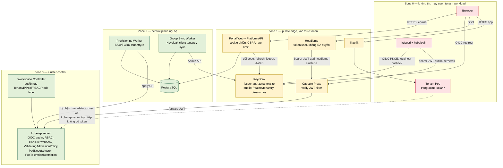
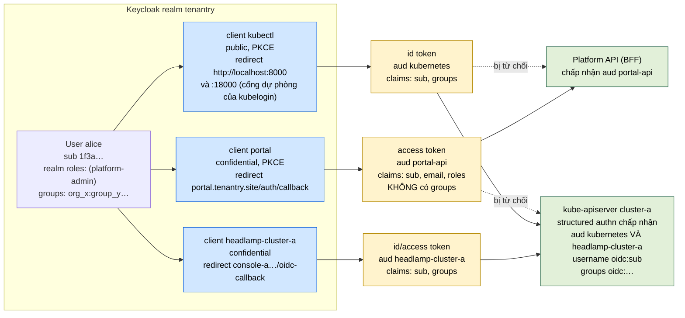
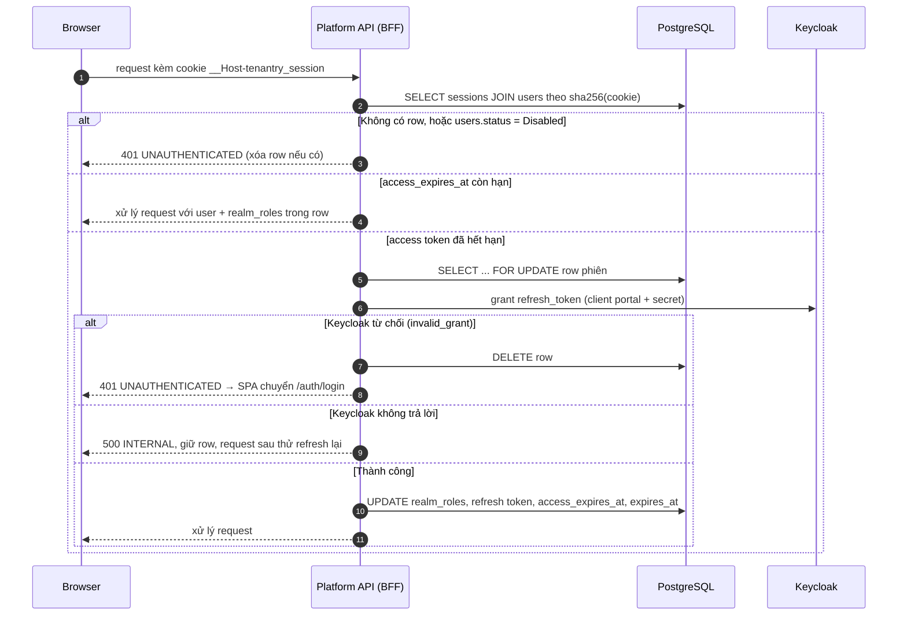
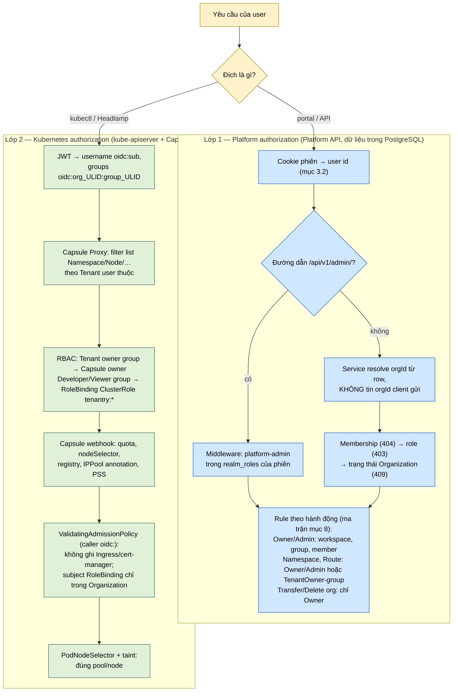

# 06 — Security & Identity

> Nơi định nghĩa cho: trust boundary, OIDC client, **phiên portal và thời hạn token**, hai lớp authorization, **thu hồi quyền**, rate limit, credential nội bộ, ma trận quyền. Nghiệp vụ nền ở `PRODUCT-PLAN.md` mục 8–12, 20.

## 1. Trust boundaries

**Mục đích:** thấy rõ cái gì tin cái gì, credential nào đi qua biên nào.

**Điểm cần review**

- **Portal không bao giờ cầm token có thể gọi Kubernetes.** Token của client `portal` có audience `portal-api`, kube-apiserver không nhận; Pod API không mount token ServiceAccount.
- **API và hai worker dùng chung một role PostgreSQL đọc-ghi** (mục 7). Ai chiếm được một trong ba tiến trình là ghi được mọi bảng, nên điều khiển được cả hai worker qua DB: tạo CR (controller vẫn giữ trong khuôn Tenant, không tạo được cluster-admin binding) và ghi `groups`/`group_members` để Group Sync đưa bất kỳ user nào vào group Keycloak của bất kỳ Organization nào, tức là vào được mọi Tenant qua binding. Tách hai worker thành hai Deployment chỉ hạn chế credential bị lộ trực tiếp (secret `tenantry-sync`, token ServiceAccount), không tách được quyền đi qua DB.
- **Keycloak chỉ public `/realms/tenantry` và `/resources`**; admin console và realm `master` không ra internet (client `admin-cli` của `master` nhận mật khẩu trực tiếp, mở ra là cho dò mật khẩu admin), người vận hành vào bằng `port-forward`. Mailpit cũng không có Ingress (mục 3.2).
- **Route của tenant cùng site với portal và Keycloak**: `*.mvp.tenantry.site`, `portal.tenantry.site` và `auth.tenantry.site` chung registrable domain `tenantry.site`, nên `SameSite` không tách chúng và trang của tenant đặt được cookie `Domain=tenantry.site`. Portal tự bảo vệ bằng cookie `__Host-` và header CSRF (mục 3.2); cookie của Keycloak không có tiền tố đó, nên trang tenant có thể cài cookie phiên Keycloak của chính kẻ tấn công cho nạn nhân (login CSRF). Đây là giới hạn đã biết của MVP; Phase 2 chuyển apps domain sang một registrable domain riêng.
- Capsule Proxy là **điểm vào duy nhất** của tenant tới kube-apiserver; cổng 6443 của kube-apiserver chỉ dành cho quản trị và phải giới hạn theo IP nguồn ở firewall của hạ tầng. Tenant gọi thẳng 6443 bằng token của mình vẫn bị RBAC và admission chặn như thường (chỉ mất phần lọc danh sách của Proxy), nên đây là giảm bề mặt tấn công chứ không phải lớp cách ly. Tenant Pod vẫn resolve được `kubernetes.default`: không chặn bằng NetworkPolicy (nhiều app dùng ServiceAccount hợp lệ), nhưng ServiceAccount tenant không có RoleBinding mặc định.
- Zone 2 và Zone 3 ở MVP nằm cùng cluster; ranh giới là RBAC của ServiceAccount, không phải network. Phase 2 tách thành mạng khác.

## 2. OIDC clients và audience

**Mục đích:** một realm, ba loại client cho người dùng, ba audience — token nào dùng được ở đâu. Realm còn hai client nội bộ không đăng nhập người dùng: `cluster-verify` và `tenantry-sync` (bảng dưới).

| Client | Kiểu | Group mapper | Ghi chú |
|---|---|---|---|
| `portal` | confidential + PKCE, BFF | không | API tra quyền Organization trong DB, không cần group claim |
| `headlamp-{clusterId}` | confidential | có | mỗi Cluster mới thêm một client theo mẫu; tách audience để rotate secret Headlamp độc lập với kubectl |
| `kubectl` | public + PKCE | có | dùng chung cho mọi Cluster; Cluster phân biệt bằng endpoint Proxy |
| `cluster-verify` | confidential, chỉ client credentials | không | chỉ cho `make cluster-verify`: token của service account có aud `kubernetes`, kube-apiserver nhận thành user `oidc:` không có RoleBinding nào |
| `tenantry-sync` (từ M4) | confidential, chỉ service account | không | Group Sync Worker gọi Admin API; quyền ở mục 7. Keycloak 26.8 kiểm audience ở Admin API, nên client có client scope `kc-admin-api`, `fullScopeAllowed: false` và scope mapping đúng hai role của nó; thiếu scope này mọi lệnh admin bị 401 mà log Keycloak không ghi lý do |

Thời hạn token của mọi client lấy từ một bộ số duy nhất ở mục 3.

**Điểm cần review**

- User thuộc nhiều group → header JWT lớn; cần test kích thước với ~20 group qua Traefik, Capsule Proxy và Headlamp ở M11.
- Platform Admin có role `platform-admin` trong **mọi** token — không sao, vì Kubernetes không map realm role sang group; Admin muốn kubectl vào Tenant vẫn phải qua group binding như người khác (hoặc dùng kubeconfig admin ngoài platform).

## 3. Phiên portal và thời hạn token

### 3.1 Bộ số duy nhất

Thời hạn đặt **một lần ở realm**, không override theo client. Portal không có đồng hồ phiên riêng.

| Tham số (realm `tenantry`) | Giá trị | Ý nghĩa |
|---|---|---|
| Access Token Lifespan | 5 phút | Trần của độ trễ thu hồi quyền Kubernetes (mục 5) và độ trễ đổi role `platform-admin` trên portal |
| SSO Session Idle | 8 giờ | Không dùng gì trong 8 giờ thì phải đăng nhập lại; cũng là thời hạn refresh token |
| SSO Session Max | 24 giờ | Tối đa một lần đăng nhập, kể cả khi dùng liên tục |
| Revoke Refresh Token | tắt | Refresh token không xoay vòng một-lần, nên refresh đồng thời không làm hỏng phiên |

Ba con số là mặc định cho demo, đổi trong realm export; không có bản sao nào ở phía portal.

### 3.2 Phiên portal gắn với SSO session của Keycloak

Phiên portal **sống đúng bằng refresh token của nó**. Khi SSO session ở Keycloak kết thúc — hết idle, hết max, user logout, Admin disable account — lần refresh kế tiếp thất bại và phiên portal chết theo, chậm nhất sau 5 phút.

- **Cookie** của portal mang tiền tố `__Host-`: `__Host-tenantry_session` (`HttpOnly`), `__Host-tenantry_csrf` (JS đọc được), `__Host-tenantry_login` (`HttpOnly`); cả ba `Secure`, `SameSite=Lax`, `Path=/`, không `Domain`. Tiền tố là bắt buộc: Route của tenant trên `*.mvp.tenantry.site` cùng site với portal (mục 1), và trình duyệt chỉ nhận cookie `__Host-` do đúng host `portal.tenantry.site` đặt, nên trang của tenant không cài được phiên hay CSRF token giả cho portal.
- **Login** (`GET /auth/login`): API sinh `state`, `nonce`, PKCE verifier và đường quay lại, niêm phong (AES-256-GCM) vào cookie `__Host-tenantry_login` sống 5 phút rồi redirect sang Keycloak. Không có row DB nào trước khi đăng nhập xong.
- **Callback** (`GET /auth/callback`): kiểm `state`, đổi code, validate ID token (issuer, audience, `nonce`, hạn) và access token (audience `portal-api`), yêu cầu `email_verified=true`; upsert `users` theo `(issuer, subject)`; user `Disabled` thì trả trang lỗi 403, không tạo phiên; tạo row `sessions`; đặt cookie `__Host-tenantry_session` và `__Host-tenantry_csrf` (`Max-Age` 24 giờ).
- **Xác minh email**: realm bật `verifyEmail`, nên user tự đăng ký phải bấm link trong thư thì token mới có `email_verified=true`. Thiếu bước này, ai cũng đăng ký được bằng email của người khác và nhận lời mời thay họ (`03-flows.md` mục 3). Với Keycloak 26.8 và `verifyEmail` bật, form đăng ký chỉ hỏi email và tên, không hỏi mật khẩu: user đặt mật khẩu sau khi bấm link xác minh, nên người không giữ hộp thư đó không giữ chỗ được account. Giữ nguyên hành vi mặc định này. Ở cụm MVP, Keycloak gửi thư vào Mailpit, một hộp thư giả chạy trong namespace `keycloak`: thư không ra ngoài, chỉ người có quyền `port-forward` đọc được. Mailpit không có Ingress, vì nó giữ cả link xác minh và link đặt lại mật khẩu của mọi user. Hệ quả: người ngoài chưa tự đăng ký được nếu không có người vận hành lấy link giúp. Đổi sang SMTP thật chỉ là sửa cấu hình SMTP của realm, không đổi code.
- **Cookie phiên** là 32 byte ngẫu nhiên. DB chỉ lưu `sha256` của nó, nên đọc được bảng `sessions` cũng không dựng lại được cookie.
- **Token trong DB**: chỉ refresh token, mã hóa AES-256-GCM bằng khóa nằm trong Secret. Access token và ID token không được lưu — API chỉ cần claim `realm_access.roles` (chép vào `realm_roles`) và thời điểm hết hạn.
- **Refresh lười**: chỉ refresh khi có request tới và access token đã hết hạn; khóa row phiên trong lúc refresh để hai request đồng thời không cùng gọi Keycloak. Keycloak từ chối refresh token (`invalid_grant`) thì phiên chết; Keycloak không trả lời thì request đó nhận 500, phiên giữ nguyên và request sau thử lại — không dùng tiếp role cũ, để lời hứa "gỡ `platform-admin` có hiệu lực trong 5 phút" vẫn đúng.
- **Role `platform-admin`** đọc lại ở mỗi lần refresh, nên gỡ role có hiệu lực trên portal sau tối đa 5 phút.
- **Quyền trong Organization không nằm trong phiên**: mỗi request đọc `organization_members`, nên remove member hay đổi role có hiệu lực ngay ở request kế tiếp.
- **Logout** (`POST /auth/logout`): xóa row, xóa cookie, rồi gọi endpoint logout của Keycloak bằng refresh token. SSO session kết thúc, nên Headlamp và kubelogin của user cũng phải đăng nhập lại — "đăng xuất" nghĩa là ra khỏi mọi nơi.
- **Disable user** (`POST /api/v1/admin/users/{userId}:disable`, `:enable` ngược lại; M5): API đặt `users.status=Disabled` và xóa mọi row `sessions` của user trong một transaction. Group Sync Worker thấy đổi trạng thái (`users.sync_status`, `02-data-model.md` mục 2) thì đặt `enabled=false` (hoặc `true`) trên Keycloak bằng client `tenantry-sync`; API không cầm credential Keycloak nào ngoài client `portal`.
- **CSRF**: double-submit — cookie `__Host-tenantry_csrf` phải khớp header `X-CSRF-Token` ở mọi request không phải `GET`/`HEAD`/`OPTIONS`, kể cả `POST /auth/logout` khi đang có phiên.
- **Dọn rác**: vòng `housekeeping` của worker xóa row có `expires_at < now()` (IMPLEMENTATION-PLAN mục 5.3).

Schema bảng `sessions`: `02-data-model.md` mục 2.

### 3.3 Vì sao session nằm trong PostgreSQL, không thêm Redis

Mỗi request vốn đã đọc PostgreSQL để tra `users.status` và `organization_members`, nên một lần tra phiên theo khóa chính không thêm chặng mạng nào. Thu hồi mọi phiên của một user là một câu `DELETE ... WHERE user_id`. Thứ Redis làm tốt hơn — tự hết hạn theo TTL — thay bằng một câu `DELETE` định kỳ. Đổi lại, thêm Redis là thêm một thành phần stateful phải deploy, backup, giám sát, và thêm một kiểu sự cố (Redis mất dữ liệu thì mọi người bị đăng xuất). Idempotency key và outbox càng không thể sang Redis vì phải commit cùng transaction với thay đổi nghiệp vụ. Ghi thành ADR 21 [29].

Điều kiện xem lại: chạy nhiều replica API và cần rate limit chính xác toàn cục (mục 6).

## 4. Hai lớp authorization

**Mục đích:** một hành động của user đi qua lớp nào, ai quyết định.

Nguyên tắc: **lớp 1 quyết định cấu hình, lớp 2 quyết định runtime**. Portal đổi binding → lớp 1 ghi DB → outbox → controller đổi RoleBinding, Group Sync đổi Keycloak → lớp 2 áp dụng. Không có đường nào để portal trực tiếp "cho phép" một request Kubernetes.

**RoleBinding do tenant tự tạo.** Capsule cấp cho owner của Tenant ClusterRole `admin` trong các Namespace của Tenant, nên TenantOwner ghi được RoleBinding bằng kubectl, kể cả RoleBinding cho người ngoài Organization hay cho `oidc:tenantry:tenant-users`. ValidatingAdmissionPolicy `tenantry-tenant-rolebinding-subjects` (chart operator, M11) chặn điều đó:

- áp cho CREATE/UPDATE `rolebindings` trong Namespace có label `capsule.clastix.io/tenant`, chỉ khi người gọi là tenant user (`request.userInfo.username` bắt đầu bằng `oidc:`);
- mỗi subject phải là Group tên `oidc:org_<ULID của Organization sở hữu Tenant>:...`, hoặc ServiceAccount có namespace bắt đầu bằng `<tên Tenant>-`. Organization của Tenant đọc từ label Namespace `tenantry.io/org=<ULID>` do controller gắn qua `Tenant.namespaceOptions.additionalMetadata`;
- `additionalRoleBindings` của Capsule, operator và controller của Kubernetes không phải người gọi `oidc:` nên không bị chặn.

Nhờ luật này, mọi quyền Kubernetes trong Tenant vẫn bắt nguồn từ group do portal quản lý, và cam kết thu hồi ở mục 5 đúng. Test M11: owner không bind được user ngoài Organization hay `oidc:tenantry:tenant-users`.

**Điểm cần review**

- Hai lớp có thể lệch có chủ ý: OrgOwner **không** nằm trong group nào bound vào Workspace thì có toàn quyền cấu hình trên portal nhưng `kubectl` bị từ chối [9.2]. UI phải giải thích ("bạn chưa có quyền Kubernetes ở Workspace này, thêm mình vào group Owner").
- Namespace và Route là hai chỗ duy nhất lớp 1 **đọc** binding Kubernetes (TenantOwner-group) để quyết định quyền portal. Cần test riêng ma trận này.

## 5. Thu hồi quyền

**Mục đích:** minh bạch độ trễ mất quyền ở từng nơi, để không hứa "revoke ngay". Sequence đầy đủ: `03-flows.md` mục 4.

| Thay đổi | Quyền portal | Quyền Kubernetes |
|---|---|---|
| Remove member khỏi Organization, đổi Organization role | Ngay ở request kế tiếp (đọc DB) | Theo dòng "gỡ khỏi group" bên dưới, cho mọi group của Org mà user thuộc |
| Gỡ binding group ↔ Workspace | Ngay | Ngay khi controller xóa RoleBinding/owner — RBAC đổi nên token cũ cũng mất quyền |
| Gỡ user khỏi group | Ngay | **Chậm nhất 5 phút**: token đã phát hành dùng được tới khi hết hạn; token mới không còn group |
| Disable user | Ngay (xóa mọi phiên) | Chậm nhất 5 phút sau khi Group Sync Worker disable account trên Keycloak (mục 3.2) |
| Gỡ realm role `platform-admin` | Chậm nhất 5 phút (lần refresh kế tiếp) | Không liên quan |
| RoleBinding TenantOwner tự tạo bằng kubectl | — | Không cần thu hồi: VAP `tenantry-tenant-rolebinding-subjects` (mục 4, M11) chỉ cho subject là group của chính Organization, nên gỡ user khỏi group/Organization theo các dòng trên là đủ |

Khi gỡ user khỏi group, Group Sync Worker chỉ gỡ membership trên Keycloak, **không logout user**. Keycloak chạy lại group mapper mỗi lần refresh token (đã kiểm ở M4 trên Keycloak 26.8: refresh token lấy trước khi đổi group vẫn ra token theo membership mới; sau khi gỡ, claim `groups` biến mất trong khoảng 60 giây), nên lần refresh kế tiếp của portal, Headlamp hay kubelogin đã không còn group đó. Không logout thì user không bị đăng xuất khỏi mọi nơi, kể cả các Organization khác mà họ vẫn là member.

- Thêm user vào group cũng vậy: quyền mới xuất hiện ở lần phát token kế tiếp, chậm nhất 5 phút.

Cam kết ghi vào UI và audit: *"Quyền Kubernetes bị thu hồi chậm nhất sau 5 phút. Quyền trên portal bị thu hồi ngay."*

**Điểm cần review**

- Không introspection ở Capsule Proxy cho từng request: nó thêm độ trễ và đặt Keycloak lên đường dữ liệu. Giữ TTL ngắn.

## 6. Rate limit

- Đặt trong Platform API bằng token bucket trong bộ nhớ (`golang.org/x/time/rate`), không cần kho ngoài.
- `/auth/login`, `/auth/callback`: mỗi endpoint một bucket riêng, theo IP client, 20 request/phút (một lần đăng nhập tốn một request ở mỗi endpoint). IP lấy từ `X-Forwarded-For` chỉ khi request đến từ proxy tin cậy (Traefik, cấu hình `api.trustedProxies`): địa chỉ bên phải nhất không phải proxy; từ nơi khác header bị bỏ qua.
- Mọi request ghi của `/api/v1` (gồm `:retry`, `:accept`): theo user, mặc định 120 request/phút.
- Vượt ngưỡng: `429` mã `RATE_LIMITED` kèm `Retry-After`.
- Giới hạn đã biết: bucket nằm theo từng replica. MVP chạy một replica API nên chính xác; khi tăng replica thì chuyển sang middleware rate limit của Traefik hoặc một kho đếm chung.

## 7. Credential nội bộ và bí mật

| Credential | Chủ | Quyền | Lưu ở | Rotate |
|---|---|---|---|---|
| SA `tenantry-worker-provisioning` | Provisioning Worker | `platformworkspaces`, `platformnodegrants`, `platformsharedpools` (`tenantry.io`): `get/list/watch/create/patch/delete`; `platformnodeinventories`: `get/list/watch` (object duy nhất do chart operator tạo). Không ghi `*/status`, không quyền nào khác | in-cluster SA (MVP); Phase 2 thay bằng Cluster Agent | tự động theo SA token projection |
| SA `tenantry-operator` | Workspace Controller | Bốn CRD `tenantry.io`: đọc, finalizer, ghi `*/status`. Capsule `tenants`, `globaltenantresources` (ghi), `globalresourcequotas` (đọc, cho `status.usage`); Capsule Proxy `proxysettings`; Calico `ippools` (ghi) ở `projectcalico.org/v3`; `services` (đọc, cho Route); `serviceaccounts/token` (create, chỉ `resourceNames` `tenantry-proxy-probe`, Role trong namespace `tenantry-operator`); `tokenreviews`, `subjectaccessreviews` (create, cho endpoint metrics HTTPS), `ipamblocks` (đọc) ở `crd.projectcalico.org/v1` vì v3 không có resource này; `namespaces`, `ingresses` (ghi); `pods` (đọc: node sạch, Pod còn trên node); `nodes` (đọc, patch label/taint); `events`. Không có `certificates`. Chạy trong namespace riêng `tenantry-operator`: Capsule `users` nhận cả group `system:serviceaccounts:tenantry-operator`, nên chỉ operator có quyền trong namespace này: SA probe `tenantry-proxy-probe` và SA `default` do Kubernetes tạo có 0 quyền, chart không tạo SA nào khác (`make operator-chart-lint` khẳng định) (đặt ở `tenantry-system` thì SA của API và worker cũng thành Capsule user). Được render làm owner của mọi Tenant, để tạo Namespace qua webhook Capsule | in-cluster SA | theo SA |
| Keycloak client `tenantry-sync` (từ M4) | Group Sync Worker | service account với role `manage-users`, `query-groups` của `realm-management` (scope mapping đúng hai role đó, client scope `kc-admin-api`, mục 2); không `manage-realm`. `manage-users` đặt lại được mật khẩu và gán realm role (kể cả `platform-admin`) cho bất kỳ user nào, nên secret này **mạnh ngang Platform Admin** | Sinh bằng script, giữ ở Secret `keycloak-realm`; worker nhận bản sao trong Secret `tenantry-keycloak-sync` mà chỉ Deployment `tenantry-worker-groupsync` mount (`make chart-lint` fail nếu Deployment khác mount) | thủ công, ghi runbook |
| Client secret `portal`, `headlamp-cluster-a` | API, Headlamp | OIDC | Secret `keycloak-realm` (ns `keycloak`, dùng khi nạp realm); API và Headlamp giữ bản sao trong namespace của mình | thủ công; realm chỉ nạp một lần nên đổi phải đổi cả trong Keycloak |
| Client secret `cluster-verify` | `make cluster-verify` | token aud `kubernetes`; kube-apiserver nhận thành user `oidc:` không có RoleBinding nào | Secret `keycloak-realm`, cùng Secret với hai client secret trên và mật khẩu user demo, user `admin` của realm `tenantry` | thủ công |
| Admin realm `master` (bootstrap admin) | người vận hành | toàn quyền Keycloak: sửa realm, mapper, client, đúc token cho mọi user | Secret `keycloak-admin` (ns `keycloak`); chỉ dùng qua `port-forward` (mục 1) | thủ công |
| Mật khẩu database `keycloak` | Keycloak | DB `keycloak` trên cùng instance PostgreSQL | Secret `keycloak-db` (ns `keycloak`), chép từ Secret `postgres` | thủ công |
| Khóa mã hóa phiên | API | AES-256-GCM cho refresh token trong `sessions` và cookie `__Host-tenantry_login` | Kubernetes Secret | thủ công; đổi khóa = mọi người đăng nhập lại |
| PostgreSQL user `tenantry` | API + hai worker, **một role đọc-ghi dùng chung** (mục 1) | DB `tenantry` | Secret | thủ công |
| API token Cloudflare | cert-manager ClusterIssuer `letsencrypt` | sửa DNS của zone `tenantry.site` (cho DNS-01), không quyền nào khác | Secret trong `cert-manager` | thủ công |
| Private key wildcard `*.mvp.tenantry.site` | Traefik | TLS cho mọi Route | Secret trong `ingress-system`; tenant không đọc được | cert-manager tự gia hạn |

Hai worker là hai Deployment để một tiến trình không cầm đồng thời quyền apply CR và quyền quản trị user Keycloak (IMPLEMENTATION-PLAN mục 5.3). Việc tách chỉ hạn chế credential bị lộ trực tiếp: qua role PostgreSQL dùng chung, chiếm được một tiến trình vẫn điều khiển được cả hai worker (mục 1).

`tenantry-sync` được thu hẹp ở M12 (hardening) bằng fine-grained admin permissions v2 của Keycloak 26: chỉ quản lý membership của group `org_*` và `tenantry:tenant-users`, enable/disable user.

Operator cần quyền patch Node — quyền rộng nhất trong hệ thống — và RBAC không lọc được theo key label. ValidatingAdmissionPolicy (M8) chỉ cho SA `tenantry-operator` và các group trong value `nodeLabelAdmins` của chart đổi label/taint có key `tenantry.io/*` hoặc `workspaces.tenantry.io/*` trên Node. Mặc định danh sách rỗng (chỉ operator); values của lab thêm `kubeadm:cluster-admins` để `10-nodes.sh` gắn được label/taint `system` cho node mới — group này vốn đã toàn quyền cụm, tự gỡ được VAP, nên cho nó qua không làm yếu đi gì. Tenant (`oidc:`) và mọi ServiceAccount khác vẫn bị chặn; phần còn lại (operator chỉ đụng hai tiền tố đó) được giữ bằng test của operator.

Không có credential nào của user được lưu ở dạng dùng lại được: kubeconfig không chứa token; portal không lưu password; refresh token trong DB đã mã hóa; `idempotency_keys` không giữ link mời (`02-data-model.md` mục 2); audit không lưu token.

**Điểm cần review**

- Đã kiểm ở M4 trên Keycloak 26.8 của lab: `manage-users` + `query-groups` đủ để tạo/xóa group và thêm/gỡ member; enable/disable user kiểm ở M5.

## 8. Ma trận quyền

| Hành động | PlatformAdmin | OrgOwner | OrgAdmin | OrgMember + TenantOwner group | OrgMember + Developer | OrgMember + Viewer | OrgMember không có binding |
|---|---|---|---|---|---|---|---|
| Đăng ký Cluster, duyệt/tạo Org, entitlement, ClusterGrant, node, pool, onboarding policy | ✅ | — | — | — | — | — | — |
| Disable/enable user | ✅ | — | — | — | — | — | — |
| Đọc `/entitlement`, `/usage` của Organization | — (dùng `/admin/organizations/{orgId}`) | ✅ | ✅ | 403 | 403 | 403 | 403 |
| Xem Members, Groups, Clusters đã cấp, Settings (trừ nút Leave), Audit | — | ✅ | ✅ | — | — | — | — |
| Đổi display name Org | — | ✅ | ✅ | — | — | — | — |
| Đề nghị transfer ownership, xóa Org | — | ✅ | — | — | — | — | — |
| Accept hoặc từ chối transfer ownership | — | — | ✅ (chỉ người được đề nghị) | — | — | — | — |
| Mời, xem/thu hồi invitation, remove member, đổi role (trừ Owner) | — | ✅ | ✅ | — | — | — | — |
| Tự rời Organization | — | — (transfer trước) | ✅ | ✅ | ✅ | ✅ | ✅ |
| Tạo/xóa group, thêm/gỡ member | — | ✅ | ✅ | — | — | — | — |
| Tạo/resize/cordon/delete Workspace | — | ✅ | ✅ | — | — | — | — |
| Đổi group binding của Workspace | — | ✅ | ✅ | — | — | — | — |
| Namespace create/delete trên portal | — | ✅ | ✅ | ✅ | xem | xem | — |
| Route create/delete trên portal | — | ✅ | ✅ | ✅ | xem | xem | — |
| Xem Workspace trên portal | — (`/workspaces/*` trả 404) | ✅ mọi Workspace | ✅ mọi Workspace | ✅ | ✅ | ✅ | — |
| Tải kubeconfig / mở Headlamp | — | ✅* | ✅* | ✅ | ✅ | ✅ | — |
| kubectl: tạo Namespace trong Tenant | — | * | * | ✅ | ❌ | ❌ | ❌ |
| kubectl: CRUD workload | — | * | * | ✅ | ✅ | ❌ | ❌ |
| kubectl: tạo RoleBinding | — | * | * | ✅ chỉ subject trong Organization | ❌ | ❌ | ❌ |
| kubectl: tạo/sửa/xóa Ingress, Certificate | ❌ | ❌ | ❌ | ❌ | ❌ | ❌ | ❌ |
| kubectl: đọc Secret (trực tiếp hoặc mount vào Pod) | — | * | * | ✅ | ✅ (qua Pod) | ❌ | ❌ |
| kubectl: xem log | — | * | * | ✅ | ✅ | ✅ | ❌ |
| kubectl: exec | — | * | * | ✅ | ✅ | ❌ | ❌ |
| kubectl: sửa label/annotation isolation, nodeSelector | ❌ | ❌ | ❌ | ❌ | ❌ | ❌ | ❌ |
| Xem operation | ✅ mọi org và operation cấp Cluster | ✅ mọi operation của Org | ✅ mọi operation của Org | ✅ | ✅ | ✅ | — |
| Retry operation | ✅ mọi org | ✅ | ✅ | — | — | — | — |
| Force finalizer khi delete kẹt | ✅ | ❌ | ❌ | — | — | — | — |

- `*` = chỉ khi bản thân nằm trong một group được bind vào Workspace; platform role không tự sinh quyền Kubernetes.
- Ba cột OrgMember có binding chỉ áp cho Workspace mà group của user có binding: OrgMember chỉ thấy các Workspace đó (Overview rút gọn) và chỉ thấy operation của các Workspace đó.
- Ngoài ma trận: mọi user đã đăng nhập xin tạo Organization (tối đa một yêu cầu `Pending`) và accept invitation gửi tới email đã xác minh của chính mình. `GET /api/v1/me` chỉ trả user và `isPlatformAdmin`.
- Mã lỗi: người không phải member nhận `404` ở mọi endpoint của Organization; member thiếu role nhận `403 FORBIDDEN`; endpoint cần Organization đã duyệt (`/entitlement`, `/usage`, mời member, tạo group/Workspace) trả `409 ORG_NOT_ACTIVE` khi Organization chưa `Active`. Thứ tự kiểm: 404 → 403 → 409 [9.2].

Platform Admin làm việc với Organization qua `/api/v1/admin/*` (ví dụ `GET /api/v1/admin/organizations/{orgId}` trả entitlement, ClusterGrant và usage). Các endpoint `/organizations/{orgId}`, `/workspaces/*`, `/groups/*` chỉ dành cho member: Admin không phải member nhận 404 như mọi người ngoài. Ngoại lệ duy nhất là operation — Admin xem, retry và force được operation của mọi Organization trên `/operations/{id}`, và là người duy nhất thấy operation cấp Cluster.

**Điểm cần review**

- Hàng "Tải kubeconfig": Owner không có group binding tải được kubeconfig nhưng dùng sẽ bị 403 — hiện kèm cảnh báo, vì kubeconfig là per-user và họ có thể tự thêm mình vào group ngay sau đó.
- Developer có `exec` và xem log (MVP không có policy profile [10.3]). Secret thì đã rõ: bỏ `get secrets` khỏi ClusterRole Developer chỉ chặn đọc trực tiếp, còn ai tạo được Pod trong Namespace thì mount được mọi Secret của Namespace đó vào Pod, nên Developer coi như đọc được Secret. Chỉ Viewer không chạm được Secret.
- ClusterRole `tenantry:tenant-developer` (chart `tenantry-operator`, `files/tenant-roles.yaml`): ghi workload, Service, ConfigMap, PVC; tạo/sửa/xóa Secret nhưng không `get`/`list` Secret; Ingress và NetworkPolicy chỉ đọc; không RoleBinding, không quota. `tenantry:tenant-viewer`: chỉ đọc, có log, không Secret, không exec. Có test SubjectAccessReview trong envtest và ma trận `can-i` trong `cluster-verify`.
