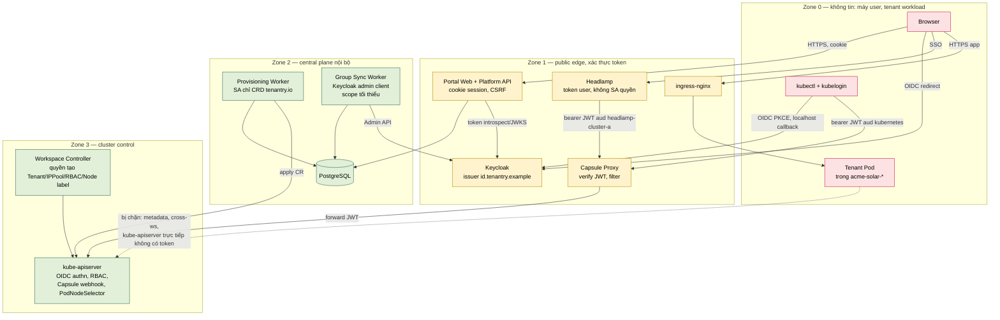
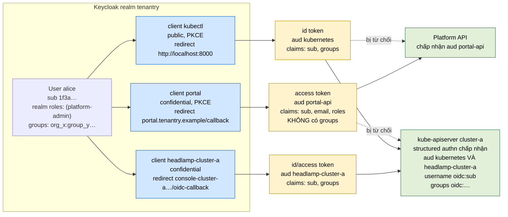
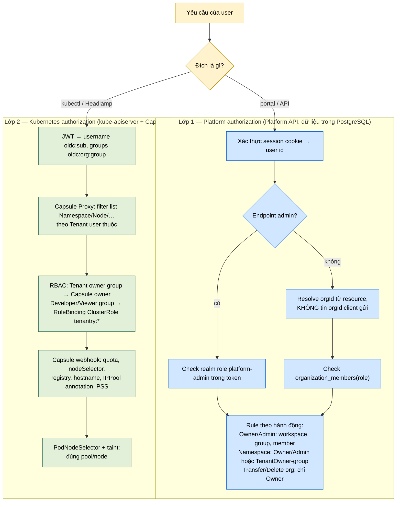
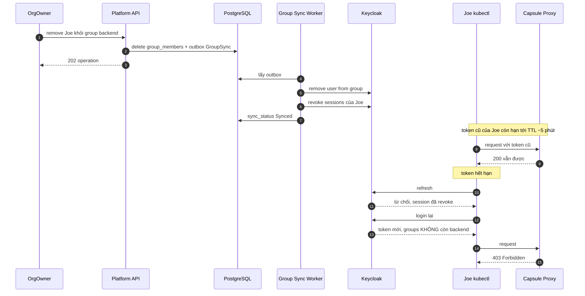

# 06 — Security & Identity: trust boundary, OIDC client, hai lớp authorization

> Nguồn sự thật: `docs/PRODUCT-PLAN.md` v0.6, mục 8, 9, 10, 11, 12, 20. Tài liệu này vẽ lại để review đường đi của token và quyền.
> Cách đọc: trust boundary → OIDC client/audience → hai lớp authorization → revocation → credential nội bộ → ma trận quyền.

## 1. Trust boundaries

**Mục đích:** thấy rõ cái gì tin cái gì, credential nào đi qua biên nào.

**Điểm cần review**

- **Portal không bao giờ cầm token có thể gọi Kubernetes.** Token `portal-api` không nằm trong audience kube-apiserver chấp nhận. Nếu API bị chiếm, kẻ tấn công chỉ có thể tạo CR (qua worker) — và CR bị controller giới hạn trong khuôn Tenant.
- Capsule Proxy là **điểm vào duy nhất** cho tenant tới kube-apiserver; kube-apiserver không expose public. Tenant Pod trong cluster vẫn có thể resolve `kubernetes.default` — cần NetworkPolicy chặn egress tới API server từ tenant namespace hay chấp nhận (RBAC vẫn bảo vệ)? Đề xuất: **không chặn** (nhiều app dùng ServiceAccount hợp lệ) nhưng ServiceAccount tenant không có RoleBinding mặc định.
- Zone 2 và Zone 3 ở MVP nằm cùng cluster; ranh giới là RBAC của ServiceAccount, không phải network. Phase 2 tách thành mạng khác.

## 2. OIDC clients và audience

**Mục đích:** một realm, ba client, ba audience — token nào dùng được ở đâu.

Bảng quyết định:

| Client | Kiểu | Group mapper | Token TTL đề xuất | Ghi chú |
|---|---|---|---|---|
| `portal` | confidential + PKCE, BFF | không | access 15 phút, session cookie 8 giờ, refresh trong BFF | groups không cần vì API tra DB |
| `headlamp-cluster-a` | confidential | có | 5 phút, refresh có | mỗi Cluster mới thêm một client theo mẫu |
| `kubectl` | public + PKCE | có | 5 phút, refresh có (kubelogin cache) | dùng chung cho mọi Cluster; Cluster phân biệt bằng endpoint Proxy |

**Điểm cần review**

- Group claim chỉ nằm trong token của `headlamp-*` và `kubectl`. User có nhiều group → header JWT lớn; cần test kích thước với ~20 group (ingress-nginx `large-client-header-buffers`).
- Có nên cho `headlamp-cluster-a` dùng luôn audience `kubernetes` để bớt một audience? Plan chọn tách để có thể thu hồi/rotate secret Headlamp độc lập với kubectl. Giữ.
- Platform Admin có role `platform-admin` trong **mọi** token — không sao, vì Kubernetes không map realm role sang group; Admin muốn kubectl vào Tenant vẫn phải qua group binding như người khác (hoặc dùng kubeconfig admin ngoài platform).

## 3. Hai lớp authorization

**Mục đích:** một hành động của user đi qua lớp nào, ai quyết định.

Nguyên tắc: **lớp 1 quyết định cấu hình, lớp 2 quyết định runtime**. Portal đổi binding → lớp 1 ghi DB → outbox → controller đổi RoleBinding + Group Sync đổi Keycloak → lớp 2 áp dụng ở token mới. Không có đường nào để portal trực tiếp "cho phép" một request Kubernetes.

**Điểm cần review**

- Trường hợp hai lớp lệch: OrgOwner **không** nằm trong group nào bound vào Workspace → có toàn quyền cấu hình trên portal nhưng `kubectl` bị từ chối. Đây là hành vi mong muốn (plan 10.1) nhưng UI phải giải thích ("bạn chưa có quyền Kubernetes ở Workspace này, thêm mình vào group Owner").
- Namespace UI là chỗ duy nhất lớp 1 **đọc** binding Kubernetes (TenantOwner-group) để quyết định quyền portal. Cần test riêng ma trận này.

## 4. Revocation contract

**Mục đích:** minh bạch độ trễ mất quyền, để không hứa "revoke ngay".

Cam kết ghi vào UI/audit: *"Quyền Kubernetes bị thu hồi chậm nhất sau `token TTL` (mặc định 5 phút). Phiên portal bị thu hồi ngay."*

**Điểm cần review**

- Có cần chặn sớm hơn ở Capsule Proxy (Proxy gọi Keycloak introspection mỗi request)? Trade-off: thêm độ trễ và phụ thuộc Keycloak trên đường dữ liệu. Plan quyết định **không**; giữ TTL ngắn.
- Portal session: khi user bị remove khỏi org, request tiếp theo đọc `organization_members` và mất quyền **ngay** — không phụ thuộc token. Ghi rõ điểm khác biệt này trong tài liệu người dùng.

## 5. Credential nội bộ và bí mật

| Credential | Chủ | Quyền | Lưu ở | Rotate |
|---|---|---|---|---|
| SA `tenantry-provisioner` | Provisioning Worker | `platformworkspaces.tenantry.io` get/list/watch/create/patch + status | in-cluster SA (MVP); Phase 2: thay bằng Cluster Agent | tự động theo SA token projection |
| SA `tenantry-controller` | Workspace Controller | Tenant, ResourcePool, IPPool, NetworkPolicy, RoleBinding, Namespace, Certificate, Node patch labels/taints (chỉ label prefix `tenantry.io/` — enforce bằng test, K8s RBAC không lọc theo label) | in-cluster SA | theo SA |
| Keycloak client `tenantry-admin` | Group Sync Worker | service account với role `manage-users`, `query-groups`, `manage-realm` cho group thôi nếu tách được | Kubernetes Secret | thủ công, ghi runbook |
| Client secret `portal`, `headlamp-cluster-a` | API, Headlamp | OIDC | Kubernetes Secret | thủ công |
| PostgreSQL user `tenantry` | API + workers | DB `tenantry` | Secret | thủ công |
| CA lab `capsule-lab-ca` | cert-manager ClusterIssuer | ký mọi cert nội bộ + wildcard tenant | Secret trong `cert-manager` | 10 năm (đã có) |

Không có credential nào của user được lưu: kubeconfig không chứa token; portal không lưu password; audit không lưu token.

**Điểm cần review**

- Controller cần quyền patch Node — đây là quyền rộng nhất trong hệ thống. Có thể thu hẹp bằng ValidatingAdmissionPolicy chỉ cho SA controller đổi label/taint prefix `tenantry.io/`. Đề xuất thêm vào M8 như hardening.
- Keycloak Admin scope: kiểm tra thật xem role tối thiểu để tạo group + add member + revoke session là gì; nếu buộc phải `manage-users` thì ghi rõ trong ADR.

## 6. Ma trận quyền (rút gọn để review)

| Hành động | PlatformAdmin | OrgOwner | OrgAdmin | OrgMember + TenantOwner group | OrgMember + Developer | OrgMember + Viewer |
|---|---|---|---|---|---|---|
| Đăng ký Cluster, tạo Org, ClusterGrant, node, pool | ✅ | — | — | — | — | — |
| Đổi display name Org | ✅ | ✅ | ✅ | — | — | — |
| Transfer ownership, xóa Org (không personal) | — | ✅ | — | — | — | — |
| Mời, remove member, đổi role (trừ Owner) | — | ✅ | ✅ | — | — | — |
| Tạo/xóa group, thêm member | — | ✅ | ✅ | — | — | — |
| Tạo/resize/cordon/delete Workspace | — | ✅ | ✅ | — | — | — |
| Đổi group binding của Workspace | — | ✅ | ✅ | — | — | — |
| Namespace create/delete trên portal | — | ✅ | ✅ | ✅ | xem | xem |
| Xem Workspace trên portal | ✅ (admin view) | ✅ | ✅ | ✅ | ✅ | ✅ |
| Tải kubeconfig / mở Headlamp | — | ✅* | ✅* | ✅ | ✅ | ✅ |
| kubectl: tạo Namespace trong Tenant | — | * | * | ✅ | ❌ | ❌ |
| kubectl: CRUD workload | — | * | * | ✅ | ✅ | ❌ |
| kubectl: đọc Secret, exec | — | * | * | ✅ | theo policy | ❌ |
| kubectl: sửa label/annotation isolation, nodeSelector | ❌ | ❌ | ❌ | ❌ | ❌ | ❌ |
| Retry operation | ✅ mọi org | ✅ | ✅ | — | — | — |
| Force finalizer khi delete kẹt | ✅ | ❌ | ❌ | — | — | — |

`*` = chỉ khi bản thân nằm trong một group được bind vào Workspace; platform role không tự sinh quyền Kubernetes.

**Điểm cần review**

- Hàng "Tải kubeconfig": Owner không có group binding tải được kubeconfig nhưng dùng sẽ bị 403 — nên ẩn nút hay hiện kèm cảnh báo? Đề xuất: hiện kèm cảnh báo, vì kubeconfig là per-user và họ có thể tự thêm mình vào group ngay sau đó.
- Developer có `exec`/đọc Secret hay không là quyết định policy chưa chốt (plan 10.3 "tùy policy"). Đề xuất mặc định: Developer **được** exec/log, **không** đọc Secret; có thể mở bằng policy profile sau.
