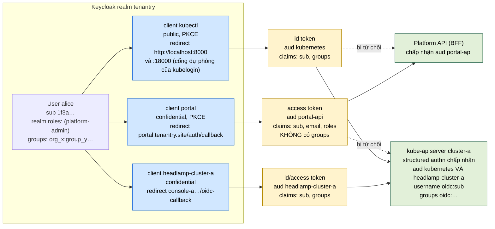
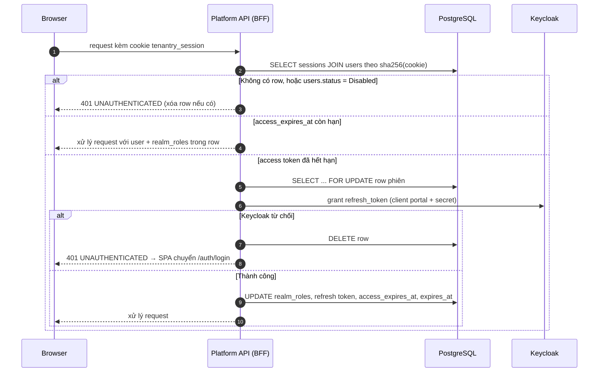
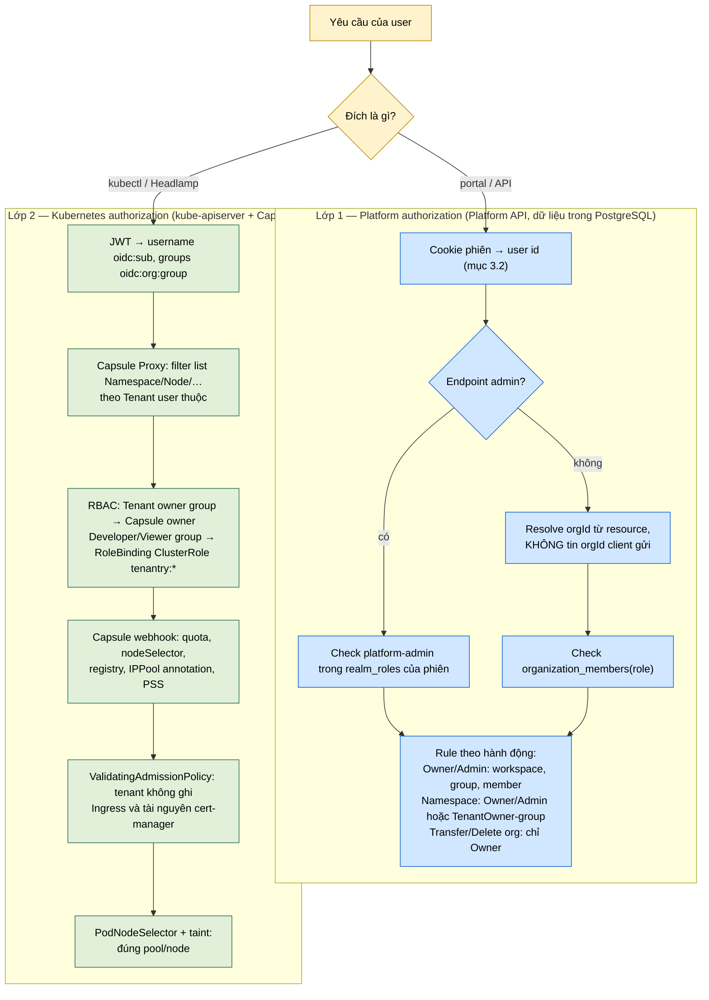

# 06 — Security & Identity

> Nơi định nghĩa cho: trust boundary, OIDC client, **phiên portal và thời hạn token**, hai lớp authorization, **thu hồi quyền**, rate limit, credential nội bộ, ma trận quyền. Nghiệp vụ nền ở `PRODUCT-PLAN.md` mục 8–12, 20.

## 1. Trust boundaries

**Mục đích:** thấy rõ cái gì tin cái gì, credential nào đi qua biên nào.

**Điểm cần review**

- **Portal không bao giờ cầm token có thể gọi Kubernetes.** Token của client `portal` có audience `portal-api`, kube-apiserver không nhận. Nếu API bị chiếm, kẻ tấn công chỉ tạo được CR (qua worker), và CR bị controller giới hạn trong khuôn Tenant.
- Capsule Proxy là **điểm vào duy nhất** của tenant tới kube-apiserver; cổng 6443 của kube-apiserver chỉ dành cho quản trị và phải giới hạn theo IP nguồn ở firewall của hạ tầng. Tenant gọi thẳng 6443 bằng token của mình vẫn bị RBAC và admission chặn như thường (chỉ mất phần lọc danh sách của Proxy), nên đây là giảm bề mặt tấn công chứ không phải lớp cách ly. Tenant Pod vẫn resolve được `kubernetes.default`: không chặn bằng NetworkPolicy (nhiều app dùng ServiceAccount hợp lệ), nhưng ServiceAccount tenant không có RoleBinding mặc định.
- Zone 2 và Zone 3 ở MVP nằm cùng cluster; ranh giới là RBAC của ServiceAccount, không phải network. Phase 2 tách thành mạng khác.

## 2. OIDC clients và audience

**Mục đích:** một realm, ba loại client, ba audience — token nào dùng được ở đâu.

| Client | Kiểu | Group mapper | Ghi chú |
|---|---|---|---|
| `portal` | confidential + PKCE, BFF | không | API tra quyền Organization trong DB, không cần group claim |
| `headlamp-{clusterId}` | confidential | có | mỗi Cluster mới thêm một client theo mẫu; tách audience để rotate secret Headlamp độc lập với kubectl |
| `kubectl` | public + PKCE | có | dùng chung cho mọi Cluster; Cluster phân biệt bằng endpoint Proxy |

Thời hạn token của cả ba client lấy từ một bộ số duy nhất ở mục 3.

**Điểm cần review**

- User thuộc nhiều group → header JWT lớn; cần test kích thước với ~20 group qua Traefik, Capsule Proxy và Headlamp.
- Platform Admin có role `platform-admin` trong **mọi** token — không sao, vì Kubernetes không map realm role sang group; Admin muốn kubectl vào Tenant vẫn phải qua group binding như người khác (hoặc dùng kubeconfig admin ngoài platform).

## 3. Phiên portal và thời hạn token

### 3.1 Bộ số duy nhất

Thời hạn đặt **một lần ở realm**, không override theo client. Portal không có đồng hồ phiên riêng.

| Tham số (realm `tenantry`) | Giá trị | Ý nghĩa |
|---|---|---|
| Access Token Lifespan | 5 phút | Trần của độ trễ thu hồi quyền Kubernetes (mục 5) và độ trễ đổi role `platform-admin` trên portal |
| SSO Session Idle | 8 giờ | Không dùng gì trong 8 giờ thì phải đăng nhập lại; cũng là thời hạn refresh token |
| SSO Session Max | 24 giờ | Tối đa một lần đăng nhập, kể cả khi dùng liên tục |
| Revoke Refresh Token | tắt | Refresh token không xoay vòng một-lần, nên refresh đồng thời không làm hỏng phiên |

Ba con số là mặc định cho demo, đổi trong realm export; không có bản sao nào ở phía portal.

### 3.2 Phiên portal gắn với SSO session của Keycloak

Phiên portal **sống đúng bằng refresh token của nó**. Khi SSO session ở Keycloak kết thúc — hết idle, hết max, user logout, Group Sync thu hồi, Admin disable account — lần refresh kế tiếp thất bại và phiên portal chết theo, chậm nhất sau 5 phút.

- **Login** (`GET /auth/login`): API sinh `state`, `nonce`, PKCE verifier và đường quay lại, niêm phong (AES-256-GCM) vào cookie `tenantry_login` sống 5 phút rồi redirect sang Keycloak. Không có row DB nào trước khi đăng nhập xong.
- **Callback** (`GET /auth/callback`): kiểm `state`, đổi code, validate ID token (issuer, audience, `nonce`, hạn) và yêu cầu `email_verified=true`; upsert `users` theo `(issuer, subject)`; tạo row `sessions`; đặt cookie `tenantry_session` (`HttpOnly`, `Secure`, `SameSite=Lax`, `Max-Age` 24 giờ).
- **Xác minh email**: realm bật `verifyEmail`, nên user tự đăng ký phải bấm link trong thư thì token mới có `email_verified=true`. Thiếu bước này, ai cũng đăng ký được bằng email của người khác và nhận lời mời thay họ (`03-flows.md` mục 3). Ở cụm MVP, Keycloak gửi thư vào Mailpit, một hộp thư giả chạy trong namespace `keycloak`: thư không ra ngoài, chỉ người có quyền `port-forward` đọc được. Mailpit không có Ingress, vì nó giữ cả link xác minh và link đặt lại mật khẩu của mọi user. Hệ quả: người ngoài chưa tự đăng ký được nếu không có người vận hành lấy link giúp. Đổi sang SMTP thật chỉ là sửa cấu hình SMTP của realm, không đổi code.
- **Cookie phiên** là 32 byte ngẫu nhiên. DB chỉ lưu `sha256` của nó, nên đọc được bảng `sessions` cũng không dựng lại được cookie.
- **Token trong DB**: chỉ refresh token, mã hóa AES-256-GCM bằng khóa nằm trong Secret. Access token và ID token không được lưu — API chỉ cần claim `realm_access.roles` (chép vào `realm_roles`) và thời điểm hết hạn.
- **Refresh lười**: chỉ refresh khi có request tới và access token đã hết hạn; khóa row phiên trong lúc refresh để hai request đồng thời không cùng gọi Keycloak.
- **Role `platform-admin`** đọc lại ở mỗi lần refresh, nên gỡ role có hiệu lực trên portal sau tối đa 5 phút.
- **Quyền trong Organization không nằm trong phiên**: mỗi request đọc `organization_members`, nên remove member hay đổi role có hiệu lực ngay ở request kế tiếp.
- **Logout** (`POST /auth/logout`): xóa row, xóa cookie, rồi gọi endpoint logout của Keycloak bằng refresh token. SSO session kết thúc, nên Headlamp và kubelogin của user cũng phải đăng nhập lại — "đăng xuất" nghĩa là ra khỏi mọi nơi.
- **Disable user**: Admin disable thì API set `users.status=Disabled`, xóa mọi row `sessions` của user và disable account trên Keycloak.
- **CSRF**: double-submit — cookie `tenantry_csrf` (không `HttpOnly`) phải khớp header `X-CSRF-Token` ở mọi request không phải `GET`/`HEAD`/`OPTIONS`.
- **Dọn rác**: vòng `housekeeping` của worker xóa row có `expires_at < now()` (IMPLEMENTATION-PLAN mục 5.3).

Schema bảng `sessions`: `02-data-model.md` mục 2.

### 3.3 Vì sao session nằm trong PostgreSQL, không thêm Redis

Mỗi request vốn đã đọc PostgreSQL để tra `users.status` và `organization_members`, nên một lần tra phiên theo khóa chính không thêm chặng mạng nào. Thu hồi mọi phiên của một user là một câu `DELETE ... WHERE user_id`. Thứ Redis làm tốt hơn — tự hết hạn theo TTL — thay bằng một câu `DELETE` định kỳ. Đổi lại, thêm Redis là thêm một thành phần stateful phải deploy, backup, giám sát, và thêm một kiểu sự cố (Redis mất dữ liệu thì mọi người bị đăng xuất). Idempotency key và outbox càng không thể sang Redis vì phải commit cùng transaction với thay đổi nghiệp vụ. Ghi thành ADR 21 [29].

Điều kiện xem lại: chạy nhiều replica API và cần rate limit chính xác toàn cục (mục 6).

## 4. Hai lớp authorization

**Mục đích:** một hành động của user đi qua lớp nào, ai quyết định.

Nguyên tắc: **lớp 1 quyết định cấu hình, lớp 2 quyết định runtime**. Portal đổi binding → lớp 1 ghi DB → outbox → controller đổi RoleBinding, Group Sync đổi Keycloak → lớp 2 áp dụng. Không có đường nào để portal trực tiếp "cho phép" một request Kubernetes.

**Điểm cần review**

- Hai lớp có thể lệch có chủ ý: OrgOwner **không** nằm trong group nào bound vào Workspace thì có toàn quyền cấu hình trên portal nhưng `kubectl` bị từ chối [10.1]. UI phải giải thích ("bạn chưa có quyền Kubernetes ở Workspace này, thêm mình vào group Owner").
- Namespace UI là chỗ duy nhất lớp 1 **đọc** binding Kubernetes (TenantOwner-group) để quyết định quyền portal. Cần test riêng ma trận này.

## 5. Thu hồi quyền

**Mục đích:** minh bạch độ trễ mất quyền ở từng nơi, để không hứa "revoke ngay". Sequence đầy đủ: `03-flows.md` mục 4.

| Thay đổi | Quyền portal | Quyền Kubernetes |
|---|---|---|
| Remove member khỏi Organization, đổi Organization role | Ngay ở request kế tiếp (đọc DB) | Theo dòng "gỡ khỏi group" bên dưới, cho mọi group của Org mà user thuộc |
| Gỡ binding group ↔ Workspace | Ngay | Ngay khi controller xóa RoleBinding/owner — RBAC đổi nên token cũ cũng mất quyền |
| Gỡ user khỏi group | Ngay | **Chậm nhất 5 phút**: token đã phát hành dùng được tới khi hết hạn; token mới không còn group |
| Disable user | Ngay (xóa mọi phiên) | Chậm nhất 5 phút |
| Gỡ realm role `platform-admin` | Chậm nhất 5 phút (lần refresh kế tiếp) | Không liên quan |

Khi gỡ user khỏi group **đang có binding Workspace**, Group Sync Worker gỡ membership trên Keycloak rồi gọi logout user (`POST /admin/realms/tenantry/users/{id}/logout`) để refresh token cũ không xin được token mới. Hệ quả cần ghi trên UI:

- Logout của Keycloak kết thúc **mọi** SSO session của user, không riêng Workspace hay Organization nào. User bị gỡ sẽ phải đăng nhập lại ở portal, Headlamp và kubectl — kể cả với các Organization khác mà họ vẫn là member.
- Group không có binding nào thì không cấp quyền Kubernetes, nên gỡ member khỏi group đó không logout ai.
- Thêm user vào group không logout: quyền mới xuất hiện ở lần phát token kế tiếp, chậm nhất 5 phút.

Cam kết ghi vào UI và audit: *"Quyền Kubernetes bị thu hồi chậm nhất sau 5 phút. Quyền trên portal bị thu hồi ngay."*

**Điểm cần review**

- Không introspection ở Capsule Proxy cho từng request: nó thêm độ trễ và đặt Keycloak lên đường dữ liệu. Giữ TTL ngắn.
- Cần kiểm chứng trên lab: Keycloak chạy lại group mapper khi refresh, tức token refresh ngay sau khi gỡ group đã không còn group claim. Nếu đúng, bước logout chỉ còn là lớp bảo vệ thứ hai và có thể bỏ để user không bị đăng xuất mọi nơi.

## 6. Rate limit

- Đặt trong Platform API bằng token bucket trong bộ nhớ (`golang.org/x/time/rate`), không cần kho ngoài.
- `/auth/login`, `/auth/callback`: theo IP client, mặc định 20 request/phút. IP lấy từ `X-Forwarded-For` chỉ khi request đến từ Traefik.
- Mọi request ghi của `/api/v1` (gồm `:retry`, `:accept`): theo user, mặc định 120 request/phút.
- Vượt ngưỡng: `429` mã `RATE_LIMITED` kèm `Retry-After`.
- Giới hạn đã biết: bucket nằm theo từng replica. MVP chạy một replica API nên chính xác; khi tăng replica thì chuyển sang middleware rate limit của Traefik hoặc một kho đếm chung.

## 7. Credential nội bộ và bí mật

| Credential | Chủ | Quyền | Lưu ở | Rotate |
|---|---|---|---|---|
| SA `tenantry-worker-provisioning` | Provisioning Worker | `platformworkspaces`, `platformnodegrants` (`tenantry.io`): `get/list/watch/create/patch/delete`. Không ghi `status`, không quyền nào khác | in-cluster SA (MVP); Phase 2 thay bằng Cluster Agent | tự động theo SA token projection |
| SA `tenantry-operator` | Workspace Controller | Tenant, ResourcePool, IPPool, NetworkPolicy, RoleBinding, Namespace, Ingress, Node patch labels/taints (chỉ prefix `tenantry.io/` — enforce bằng test, K8s RBAC không lọc theo label) | in-cluster SA | theo SA |
| Keycloak client `tenantry-sync` | Group Sync Worker | service account với role `manage-users`, `query-groups` của `realm-management`; không `manage-realm` | Kubernetes Secret | thủ công, ghi runbook |
| Client secret `portal`, `headlamp-cluster-a` | API, Headlamp | OIDC | Kubernetes Secret | thủ công |
| Khóa mã hóa phiên | API | AES-256-GCM cho refresh token trong `sessions` và cookie `tenantry_login` | Kubernetes Secret | thủ công; đổi khóa = mọi người đăng nhập lại |
| PostgreSQL user `tenantry` | API + workers | DB `tenantry` | Secret | thủ công |
| API token Cloudflare | cert-manager ClusterIssuer `letsencrypt` | sửa DNS của zone `tenantry.site` (cho DNS-01), không quyền nào khác | Secret trong `cert-manager` | thủ công |
| Private key wildcard `*.mvp.tenantry.site` | Traefik | TLS cho mọi Route | Secret trong `ingress-system`; tenant không đọc được | cert-manager tự gia hạn |

Hai worker là hai Deployment để một tiến trình không cầm đồng thời quyền apply CR và quyền quản trị user Keycloak (IMPLEMENTATION-PLAN mục 5.3).

Không có credential nào của user được lưu ở dạng dùng lại được: kubeconfig không chứa token; portal không lưu password; refresh token trong DB đã mã hóa; audit không lưu token.

**Điểm cần review**

- Controller cần quyền patch Node — quyền rộng nhất trong hệ thống. Thu hẹp bằng ValidatingAdmissionPolicy chỉ cho SA controller đổi label/taint prefix `tenantry.io/`; làm ở M8 như hardening.
- Kiểm chứng trên Keycloak 26 của lab rằng `manage-users` + `query-groups` đủ để tạo group, thêm/gỡ member và logout user.

## 8. Ma trận quyền

| Hành động | PlatformAdmin | OrgOwner | OrgAdmin | OrgMember + TenantOwner group | OrgMember + Developer | OrgMember + Viewer |
|---|---|---|---|---|---|---|
| Đăng ký Cluster, duyệt/tạo Org, ClusterGrant, node, pool | ✅ | — | — | — | — | — |
| Đổi display name Org | — | ✅ | ✅ | — | — | — |
| Transfer ownership, xóa Org | — | ✅ | — | — | — | — |
| Mời, remove member, đổi role (trừ Owner) | — | ✅ | ✅ | — | — | — |
| Tạo/xóa group, thêm member | — | ✅ | ✅ | — | — | — |
| Tạo/resize/cordon/delete Workspace | — | ✅ | ✅ | — | — | — |
| Đổi group binding của Workspace | — | ✅ | ✅ | — | — | — |
| Namespace create/delete trên portal | — | ✅ | ✅ | ✅ | xem | xem |
| Route create/delete trên portal | — | ✅ | ✅ | ✅ | xem | xem |
| Xem Workspace trên portal | ✅ (admin view) | ✅ | ✅ | ✅ | ✅ | ✅ |
| Tải kubeconfig / mở Headlamp | — | ✅* | ✅* | ✅ | ✅ | ✅ |
| kubectl: tạo Namespace trong Tenant | — | * | * | ✅ | ❌ | ❌ |
| kubectl: CRUD workload | — | * | * | ✅ | ✅ | ❌ |
| kubectl: tạo/sửa/xóa Ingress, Certificate | ❌ | ❌ | ❌ | ❌ | ❌ | ❌ |
| kubectl: đọc Secret, exec | — | * | * | ✅ | theo policy | ❌ |
| kubectl: sửa label/annotation isolation, nodeSelector | ❌ | ❌ | ❌ | ❌ | ❌ | ❌ |
| Xem operation | ✅ mọi org | ✅ | ✅ | ✅ | ✅ | ✅ |
| Retry operation | ✅ mọi org | ✅ | ✅ | — | — | — |
| Force finalizer khi delete kẹt | ✅ | ❌ | ❌ | — | — | — |

`*` = chỉ khi bản thân nằm trong một group được bind vào Workspace; platform role không tự sinh quyền Kubernetes.

Platform Admin làm việc với Organization qua `/api/v1/admin/*`. Các endpoint `/organizations/{orgId}` chỉ dành cho member: Admin không phải member nhận 404 như mọi người ngoài. Ngoại lệ duy nhất là operation — Admin xem, retry và force được operation của mọi Organization ngay trên `/operations/{id}`.

**Điểm cần review**

- Hàng "Tải kubeconfig": Owner không có group binding tải được kubeconfig nhưng dùng sẽ bị 403 — hiện kèm cảnh báo, vì kubeconfig là per-user và họ có thể tự thêm mình vào group ngay sau đó.
- Developer có `exec`/đọc Secret hay không chưa chốt [10.3]. Đề xuất mặc định: Developer **được** exec/log, **không** đọc Secret; mở bằng policy profile sau.
