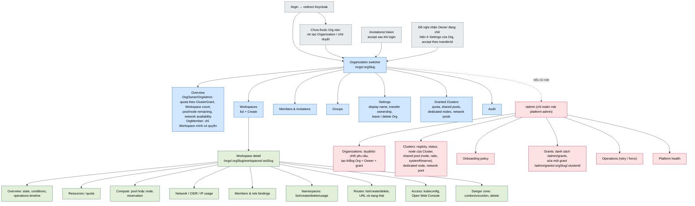
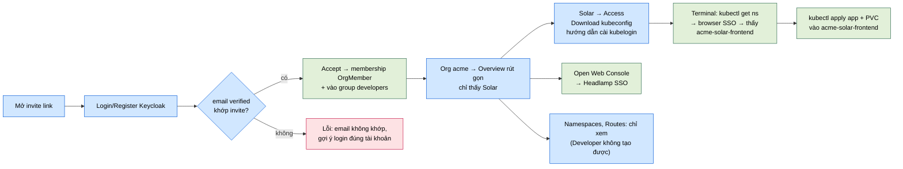
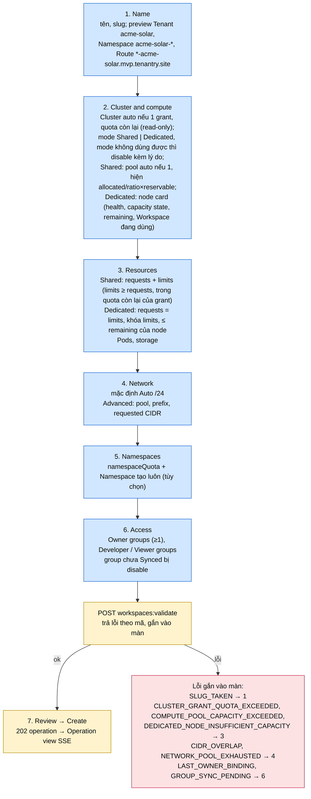
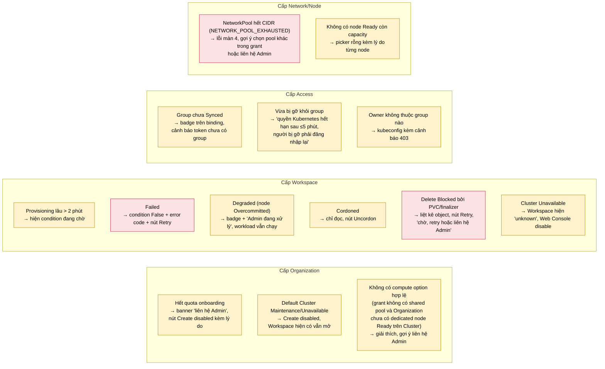
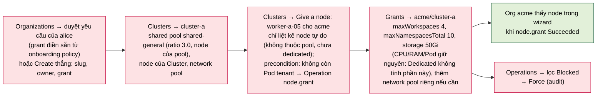

# 07 — Portal UX: information architecture và wireflow

> Góc nhìn, không định nghĩa gì mới: IA và yêu cầu ở `PRODUCT-PLAN.md` mục 19, 22, 28; route thật ở `IMPLEMENTATION-PLAN.md` mục 6; màn hình mẫu ở `docs/design/mockups/`. Đây là sơ đồ luồng màn hình để review trải nghiệm, không phải thiết kế giao diện.
> Cách đọc: sitemap → wireflow từng persona → wizard tạo Workspace → màn hình trạng thái/lỗi bắt buộc.

## 1. Sitemap

**Mục đích:** toàn bộ route của portal và ai thấy gì.

**Ai thấy gì.** OrgOwner và OrgAdmin thấy mọi mục. OrgMember chỉ thấy Overview rút gọn (các Workspace mình có quyền) và Workspaces; không thấy quota/usage toàn Org, Members, Groups, Clusters, Audit; Settings của OrgMember chỉ có nút Leave. API từ chối tương ứng (`PRODUCT-PLAN.md` mục 9.2), portal không chỉ ẩn menu. Organization `Pending`/`Rejected` chỉ có màn trạng thái yêu cầu.

**Điểm cần review**

- URL dùng **slug** (`/orgs/acme/workspaces/solar`) vì slug immutable — đổi display name không làm hỏng bookmark.

## 2. Wireflow — user mới (Alice)

**Mục đích:** từ chưa có tài khoản tới Workspace Ready; Admin chỉ can thiệp đúng một lần, ở bước duyệt yêu cầu tạo Organization.

```mermaid
flowchart LR
  classDef s fill:#d1e7ff,stroke:#0b5ed7,color:#000
  classDef d fill:#fff3cd,stroke:#b58900,color:#000
  classDef e fill:#e2f0d9,stroke:#2d6a4f,color:#000

  S1["Landing<br/>nút Sign up / Login"]:::s
  S2["Keycloak Register (email, tên)<br/>bấm link xác minh rồi mới đặt mật khẩu"]:::s
  S3["Callback → tạo user record<br/>màn trống: xin tạo Organization"]:::s
  S3a["Gửi yêu cầu: slug 'acme'<br/>preview tên Kubernetes acme-*"]:::s
  S3b["Chờ duyệt<br/>(từ chối → hiện lý do, gửi lại)"]:::d
  S4["Admin duyệt → Overview Org acme<br/>banner: bạn có quota Shared<br/>2 CPU / 4 GiB / 2 Workspace"]:::e
  S5["Workspaces → Create"]:::s
  W["Wizard 7 màn, xem mục 4<br/>Solar, Shared, 2 CPU / 4 GiB,<br/>admins = Owner, developers = Developer,<br/>viewers = Viewer"]:::d
  S6["Operation view<br/>Operation Pending → Running → Succeeded,<br/>timeline theo Condition"]:::s
  S7["Workspace Overview<br/>conditions xanh,<br/>nút Kubeconfig + Web Console bật"]:::e
  S7a["Namespaces → tạo frontend<br/>(sau khi app chạy: Routes → tạo web)"]:::s
  S8["Members → Invite<br/>Joe (group developers), Bob (group viewers)"]:::s
  S9["Copy link, gửi tay"]:::s

  S1 --> S2 --> S3 --> S3a --> S3b --> S4 --> S5 --> W --> S6 --> S7 --> S7a
  S4 --> S8 --> S9
```

Ghi chú:

- Callback (S3) chỉ upsert user và tạo phiên nên nhanh và idempotent; không có gì ở đây phụ thuộc Cluster.
- Slug Organization do user tự chọn ở S3a, chỉ gồm chữ thường và số (không có `-`) và **không sửa được** sau đó [4.2]; form phải hiện ngay tên Kubernetes sẽ sinh ra (`acme-<workspace>`) và báo `SLUG_TAKEN` tại chỗ.
- S3b phải nói rõ đang chờ ai và cho thấy lý do khi bị từ chối; một user chỉ có một yêu cầu chờ duyệt tại một thời điểm.
- Ngay sau duyệt, group `admins` còn `Sync pending` vài giây; wizard tạo Workspace báo `GROUP_SYNC_PENDING` tới khi group sync xong.

## 3. Wireflow — Developer (Joe) và Viewer (Bob)

**Mục đích:** người được mời vào group `developers`/`viewers` dùng data plane; tạo Namespace và Route là việc của OrgOwner/OrgAdmin hoặc group TenantOwner, không phải của Developer.

Bob (group `viewers`, Viewer) đi cùng đường, khác ở chỗ Headlamp/kubectl chỉ đọc; thử `kubectl delete` → 403 kèm thông điệp của RBAC. Route `web` cho app của Joe do Alice tạo trên portal.

**Điểm cần review**

- Khi Joe chưa cài kubelogin, lỗi xảy ra ở terminal, không ở portal. Trang Access nên có block "Kiểm tra: `kubectl oidc-login --version`" và link cài.
- Joe thuộc nhiều Workspace cùng Cluster sẽ thấy tất cả Namespace được phép trong một `kubectl get ns` — plan nói đây không phải lỗi; UI Access nên ghi một dòng để tránh thắc mắc khi demo.

## 4. Wizard tạo Workspace

**Mục đích:** 7 màn gom 12 mục của plan 19.1, chỗ nào gọi API validate, chỗ nào auto-select. Khớp mockup `pages-workspace.js`.

| Màn | Mục của plan 19.1 |
|---|---|
| 1 Name | 1 |
| 2 Cluster and compute | 2, 3, 4, 5 |
| 3 Resources | 6 |
| 4 Network | 7 |
| 5 Namespaces | 8, cộng Namespace tạo luôn (tùy chọn, trường `namespaces` của body tạo, plan 16.4) |
| 6 Access | 9, 10 |
| 7 Review | 11, 12 |

Nội dung giải thích bắt buộc trong wizard (plan 19.1): Cluster không đổi sau khi tạo; Shared vs Dedicated khác ở placement; node thuộc Org nhưng chia capacity; Dedicated dùng Guaranteed QoS; Workspace Shared trừ CPU/RAM/Pod vào quota của grant, Workspace Dedicated chỉ trừ vào dung lượng còn lại của node đã chọn, số Workspace, Namespace và storage trừ vào grant với cả hai mode; CIDR không đổi tùy tiện; Owner tạo được Namespace, Developer không; không hỗ trợ cluster-scoped resource.

Hết `maxWorkspacesTotal` của entitlement (`ENTITLEMENT_EXCEEDED`) hoặc `maxWorkspaces` của grant thì nút Create ở danh sách Workspace đã disable kèm lý do (mục 5), không vào được wizard.

Rời mỗi màn, wizard gọi `:validate` với payload hiện tại và gọi lần cuối trước Submit (IMPLEMENTATION-PLAN mục 6.4); sơ đồ chỉ vẽ lần cuối. Submit vẫn tự validate lại trong transaction.

## 5. Màn hình trạng thái, rỗng và lỗi bắt buộc

**Mục đích:** plan 19.2 yêu cầu không chỉ làm happy path; mỗi trạng thái dưới đây phải có màn hình/thông điệp.

**Điểm cần review**

- Operation view cần **timeline theo Condition**, không phải progress bar chung: người bảo vệ sẽ hỏi "đang kẹt ở đâu", câu trả lời phải là "NetworkReady=False, reason IPPoolNotReady".
- Thông điệp lỗi hiển thị mã ổn định (ví dụ `DEDICATED_NODE_INSUFFICIENT_CAPACITY`) cộng câu tiếng Việt/Anh; mã này cũng xuất hiện trong test E2E nên UI và test cùng một nguồn (OpenAPI enum).

## 6. Khu Admin — luồng cấp phát cho một khách hàng

Ghi chú:

- Mode Dedicated không phải một ô trong grant: Organization dùng được Dedicated ngay khi có dedicated node trên Cluster (plan 5.2).
- Bước A3: muốn lấy một node của shared pool, Admin bớt node khỏi pool trên portal → drain → uncordon → cấp (`05-network-and-scheduling.md` mục 1). Nếu node chưa sạch, UI liệt kê Pod lạ (`DEDICATED_NODE_NOT_CLEAN`); drain làm bằng kubectl ngoài portal, vì platform không quản trị Node (non-goal).
- Bước A4: giảm grant dưới allocation hiện tại bị từ chối `CLUSTER_GRANT_BELOW_ALLOCATION`; UI hiện số tối thiểu ngay dưới từng ô (plan 5.5).
