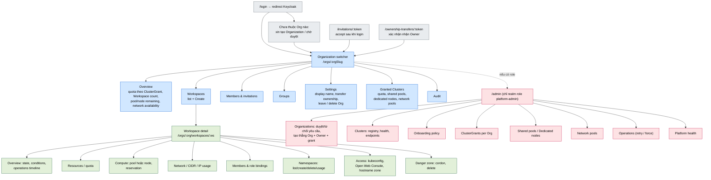
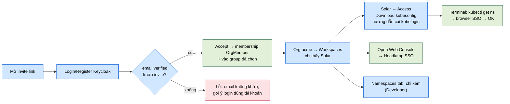
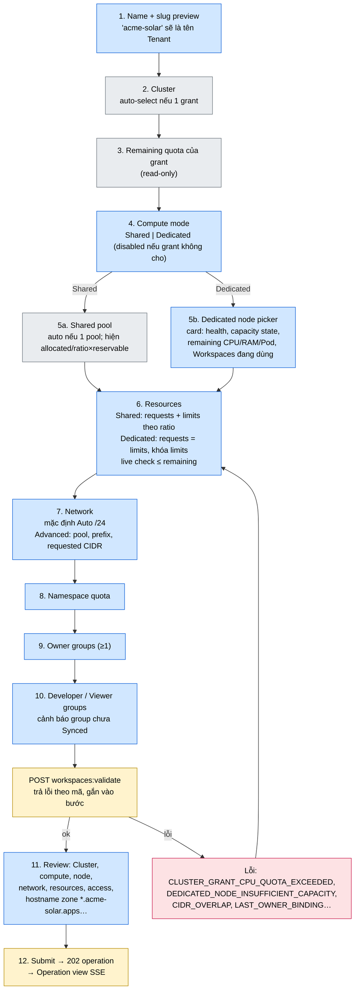
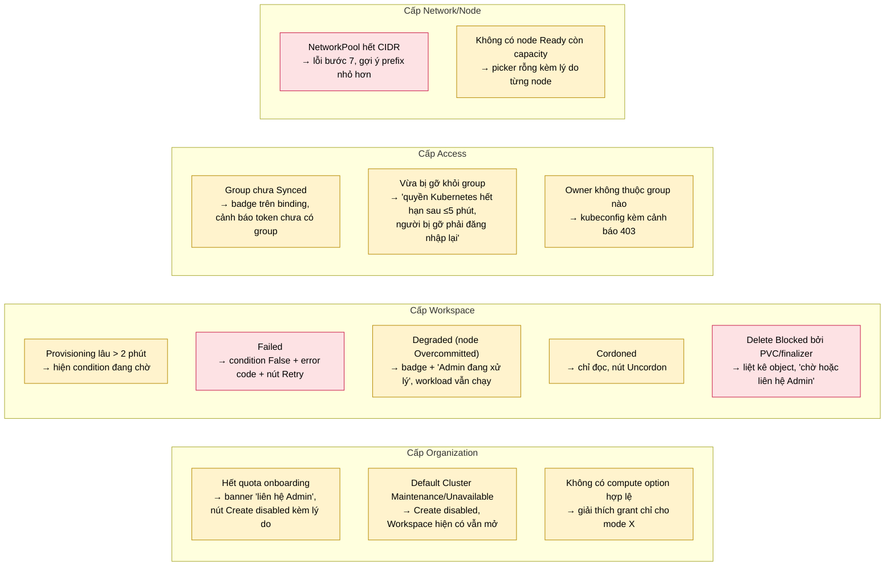
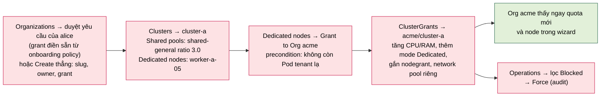

# 07 — Portal UX: information architecture và wireflow

> Góc nhìn, không định nghĩa gì mới: IA và yêu cầu ở `PRODUCT-PLAN.md` mục 19, 22, 28; route thật ở `IMPLEMENTATION-PLAN.md` mục 6. Đây là sơ đồ luồng màn hình để review trải nghiệm, không phải thiết kế giao diện.
> Cách đọc: sitemap → wireflow từng persona → wizard tạo Workspace → màn hình trạng thái/lỗi bắt buộc.

## 1. Sitemap

**Mục đích:** toàn bộ route của portal và ai thấy gì.

**Điểm cần review**

- URL dùng **slug** (`/orgs/acme/workspaces/solar`) vì slug immutable — đổi display name không làm hỏng bookmark.
- OrgMember chỉ có binding vào một Workspace vẫn thấy Overview của Org? Đề xuất: thấy Overview rút gọn (Workspace mình có quyền), không thấy quota/usage toàn Org, không thấy Members/Groups/Settings/Clusters.

## 2. Wireflow — user mới (Alice)

**Mục đích:** từ chưa có tài khoản tới Workspace Ready; Admin chỉ can thiệp đúng một lần, ở bước duyệt yêu cầu tạo Organization.

```mermaid
flowchart LR
  classDef s fill:#d1e7ff,stroke:#0b5ed7,color:#000
  classDef d fill:#fff3cd,stroke:#b58900,color:#000
  classDef e fill:#e2f0d9,stroke:#2d6a4f,color:#000

  S1["Landing<br/>nút Sign up / Login"]:::s
  S2["Keycloak Register<br/>email verify"]:::s
  S3["Callback → tạo user record<br/>màn trống: xin tạo Organization"]:::s
  S3a["Gửi yêu cầu: slug 'acme'<br/>preview tên Kubernetes acme-*"]:::s
  S3b["Chờ duyệt<br/>(từ chối → hiện lý do, gửi lại)"]:::d
  S4["Admin duyệt → Overview Org acme<br/>banner: bạn có quota Shared<br/>2 CPU / 4 GiB / 2 Workspace"]:::e
  S5["Workspaces → Create"]:::s
  W["Wizard 12 bước<br/>xem mục 4"]:::d
  S6["Operation view<br/>Validating → Reserving →<br/>Provisioning → Ready"]:::s
  S7["Workspace Overview<br/>conditions xanh,<br/>nút Kubeconfig + Web Console bật"]:::e
  S8["Members → Invite Joe<br/>copy link"]:::s
  S9["Groups → developers<br/>add Joe"]:::s
  S10["Workspace → Members & bindings<br/>developers = Developer"]:::s

  S1 --> S2 --> S3 --> S3a --> S3b --> S4 --> S5 --> W --> S6 --> S7
  S4 --> S8 --> S9 --> S10
```

**Điểm cần review**

- Callback (S3) chỉ upsert user và tạo phiên nên nhanh và idempotent; không có gì ở đây phụ thuộc Cluster.
- Slug do user tự chọn ở S3a và **không sửa được** sau đó; form phải hiện ngay tên Kubernetes sẽ sinh ra (`acme-<workspace>`) và báo `SLUG_TAKEN` tại chỗ.
- S3b phải nói rõ đang chờ ai và cho thấy lý do khi bị từ chối; một user chỉ có một yêu cầu chờ duyệt tại một thời điểm.

## 3. Wireflow — người được mời (Joe) và người xem (Bob)

Bob (Viewer) đi cùng đường, khác ở chỗ Headlamp/kubectl chỉ đọc; thử `kubectl delete` → 403 kèm thông điệp của RBAC.

**Điểm cần review**

- Khi Joe chưa cài kubelogin, lỗi xảy ra ở terminal, không ở portal. Trang Access nên có block "Kiểm tra: `kubectl oidc-login --version`" và link cài.
- Joe thuộc nhiều Workspace cùng Cluster sẽ thấy tất cả Namespace được phép trong một `kubectl get ns` — plan nói đây không phải lỗi; UI Access nên ghi một dòng để tránh thắc mắc khi demo.

## 4. Wizard tạo Workspace

**Mục đích:** 12 bước của plan 19.1, chỗ nào gọi API validate, chỗ nào auto-select.

Nội dung giải thích bắt buộc trong wizard (plan 19.1): Cluster không đổi sau khi tạo; Shared vs Dedicated khác ở placement; node thuộc Org nhưng chia capacity; Dedicated dùng Guaranteed QoS; allocation trừ vào grant; CIDR không đổi tùy tiện; Owner tạo được Namespace, Developer không; không hỗ trợ cluster-scoped resource.

**Điểm cần review**

- Với MVP một Cluster, một pool: bước 2, 3, 5a gần như rỗng → gộp thành một màn "Cluster & capacity" read-only để wizard thực tế còn ~8 bước. Data model không đổi, chỉ UI.
- `:validate` gọi khi nào? Đề xuất: gọi **mỗi khi rời bước 6/7/9** (debounce) để lỗi hiện đúng chỗ, và gọi lần cuối trước Submit. Submit vẫn tự validate lại trong transaction.
- Bước 1 hiện slug preview là quan trọng vì slug immutable; đồng thời hiện luôn hostname zone để user hiểu tên đó xuất hiện ở đâu.

## 5. Màn hình trạng thái, rỗng và lỗi bắt buộc

**Mục đích:** plan 19.2 yêu cầu không chỉ làm happy path; mỗi trạng thái dưới đây phải có màn hình/thông điệp.

**Điểm cần review**

- Operation view cần **timeline theo Condition**, không phải progress bar chung: người bảo vệ sẽ hỏi "đang kẹt ở đâu", câu trả lời phải là "NetworkReady=False, reason IPPoolNotReady".
- Thông điệp lỗi hiển thị mã ổn định (ví dụ `DEDICATED_NODE_INSUFFICIENT_CAPACITY`) cộng câu tiếng Việt/Anh; mã này cũng xuất hiện trong test E2E nên UI và test cùng một nguồn (OpenAPI enum).

## 6. Khu Admin — luồng cấp phát cho một khách hàng

**Điểm cần review**

- Bước A3: nếu node chưa sạch, UI phải liệt kê Pod lạ và hướng dẫn cordon/drain — Admin làm bằng kubectl ngoài portal. Chấp nhận, vì platform không quản trị Node (non-goal).
- Giảm grant dưới allocation hiện tại bị từ chối: UI hiển thị allocation hiện tại ngay cạnh ô nhập để Admin không phải thử-sai.
